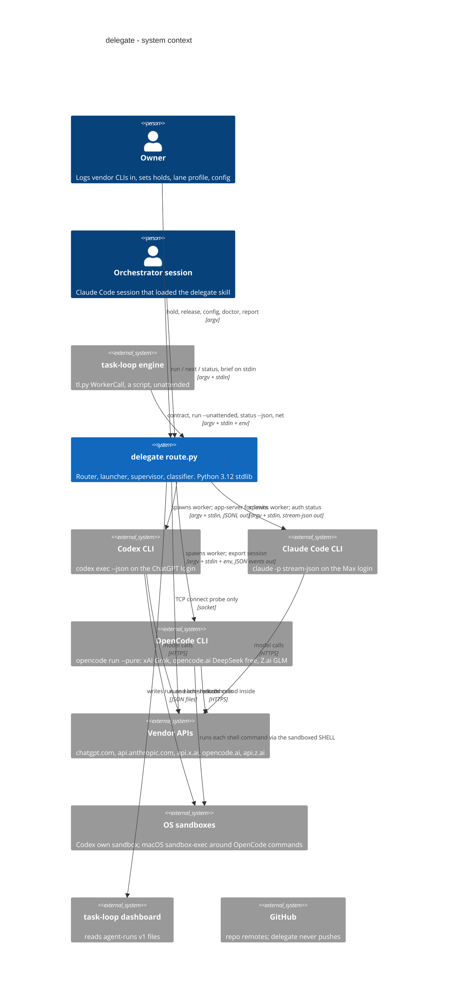
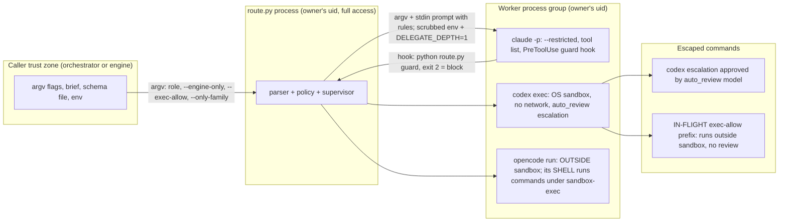
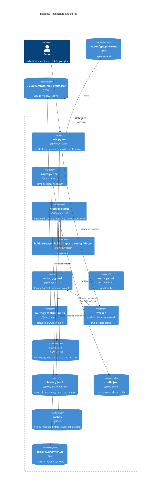
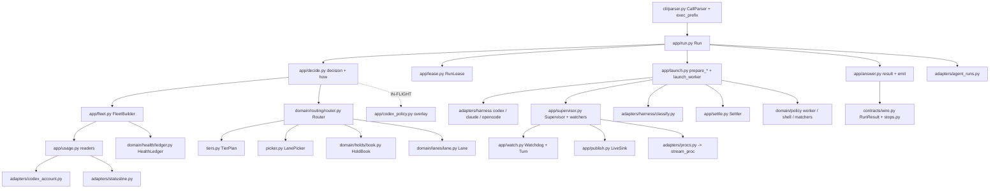

# delegate (iorlas-delegate): C4 architecture

Status: drawn 2026-11-01 from code, read only. Nothing was run (no tests, no git commands).

## Which code this describes

| tree | what it is | how it was used |
|---|---|---|
| `/home/iorlas/Workspaces/iorlas-delegate` | the main checkout, HEAD `237e461` = 0.53.0 (`.git/HEAD`, `.claude-plugin/plugin.json`) | stale: `origin/main` is `86b96d7` (`.git/refs/remotes/origin/main`) |
| `/home/iorlas/Workspaces/wt/UNITYD` | worktree on branch `release/UNITYD`: reset to `86b96d7` (= origin/main), then a commit `ebe839c` "wip UNITYCODEX-D" (`.git/worktrees/UNITYD/logs/HEAD`), plugin.json 0.55.0 | **the source of every file:line below** |

All delegate paths below are relative to the delegate repo root, read in UNITYD. Without git I could not split the UNITYD content
into "on origin/main" and "in the wip commit / uncommitted". A diff against the 0.53.0 checkout shows exactly what is newer than 0.53.0:
`app/codex_policy.py` (new), `cli/parser.py`, `app/decide.py`, `app/launch.py`, `app/run.py`, `adapters/harness/classify.py`,
`skills/delegate/{SKILL.md,contract.json}`, `docs/dev/integrations.md`, tests `test_exec_allow.py`, `test_only_family.py`.
Marked in this document:

- **IN-FLIGHT** = the `--exec-allow` work (Codex rules overlay). The caller of this analysis named it in progress; treat every claim about it as a snapshot of moving code.
- `--only-family` and `--engine-only-advisory` are also newer than 0.53.0; task-loop's own doc already relies on them ("delegate PINFAMILY",
  C4 `docs/dev/integrations.md:77-79`), so they probably landed on origin/main **(unverified)**.

task-loop references below are to `/home/iorlas/Workspaces/wt/C4` and are prefixed `C4:`.

---

## Level 1: system context

delegate is a Claude Code plugin whose one program, `skills/delegate/route.py`, picks a lane (subscription), model and effort for a
role, launches a vendor CLI as a worker, supervises it, classifies how it ended and prints one JSON answer
(`skills/delegate/route.py:7-11` puts `src/` on the path and calls `delegate.cli.main`).



### People and external systems

| actor | role | evidence |
|---|---|---|
| Owner | logs in each CLI in his own terminal (constitution rule 8, `docs/dev/constitution.md:15`), sets holds (`cli/verbs.py:17`), enables opt-in lanes (`route.py config set profile.lanes.X enabled`, README) | |
| Orchestrator session | a Claude session; reads `skills/delegate/SKILL.md` (the only file read on a normal call); may get the `agent_tool` handoff instead of a worker (`app/run.py:78-79`) | |
| task-loop engine | runs `route.py` as a script: `contract --json` (C4: `src/taskloop/adapters/delegate_route.py:49`), `run ... --unattended` built by `RunRequest.to_argv`, `status --json` (C4: `adapters/delegate.py:140`), `net` (C4: `adapters/delegate.py:164`), `status --claude-usage` | C4: `docs/dev/integrations.md:69-70` |
| Codex CLI | worker for `OPENAI_SUBSCRIPTION`; also `codex app-server` (rate limits, `adapters/codex_account.py:21`) and `codex login status` (`adapters/harness/codex.py:192`) | |
| Claude Code CLI | worker for `CLAUDE_SUBSCRIPTION` when unattended (`app/decide.py:83-84`: `agent_tool` becomes `claude_p`); `claude auth status` | |
| OpenCode CLI | worker for `GROK_SUBSCRIPTION`, `DEEPSEEK_FREE`, `ZAI_CODING_SUBSCRIPTION` (`skills/delegate/routing.json` lanes; `app/harnesses.py:8-10`), macOS only (`adapters/harness/opencode.py:104`) | |
| Usage sources | Codex: `codex app-server` JSON-RPC. Claude: `--claude-usage` JSON from the orchestrator's `get_usage`, else `~/.claude/state/max-limits.json` written by `capture-limits` from the status line (`adapters/statusline.py:10`). OpenCode lanes: none (`app/usage.py:170-171`) | |
| OS sandbox | Codex: its own `-s workspace-write`/`read-only` sandbox (`app/decide.py:91-94`). OpenCode: a generated `$SHELL` that `exec`s `/usr/bin/sandbox-exec -p PROFILE` (`adapters/harness/opencode_sandbox.py:64-83`). **No bwrap/Landlock code exists in delegate** (grep over `src/`): on Linux the only OS sandbox is Codex's own (its mechanism is Codex's, unverified here) and the OpenCode lanes refuse to launch (`app/launch.py:144-146`). Claude workers run with no OS sandbox, only the PreToolUse hook and Claude's auto-mode classifier. | |
| GitHub | not contacted by delegate; workers are told never to push (`domain/policy/worker.py:12-13`); a Codex escalation could in principle approve one (unverified) | |

### Trust and permission boundaries



| boundary | enforced by | what it really is |
|---|---|---|
| Worker sandbox (Codex) | `-s workspace-write`/`read-only`, `network_access=false`, `writable_roots=[]`, `approval_policy=on-request`, `approvals_reviewer=auto_review`, `--ignore-user-config --ignore-rules` (`app/decide.py:25-26`) | OS-level for Codex commands; an escalated command leaves it after a model review |
| Worker sandbox (OpenCode) | sandbox-exec profile: deny outbound IP, deny secret subpaths and `.env*`, writes only cwd (or `.task/` on read steps), temp, caches (`adapters/harness/opencode_sandbox.py:74-78`); OpenCode's own permission table (`opencode_sandbox.py:39-45`) | OS-level for shell commands only; OpenCode's own tools are limited by its permission rules, not the OS |
| Worker env | `child_env` = `child_env.scrub_current(keep=("CLAUDE_CONFIG_DIR",))` + `DELEGATE_DEPTH=1` (`app/env.py:171-176`) | strips credential-looking variables; `DELEGATE_DEPTH` is only read by the skill text (`SKILL.md:6`), never by code |
| Secret-path guard | regex `SECRET_RE` (`domain/policy/matchers.py:8`); Claude: PreToolUse hook `route.py guard` (`app/launch.py:42-47`, `cli/verbs.py:76-86`); Codex: supervisor kills on a matching `Cmd` event (`app/launch.py:91-93`, `app/supervisor.py:124-138`); OpenCode: on `CmdEnd` (`adapters/harness/opencode.py:87`) | a tripwire, stated so in `docs/dev/integrations.md:78`. For Codex and OpenCode it fires after the command started or finished |
| Git-write guard | `git_write` per piece (`domain/policy/shell.py:29-41`), Claude steps only, via the hook; every lane: HEAD/branch compared before/after (`adapters/git.py:20-36`, `app/run.py:249`) | Codex and OpenCode write steps have no git guard, only the after-the-fact `git_violation` |
| Read-only shell | `read_only_problem` allow-list (`domain/policy/shell.py:10-13, 68-80`), Claude read steps only | text filter |
| Engine-only recipes | Claude: hook `writer_problem` (`domain/policy/shell.py:96-109`); OpenCode: bash deny rules (`opencode_sandbox.py:34-36`); Codex cannot, so the router drops Codex write steps unless `--engine-only-advisory` (`domain/routing/router.py:18, 39-49, 115-119`) | |
| IN-FLIGHT `--exec-allow` | parser validates 2..8 strings, first token not a shell/interpreter (`cli/parser.py:58-69`) and not an engine-only recipe (`cli/parser.py:43-48`); `how()` drops `--ignore-rules` and points `CODEX_HOME` at an overlay with `prefix_rule(... decision="allow")` (`app/decide.py:93-100`, `app/codex_policy.py:11-37`) | lets a caller-named argv prefix run outside the Codex sandbox without the reviewer |

### What crosses each arrow

| arrow | payload | evidence |
|---|---|---|
| caller -> `route.py run` | argv: `ROLE --cwd --brief --schema --resume --cap --timeout --idle --unattended --authored-by --premium --allow-degraded --only-family* --engine-only* --engine-only-advisory --exec-allow JSON* --claude-usage --parent --task --title --call-id` (`cli/parser.py:88-97`); brief on stdin or `--brief FILE` (`app/run.py:80`); env `DELEGATE_LIVE_FILE`, `DELEGATE_CONFIG_DIR`, `DELEGATE_NOW`, `DELEGATE_NOCACHE`, `DELEGATE_STOP_GRACE` (`app/publish.py:23`, `app/env.py:29,47`, `app/usage.py:52`, `adapters/procs.py:19`) | `contracts/wire.py:48-84` `RunRequest.to_argv` is the typed builder; it has no `only_family`, `cap`, `premium` (task-loop builds its own) |
| `route.py run` -> caller, stdout | exactly one JSON object `RunResult` (contract 3), validated through the record before print (`app/answer.py:47-74`, `contracts/wire.py:175-222`) | schema generated into `skills/delegate/contract.json` `answer_schema` |
| `route.py run` -> caller, stderr | `delegate: worker pid=N pgid=N run_id=R` (`app/run.py:144`), `delegate: ref=REF run_id=R` (`app/run.py:160`), warnings, last 2000 chars of worker stderr (`app/run.py:221-222`) | task-loop parses `delegate: ref=` (comment at `app/run.py:158`) |
| `route.py run` -> live file | JSONL: line 1 `WorkerStarted{v,pid,pgid,run_id}`, then `{t,k,...}` kinds start, cmd_start/end, tool_start/end, msg, think, tokens, stall, retry, end, raw (`app/publish.py:52-71, 153-183`; records `contracts/live.py`) | capped 20 MB (`contracts/live.py` `LIVE_FILE_MAX`) |
| `route.py contract --json` | `{contract, reasons, run_args}` from `contract.json` (`cli/verbs.py:89-92`) | |
| `route.py status --json [--cheap]` | `Status` v1 (`contracts/status.py`), snapshot cached in `status-snapshot.json` (`app/status.py:73-76, 79-96`) | |
| route.py -> codex | argv `codex exec -C WD -s SANDBOX -m MODEL -c model_reasoning_effort=E` + access + isolation (`-c skills.config=[...]`, `project_doc_fallback_filenames`) + `--json -o FILE [--output-schema F] -` (`app/decide.py:64-73, 94`, `adapters/harness/codex.py:68-77`); resume uses `exec resume ... -c sandbox_mode=` (`codex.py:72-74`); stdin = rules + brief (`app/launch.py:122`); env = scrubbed + `UV_CACHE_DIR`/`UV_NO_CACHE`/`UV_OFFLINE` (+ IN-FLIGHT `CODEX_HOME=overlay`) (`app/decide.py:29-41`) | |
| route.py -> claude | `claude -p --output-format stream-json --verbose --model M --effort E --session-id RID / --resume REF --append-system-prompt PREAMBLE+repo docs --restricted --tools Read,Glob,Grep[,Edit,Write],Bash --strict-mcp-config --permission-mode auto --permission-prompts none --settings {PreToolUse guard} [--json-schema]` (`adapters/harness/claude.py:94-102`, `app/launch.py:127-138`) | |
| route.py -> opencode | `opencode run --pure --format json --print-logs --log-level INFO -m M --variant E --dir CWD [--session REF]`; env `SHELL=<sandbox script>`, `XDG_CONFIG_HOME=<empty>`, `OPENCODE_DISABLE_*`, `OPENCODE_CONFIG_CONTENT={permission, enabled_providers}` (`adapters/harness/opencode.py:106-134`) | |
| route.py -> dashboard | `~/.config/agent-runs/runs/<run_id>.json` and `lanes/delegate.json` (`adapters/agent_runs.py:20-58`) | public format agent-runs v1 |

---

## Level 2: containers

Every verb is one short-lived `route.py` process. The only long-lived things are the workers it spawns and the files.



### The verbs as processes

| verb | entry | reads | writes | notes |
|---|---|---|---|---|
| `run ROLE` | `cli/verbs.py:110` -> `app/run.py:51` `Run.go` | everything below | state, history, checkpoint, net.json, agent-runs, codex-last-*.txt, opencode files, overlay | the contract |
| `next ROLE` | `cli/verbs.py:95` -> `app/decide.py:134` `decision` | routing, config, state, history | **state** (`prev` `decide.py:158-163`, stale-hold stamps `app/fleet.py:119-131`, `codex_limits` `app/usage.py:57`, out pops `app/fleet.py:79`), **config** (auto-enable `app/fleet.py:70`, `offered` `decide.py:165`), checkpoint (`app/fleet.py:92`), agent-runs lanes (`decide.py:142`) | looks read-only, is not |
| `status [--json] [--claude-usage J]` | `app/status.py:99` | same as next | snapshot (`status.py:108`), checkpoint, agent-runs lanes (`status.py:105`), state via usage readers and login cache | `--cheap`: reads snapshot, state, net.json only (`status.py:79-96`) |
| `contract --json` | `cli/verbs.py:89` | `contract.json` (loaded at import, `contracts/stops.py:14`) | nothing | handshake, but `main` still loads routing first (`cli/main.py:29`) |
| `hold / release / holds` | `cli/verbs.py:17,30,37` | state | state `holds` | `--until` mandatory (`domain/holds/book.py:71-78`) |
| `report --lane --event out` or `ok` | `cli/verbs.py:42` | state, fleet | state `out`, history `ReleaseRow` | |
| `config set` / `show`, `doctor` (alias `init`) | `app/doctor.py` | config, machine | config (`app/doctor.py:108`) | |
| `guard [--read-only] [--engine-only R]` | `cli/verbs.py:76`, `NO_CONFIG` (`cli/main.py:15`) | stdin hook JSON | nothing | exit 2 = block |
| `net [--lane] [--host]` | `app/net.py:27`, `NO_CONFIG` | | `net.json` in the config dir (`app/net.py:18`) | "no config" but still needs `config_dir()` |
| `capture-limits [--print]` | `cli/verbs.py:61` | stdin | `~/.claude/state/max-limits.json` (`adapters/statusline.py:29-30`) | writes inside Claude Code's own folder |

Worker processes: spawned with `start_new_session=True`, so pgid = pid (`adapters/procs.py:31-35`); stopped by `stream_proc.stop_tree`
(SIGTERM, `DELEGATE_STOP_GRACE` 5 s, SIGKILL) (`adapters/procs.py:53-72`). Short helper processes: `git -C` (`adapters/git.py:8-10`),
`codex app-server`, `codex login status`, `claude auth status`, `opencode export`, `sandbox-exec` preflight (`opencode_sandbox.py:90-99`).

### Stores

Config dir = `$DELEGATE_CONFIG_DIR`, else `~/.claude/plugins/data/<plugin>-<marketplace>` derived from the install path; a checkout without
the variable exits (`app/env.py:33-54`). Mode 0700 dir, 0600 files (`contracts/stores.py` `private`).

| store | path | writers (several = flagged) | readers | locking |
|---|---|---|---|---|
| `state.json` (`StateDoc` v1, `contracts/state.py:94-105`) | config dir | **many**: lease claim/heartbeat thread/stamps/release (`app/lease.py:50-116`), keep_ref (`app/run.py:148-154`), Settler.mark_out (`app/settle.py:59-62`), launch clears out (`app/launch.py:256`), `prev` (`app/decide.py:163`), usage caches (`app/usage.py:57,130`), AuthCache (`app/fleet.py:156-160`), stale holds (`app/fleet.py:119-131`), drift `warned_at` (`app/fleet.py:134-141`), `_apply_out` pop (`app/fleet.py:79`), verbs hold/release/report | every verb but guard/net | one `process_lock` on `state.json.lock`, 10 s, TimeoutError -> answer `lock` (`contracts/stores.py:26-37`, `app/run.py:51-55`) |
| `history.jsonl` | config dir | **several**: `RunRow` (`app/run.py:235`), `RefusalRow` (`app/run.py:46`), `CanaryRow` (`app/run.py:186`), `ReapRow` (`app/lease.py:77`), `GapRow` (`app/launch.py:236`), `ReleaseRow` (`cli/verbs.py:48`) | health fold (`app/fleet.py:85-93`), resume token base (`app/launch.py:123`, `stores.py:144-149`) | lock + O_APPEND; rotation >1 MB keeps 14 days (`contracts/stores.py:110-120`); **every error swallowed** (`stores.py:112`) |
| `config.json` | config dir | **owner by hand**, `config set` (`app/doctor.py:108`), FleetBuilder auto-enable (`app/fleet.py:70`), `mark_offered` (`app/decide.py:165`) | `load_routing` (`app/env.py:67-83`), FleetBuilder profile | lock (`contracts/stores.py:184-190`) |
| `health-checkpoint.json` | config dir | every fleet build that saw rows (`app/fleet.py:92`): run, next, status, report | FleetBuilder | **none** (atomic replace, last writer wins, `stores.py:165-167`) |
| `status-snapshot.json` | config dir | full `status` (`app/status.py:73-76`) | `status --cheap` | none |
| `net.json` | config dir | every probe: run (outcome ladder via `net_up`, `app/net.py:22-24`), `net`, supervisor net wait | `status`, `status --cheap` | none |
| `codex-last-<rid8>.txt` | config dir | codex `-o` | CodexHarness.summary, then unlinked (`adapters/harness/codex.py:169-172`) | per run |
| `opencode-home/`, `opencode-cache/`, `opencode-free-{data,cache}/`, `opencode-shell-<id>.sh`, `opencode-sessions/<ses>.json` | config dir | OpenCodeHarness launch/export (`adapters/harness/opencode.py:106-134, 297-310`); shell removed in `cleanup` (`opencode.py:149-151`) | the worker; `find_transcript` | none |
| IN-FLIGHT `codex-overlay/<sha16>/rules/default.rules` + symlinks `auth.json`, `sessions` -> real `$CODEX_HOME` | config dir | `codex_policy.overlay_home` on every `how()` with exec-allow (`app/codex_policy.py:17-37`), also from `next` | the Codex worker (`CODEX_HOME`) | none; never cleaned |
| `.task/uv-cache` | the worker's cwd | Codex write steps via `UV_CACHE_DIR` (`app/decide.py:35-36`) | uv | n/a |
| agent-runs `runs/<id>.json`, `lanes/delegate.json` | `app_dirs.config_dir("agent-runs")` (`adapters/agent_runs.py:20-21`) | delegate only; also **deletes any file older than 7 days in `runs/`** whatever its producer (`agent_runs.py:38-44`) | task-loop dashboard | atomic replace |
| `~/.claude/state/max-limits.json` | Claude's dir | `capture-limits` | claude usage reader (`app/usage.py:139`), doctor | none |
| Vendor transcripts | `~/.codex/sessions/**/<thread>.jsonl`, `~/.claude/projects/*/<sid>.jsonl` | the vendor CLIs | `harnesses.find_transcript` (`app/harnesses.py:25-27`), `codex_account` token readers | read only |
| `routing.json`, `contract.json` | `skills/delegate/` | release only | `load_routing`, `stops.CONTRACT` | read only |

DOC/CODE MISMATCH: `docs/dev/integrations.md:126` and `app/status.py:81` say login answers live in `auth-cache.json` (TTL 10 min); the
code keeps them in `state.json` `auth` (`app/fleet.py:146-160`, `app/usage.py:108-109`; `contracts/state.py:4` says the old file "is merged in").

---

## Level 3: components of `route.py run`



### The `run` sequence (one call)

1. Parse. A bad flag becomes a `bad_request` answer, exit 0 (`cli/parser.py:50-55`), except the IN-FLIGHT `--exec-allow` checks, which `sys.exit` with text (see smells).
2. `decision` (`app/decide.py:134-167`): build the fleet, stamp stale holds, publish lane limits, mark full lanes busy (`app/fleet.py:109-116`), route.
3. Stop without a launch: `refuse` writes a `RefusalRow` and answers (`app/run.py:43-48, 85-99`). `agent_tool` handoff answers `agent_model` + `brief_prefix` (`app/run.py:78-79`).
4. Lease: claim inside the state lock, reap orphans, enforce slots, canary and `--task` uniqueness (`app/lease.py:50-84`); heartbeat thread every 30 s, TTL 120 s (`domain/lanes/leases.py:3`).
5. Launch ladder (`app/run.py:166-212`): canary probe if the pair's bench just ended (30 s, "Reply with exactly: OK"), the launch, one relaunch on a pre-session network drop with the net back, one schema re-ask in the same thread.
6. Per launch (`app/launch.py:208-260`): `prepare_*` builds `LaunchSpec`; agent-runs record; `Supervisor.run`; classify; `Settler.apply` or clear the lane's out mark.
7. Finish (`app/run.py:215-258`): agent-runs end, keep ref, `RunRow`, usage record, `git_violation`, `worker` report; a done answer with survivors becomes `worker_survived`.

### The same call as a sequence

```mermaid
sequenceDiagram
  participant C as caller
  participant R as Run (app/run.py)
  participant D as decision (app/decide.py)
  participant S as state.json
  participant L as RunLease
  participant X as launch_worker
  participant W as worker CLI
  C->>R: argv + brief (stdin or --brief)
  R->>D: decision(a, cfg, unattended)
  D->>S: load; write prev, stale holds, caches
  D-->>R: d (Run or Stop) + d.how
  alt stop, error, agent_tool
    R-->>C: one JSON answer, RefusalRow in history
  else run
    R->>L: claim (inside the state lock)
    L->>S: leases[rid]
    R->>X: canary? then launch_one(brief)
    X->>W: spawn own session; prompt on stdin
    W-->>X: JSONL events (stdout), logs (stderr)
    X->>X: classify, Settler.apply or clear out mark
    X-->>R: result dict
    R->>R: network relaunch once; schema re-ask once
    R->>L: release
    R->>S: refs[ref]
    R-->>C: one JSON answer (RunResult)
  end
```

### Routing data the router reads

| role | chain in `routing.json` (family, model, mode) | ordering rules |
|---|---|---|
| planner | openai gpt-6.1-sol read_only; claude sonnet-5.5 | Claude last (`domain/routing/tiers.py:64-66`) |
| worker | deepseek free (opt-in), zai glm-5.3 (opt-in), openai gpt-6.1-sol, xai grok-4.7, claude sonnet-5.5; all write | opt-in families drop out unless enabled (`domain/routing/router.py:63`) |
| reviewer | `by_author` table for openai, claude, xai, unknown, deepseek, zai; `order: cost`; `exclude_families: [xai]` | cheapest configured `cost` first inside a tier (`tiers.py:57-59`); same-family step flagged `same_family`, kept last |
| light | deepseek free, zai glm-5.3-flash, openai gpt-6-luna, claude haiku-5.5 read_only, claude sonnet-5.5 write | |

Lane usability (`domain/lanes/lane.py:58-72`), in order: an owner hold covering the role, a benched (lane, model) pair, an out mark, then
the weekly and 5-hour percentages against the strict gate (`worker_lane_gate` 95/90, or `orchestrator_reserve` 90/85 on the shared Claude
lane) or, on the relaxed pass, the ceiling (98/97, shared 95/95). Slots: `max_parallel` 4, one at `strain.five_hour` 80 (`lane.py:85-91`);
a full lane becomes a busy copy (`app/fleet.py:109-116`). An unattended call whose first choice is only busy answers `busy` instead of
falling to the next rung (`router.py:73-77`), except when `--only-family` is set.

### Who decides each stop reason

| reason (`contract.json`) | decided in | lane or pair effect |
|---|---|---|
| `secrets` | supervisor policy hit -> `classify` (`classify.py:38-39`) | none |
| `rate_limited`, `credit_exhausted` | `classify` on vendor text or HTTP 429; supervisor `LaneGoneWatcher`/`LogWatcher` (`app/supervisor.py:70-107`) | `out` until the time the message names, else a fresh Codex reading, else soonest reset, else 1 h (`app/settle.py:102-113`, `adapters/harness/reset_parse.py`) |
| `logged_out` | `classify` (login words, 401/403) | out 900 s (`settle.py:115-119`) |
| `hung` | Watchdog first-event/silence or Turn stall (`app/watch.py:78-83, 118-133`); canary timeout (`app/run.py:188-189`) | first-event: lane out 1800 s; else counted by the breaker |
| `network` | `classify` before work, `Settler.net_pass` probe (`settle.py:64-70`), supervisor net wait (`supervisor.py:165-170`) | none; `resumable`/`partial` set |
| `vendor_blip`, `worker_failed` | `classify` (`classify.py:68-73`) | breaker pair facts (`domain/health/ledger.py:21`) |
| `bad_request` | `classify` (4xx, schema, unknown flag, IN-FLIGHT unknown resume thread `classify.py:19`); `CallParser.error` | none |
| `timeout`, `killed`, `worker_survived` | supervisor timeout / signal; `procs.worker_end` (`app/run.py:253-257`) | none |
| `schema_invalid` | `Run._schema` after one re-ask (`app/run.py:194-212`) | none |
| `busy`, `duplicate_task` | router, `RunLease.claim` (`app/lease.py:57-63`) | none; poll 60-120 s |
| `held`, `no_lane`, `engine_only_unenforced`, `caller`, `setup`, `lock`, `crash` | router / `Run._stopped` / `prepare_*` / `Run.go` | `setup` from OpenCode nested sandbox marks the lane out 1 h (`app/launch.py:147-151`) |

### Components

| component | responsibility | public interface | depends on | data contracts |
|---|---|---|---|---|
| CLI (`cli/main.py`, `cli/parser.py`, `cli/verbs.py`) | parse, dispatch, guard hook stdin/exit | `main(argv)`; `TABLE`, `NO_CONFIG` (`cli/main.py:8-15`) | app | argparse namespace (`env.Args`) |
| Run (`app/run.py`) | one call end to end; never raises past `go` for lock timeouts and launcher exceptions | `Run(a, cfg, unattended, idle_s).go()` | decide, lease, launch, answer, agent_runs, git, procs, usage | `RunRow`, `RefusalRow`, `CanaryRow` (`contracts/history.py`) |
| Decision (`app/decide.py`) | fleet + router + what a step runs on (`how`) | `decision(a, cfg, unattended) -> (d, lanes, warnings, t)`; `how(lane, step, cfg, cwd, unattended, exec_allow)` | fleet, usage, router, holds, codex_policy, agent_runs, git | `CallArgs` (`contracts/routing.py:136-148`), `Decision` = `Run`/`Stop`/`Error`/`LaneOut`, `d["how"]` an untyped dict |
| FleetBuilder (`app/fleet.py`) | one `Lane` per enabled lane: profile mode, usage reading, out board, health view | `build(doc, t, usage, check_config) -> Fleet`; `mark_busy`, `settle_holds`, `drift_warnings`; `AuthCache` | stores, readers (injected), HealthLedger, LeaseBook | `Lane` (`domain/lanes/lane.py:17-40`), `HealthState` |
| Usage readers (`app/usage.py`) | fill five/week/resets/out from the vendor | `READERS[spec.reader](lane, S, st, t, ai_usage)` (`app/usage.py:174`) | codex_account (app-server), statusline, ClaudeHarness login probe | `UsageCache` in state |
| Router (`domain/routing/router.py`) | pure decision: resume on its lane, else tiers strict then relaxed, busy-wait for an unattended first choice, engine-only filtering, typed stops | `Router(routing, holds, prev, t).route(role, args, lanes, rec) -> Decision` | TierPlan, LanePicker, DwellMemory, HoldBook, Lane | `Run.rung/fallback/fallback_reason/first_lane` |
| TierPlan (`domain/routing/tiers.py`) | order: premium, non-Claude unflagged, non-Claude late flags, Claude unflagged, Claude late; `order: cost` sort; Opus (`loop: false`) and excluded families barred | `tiers(role, args, off)` (`tiers.py:53-71`) | routing models | `Step` |
| LanePicker (`domain/routing/picker.py`) | first usable lane of a family | `pick(family, lanes, relaxed, trace, model)` returns `ok[0]` (`picker.py:16-26`) | Lane.usable | |
| Holds (`domain/holds/book.py`) | owner holds by lane and roles, always with an end; one stale ask | `HoldBook.covering/refusal/rows/release`, `new_hold` | time spec | `Hold` |
| Health breaker (`domain/health/ledger.py`) | replayable fold over history: lane facts and pair facts, bench ladder 15/30/60 min, canary | `HealthLedger(policy).fold(rows, base)`, `.view(state, lane, model, t)` | contracts.history | `BreakerPolicy` (`contracts/routing.py:56-63`) |
| Lease (`app/lease.py`, `domain/lanes/leases.py`) | slot accounting, orphan reaping, duplicate task | `RunLease.claim/keep_alive/worker_started/stamp_*/release` | stream_proc `proc_start/alive`, procs.stop | `Lease` in state |
| Launch (`app/launch.py`) | per-vendor preparation, rules prompt, guard settings, denied items, one ladder | `launch_worker(d, brief, a, rid, t, cfg, meta, hooks) -> dict`; `PREPARE` (`launch.py:174`) | harnesses, Supervisor, classify, Settler, policy, codex_account, agent_runs, LiveSink | `LaunchInputs`/`LaunchSpec` (`adapters/harness/base.py:15-44`); result is an untyped dict |
| Harnesses (`adapters/harness/{codex,claude,opencode}.py`) | argv, line parser into `HarnessEvent`s and `Evidence`, summary, transcript path, login probe | `Harness` Protocol (`adapters/harness/base.py:106-139`) | contracts.events, procs | `Summary`, `Evidence` |
| Supervisor (`app/supervisor.py`, `app/watch.py`) | spawn, pump stdout/stderr, watchers (lane gone, harness log, first-event/silence, answer grace, stall, network), timeout, signals, parent death | `Supervisor(...).run(spec, timeout) -> RunOutcome` | procs, watch, LiveSink | `RunHooks`, `RunOutcome` |
| Classify (`adapters/harness/classify.py`) | vendor text + measured facts -> one reason; model text never an input | `classify(rc, vendor_err, stderr, timed_out, work_seen, structured) -> Outcome or None` (`classify.py:29-74`) | regexes only | reason names = `contract.json` rows |
| Settler (`app/settle.py`) | apply the reason: answer text, `retry_after`, lane out marks, network second opinion | `Settler.apply(...)`, `mark_out(...)` (`settle.py:59-82`) | StateStore, netprobe, reset_parse | `OutState` |
| Policy (`domain/policy/*`) | rules text, per-tool-call verdict, denial records | `judge(tool, input, read_only, engine_only) -> Verdict` (`worker.py:25-42`), `secret_hit`, `git_write`, `writer_problem` | contracts.wire `RECIPE_RUNNERS` | `ev.Denied` -> `Denied` |
| Usage accounting (`domain/cost/accounting.py`, `adapters/codex_account.py`) | per-call tokens: subtract a resumed thread's prior total, add auto-review child threads, context size | `accounting.per_call/merge/fields`, `codex_account.child_tokens/thread_total/context_k` | rollout files | `Usage`, `UsageTokens` |
| Transcript readers (`app/harnesses.py`, harness `.transcript`, `run.transcript_info`) | path of the vendor transcript and the byte window this call wrote | `find_transcript(ref, family)`; `transcript_info(path, family, start)` (`app/run.py:261-271`) | vendor dirs | `TranscriptInfo` |
| Answer (`app/answer.py`, `contracts/wire.py`, `contracts/stops.py`) | the one JSON line; stop facts from `contract.json`; schema subset check | `result(outcome, **kw)`, `emit(r, interactive)`, `schema_problem` | codec | `RunResult`, `StopFacts` |
| IN-FLIGHT Codex policy (`app/codex_policy.py`) | per-prefix-set rules file and isolated `CODEX_HOME` | `overlay_home(prefixes) -> Path` | env.config_dir | `prefix_rule(pattern=[...], decision="allow")` text |

### Dependency direction and its enforcement

Layers: `cli -> app -> {domain, adapters} -> contracts`. `tests/test_layers.py:10` forbids contracts -> {adapters, app, domain, cli},
adapters -> {app, domain, cli}, domain -> {adapters, app, cli}, app -> cli; domain may not import `os, subprocess, socket, time, random,
shutil, pathlib, sys, uuid` nor call `open` (`test_layers.py:12, 47-52`); `re` only in `matchers.py` in domain and nowhere in app or contracts
(`test_layers.py:11, 37-45`); no import inside a function; 400 SLOC per file (`test_layers.py:13`). `tests/test_rules.py:21-57` adds the 80-line
function cap and a shrink-only `KNOWN_OVERSIZE` (empty, `test_rules.py:22`), and that only the vendored `stream_proc` sends signals (`test_rules.py:60`).

Checked by grep: no adapters or contracts module imports domain or app. Violations of intent the tests do not see:

- `contracts/stores.py` does file I/O, locking and stderr printing (`stores.py:6-16, 69-101`): the stores live in the contracts layer, so "contracts" is not pure data.
- `contracts/stops.py:6,14` reads `skills/delegate/contract.json` from disk at import time.
- `domain/routing/router.py:18` hard-codes which runners can deny engine-only recipes (`("claude_p", "opencode")`): a harness capability inside the pure router.
- `app/launch.py` knows each harness's internals (Codex token arithmetic `launch.py:190-198`, OpenCode free-model check `launch.py:165-171`, Z.ai model pin `launch.py:152-153`): the Harness Protocol does not cover preparation.

---

## Where the picture is hard to draw

Each item made a box or an arrow impossible to draw cleanly. "By reading" means I traced the code and did not run it.

1. **Dwell memory is written but never read.** `decision` stores `prev[family]` (`app/decide.py:158-163`), `Router` builds `DwellMemory`
   (`domain/routing/router.py:27`), but `DwellMemory.sticky` (`domain/routing/dwell.py:14-17`) has no caller (grep) and the picker returns
   the first usable lane in dict order (`domain/routing/picker.py:26`). `settings.min_dwell_minutes` (30 in `routing.json`) changes nothing.
   I could not draw the arrow "dwell -> picker".

2. **Read-looking verbs write the owner's config.** `next` and `status` run `FleetBuilder.build`, which turns an undecided lane on in
   `config.json` (`app/fleet.py:68-71`), records `offered` (`app/decide.py:164-165`), saves the checkpoint (`app/fleet.py:92`), drops out
   marks (`app/fleet.py:79`) and caches limits (`app/usage.py:57`). In the store table, `config.json` has three writers besides the owner.

3. **"Every outcome is an answer" holds only after the decision.** `app/run.py:3` and `docs/dev/integrations.md:57` promise one JSON object
   and exit 0. But `Run.go` catches only `TimeoutError` (`app/run.py:51-55`); `config_dir()` (`app/env.py:50`), `load_routing`
   (`app/env.py:75,95`) and `parse_json_arg` (`app/decide.py:114`) `sys.exit` with text, and any exception inside `decision` is a traceback.
   IN-FLIGHT: `exec_prefix` and the engine-only conflict check `sys.exit` with text (`cli/parser.py:47, 58-69`), bypassing
   `CallParser.error`'s `bad_request` answer (`cli/parser.py:50-55`); `tests/test_exec_allow.py:37-45, 53-64` assert that SystemExit.
   DOC/CODE MISMATCH with `docs/dev/integrations.md:57` ("a bad flag or argument of `run` included (`bad_request` ...)").

4. **IN-FLIGHT `--exec-allow` contradicts a written lesson.** `docs/dev/constitution.md:24`: "A fixed-command whitelist does not bound a
   build tool that runs repo code (Unity, `dotnet test`): the worker edits the code first." The overlay allows `prefix_rule(... "allow")`
   with no reviewer (`app/codex_policy.py:11-14`) for a write step that may first edit what `just unity-shot` runs. The first-token blocklist
   (`cli/parser.py:66`) does not include `nice`, `timeout`, `command`, `uv`, `npx`, `make` and similar launchers; with the caller trusted it
   is a typo guard, not a boundary. The engine-only conflict check compares only `prefix[1]` (`cli/parser.py:46`), so `["just","-f","x","slow"]`
   passes (by reading). The comment `domain/routing/router.py:16-17` ("`--ignore-rules` drops its execpolicy", so Codex cannot deny engine-only)
   stops being true once the overlay loads rules: two mechanisms now touch the same Codex policy file.

5. **IN-FLIGHT overlay and the real Codex home.** `overlay_home` symlinks `auth.json` and `sessions` into a per-hash dir under the config
   dir, never cleans it, and re-points the symlinks on every call (`app/codex_policy.py:28-36`). If Codex refreshes its token by replacing
   `auth.json` (rename over the symlink), the refreshed token lands in the overlay and the next call's `os.replace` throws it away
   (unverified: depends on how codex-cli writes `auth.json`). `codex_isolation` lists skills under the *real* `CODEX_HOME`
   (`app/decide.py:69-71`) while the worker runs with the overlay as `CODEX_HOME` (`app/decide.py:99`); skills Codex keeps under its home
   would then not be the ones turned off (unverified). Codex also writes its own runtime files into whatever `CODEX_HOME` is (unverified),
   shared by all calls with the same prefixes.

6. **`CODEX_HOME` is resolved in four places and ignored in a fifth.** `app/onboard.py:12-13`, `app/decide.py:69`, `app/codex_policy.py:31`,
   `adapters/codex_account.py:17-18` honour it; `CodexHarness.transcript` hard-codes `~/.codex/sessions` (`adapters/harness/codex.py:189`).
   `ClaudeHarness.transcript` hard-codes `~/.claude/projects` (`adapters/harness/claude.py:210`) while `child_env` keeps `CLAUDE_CONFIG_DIR`
   for the worker (`app/env.py:171`). The OpenCode `auth.json` path is computed three times (`app/onboard.py:33, 49`, `adapters/harness/opencode.py:319`).
   `run._finish` calls `find_transcript` twice for the same ref (`app/run.py:226, 231`).

7. **The stop reason is decided in four places.** `classify` (`adapters/harness/classify.py:29-74`), `Settler.net_pass` rewriting to
   `network` (`app/settle.py:64-70`), `launch_worker` overrides (killed-after-answer -> done, net -> network, `app/launch.py:247-251`), and
   `Run` (`schema_invalid` `app/run.py:210-211`, canary `hung` `app/run.py:188-189`, `worker_survived` `app/run.py:256-257`). The module
   docstring calls `classify` "the one outcome ladder" (`classify.py:1`).

8. **Router stop reasons that never reach the wire.** The router returns `only_family_unready` (`domain/routing/router.py:121-124`) and
   `engine_only_unenforced` without a pin (`router.py:107-110`); `Run._stopped` maps everything but `busy`, and `engine_only_unenforced`
   *with* `--only-family`, to `no_lane` (`app/run.py:93-99`). `contract.json` has no `only_family_unready` row. task-loop's doc expects
   `only_family_unready` "(or `no_lane` while pinned)" (C4: `docs/dev/integrations.md:78-79`); only the `no_lane` half can happen.

9. **The caller-facing contract is wider than "run and status".** task-loop also calls `contract --json` (C4:
   `src/taskloop/adapters/delegate_route.py:49`) and `net` (C4: `src/taskloop/adapters/delegate.py:164`), while
   `docs/dev/integrations.md:138` lists everything but `run`, `status --json`, `status --claude-usage` as private. `contracts/wire.py`
   `RunRequest` has no `only_family`, `cap` or `premium` (`wire.py:48-84`), so it is not the full request either.

10. **Git guard gaps (by reading, not exercised).** `git_args` skips `-C`, `--no-pager`, `--git-dir` but not `-c key=value`
    (`domain/policy/shell.py:21-26`), so on a Claude *write* step `git -c x=y commit -m m` gives sub `-c` and passes `git_write`; leading
    assignments (`FOO=1 git push`) and wrappers (`env git push`, `command git push`) also pass, because `git_write` checks `name_of(t[0])`
    (`shell.py:31-33`) and `after_assignments` is used only by `writer_problem` (`shell.py:90-99`). Read-only steps are safe here
    (`piece_problem` rejects them, `shell.py:45-65`). Codex and OpenCode write steps have no git guard at all; `git.changes` sees only HEAD
    and branch (`adapters/git.py:20-36`), not stash, tags or a push.

11. **Secret policing runs after the fact on two lanes.** Codex is stopped on `item.started` of a matching command
    (`adapters/harness/codex.py:59, 111-113`), so the command already runs; OpenCode on `CmdEnd`, after it finished
    (`adapters/harness/opencode.py:87`). The docs already call it a tripwire (`docs/dev/integrations.md:78`); the diagram arrow
    "guard blocks" is honest only for Claude.

12. **delegate reads task-loop's folder.** `readable_outside` lets an OpenCode read step read `config_dir("task-loop")/runs`
    (`adapters/harness/opencode_sandbox.py:22-24`). `docs/dev/integrations.md:151`: "Never make delegate read anything of task-loop's".

13. **A shared directory with one janitor.** `agent_runs.run` deletes every `*.json` older than 7 days in `agent-runs/runs/`, whichever
    producer wrote it (`adapters/agent_runs.py:38-44`), though the format is a multi-producer public contract (`"producer": "delegate"` in the record).

14. **Silent loss in the breaker's input.** `HistoryStore.add` suppresses every exception, including the lock `TimeoutError`
    (`contracts/stores.py:110-116`), so a refusal or run row (the health fold's only input, `domain/health/ledger.py:1-13`) can vanish under
    contention without a trace. `health-checkpoint.json`, `net.json` and `status-snapshot.json` have no lock (`stores.py:165-167`,
    `adapters/netprobe.py:92-98`, `app/status.py:73-76`).

15. **One fact, two copies.** `app/settle.py:23-26` (`LOGOUT_OUT` 900, `CREDIT_PROBE` 6 h, `GUESS_WINDOW` 6 h) next to `BreakerPolicy`
    (`logout_s` 900, `credit_probe_s` 6 h, `guess_s` 15 min, `contracts/routing.py:56-63`); constitution rule 1 (`docs/dev/constitution.md:7`).
    Retired-key shims (`contracts/state.py:108-131`, `app/env.py:72-81`) sit beside rule 2, "no backward compatibility" (`constitution.md:8`).

16. **Recursion guard is text.** `DELEGATE_DEPTH=1` is set for every worker (`app/env.py:176`) and only `SKILL.md:6` reads it; no code
    refuses a nested `route.py run`. Codex sub-agents cannot be turned off at all (`app/decide.py:65-68`).

17. **Documentation drift found while drawing.**
    - DOC/CODE MISMATCH: Python and OS: `cli/parser.py:14` "Python 3.8+ ... Windows", `SKILL.md:26` "No Python 3.8+", and the release line
      `docs/dev/constitution.md:45` "3 OS x Python 3.8 and 3.12" versus README "Python 3.12+ ... macOS, Linux", `typing.override`
      (`cli/parser.py:7`, 3.12+), CI `python: ["3.12"]` (`.github/workflows/test.yml:9`), and POSIX-only code (`adapters/procs.py:7`).
    - DOC/CODE MISMATCH: `auth-cache.json` (`docs/dev/integrations.md:126`, `app/status.py:81`) vs `state.json` `auth` (`app/fleet.py:146`).
    - DOC/CODE MISMATCH: README says the agent-runs writer is `skills/delegate/agent_runs.py`; it is `src/delegate/adapters/agent_runs.py`.
    - DOC/CODE MISMATCH: `SKILL.md:9` sends the reader to `docs/dev/integrations.md`, which an install does not ship (`integrations.md:3-4`).
    - DOC/CODE MISMATCH (task-loop side): C4 `docs/dev/integrations.md:81` "a checkout reads `~/.config/delegate`"; delegate's checkout
      refuses to run without `DELEGATE_CONFIG_DIR` (`app/env.py:47-50`, `docs/dev/constitution.md:41`).
    - DOC/CODE MISMATCH: `tests/test_layers.py:2` "No rules gate exists in this repo yet" while `tests/test_rules.py` and `just check` exist (CLAUDE.md).
    - The task brief for this document mentions bwrap on Linux; delegate has none (see Level 1, OS sandbox).
