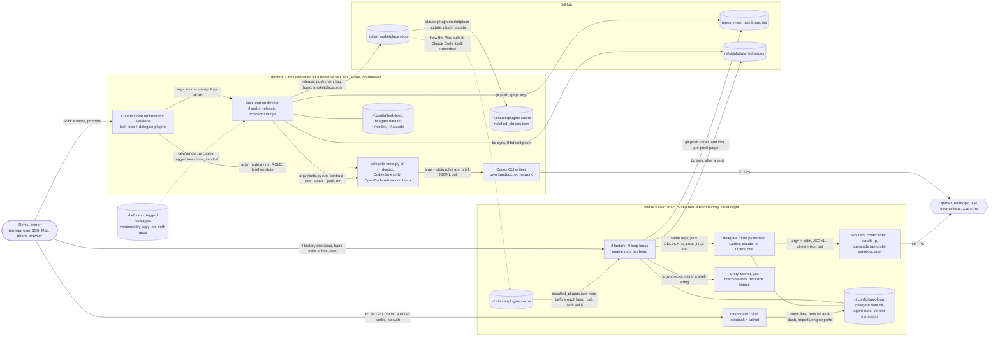
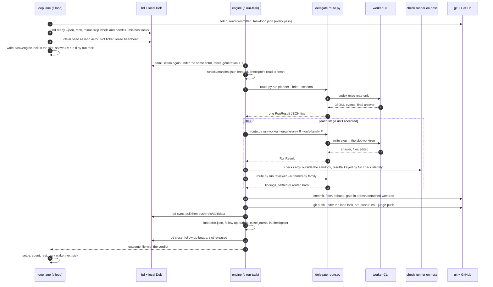
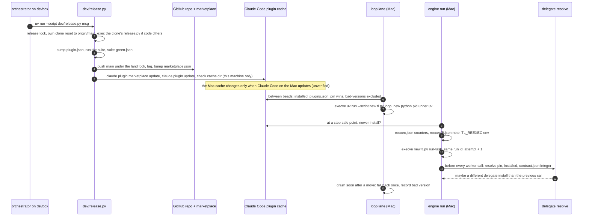
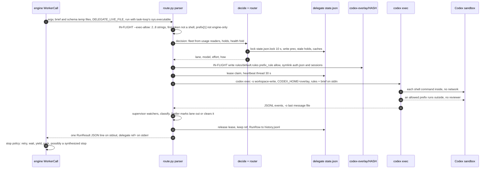
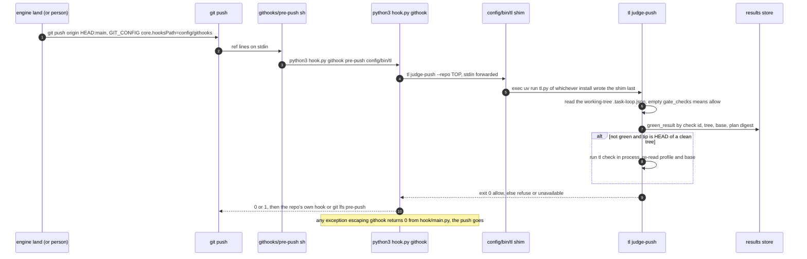
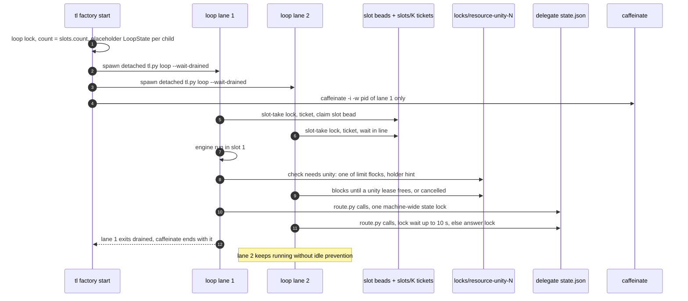

# The factory as one system: C4 across task-loop and delegate

Combined picture, drawn 2026-11-01 from `c4-task-loop.md` (task-loop 0.23.299, this worktree) and `c4-delegate.md` (delegate 0.55.0 in
`/home/iorlas/Workspaces/wt/UNITYD`, which includes the IN-FLIGHT `--exec-allow` work), the review documents under `docs/review/`, and
the deployment facts given by the owner. Static reading; nothing was run. Paths: `tl/` = `src/taskloop/`, `dash/` = `src/taskloop_dash/`,
`dg:` = a delegate path under `src/delegate/` (or the delegate repo root when it starts with `skills/` or `docs/`). "(unverified)" marks a claim the code read here
does not settle.

Re-verified for this document, because the rest leans on them:

1. The pre-push judge still authorizes with the ID-only query: `tl/app/land/push_judge.py:71-75` calls `green_result`, whose docstring is
   "this ID-only query must never authorize delivery" (`tl/app/checks/cache.py:263-265`). Same text in the main checkout (0.23.293).
2. Hook fail-open: `tl/hook/main.py:12-23` wraps the `githook` branch in `except Exception: return 0`, so an exception outside
   `prepush.entry`'s own `(OSError, ValueError, SubprocessError)` handler (`tl/hook/prepush.py:22`), an `ImportError` included, allows the push.
3. Run manifests are written by get-then-put with no lock: every `RunLocator` method is `old = self.get(run)` then `self._put(...)`
   (`tl/contracts/locator.py:104-177`).

---

## Level 1: the whole system

### Trust boundaries

| Boundary | Where it is | What crosses | Enforced by | Weak point |
|---|---|---|---|---|
| Owner to machines | SSH to devbox; local login on the Mac | everything | the OS user | one Unix user per machine runs every process: tl, delegate, workers, dashboard |
| Orchestrator to engine | `tl` argv, PreToolUse hook on every Bash call | verbs | hook denies `pkill`/`killall` only (`tl/hook/rules.py:19-48`) | the hook fails open (`tl/hook/main.py:22-23`) |
| Engine to router | `route.py` subprocess, last JSON line | `RunRequest` argv, one `RunResult` | contract integer 3 (`tl/adapters/delegate.py:105-113`) | flags are not negotiated (A.F08); task-loop also reads delegate files directly (contradiction C3) |
| Router to worker: **the sandbox line** | `codex exec -s workspace-write`, `network_access=false` (`dg:app/decide.py:25-26`); `sandbox-exec` around OpenCode's SHELL (`dg:adapters/harness/opencode_sandbox.py:64-83`); `claude -p` has no OS sandbox | brief, cwd, scrubbed env | OS for Codex and OpenCode commands; hook for Claude | Codex escalations pass by model review; IN-FLIGHT `--exec-allow` lets a named prefix run outside with no review (`dg:app/codex_policy.py:11-14`); on Linux only Codex's own sandbox exists |
| Worker to engine state | worktree `.task/` | files | nothing | `.task/engine.lock` and `.task/engine.take` live in the writer's tree (`tl/contracts/paths.py:276-281`) |
| Candidate to delivery | git pre-push, `tl judge-push` | ref lines on stdin | `core.hooksPath` injected into tl's children (`tl/adapters/childenv.py:56-64`) | the judge reads the candidate's own `.task-loop.json` (`tl/app/land/push_judge.py:49-58`) and an empty `gate_checks` allows (`:103-104`) |
| Browser to dashboard | HTTP on loopback or 100.64.0.0/10 | JSON | Host, same Origin, `X-Taskloop-Dash: 1`, `application/json` (`dash/http.py:40-52`) | any tailnet peer gets all owner writes; no authentication |
| Machine to machine | GitHub only: git refs and `refs/dolt/data` | commits, Dolt chunks | nothing coordinates the two factories | bd claims are local to one machine's Dolt DB until `bd sync` (contradiction C6) |
| Release to running code | marketplace repo, plugin cache | versioned plugin dirs | `installed_plugins.json` plus `pinned.json`, `bad-versions.json` | three independent hop points, no compatibility negotiation (flow b) |

---

## Level 2: end-to-end flows

### (a) A bead from `bd ready` to close (Mac factory, one lane)

Steps 3 and 5 are the double claim (c4-task-loop item 8). Step 16 is where flow (d) starts. Step 17 is the only Dolt traffic of the bead:
no pull happens before step 3 (grep of `tl/app` finds `dolt_push`/`bd sync` only in `land/outbound.py:134-153` and `land/stack.py:217`).

### (b) A version update reaching a running factory

Three hop points (steps 7, 9, 12), each deciding alone. Step 8 is A.F06: the comment "the pid stays" (`tl/app/loop/loop.py:353-355`) is
false under `uv run`. Step 12 is A.F08 / encapsulation-apis F01: the integer matches while flags may not.

### (c) A worker call through delegate to Codex

Steps 2 and 6 exist only in UNITYD; task-loop sends no `--exec-allow` yet (grep of `src/` and `skills/task-loop/*.md`: none). An older
parser given that flag `sys.exit`s with text (`dg:cli/parser.py:58-69`), which task-loop turns into a synthesized stop
(`tl/adapters/delegate.py:197-205`, `:207`).

### (d) A push through the pre-push judge

`land-stack` judges with `authorization.results` and the full key instead (`tl/app/land/stackgate.py:36`): two delivery judges, two evidence rules.

### (e) Lanes: N loops sharing slots and the unity resource

"Lane" means three things here: a loop process (`factory-lane-N.log`, `tl/app/launch/factory.py:58-66`), a delegate subscription lane with its
own `max_parallel` 4 slots and leases (`dg:domain/lanes/lane.py:85-91`), and a check lane that runs checks in parallel
(`tl/contracts/config.py:340`). The unity resource is the only cross-lane scheduler that knows about Unity; delegate's slot accounting
knows nothing about task-loop slots, and task-loop's slot pool knows nothing about delegate's lane capacity.

---

## Level 3: every piece of persistent state, both apps

Columns: **Owner** = single writer, or the writers when several (**bold** = several without one serializing lock). Lifetime is how long it
is kept. Crash = what a `kill -9` of a writer leaves. `C` = `~/.config/task-loop`; `D` = delegate's data dir
(`~/.claude/plugins/data/iorlas-delegate-iorlas-marketplace`, `dg:app/env.py:33-54`).

### Shared and external authorities

| State | Location / format | Owner | Readers | Lifetime | Crash leaves |
|---|---|---|---|---|---|
| Beads (task text, status, assignee, deps, slot metadata, fence generation) | local Dolt DB in each repo, per machine; `bd --json` | bd; called by **engine, loop, tl verbs, dashboard (tl-dash), sessions; on two machines** | everything | forever | claim taken and fence not bumped (`tl/contracts/fence.py:71-78` two calls); a claim not yet synced to the other machine |
| `refs/dolt/data` | GitHub; Dolt chunks | `bd sync` from **either machine** | the other machine's next sync | forever | a landed bead whose sync failed: blocked with FAULT_LAND (`tl/app/land/outbound.py:134-152`) |
| Code: main, task branches | GitHub; git | engine land under `locks/land-<url>.lock`, release, `land-stack`, persons | everything | forever | pushed and no `landed/` receipt: the rerun finds the land (`outbound.py:134-138`) |
| Plugin install choice | `~/.claude/plugins/installed_plugins.json`, `plugins/cache/<mkt>/<plugin>/<ver>/` | Claude Code (`claude plugin update`) | loop moves, engine safe points, delegate resolve (`tl/app/release/catalog.py:19-48`) | until replaced | a half-copied cache dir, skipped by the marker-file check (`catalog.py:24-26`) |
| Marketplace entry | `iorlas-marketplace/.claude-plugin/marketplace.json`, tags | `dev/release.py` (`tl/app/release/publish.py:18`) | Claude Code | forever | pushed main without a marketplace bump: release half done (unverified recovery) |
| Shelf vendor copies | `skills/task-loop/_vendor/*`, `skills/delegate/_vendor/*`; `dev/vendor.json` tag, commit, tree hash | `dev/vendor.py` in each app separately | both apps through `sys.path` append | per release | n/a; but the two apps carry different versions (stream-proc 0.2.2 vs 0.2.1, `dev/vendor.json` in each) |

### task-loop (`C`)

| State | Format | Owner | Readers | Lifetime | Crash leaves |
|---|---|---|---|---|---|
| `runs/R/manifest.json` | `RunManifest` (JsonStore) | **engine lifecycle + `mark_lost` from loop start, `tl wait`, `tl doctor`, `tl report`, owner-request gate (dashboard POST)**: get-then-put, no lock (`tl/contracts/locator.py:104-177`) | dashboard, reports, resume | until prune | live state with a dead pid; a `beat` racing `mark_lost` resurrects or buries a run |
| `runs/R/` other files (plan, checks, pause, reexec, done, handoff, raw answers) | JSON, plain text | engine | dashboard, next attempt | until prune | half-handover between `reexec.json` and `reexec/B.json` (dataflow, Version hop) |
| `runs/R/owner-request.json` | `OwnerRequest`, locked | tl park/stop/note, dashboard POST | engine at step boundaries | consumed | a request no engine will read if the run is dead but pid-live (A.F11) |
| `checkpoints/B.json`, `B.call.json` | `Checkpoint` v3 | engine through `Checkpoints.writer()` + fence; every engine part can mutate it in memory (`tl/app/run/state.py:98-121`) | engine, `--dry-run` | until close | a torn or foreign-version file read as absent = fresh plan (A.F04) |
| `parks/B.json` | `Park` | **engine close + loop profile-ahead read-modify-write, no lock** (`tl/app/loop/take.py:81-86`, `tl/contracts/parks.py:42-46`) | loop pick and settle, entry, dashboard | until resumed | lost wake or an older wake winning |
| `landed/B.json` | `Landed` | **engine (`tl/app/run/engine.py:360`), `tl land` (`tl/cli/land.py:31`)** | reconcile, loop, close guard | long | push done, receipt missing |
| `pauses/`, `reexec/`, `followups/`, `artifacts/` | small JSON, files | engine | engine, loop fallback, dashboard | one bead | pointer deleted before adoption (dataflow, Pause) |
| `asks/B.json`, `ask-ledger.jsonl` | `Ask` v3, locked per bead | engine, verbs, sweeps, dashboard via Intake | same | until answered | consistent; but the dashboard does not carry the ask id (`tl/app/launch/dash_ports.py:50-54`, A.F09) |
| `decisions/K/` | ADR JSON, `uses.jsonl` | engine, owner verbs, dashboard | planner, dashboard | long | lock behaviour unverified |
| `results/K/<sha1(check)>/`, `check-durations/` | `PassRecord`, `Durations` | **every check runner: stage, gate, `tl check`, push judge** (one file per key) | gate, push judge, `tl green`, dashboard | long | a key per file, so races are per key |
| `loop/K.<pid>.json` | `LoopState` v2 | **factory placeholder + child; any `LoopFiles.live()` reader renames dead ones** (`tl/app/launch/factory.py:67-70`, `tl/app/loop/files.py:59-61`) | dashboard (own glob), status, other loops | while live, then `died-<pid>.json` | phantom loop under uv after an exec (A.F06) |
| `loop/K.command.json`, `K-rest.json` | locked | stop verbs; every lane | loops | short | stop aimed at the old pid after a hop (A.F06) |
| `loop/K.jsonl`, `loop/K/` logs, outcomes, `exits.jsonl` | JSONL, logs, symlinks | loops, engines, factory | `tl factory logs`, dashboard | rotated | unmatched start/end rows |
| `slots/K/`, `slot-state/`, `worktrees/K/` | tickets, stamps, `Owned` | loop, run-task, slot verbs | same | slot life | ticket by pid only (L09) |
| worktree `.task/engine.lock`, `.task/engine.take` | `Lock` | **loop writes before spawn, run-task takes it, both drop it**; inside the writer's tree | loop, status, cutover | one bead | a stale lock a worker could also have edited |
| `locks/*.lock` + `.holder` | flock | every process | dashboard holders | by design | released by the kernel; holder hint stale |
| `snapshots/delegate.*.json`, `usage-history.jsonl` | `StatusSnapshot` | tl lanes, tl usage, loop chores every 20 min | dashboard lane cards | overwritten | stale copy of delegate's own snapshot |
| `events.jsonl`, `traces.jsonl` | JSONL | verbs, loop, engine | dashboard, reports, reflect | rotated | partial last line, skipped |
| `sessions/`, `handoff/K.md`, `repos.json` (locked) | JSON, markdown | session hooks, `tl handoff`, `tl register` | dashboard, SessionStart | long | fine |
| `bin/tl`, `githooks/*` (14) | sh scripts | **every SessionStart of every install, `tl hooks install`; last writer wins** (`tl/app/wire/hook.py:34-77`) | git, every shim user | until rewritten | a shim pointing at a removed install: every push refused, or (exception path) allowed |
| `pinned.json`, `bad-versions.json` | `Pin`, `BadVersions` | owner; loop on crash-after-move | loop, engine reload, delegate resolve | until cleared | fine |
| `releases/`, `suite-green.json`, `release/<hash>/` clone | JSON, a clone | release, suite | status, release | long | a clone mid-release: next release resets it |
| `dash.pid`, `dash.json` | JSON | **launcher and server** | launcher | process life | stale pid |
| `factory.db`: `bead`, `kv` (`beads.<repo_key>`) | cached bd projection and health | dashboard indexer | dashboard readers | marker-gated | old rows and success time retained on bd failure |
| `host.json`, `.task-loop.json` | `HostResources`; profile (no version, `tl/contracts/config.py:248`) | owner by hand; profile also by any commit, including a writer's | loop, checks; profile: loop, engine, **push judge reads the working tree** | long | n/a |

### delegate (`D` unless noted)

| State | Format | Owner | Readers | Lifetime | Crash leaves |
|---|---|---|---|---|---|
| `state.json` | `StateDoc` v1, one lock 10 s (`dg:contracts/stores.py:26-37`) | **run (lease, refs, out marks), next, status, hold/release/report, fleet build, usage caches** under one lock | every verb but guard/net | forever | a lease with a dead pid until reaped; an unreadable file read as empty (L03, M01) |
| `history.jsonl` | rows, lock + O_APPEND, rotated 1 MB / 14 days | run, lease reaper, launch, report | health fold, resume base | 14 days | **a row silently lost**: every error swallowed (`dg:contracts/stores.py:110-116`) |
| `config.json` | settings + lane profile, locked | **owner, `config set`, fleet build auto-enable, `mark_offered`**: `status --json`, which task-loop polls, can enable a lane (`dg:app/fleet.py:68-70`) | routing, fleet | forever | fine (locked) |
| `health-checkpoint.json`, `status-snapshot.json`, `net.json` | JSON, no lock | **every fleet build; full status; every probe** | fleet, `status --cheap` | overwritten | last writer wins |
| `codex-last-*.txt`, `opencode-*` dirs and shells | files | one run | that run | one call | leftovers on kill |
| IN-FLIGHT `codex-overlay/<sha16>/` | rules file + symlinks to the real `auth.json`, `sessions` | every `how()` with exec-allow, `next` too | Codex as `CODEX_HOME` | never cleaned | a refreshed token may land in the overlay and be replaced next call (unverified) |
| `~/.config/agent-runs/runs/`, `lanes/delegate.json` | agent-runs v1 | delegate; deletes **anyone's** file older than 7 days (`dg:adapters/agent_runs.py:38-44`) | **nobody in task-loop**: no reader in `src/` (grep), no spec in `docs/contracts/` | 7 days | orphan files |
| `~/.claude/state/max-limits.json` | JSON | `capture-limits` from the status line | claude usage reader | overwritten | stale reading |
| worker cwd `.task/uv-cache` | uv cache | Codex write steps | uv | slot life | shares `.task/` with the engine lock |
| Vendor transcripts `~/.codex/sessions`, `~/.claude/projects`, OpenCode `opencode.db` | vendor formats | the vendor CLIs | delegate token and transcript readers; task-loop reads `opencode.db` (`tl/adapters/opencode.py:13-32`) | vendor's | n/a |
| `skills/delegate/contract.json`, `routing.json` | JSON | delegate release | delegate at import; **task-loop reads `contract.json` directly** (`tl/adapters/delegate.py:93`, `:104`) | per install | n/a |

---

## Contradictions between the two apps' pictures

| # | task-loop says | delegate says | Code | Who should win |
|---|---|---|---|---|
| C1 | **Stop reason.** task-loop treats `stop` as producer facts and chooses the transition (architecture.md, Delegate contract) | `classify` is "the one outcome ladder" (`dg:adapters/harness/classify.py:1`) | delegate decides a reason in four places (c4-delegate item 7); task-loop then synthesizes its own stops with its own scope and permanence (`tl/adapters/delegate.py:197-205`), rewrites a reviewer timeout to an overrun (dataflow, Delegate boundary), and re-derives permanence in four places (A.F07) | delegate owns the cause, task-loop owns the disposition; neither rewrites the other's (zoom-out Z07) |
| C2 | "Only the contract is shared: never read delegate's files or call anything but `route.py run` and `status`" (`CLAUDE.md`; `docs/dev/integrations.md:83`) | public: `run`, `status --json`, `status --claude-usage`; everything else private (`docs/dev/integrations.md:138` in delegate) | task-loop calls `contract --json` (`tl/adapters/delegate_route.py:49`) and `net` (`tl/adapters/delegate.py:164`), reads `contract.json` (`:93`, `:104`) and delegate's `history.jsonl` (`tl/app/report/planner.py:12`, `:35`) | write down the real list or cut the calls (Z09) |
| C3 | "Never make delegate read anything of task-loop's" (delegate `docs/dev/integrations.md:151`) | OpenCode read steps may read `config_dir("task-loop")/runs` (`dg:adapters/harness/opencode_sandbox.py:22-24`) | both | delegate's own rule |
| C4 | agent-runs v1 is not mentioned by task-loop's code or `docs/contracts/` (only `dash-api.md`, `handoff-v1.md`, `worker-run-v4.md`) | agent-runs v1 is "a public contract", spec "owned by the consumer side" in task-loop (delegate README:46, `docs/dev/integrations.md:10-12`) | producer only | delete the producer (Z10) |
| C5 | `only_family_unready` pauses a pinned run (`docs/dev/integrations.md:78-79`) | router returns it, `Run._stopped` maps it to `no_lane`; `contract.json` has no row (c4-delegate item 8) | only `no_lane` happens | delegate: one row or none |
| C6 | a bd claim is "atomic" and the fence is the ownership token (c4-task-loop Level 1, A.F03) | n/a | the claim is atomic in one machine's Dolt DB; nothing pulls before a claim; the land's error text already names "another machine ran this bead" (`tl/app/land/outbound.py:126-128`); bd's own auto-sync, if any, unverified | one factory per repo, or claim-then-sync (Z06) |
| C7 | Workers table maps "reader, writer, reviewer, hard" (`docs/dev/integrations.md:65-67`); CLAUDE.md says worker-run v1 | roles planner, worker, reviewer, light; contract 3 | `ROLES` = plan, write, review, verify, look to planner/worker/reviewer (`tl/domain/lanes/roles.py:5`) | code; fix both docs |
| C8 | delegate is found by pin, then `installed_plugins.json` (`tl/adapters/delegate.py:88-113`), plus a newest-in-cache fallback (`:116-129`) | "always call the installed route.py" | two lookup rules | one (Z13) |
| C9 | the engine runs route.py with its own `sys.executable` (`tl/adapters/delegate.py:140`, `:164`, `:194`) | delegate requires Python 3.12+, docs still say 3.8 (c4-delegate item 17) | task-loop picks delegate's interpreter | delegate should be launched by its own shebang or `uv run --script` |
| C10 | "lane" = a loop process of the factory | "lane" = a subscription with slots | plus check lanes | rename the factory's (Z22) |
