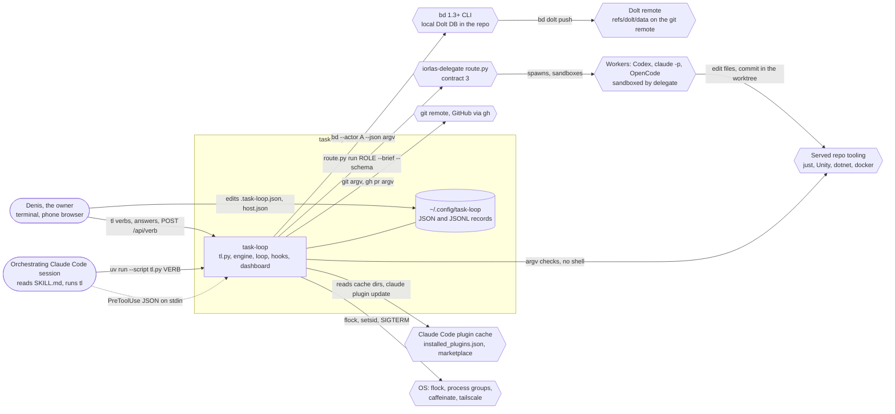
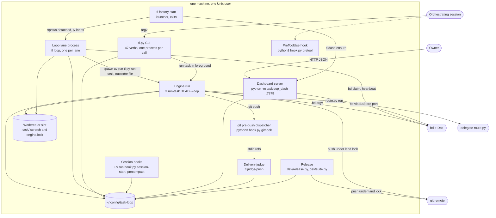
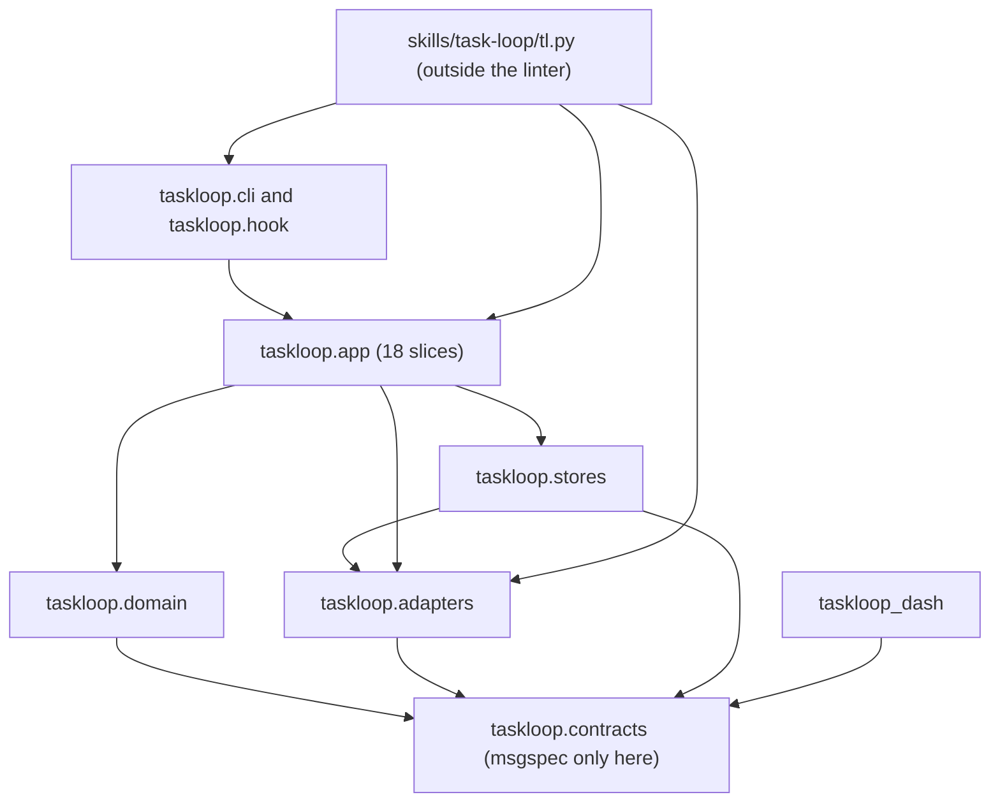
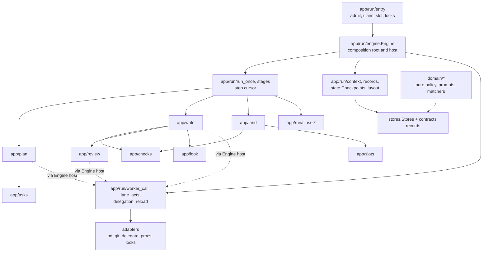
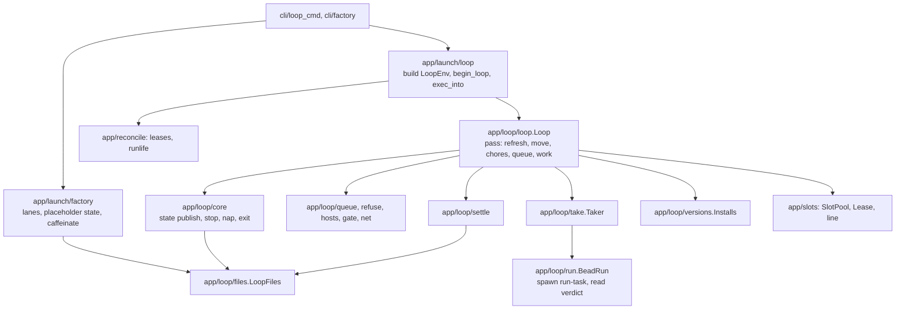

# task-loop: C4 model (context, containers, components)

Static reading of the worktree at plugin version 0.23.299 (`.claude-plugin/plugin.json:4`), 2026-11-01. Every claim cites a file
and line that was opened for this document; paths are relative to the repository root, and `src/taskloop/` is shortened to `tl/`
where a table would otherwise not fit. Nothing was run. "(unverified)" marks a claim the code read here does not settle.
"DOC/CODE MISMATCH" marks a place where a document in this repo says something the code does not do.

Diagrams are mermaid `flowchart` (GitHub renders it; the `C4Context` dialect renders poorly there). Shapes: rounded = person,
rectangle = process, cylinder = store, hexagon = external system.

---

## Level 1: System context

### Diagram

### People and actors

| Actor | What it is | How it touches task-loop | Evidence |
|---|---|---|---|
| Owner (Denis) | the one person on the box | `tl` verbs in a terminal; the dashboard's POST verbs from a browser or phone; writes `.task-loop.json` (committed) and `host.json` by hand | `skills/task-loop/tl.py:8-57`, `tl/contracts/paths.py:182-184`, `src/taskloop_dash/http.py:112-123` |
| Orchestrating session | a Claude Code session following `skills/task-loop/SKILL.md` | runs `tl run-task`, `tl loop`, `tl status`, `tl wait`; is the only party the PreToolUse hook guards | `README.md:25-29`, `hooks/hooks.json:20-26` |
| Loop actor | a bd actor minted per loop process, never the session's | claims beads and slots in bd | `tl/app/launch/loop.py:288-303` |
| Dashboard actor | bd actor `tl-dash` | writes asks/holds/notes through Intake and bd | `tl/app/launch/dash_ports.py:29`, `:86-105` |
| Workers | Codex, `claude -p`, OpenCode (xAI) behind delegate | receive a brief and a schema, answer JSON; write code in the bead's worktree | `tl/contracts/delegate.py:52-67`, `docs/dev/integrations.md:15` |

### External systems and what crosses each arrow

| Arrow | Format | Mechanism | Who on our side | Evidence |
|---|---|---|---|---|
| task-loop -> bd | argv `bd ... --actor A --json`; JSON out | subprocess, one process site (`BdStore`) | engine, loop, tl verbs, dashboard (through ports) | `tl/adapters/bd.py:181`, `:196-211`; `docs/dev/integrations.md:16` |
| bd -> Dolt remote | Dolt push of `refs/dolt/data` | `bd dolt push`, exit codes remapped 0..4 | land outbound step, `tl bd dolt push` | `tl/adapters/bd.py:199-211`, `tl/app/land/outbound.py:142` |
| task-loop -> git remote | git argv through the `Git` port; default land command `git push origin HEAD:main` | subprocess | engine land, `tl land-stack`, release | `tl/contracts/ports.py:175`, review F01 cites `tl/contracts/config.py:164` (default push, unverified here) |
| task-loop -> GitHub | `gh pr view/list/create/edit/merge --json` | subprocess | `tl land-stack` only | `tl/app/land/forge.py:29-50` |
| task-loop -> delegate | argv `route.py run ROLE --brief F --cwd D --schema F [--unattended] --parent --task --title [--resume --authored-by --call-id --timeout --idle] [--engine-only R]* [--engine-only-advisory] [--only-family F]*`; env `DELEGATE_LIVE_FILE`; answer = last JSON line | subprocess per call, temp files for brief and schema | engine `WorkerCall` | `tl/contracts/delegate.py:52-70`, `tl/adapters/delegate_route.py:57-60` |
| task-loop -> delegate (side) | `route.py contract --json`, `status --json`, `status --claude-usage`, `net` | subprocess | engine resolve, `tl lanes`, `tl usage`, loop chores | `tl/adapters/delegate_route.py:48-53`, `tl/adapters/delegate.py:139-169` |
| task-loop reads delegate files | `skills/delegate/contract.json` (needs a `reasons` map and `contract` int) | file read | `adapters/delegate.resolve` | `tl/adapters/delegate.py:66-71`, `:93`, `:104` |
| task-loop -> served repo tools | argv lists from `.task-loop.json` (`checks[].argv`, `slots.setup`, `engine.prepare.cmd`, `engine.plan_cmd`), never a shell string | Spawner | check runner, slot setup, prepare, gate plan | `docs/dev/integrations.md:20-48`, `skills/task-loop/SKILL.md:55-58` |
| task-loop -> docker (history: removed in 0.23.403, a check now runs `in: linux` on the ssh executor) | `docker info`, `docker run --init -i --name ...` | subprocess | container-required checks | `tl/app/checks/execution.py:39`, `tl/adapters/container_run.py:31`, `:64` |
| task-loop -> Claude Code | reads `~/.claude/plugins/installed_plugins.json` and `plugins/cache/<mkt>/<plugin>/<ver>/`; release runs `claude plugin marketplace update`, `claude plugin update` | file read; subprocess (release only) | loop install moves, pins, delegate discovery, release | `tl/app/release/catalog.py:19-48`, `tl/adapters/delegate.py:74-85`, `dev/release.py:20-22` |
| task-loop -> OpenCode | SQLite `~/.local/share/opencode/opencode.db`, tables `session`, `message`, `part`, read only | sqlite read (unverified: module not opened) | engine trace, context size | `docs/dev/integrations.md:15` |
| Claude Code -> task-loop | hook event JSON on stdin (`tool_name`, `tool_input`; `session_id`, `transcript_path`, `source`) | `hooks/hook.py` per event | hooks | `hooks/hooks.json:3-27`, `tl/hook/pretool.py:7-18`, `tl/app/wire/hook.py:16-24` |
| git -> task-loop | pre-push ref lines on stdin (`<local ref> <sha> <remote ref> <sha>`) | `<config>/githooks/pre-push` -> `python3 hooks/hook.py githook pre-push <config>/bin/tl` | push judge | `tl/app/wire/hook.py:51-56`, `tl/hook/prepush.py:9-24`, `tl/app/land/push_judge.py:38-46` |
| task-loop -> OS | `flock` (vendored `process_lock`), detached sessions and process groups, `caffeinate -i -w PID` on macOS, `tailscale ip` | syscalls / subprocess | every lock; factory; dashboard bind | `skills/task-loop/_vendor/process_lock/__init__.py:187`, `tl/adapters/factory.py:6-8`, `tl/app/launch/dash.py:43-66` |

No launchd, launchctl or systemd code exists: a grep of `src`, `skills/task-loop`, `dev` for `launchd|launchctl` finds nothing; `README.md:73`
says "installs no OS service", which matches. `caffeinate` is the only macOS-specific integration (`tl/adapters/factory.py:7`).

### Trust and permission boundaries

| Boundary | What is enforced, where | What is NOT enforced |
|---|---|---|
| Writer sandbox | Owned by delegate, not task-loop: "Delegate, not the engine, tells each worker what its sandbox allows" (`skills/task-loop/SKILL.md:66-67`). task-loop compensates: checks run outside the sandbox (`tl/app/write/check_round.py:1`), links are opened from the host because the writer has no network (`tl/app/review/link_check.py:1`), engine-owned `just` recipes are passed as `--engine-only` (`tl/contracts/delegate.py:61-64`), run records live outside the worktree "where no worker can write them" (`tl/app/run/layout.py:1-4`). | The sandbox rules themselves (unverified: delegate code not read). The engine lock `.task/engine.lock` and `.task/engine.take` live inside the worktree (`tl/contracts/paths.py:276-281`), i.e. inside the writer's reach. Host-mode writers are unsandboxed: "an unsandboxed worker can write here" (`tl/app/run/worker_call.py:176`), so for `engine.host` beads `~/.config/task-loop` is writable by the worker (inferred from that comment; unverified). |
| Who may write `~/.config/task-loop` | Intended: `tl.py` processes and bd only (`CLAUDE.md`, Conventions). Actual writers: tl verbs, loop, engine, hooks, the dashboard process (`dash.pid`, index-owned `factory.db` bead projection, plus owner writes through ports), and the release script (`releases/`, `release/<hash>/`). | No permission split: every writer is the same Unix user. |
| Profile authority | Only the `.task-loop.json` committed on the base counts for the loop and engine (`skills/task-loop/SKILL.md:60-63`, `tl/app/wire/slots.py:42-68`). | The push judge reads the working-tree file (`tl/app/land/push_judge.py:49-58`); delivery authorization reads the judged tree's copy (`tl/app/checks/authorization.py:17-19`). Three profile authorities; see smells. |
| PreToolUse hook | Runs before every Bash call of a session that has the plugin; denies `pkill`/`killall` in command position, also inside `sh -c` (`tl/hook/rules.py:19-48`). Plain `python3`, 3 s timeout (`hooks/hooks.json:20-26`); importlinter forbids msgspec and every record layer (`.importlinter` contract `hot-hook-path-is-light`). | It is the only rule. It fails open: any exception returns exit 0 with no output (`tl/hook/main.py:22-23`), unparsable input is allowed (`tl/hook/pretool.py:13-14`). Whether delegate's `claude -p` workers load this plugin's hooks: unverified. |
| Pre-push | Every subprocess tl starts gets `core.hooksPath=<config>/githooks` through `GIT_CONFIG_COUNT/KEY/VALUE` (`tl/adapters/childenv.py:56-64`); the hook forwards stdin to `tl judge-push`; only exit 0 allows (`tl/hook/prepush.py:9-24`). | A default, not a lock: `git -c core.hooksPath=` and `--no-verify` beat it, and a git run outside tl does not see it (`tl/cli/hooks.py:1-3`). An exception type other than OSError/ValueError/SubprocessError escapes `githook` into `hook/main.py:22`, which returns 0, i.e. allows the push (inferred from the two handlers; not exercised). |
| Dashboard network | No auth; the bind is the access rule: loopback and 100.64.0.0/10 only, nothing overrides (`src/taskloop_dash/bind.py:13-29`, `:78-94`). Writes need one Host in the allowed set, `X-Taskloop-Dash: 1`, same Origin, `application/json` (`src/taskloop_dash/http.py:40-52`). | DOC/CODE MISMATCH: `README.md:85` says "In a container: `TASK_LOOP_DASH_BIND=0.0.0.0`"; `bind_refusal` refuses 0.0.0.0 with no override (`src/taskloop_dash/bind.py:79-83`). |

---

## Level 2: Containers

### Diagram

### Processes

| Container | Started by, how | Entry | Lifetime | Talks to |
|---|---|---|---|---|
| tl.py CLI | person, session, shim `<config>/bin/tl` (`exec uv run --quiet --script tl.py`, `tl/app/wire/hook.py:27-45`) | `skills/task-loop/tl.py:451-456`; verbs table `:405-448` | one call | everything below through `Ctx` (env, Spawner, Git, Identity built once, `tl.py:105-114`) |
| Loop lane | `tl loop` (`tl.py:363-365`), or `tl factory start` which spawns `sys.executable tl.py loop --repo R --wait-drained` once per missing lane (`tl/cli/factory.py:68-70`, `tl/app/launch/factory.py:97-120`) | `tl/app/loop/loop.py:85-114` | until drained, `--until`, `--max-beads`, stop command, signal; may `execve` into a newer install between beads (`loop.py:353-369`, `tl/app/launch/loop.py:187-199`) | bd, engine children, delegate status, dashboard (indirectly via files) |
| Engine run | the loop spawns `uv run --script <install>/tl.py run-task BEAD --loop --worktree WT --outcome-file F [--slot S]` (`tl/app/launch/loop.py:235-238`) in its own process group (`:173-176`); or a person/session runs `tl run-task` | `tl/app/run/entry.py:173`, `run_in` `:313-351`, `run_bead` `:365-420` | one bead; may exec into a newer install at a safe point (`tl/app/run/reload.py:113`) | delegate, bd, git, check tools, docker |
| PreToolUse hook | Claude Code, before each Bash call (`hooks/hooks.json:20-26`) | `hooks/hook.py` -> `tl/hook/main.py:13-14` -> `tl/hook/pretool.py` | under 3 s | nothing (pure) |
| Session hooks | Claude Code SessionStart and PreCompact, `uv run --quiet --script` (`hooks/hooks.json:4-19`) | `tl/hook/session.py:100-104` | one event | writes `sessions/`, `bin/tl`, `githooks/`, `handoff/` |
| Pre-push dispatcher | git, from `<config>/githooks/<name>` (14 client hooks, `tl/app/wire/hook.py:49-56`) | `tl/hook/prepush.py:51-71` | one push | runs `<config>/bin/tl judge-push --repo TOP`, then the repo's own hook or `git lfs pre-push` |
| Delivery judge | `tl judge-push` (`tl.py:433-434`) | `tl/app/launch/push_judge.py:30-38` -> `tl/app/land/push_judge.py:98-107` | one push; may run `tl check` in process (`push_judge.py:31-33`, `land/push_judge.py:82`) | results store, git, check tools |
| Dashboard server | `tl dash ensure` (`tl/app/launch/dash.py:175-198`) spawns `sys.executable -m taskloop_dash --ports taskloop.app.launch.dash_ports:ports --port P --bind B` detached (`dash.py:146-148`) | `src/taskloop_dash/cli/dash.py:39`; `Dash` wiring `src/taskloop_dash/app.py:16-27` | until replaced (code hash or bind change, `dash.py:99-112`) or `tl dash stop` | config dir, bd (ports), engine code imported at runtime by name |
| Release | person or session: `uv run --script dev/release.py "msg" ...` | `dev/release.py`, `tl/app/release/flow.py:95-125`, `:150` | one release | own clone `<config>/release/<hash>/` (`tl/app/release/clone.py:11`), git remote under the land lock (`tl/app/release/push.py:26`), marketplace checkout, `claude plugin` |
| Suite | release, or a person: `uv run --script dev/suite.py` | `tl/app/release/suite.py` | one run; host lock `<config>/locks/suite-host.lock` (`suite.py:119`) | pytest-xdist workers |

`tl.py` verbs by container they start or touch (from `tl.py:405-448`):

| Group | Verbs |
|---|---|
| Engine | `run-task`, `selftest`, `check`/`gate`, `judge-push`, `green` |
| Loop | `loop [status]`, `next`, `stop`, `factory start/status/stop/logs`, `cutover check`, `pin`, `rollback`, `prune` |
| bd bookkeeping by hand | `claim`, `land`, `close`, `block`, `bd ...`, `queue`, `lint`, `slot ...`, `worktree`, `worktrees`, `land-lock`, `land-stack` |
| Owner inbox | `ask`, `answer`, `hint`, `hold`, `override`, `park`, `note`, `wait` |
| Observability | `status`, `report`, `lost`, `trace`, `reflect digest`, `handoff`, `doctor`, `actor`, `register`, `lanes`, `usage`, `dash`, `hooks install` |

### Stores

All under `ConfigDir` (`tl/contracts/paths.py:15-234`) unless noted. "Many" in the last column means more than one process kind writes it.
JSON documents go through `JsonStore` (atomic replace, no lock: `tl/contracts/stores.py:80-121`) unless a lock is named.

| Path | Record (`contracts`) | Writers | Readers | Many writers |
|---|---|---|---|---|
| `runs/<run>/engine.jsonl`, `runs/<run>/live/` | `EngineLog` via `RunLog` (`stores.py:169`); live worker files | engine (`tl/app/run/context.py`, `Engine.__init__` `engine.py:161-171`) | dashboard (`readers/runlogs.py`, `readers/records.py:88`), `tl trace`, `tl wait`, `tl report` | no |
| `runs/<run>/manifest.json` | `RunManifest` v? (`contracts/run.py:194`) via `RunLocator` | engine (create, take_up, beat, advance, end: `locator.py:104-171`); reconciler `mark_lost` from loop start, `tl wait`, `tl doctor`, `tl report`, owner requests (`runlife.py:64-75`, `cli/wait.py:33`, `wire/doctor.py:102`, `report/card.py:53`, `run/requests.py:48`) | everything that shows runs | **yes**, read-modify-write with no lock (`locator.py:104-121`) |
| `runs/<run>/owner-request.json` (+ `.lock`) | `OwnerRequest` | `tl park/stop/note`, dashboard POST (`requests.py:52-60`, locked) | the engine at step boundaries | yes, but locked |
| `runs/<run>/` other files: `engine-checks[.rN].json`, `checks/`, `plan.json`, `pause.json`, `reexec.json`, `done.json`, `handoff.json`, `prepare.stamp`, `plan-note-*` | `CheckRun`, plan, run hand-overs | engine; `tl check` creates standalone runs | dashboard, next run | no |
| `checkpoints/<bead>.json` | `Checkpoint` v3 (`contracts/checkpoint.py:162`) | engine only, through `Checkpoints.writer()` with `fence.check` (`tl/app/run/state.py:104-121`); `Engine.call_dir` also names the folder by hand (`engine.py:351`) | engine resume, `tl run-task --dry-run` | no (but see smells: every engine part can mutate the in-memory state) |
| `asks/<bead>.json`, `asks/.<sweep>`, `ask-ledger.jsonl` | `Ask` v3 (`contracts/ask.py:80`), `LedgerEntry` | engine (raise, consume), `tl ask ...`, loop sweeps, dashboard answers, all through `AskStore` under `locks/ask-<bead>.lock` (`stores.py:252-270`) | same | yes, locked per bead |
| `decisions/<repo>/ADR-n.json`, `uses.jsonl` | ADR | engine, owner verbs, dashboard prune/stick | engine planner, dashboard | yes (lock: unverified) |
| `parks/<bead>.json` | `Park` (`contracts/parks.py:28-46`) | engine close (`asks/parks.py:39-45`, `run/stages.py:165`), loop on profile-ahead (`loop/take.py:81-86`) | loop pick (`loop/loop.py:260`, `loop/settle.py:132`), engine entry, dashboard (`readers/records.py:56`) | **yes**, unlocked read-modify-write (`take.py:86`) |
| `pauses/<bead>.json` | `NetPause` | engine on network pause | next engine (`engine.py:153`), dashboard | no |
| `reexec/<bead>.json` | `ReloadNote` | engine before exec (`release/reexec.py:21`) | loop crash fallback (`loop/run.py:76-86`) | no |
| `landed/<bead>.json` | `Landed` | engine (`engine.py:360`), `tl land` (`cli/land.py:31`) | reconcile, loop, close guard | **yes** |
| `followups/<bead>.json` | `FollowupOutbox` | engine close and review (`run/closer_notes.py`, `write/review_round.py`) | engine | no |
| `artifacts/<repo>/<bead>/<run>/<stage>-<attempt>/<name>` (+ `<name>.json`) | `ArtifactMeta` | the `artifact_add` tool server and the engine's renders (`app/artifacts/store.py`) | dashboard `/api/artifact`, the owner-look bead | no |
| `results/<repo_key>/<sha1(check)>/<digest>.json`, `results/<repo_key>/base-red/`, `check-durations/<repo_key>.json` | `PassRecord`, `BaseRedRecord`, `Durations` | every check runner: stage round, land gate, `tl check`, push judge (`checks/cache.py:1`, `runner.py:43`, `:139`) | land gate, push judge, `tl green`, dashboard | **yes** (one file per key, so conflicts are per key) |
| `loop/<key>.<pid>.json` | `LoopState` v2 (`contracts/loop.py:56-78`) | the loop each pass (`loop/core.py:96`); factory writes a placeholder for the child and later patches `log` (`launch/factory.py:67-70`, `:83-88`) | dashboard (own glob, `readers/world.py:68-69`), `tl status`, `tl factory status`, other loops | **yes** (launcher and child) |
| `loop/<key>.command.json` | `LoopCommand` v1 | `tl stop`, `tl factory stop` (`loop/files.py:85-92`, under loop lock) | loop (`files.py:77-83`) | yes, locked |
| `loop/<key>-rest.json` | `Rest` | every lane of the repo (`files.py:110-114`, locked) | loops | yes, locked |
| `loop/<key>.jsonl` | `LoopLogLine` | loop (`loop.py:345-351`) | `tl loop status`, `tl report`, dashboard | yes when several lanes (append) |
| `loop/<key>/` | run logs, `*.outcome.json`, `exits.jsonl`, `died-<pid>.json`, `loop.pid`, `factory-<pid>.log`, `factory-lane-N.log` symlinks | loop (`run.py:63-72`, `files.py:126-127`), engine (outcome file), factory (`factory.py:58-66`, `:112`); **any reader of `LoopFiles.live()` moves a dead loop's state here** (`files.py:59-61`) | `tl factory logs`, dashboard | **yes** |
| `slots/<key>/NNNNNN.json`, `slots/<key>/seq`, `slots/<key>.setup`, `slot-state/<key>/<slot>/` | slot tickets, setup stamps, per-slot TMP/NuGet/dotnet dirs (`domain/slot_env.py:16-21`) | loop, run-task (`slots/line.py`, `stores/files.py`) | same | yes (tickets locked by `slot-take-*.lock`, `wire/slots.py:146`) |
| `worktrees/<key>/<k>.json` | `Owned` | `owned.create` (`slots/owned.py`) | prune, cleanup, `tl worktrees` | yes (loop, run-task, verbs) |
| `locks/*.lock` (+ `.holder`) | flock files: `land-<url>`, `release-<clone>`, `suite-host`, `loop-<key>`, `ask-<bead>`, `slot-take-<key>`, `review-<hash>`, `reflect-digest*`, `resource-*` | every process | lock holders' hints read by dashboard (`resource_holders`, `dash_ports.py:105`) | by design |
| `snapshots/delegate.status.json`, `snapshots/delegate.tried.json`, `usage-history.jsonl` | `StatusSnapshot`, `StatusTried`, `UsageRow` | `tl lanes`, `tl usage`, loop chores when 20 min old (`wire/lanes.py`, `launch/loop.py:154-156`) | dashboard lane cards (`readers/world.py`) | yes |
| `events.jsonl`, `traces.jsonl` | `Event`, `RunTrace` | `trail.event` from verbs, loop, engine (`launch/loop.py:248`, `run/reload.py`); traces from engine records | dashboard, `tl trace`, `tl report`, reflect | yes (append) |
| `sessions/<id>.json` | `SessionIndex` | SessionStart hook (`wire/hook.py:16-24`) | dashboard, trace | no |
| `repos.json` | `ReposIndex` | `tl register`, loop, any tl verb via `trail` (locked: `stores.py:497-500`) | dashboard (and its 7878 start refusal, `bind.py:91-92`) | yes, locked |
| `shared/<key>.json` | `SharedNotes` | engine (`run/shared.py:29`) | engine | no; but the key there is `sha1(common dir)[:12]`, not the `repo_key` `paths.shared()` documents |
| `pinned.json`, `bad-versions.json` | `Pin`, `BadVersions` | `tl pin/rollback` (`release/pins.py`); loop on crash-after-move (`loop/run.py:85`, `loop.py:129`) | loop install choice, engine reload, delegate resolve | pin: no; bad-versions: loop only |
| `releases/last.json`, `suite-green.json`, `suite-*.log`; `release/<hash>/` clone | `ReleaseResult`, `SuiteGreens` | `dev/release.py`, `dev/suite.py` (`release/flow.py:139-148`, `suite.py:38`) | `tl status`, release cache | no |
| `reflect-digest.json`, `reflect-view.json` | `ReflectState` | `tl reflect digest`, loop chores daily (`launch/loop.py:158-161`), under `reflect-digest*.lock` (`report/reflect.py:202`, `:236`) | reflect, dashboard | yes, locked |
| `handoff/<key>.md` | handoff-v1 (`docs/contracts/handoff-v1.md`) | `tl handoff write`, PreCompact hook (`hook/session.py:88-96`) | SessionStart after compaction (`session.py:80-82`) | yes |
| `dash.pid`, `dash.json`, `dash.log` | `DashState`; process log | dashboard server, launcher | launcher (`ping`, `stale_reason`) | launcher and server |
| `factory.db`: `bead`, `kv` (`beads.<repo_key>`) | cached bd rows, marker, success time, error | dashboard indexer (`index/beadpass.py`, `contracts/beadrows.py`) | dashboard readers | indexer only; bd remains authoritative |
| `githooks/<14 names>`, `bin/tl` | sh scripts | SessionStart hook and `tl hooks install` (`wire/hook.py:34-77`, `cli/hooks.py:12-19`) | git, every shim user | **yes**, and the last writer's install wins |
| `host.json` | `HostResources` | the person (`paths.py:182-184`) | loop host affinity (`launch/loop.py:257`), checks | no |
| worktree `.task/engine.lock`, `.task/engine.take`, `.task/<bead>/artifacts`, `.task/checks/` | `Lock` | loop `loop_lock` (`launch/loop.py:202-204`), run-task `EngineLock` (`entry.py:333-346`), both drop it (`launch/loop.py:231`, `entry.py:342-346`) | `engine_busy` from loop, `tl status`, cutover (`launch/loop.py:306-317`) | **yes**, and inside the worker's reach |

`Stores.loop_state` (`tl/stores/bundle.py:27`, `tl/stores/real.py:21`) builds `loop/<key>.json`, a single-file form nothing reads or writes: the
loop uses `loop/<key>.<pid>.json` through `LoopFiles` (`tl/app/loop/files.py:32-33`). A grep for `loop_state` finds only those definitions.

DOC/CODE MISMATCH: `tl.py:58` says "State: ~/.config/task-loop : repos.json, events.jsonl, sessions/, dash.*", four of the 40-odd kinds above.
`tl/contracts/paths.py:1` says "Nothing else in the package names a file or a folder of ours"; these do: `tl/app/run/shared.py:29`,
`tl/app/release/suite.py:38`, `:119`, `tl/app/wire/hook.py:36`, `tl/app/wire/slots.py:146`, `tl/app/report/reflect.py:202`, `:236`,
`tl/app/run/engine.py:351`, `tl/adapters/landlock.py:55`, `tl/app/launch/dash.py:134`, `:142`, `:177`, `tl/app/look/owner_look.py:90`,
`tl/app/release/clone.py:11`.

---

## Level 3: Components

### Layer rules (`.importlinter`)

| Contract | Rule | Status in code read here |
|---|---|---|
| `layers` (`.importlinter:16-23`) | cli/hook > app > stores > domain/adapters > contracts | No upward static import found (grep of `from taskloop.app|stores` under domain, adapters, contracts: none). |
| `layers-no-skips` (`:76-85`) | cli and hook never import domain or adapters | Holds for `src/taskloop/cli` and `hook` (grep: none). **`skills/task-loop/tl.py:75` imports `taskloop.adapters` (beadtools, gitrepo, ident, landlock)**: tl.py is the CLI but is not in `root_packages`, so the rule does not see it. |
| `stores-not-domain` (`:87-92`) | | holds; `stores/real.py:2` imports `adapters.locks`, which is allowed. |
| `hot-hook-path-is-light` (`:51-65`) | pretool, rules, main, prepush import no msgspec, contracts, app, adapters, stores, domain | holds: `tl/hook/pretool.py:2-4`, `rules.py:2-5`, `prepush.py:3-6`, `main.py:2-5`. `hook/session.py` imports `app.wire` (`session.py:63-66`) and is deliberately outside the contract. |
| `msgspec-in-contracts-only` (`:67-75`) | | holds by grep. |
| `dash-imports-contracts-only` (`:94-106`) | `taskloop_dash` imports only contracts | holds statically. **At runtime the dashboard process imports `taskloop.app.launch.dash_ports` by name** (`src/taskloop_dash/cli/dash.py:31-36`, `tl/app/launch/dash.py:147`), which pulls in `app.asks.intake`, `app.asks.owner_verbs`, `adapters.bd` (`dash_ports.py:9-27`). The import rule constrains source, not the process. |
| `only-launch-imports-dash` (`:108-115`) | | holds. |
| `app-slices-acyclic` (`:117-136`) + per-slice forbidden lists (`:141-503`) | order launch > prune > run > wire > loop > land > write/review/plan/look > report > checks > reconcile > release/track/doctor > slots > asks | Static cross-slice imports found by grep match every contract: land -> checks, slots; plan -> asks, checks; write -> checks; loop -> asks, slots; report -> asks, reconcile; reconcile -> release; prune -> reconcile, release, run, track; wire -> asks, doctor, loop, release, slots, track; run -> 13 slices; launch -> 13 slices. No `importlib.import_module` under `src/` outside `hook/main.py`. |
| `app-cli-spawn-through-the-spawner` (`:505-514`) | app and cli never import `adapters.procs` or `stream_proc` | not checked line by line (unverified). `tl/app/run/entry.py:3`, `:151` uses `fcntl` directly; `tl/hook/prepush.py:14-18` uses `subprocess` (hook is not in that contract). |
| ruff TID251 bans (`src/taskloop/contracts/ruff.toml`, `stores/ruff.toml`) | subprocess, socket, threading out of contracts/stores | not opened (unverified). |

Effects inside "contracts", the lowest layer: `JsonStore` reads and writes files (`tl/contracts/stores.py:90-121`), `fence.take` writes bd
metadata (`tl/contracts/fence.py:71-78`), `runlife.reconcile` rewrites manifests (`tl/contracts/runlife.py:64-75`), `guard` takes a flock
(`tl/contracts/guard.py:1-13`). `domain/interpret.py:12` imports `contracts.fence`. The layer graph orders imports, not effects
(this is `docs/review/architecture.md` F12, still true in the code).

### Engine container (`tl run-task`)

| Component | Responsibility | Public interface | Depends on | Owns (data contract) |
|---|---|---|---|---|
| `app/run/entry` | front door: worktree or slot, area lock, engine lock, admission (blocked bead reopened, foreign claim refused), bd claim, fence generation, one outcome line | `main`, `run_in`, `run_bead`, `admit`, `parked`, `preview` (`entry.py:98-420`) | wire.slots, slots.engine_lock, track.verbs, contracts.fence | `RunReport` outcome line / `--outcome-file` (`entry.py:165-171`) |
| `app/run/engine.Engine` | holds every collaborator; each part is a `cached_property` built over the engine itself (`engine.py:190-200`) | `run`, `result`, `ai`, `sh`, `run_checks`, `blocked_for`, `warn`, `record_land` ... (`engine.py:196-404`) | 50 imports from 14 slices and 8 adapters (`engine.py:12-63`) | none of its own; aliases `RunState` fields onto itself (`state.py:98-101`) |
| `app/run/run_once`, `stages` | step cursor: next step from manifest and checkpoint; claim checks, stages, land, close-out that always runs | `RunOnce.go`, `run_stages`, `select_step`, `one_stage` (`run_once.py:35-241`, `stages.py:44-350`) | ParkStore, RunLocator | step order `Step` enum (`contracts/enums.py`) |
| `app/run/context`, `records`, `layout`, `state` | run identity and files; engine log, trace line; checkpoint read-modify-write behind the fence | `RunContext.open`, `RunLayout.open`, `Checkpoints.read/save/writer` (`state.py:104-121`) | stores, contracts.fence | `Checkpoint` v3, `RunTrace`, `EngineLog` |
| `app/run/worker_call`, `lane_acts`, `delegation`, `reload`, `requests` | one AI step via delegate; stop policy applied; delegate re-resolved before every call (`delegation.py:11-27`); exec into newer install; owner requests | `WorkerCall.run`, `Delegation.route`, `OwnerVerbs.park/stop/note`, `requests.post/take` | adapters.delegate, domain.lanes.policy | `RunRequest` argv (`contracts/delegate.py:52-67`), `Reexec`, `OwnerRequest` |
| `app/plan` | planner call, schema send-back, briefs, cases, cap | `Planner` (`plan/planner.py`) | asks, checks | `PlanData`, `plan.json` |
| `app/write` | one stage: write round, prepare stamp, engine check round, review round (other family), handoff | `StageLoop`, `WriteRound`, `CheckRound`, `ReviewRound` (`write/*.py:1`) | checks | `prepare.stamp` |
| `app/checks` | the check registry: plan, executor, results cache keyed by full identity, container execution (history: removed in 0.23.403; `in: linux` replaced it), delivery authorization | `Checker`, `cached_gate`, `RunMemo`, `authorization.results`, `green_result` (`checks/runner.py:32-54`, `cache.py:263`, `authorization.py:22`) | adapters (check_files, childenv, container_run) | `PassRecord`, `CheckRun`, `results/` layout |
| `app/review` | verifier call, settle items the engine can prove, route unchecked items, link check | `Verifier`, `Routing`, `Settles`, `LinkCheck` | asks, checks | review findings |
| `app/look` | visual stages: shots, judge, owner-look bead | `Pictures`, `Judge`, `OwnerLook` | asks, checks | look items, gallery |
| `app/land` | commit, fetch, rebase, gate in a fresh detached worktree, push under the land lock, Dolt push, landed record, cleanup; also `land-stack` and the push judge | `Lander`, `Gate`, `push`, `outbound`, `stack`, `PushJudge` (`land/lander.py:81`, `gate.py:111`, `push_judge.py:61-107`) | checks, slots | `Landed`, `GatePass` (`gate.py:48-60`), `PushDecision` |
| `app/run/closer*` | close: save branch, decide outcome, record, notes and follow-ups, reflect, settle bd and slot | `Closer`, `closer_over` (`closer.py:58-181`) | land, asks | close journal in checkpoint, follow-up outbox |
| `app/asks` | asks raised and consumed; Intake for owner verbs; parks as a transition | `Intake`, `raiser`, `parks.gate/paused/ended`, `sweeps` | (none) | `Ask` v3, `Park`, ledger |
| `app/slots` | slot pool over bd beads labelled `slot`, lease heartbeats, priority line, reset, owned worktrees, engine lock | `SlotPool`, `Lease`, `EngineLock`, `owned.create` | (none) | `Lock`, `Owned`, tickets |
| `domain/*` | pure policy: lane stop decision (`domain/lanes/policy.py`), pauses, prompts, matchers (the only `re` users), bead lint, check plan | functions | contracts only | prompt texts, `ROLES` node -> delegate role (`domain/lanes/roles.py:5`) |

DOC/CODE MISMATCH: `docs/dev/integrations.md:65-67` says the Workers table in SKILL.md "is the only delegate vocabulary in this plugin" with
kinds "reader, writer, reviewer, hard"; the engine's own map is `{"plan": "planner", "write": "worker", "review": "reviewer", "verify":
"reviewer", "look": "reviewer"}` (`tl/domain/lanes/roles.py:5`).

DOC/CODE MISMATCH: `docs/dev/integrations.md:83` "Never read delegate's files"; `tl/adapters/delegate.py:93`, `:104` read
`skills/delegate/contract.json` from the delegate install. `CLAUDE.md` says "worker-run v1"; the code speaks contract 3
(`tl/adapters/delegate_wire.py:28`), as `README.md:20` and `integrations.md:69` say.

### Loop and factory container (`tl loop`, `tl factory`)

| Component | Responsibility | Interface | Owns |
|---|---|---|---|
| `app/launch/loop` | composition root: one `LoopEnv` of ~40 callables over real ports (`launch/loop.py:207-273`); own bd actor (`:288-303`); run-task argv (`:235-238`); chores (`:154-161`); exec into another install (`:187-199`) | `build`, `begin_loop`, `files_of`, `live_work`, `installs` | none |
| `app/loop/loop.Loop` | one pass: end conditions, network wait, fetch and re-read committed profile every tick (`loop.py:155-158`), move install, start worktree, release dead claims, chores, rank, work (`:201-218`) | `main`, `run`, `step`, `work`, `maybe_move`, `fall_back` | `LoopLogLine` rows (`:345-351`) |
| `app/loop/core.Core` | state publish, beat, stop-mode read, nap, exit record | `publish`, `stop_mode`, `left`, `write_exit` | `LoopState` writes |
| `app/loop/queue` etc. | ready beads with pick label, minus skip labels, epics, slots, lint failures; area busy; host affinity (`needs:<resource>`); paused bead wakes on role, not clock | `QueueRule`, `rank_ready`, `Refuser` | `QueueRow` |
| `app/loop/take.Taker` | area check, claim, slot reset, run, until one bead runs; parks on profile-ahead | `attempt_all`, `prepare`, `claimed` | writes `Park` (`take.py:81-86`) |
| `app/loop/run.BeadRun` | spawns run-task with `TASK_LOOP_SLOT_BEAD`, `TASK_LOOP_LOOP_PID`, optional `TL_REEXEC` (`run.py:68-69`); waits; reads outcome file; crash-after-exec fallback once to the old install (`:79-88`); reopens a stopped bead (`:89-94`, `:96-98`) | `run`, `wait`, `reopen` | log and outcome file names (`:63-65`) |
| `app/loop/settle.Settle` | verdict -> count, rest, set slot aside, network hold, park wake | `apply` | `Rest` writes |
| `app/loop/files.LoopFiles` | state per pid, stop command, rests, pass log, exits; liveness by pid | `write`, `read`, `live`, `request_stop`, `stop_for`, `rest_bead` (`files.py:27-133`) | `LoopState`, `LoopCommand`, `Rest` |
| `app/loop/versions.Installs` | which install to run, moves, bad versions | `move_to`, `record_bad` | `BadVersions` |
| `app/launch/factory` | tops up N lanes under the loop lock; lane N = `factory-lane-N.log` symlink to `factory-<pid>.log`; waits for each child to publish state; `caffeinate -i -w` on the first new child only (`factory.py:97-120`) | `start`, `lane_states`, `log_path`, `lines` | `loop.pid`, lane symlinks |

Lane count defaults to `slots.count` of the profile, minimum 1 (`tl/cli/factory.py:27-33`, `:68`).
DOC/CODE MISMATCH: `README.md:68-72` describes "a detached loop" with `loop.pid` and `factory.log`; the code starts N lanes with
`factory-lane-N.log` and `factory-<pid>.log` (`tl/app/launch/factory.py:58-66`), and `factory.log` is only the fallback name (`:31`).

### Dashboard container (short)

| Component | Responsibility | Evidence |
|---|---|---|
| `cli/dash` | argv, resolve `--ports module:func` by import, code hash for staleness | `src/taskloop_dash/cli/dash.py:21-36` |
| `bind` | allowed addresses, dev-copy refusal, refusal without `repos.json` on 7878 | `bind.py:21-94` |
| `http` | GET `/api/snapshot`, `/api/bead`, `/api/cost`, `/api/live`, `/api/look-shot`, `/api/artifact`, `/api/version`, static page; POST `/api/<verb>` behind `write_refusal` | `http.py:60-123` |
| `app.Dash` | wires readers and api once | `app.py:16-27` |
| `readers/*` | files to typed records: events, parks, net pauses, repos, traces, engine logs, loop states, beads (via `Ports.store`, cached on disk) | `readers/records.py:31-88`, `readers/world.py:60-76`, `readers/beads.py:73-75` |
| `views/*` | snapshot, board, floor, lane cards, ledger, bead detail (`contracts/dash.py` types) | `views/` |
| `api/writes` | nine verbs `answer look stick cause ack prune park stop note` (`contracts/dash.py:549-559`) to `Ports` callables | `api/writes.py:73-168` |
| `app/launch/dash_ports` (engine side) | builds `Ports`: `BdStore` as `tl-dash`, Intake, OwnerVerbs, ADR store, slot facts | `dash_ports.py:44-105` |

DOC/CODE MISMATCH: `CLAUDE.md` ("the dashboard server only reads") and `README.md:65` ("One read-only server") versus nine POST
verbs that write asks, holds, bd comments, run requests and ADRs (`src/taskloop_dash/api/writes.py:73-168`, `tl/app/launch/dash_ports.py:44-78`).
`tl/contracts/runlife.py:65-66` says "The dashboard never calls it"; POST park/stop/note reach `requests.post` -> `live` ->
`runlife.reconcile` (`tl/app/run/requests.py:45-50`, `:146-160`), so the dashboard process does rewrite run manifests.

---

## Where the picture is hard to draw

Each item is something that would not fit in one box or one arrow.

1. **The delivery judge still authorizes with the query that says it must not.** `PushJudge.green` calls `green_result`
   (`tl/app/land/push_judge.py:72-75`), whose docstring is "Historical display evidence; this ID-only query must never authorize delivery"
   (`tl/app/checks/cache.py:263-265`); it matches on check id, tree, base and plan digest, not execution identity (`cache.py:269-270`).
   `land-stack` uses the full-identity `authorization.results` (`tl/app/land/stackgate.py:36`). Two delivery judges with different
   evidence rules; the pre-push path is the one the engine's own push goes through (`tl/adapters/childenv.py:56-64`). Whether a slot's
   stage receipt can satisfy it in practice depends on the `PassRecord` key (unverified), but `integrations.md:56-57` promises it cannot.

2. **Three profile authorities.** Loop and engine: the copy committed on the base (`tl/app/wire/slots.py:42-68`). Push judge: the
   working-tree file of the pushing checkout (`tl/app/land/push_judge.py:49-58`), and an empty `gate_checks` there allows the push
   (`:103-104`). Delivery authorization: the judged tree's copy (`tl/app/checks/authorization.py:17-19`). A writer can edit the working-tree
   file the push judge reads.

3. **The shim and git hooks have several writers and point at whichever install wrote last.** Every SessionStart rewrites `<config>/bin/tl`
   and `<config>/githooks/*` for its own plugin root (`tl/hook/session.py:75-77`, `tl/app/wire/hook.py:34-77`), as does `tl hooks install`.
   The pre-push hook runs `<config>/bin/tl judge-push` (`wire/hook.py:64`), so an engine running install X is judged by install Y.

4. **Run manifests have six writers and no lock.** Engine lifecycle plus `mark_lost` from loop start, `tl wait`, `tl doctor`, `tl report`
   and the owner-request gate, the last reachable from the dashboard (list in Stores table). Each method is get-then-put
   (`tl/contracts/locator.py:104-121`); liveness is host plus pid (`locator.py:133`, `:145`). A `beat` racing a `mark_lost` can resurrect or
   bury a run.

5. **Loop state has two writers and a reader that moves files.** `factory._spawn` writes a placeholder `LoopState` for the child pid
   (`tl/app/launch/factory.py:67-70`) and later patches `log` (`:83-88`) while the child publishes its own (`tl/app/loop/core.py:96`).
   `LoopFiles.live()`, called by `tl status`, `tl factory status`, `tl stop` and the loop, renames a dead loop's file to `died-<pid>.json`
   (`tl/app/loop/files.py:59-61`). The dashboard re-implements the glob without liveness (`src/taskloop_dash/readers/world.py:68-69`) and
   copies `loop_key` (`src/taskloop_dash/readers/loops.py:7-9` duplicates `tl/contracts/ids.py:117-119`): an implicit contract held by
   two copies.

6. **Four repo-key schemes.** `ids.loop_key` = folder + sha1(path)[:8] (`tl/contracts/ids.py:117-119`, aliased as `repo_key` in
   `tl/app/wire/slots.py:28`); `ids.repo_key` = sha1(common dir)[:12] (`ids.py:112-114`); `check_files.repo_key` = origin URL name +
   sha1[:10] (`tl/adapters/check_files.py:44-50`); `shared.py` = sha1(common dir)[:12] by hand (`tl/app/run/shared.py:29`). Loop files key by
   checkout path, results by remote URL: two clones of one repo share check results but not loop state.

7. **The engine lock is a two-process handoff kept in the worker's directory.** The loop writes `.task/engine.lock` before spawning
   (`tl/app/launch/loop.py:202-204`, `tl/app/loop/loop.py:329`); run-task takes it again (`tl/app/run/entry.py:333-339`); both drop it
   (`launch/loop.py:231`, `entry.py:342-346`). Recognising the loop needs `TASK_LOOP_LOOP_PID` because run-task's parent is uv
   (`tl/app/slots/engine_lock.py:79-89`, `tl/app/loop/run.py:67`). The file sits in `.task/` of the worktree the writer edits
   (`tl/contracts/paths.py:276-281`). The current `EngineLock` is also a module global (`engine_lock.py:141`, `entry.py:339`).

8. **Claims are taken twice by two processes under one actor.** The loop claims through `entry.admit` + `verbs.claim`
   (`tl/app/launch/loop.py:164-170`); the child run-task claims again and bumps the fence generation (`tl/app/run/entry.py:387-396`),
   relying on bd letting an actor re-claim its own bead (`launch/loop.py:295-297`). The fence then fails open when bd cannot be read
   (`tl/contracts/fence.py:87-90`) and `take` is a separate read and update (`fence.py:71-78`).

9. **Parks: three writers, no lock.** Engine close (`tl/app/asks/parks.py:39-45`, `tl/app/run/stages.py:165`) and the loop on profile-ahead
   (`tl/app/loop/take.py:81-86`, a read-modify-write) write `parks/<bead>.json` through an unlocked `JsonStore` (`tl/contracts/parks.py:42-46`),
   while the loop's settle and pick read it to schedule (`tl/app/loop/settle.py:132`, `loop.py:260`).

10. **`Engine` is a service locator, not a component.** Every part is built over the engine itself (`tl/app/run/engine.py:190-200`), takes
    `host: Any` (`tl/app/run/state.py:108`, `worker_call.py:84`, `delegation.py:8`), and `carries_state` installs writable aliases of every
    `RunState` field on it (`state.py:98-101`). The component diagram above has dotted "via Engine host" arrows because the real edges are
    runtime attribute lookups the import graph cannot show. `entry.py` types almost every parameter `Any` (`entry.py:55-420`).

11. **The dashboard is a writer that its own contracts call a reader.** Import isolation (`.importlinter:94-106`) holds for source, but the
    process loads engine code by name (`tl/app/launch/dash.py:147`) and writes bd, asks, run requests, ADRs and manifests (item 4). It also
    files "factory" beads into a repo found by the hard-coded folder name `iorlas-task-loop` (`tl/app/launch/dash_ports.py:57-63`).

12. **Effects live in the bottom layer.** `contracts` holds file stores, bd mutation, flock and reconciliation (`tl/contracts/stores.py:80-121`,
    `fence.py:71-78`, `guard.py:1-13`, `runlife.py:64-75`); `domain/interpret.py:12` imports the bd-mutating fence. "contracts" in the
    layer diagram is not "pure records".

13. **`tl.py` sits outside the layer rules.** It imports adapters directly (`skills/task-loop/tl.py:75`) and builds bd stores for verbs
    (`:130`, `:152`, `:334-355`), which `layers-no-skips` forbids for `taskloop.cli`. `cli/land.py:31` writes `LandedStore` with `time.time()`
    (a CLI verb doing the app's transaction).

14. **One module, two jobs.** `tl/app/wire/hook.py` is documented as "index the session id" (`:1`) but also writes the `tl` shim and all 14
    git hook dispatchers (`:27-77`). `app/land/push_judge.py` is in the land slice but is driven by the check verb it calls in process
    (`tl/app/launch/push_judge.py:31-33`), so a pre-push can run the full check registry inside git's hook.

15. **Delegate is found two ways.** `resolve` uses explicit path, then pin, then `installed_plugins.json`, and refuses otherwise
    (`tl/adapters/delegate.py:88-113`); `find_route` adds a newest-in-cache fallback (`:116-129`). Which callers use which was not traced
    (unverified). The engine re-resolves before every call and may switch installs mid-run (`tl/app/run/delegation.py:11-27`).

16. **`caffeinate` covers one lane.** With N lanes, only `children[0]` is watched (`tl/app/launch/factory.py:116-119`); if that lane exits
    the others run without idle prevention.

17. **Fail-open hooks.** `hook/main.py:22-23` turns every exception into exit 0. For PreToolUse that means "allowed"; for the githook route
    an exception that is not OSError, ValueError or SubprocessError would allow a push (`tl/hook/prepush.py:22`, `:67`), contrary to
    `prepush.py:1-2` "an unavailable or erroring judge refuses".

### Docs that are stale against this code

| Doc | Says | Code |
|---|---|---|
| `docs/dev/integrations.md:3` | "A plugin install ships only `skills/` and `hooks/`" | `tl.py:73` and `hooks/hook.py:14` put `src/` on the path; `MANIFEST.sha256` lists 525 `src/` entries |
| `docs/dev/integrations.md:11` | asks, ledger and ADR stores in `taskloop.contracts.stores` and `taskloop.contracts.adrs` | true for asks (`stores.py:252`); ADR lock behaviour not checked |
| `docs/review/architecture.md` F01 | `app/wire/slots.py:47-49` returns `{}` on malformed JSON | now raises `ProfileReadError` on unreadable or malformed committed and local profiles (`tl/app/wire/slots.py:49-68`); F01 looks fixed |
| `docs/review/architecture.md` F03 | fence fails open, close is two commands | fail-open still in `tl/contracts/fence.py:87-90`; `adapters/bd.py:249-263` not re-read (unverified) |
| `README.md:85` | `TASK_LOOP_DASH_BIND=0.0.0.0` in a container | refused (`src/taskloop_dash/bind.py:79-83`) |
| `README.md:65`, `CLAUDE.md` | read-only dashboard | nine write verbs |
| `README.md:68-72` | one detached loop, `factory.log` | N lanes, per-pid logs |
| `CLAUDE.md` | worker-run v1 | contract 3 |
| `skills/task-loop/tl.py:58` | state is repos.json, events.jsonl, sessions/, dash.* | 40-odd kinds (Stores table) |
| `tl/contracts/paths.py:1` | no other module names a file of ours | 14 places listed under Stores |
| `tl/contracts/runlife.py:65-66` | the dashboard never calls reconcile | it does, through owner requests |
| `tl/app/loop/loop.py:353-355` | "The pid stays, so what is keyed by it ... carries over" | the exec goes through `uv run --script` (`tl/adapters/childenv.py:122-125`, `tl/app/launch/loop.py:194-195`), and the new loop writes state under `os.getpid()` (`launch/loop.py:260`); review F06 says the pid changes under uv (not re-verified at runtime) |
