# Durable factory: retries designed, not accreted (Fable design)

2026-11-02. Design only. Read: the C4 set, zoom-out, RCA, synthesis, ledger, pipe/simple/fore/rewrite reviews, gate-host; then the code
of task-loop 0.23.299 (`/home/iorlas/Workspaces/wt/C4`, paths below are `src/taskloop/` unless prefixed), the CRASHCAP engine
(`/home/iorlas/Workspaces/wt/CRASHCAP`, commit `b532d0fb`), delegate UNITYD (`/home/iorlas/Workspaces/wt/UNITYD`), the devbox config root
`~/.config/task-loop` and `bd` read-only. Every `file:line` is one I opened; "(unverified)" marks what I did not. Web facts for section 3
come from a search pass today; each carries its source or "(unverified)".

**Verdict in six lines.** Do not adopt DBOS, Restate, Temporal or any queue: every one is either a server, Postgres-first, single-process on
SQLite, or without Python 3.15. Build `durable-steps`: one SQLite file per config dir, five tables, a `step()` memoizer, a lease, a wait
row with a wake rule, and a read-only projection for the dashboard. About 600 lines, stdlib only, shelf package used by task-loop first and
delegate second. The journal records *what happened* (attempts, results, effect receipts, waits); it never owns bead status (bd), code (git),
check evidence (`results/`), or lane truth (delegate). A human wait ends the run; nothing "sleeps" in a workflow for three days. The
prerequisite that pays for itself before any journal: freeze the bundle per run and delete the mid-bead hop.

---

## 0. What the real logs say (and do not say)

The brief asks for counts from `~/.config/task-loop`. On the devbox they are almost all zero. A read-only sweep I delegated (not re-run by
hand; treat the numbers as "delegated count") found: `events.jsonl` 155 rows (close 75, land 51, claim 29, 2026-10-29..11-01); `traces.jsonl`
26 rows, all `landed`, 23 of them releases, 3 test pollution (`cg-*`, repo `/r`); `runs/` 26 manifests (done 16, created 8 = test pollution,
failed 2); `engine/` 18 logs with 2 failed checks; **no** `exits.jsonl`, **no** `parks/`, **no** `pauses/`, **no**
`checkpoints/`, `loop/<key>/` empty. The source would write them at `app/loop/files.py:127` (`runs()/exits.jsonl`),
`contracts/parks.py:43`, `contracts/paths.py` (checkpoints; unverified line). So the unattended loop has never finished a bead on this box:
every failure class the owner names happened on the Mac, whose config root I cannot read from here. Releases are the one thing this box
counts: 224 installed versions 0.23.73..0.23.301 in five days (2026-10-28..11-01), about 56 a day, and `bin/tl` pinned to 0.23.271 while
0.23.301 is installed (delegated count).

The evidence for the taxonomy is therefore: the owner's own incident list (NETPAUSE, CRASHCAP, the STALE KeyError, the
version hop), the commit log (`cff2a794` "KeyError: STALE ended a 70-minute run"; `b532d0fb` CRASHCAP), bead prose (`tl-7y6.2.3`: a 53-bead
schema wave on 22 Oct, a 114-row Grok batch on 24 Oct, a "pause night" of about 500 SIGTERM rows; `tl-9un.11`: 37 lost bead branches in 30
days over 410 runs and 166 beads on the Mac, root cause stale-branch names; `tl-br2.20`: 36 lost runs from two loops, 36 TAKEN rows with an
empty run id), the lens reviews' Mac counts (FORE-OPUS-01: 154/154 runs on one lane; FORE-OPUS-12: 55 `busy` refusals on 11-01;
FORE-OPUS-14: 29 `no_lane` refusals; FORE-OPUS-02: 69 version commits on 10-30), and the code paths that produce each class. I say
"(owner-reported)" where I have only the brief's word.

---

## 1. Failure taxonomy with the policy per class

Legend for "today": the code path that classifies it now. "Policy" is what the durable design does; "Who" is the one decider.

| Class | Today (code) | Observed | Retryable | Backoff | Max tries | Who decides | Persisted (journal) | Escalates to owner when | Dashboard |
|---|---|---|---|---|---|---|---|---|---|
| **1 Network / DNS** | Two paths. A delegate call that stops `(machine, transient, poll)` waits in-process up to 600 s with probes, then yields `PAUSE_NETWORK`, charged to no cap (`domain/lanes/policy.py:27-35`, `:190-198`; `app/run/lane_acts.py:44-62`, `:183-201`); the loop holds all claims and probes every 60 s (`app/loop/settle.py:78-92`, `app/loop/net.py:25-37`, `app/loop/loop.py:187-199`). But `git fetch -q origin` failing is `FAULT_INFRA` (`app/land/checkout.py:66`), which is `retries=3, escalate ASK_STUCK` (`domain/outcome.py:55-57`, `:80`). | 4 beads faulted by one DNS blip, 4 lanes exited (owner-reported). Devbox: 0. | yes | probe-driven: 30 s then NET_BACKOFF while the probe says down; when the probe says up and calls still fail, 30 min doubling to 6 h (keep `policy.py:30-34`) | unbounded while the probe says down; 3 "up-but-failing" stops per 5 min flips to the long pause | engine classifies (one classifier for git, delegate, bd, gh: `transient(text)` is the same rule); the **loop** owns the wait | one `wait(kind=network, wake_on=probe, since)` per repo, not per bead; the run's attempt ends `yielded`; nothing on the bead | after 6 h continuous, or 3 long pauses in a day: one ntfy line; **never** a bead ask | factory banner "network down since HH:MM, probing"; beads unchanged |
| **2 Rate / quota (Codex 5 h, weekly)** | delegate classifies `rate_limited`/`held`/`hung` as `(lane, transient, predicted)` with `retry_at`; engine waits ≤180 s in-process else `PAUSE_LANE` with the time (`policy.py:272-279`); `credit_exhausted`/`logged_out` are `needs_owner` → `PAUSE_LANE` (`policy.py:267-269`, `pauses.py:46-47`); delegate benches a lane 900 s on logout, 1800 s hung, 6 h credit probe (`UNITYD src/delegate/app/settle.py:20-24`); loop wakes the bead when delegate says the role is usable (`settle.py:101-104`). | 154/154 runs on one lane; 55 `busy` and 29 `no_lane` refusals in one day (FORE-OPUS-01/12/14, Mac history.jsonl). Devbox: `snapshots/delegate.status.json` windows `5h`, `week` (delegated count). | yes | none: a timer to the vendor's reset, or to delegate's `back_at` | unbounded; the bead is not charged | **delegate** (lane truth); loop holds claims (quota-aware admission, R9-19) | `wait(kind=lane, wake_at=reset, lane, role)`; attempt `yielded` | every writer lane out → one ntfy; weekly window forecast to hit 100 % before reset → one ntfy at claim time | lane card ring + "held: quota until" on the floor |
| **3 Process crash / kill / reboot** | SIGTERM: `PAUSE_KILLED`, paused, no cap (`app/run/run_once.py:50-53`, `outcome.py:77`); a close ignores a second SIGTERM (`app/run/closer.py:88-89`); the push finishes before a stop (`app/land/push.py:71-85`). SIGKILL/reboot: manifest stays live; the reconciler marks `lost` when heartbeat is stale and the pid gone, **this host only** (`contracts/runlife.py:48-52`, `:62-73`); `lost_run` is transient 60→3600 s with **no cap** (`pauses.py:76`); engine crash (`Exception` in land/close) parks as `ENGINE_CRASH` (`run_once.py:100-106`, `:222-228`; CRASHCAP `app/run/crash.py:14-24`), capped at 3 tries or 2 same-site crashes → needs_owner (CRASHCAP `pauses.py` `max_attempts=3`, `exhausted()`). Crash soon after an exec: the loop falls back once (`app/loop/run.py:79-88`). | 36 lost runs from two loops (tl-br2.20); engine_crash retried hourly forever before CRASHCAP (PIPE-OPUS-03, owner-reported CRASHCAP); "pause night" ~500 SIGTERM rows (tl-7y6.2.3). | yes | none for kill/lost (resume at once on the next pick); crash: 60 s ×2 to 1 h | kill/lost: 3 lost attempts of one run in a row → owner; crash: 3 tries or 2 same fingerprint (keep CRASHCAP) | engine writes attempts; **lease expiry** in the journal replaces the pid+host reconciler; loop resumes | `attempt(run, n, host, pid, start_id, lease_until, ended, reason)`; `step` rows with results; crash fingerprint on the attempt | 3 lost attempts, or the CRASHCAP cap | run row "attempt 3, lost 2×, last at step land" |
| **4 Stale base (main moved)** | push rejected → 3 tries then `FAULT_LAND` (`push.py:86-95`, `app/land/state.py:6`); between stages a conflict gets one fix round then `FAULT_LAND` (`run_once.py:188-202`); a gate that went stale outside the lock crashed the fix round with `KeyError: STALE` until `cff2a794` (0.23.298); the in-lock STALE path has no counter (PIPE-OPUS-01, `app/land/lander.py` unverified here); land counters live in memory (`push.py:89`, `st.pushes`). `FAULT_STALE_BASE` is transient 60→3600 (`pauses.py:60`) **and** a `_fault()` (`outcome.py:83`): two tables, two answers (M-240). | one 70-minute run killed by the KeyError (commit `cff2a794`); push races: not counted anywhere. | yes | none: fetch, rebase, re-gate at once | 3 push races + 1 conflict fix + a land iteration cap of 5 (R9-13), all **per run, in the journal** | engine | `step(land, phase, n)` rows with `pushes`, `moved`, `stale` counters; the GatePass (tree, base) as the step input | any cap → one ask ("main moves faster than this bead lands") | land phase and try counts on the run card |
| **5 Tool fault (bd, git, dotnet, Unity, docker)** | bd unreachable: the fence **fails open** (`contracts/fence.py:87-98`: `peek` None → "" ); `bd sync` after a land is `FAULT_LAND` needs_owner (`app/land/outbound.py:134-150`, `pauses.py:64`), i.e. a Dolt hiccup parks a landed bead; git ref-lock: the port retries (`checkout.py:60`); a missing tool or a Unity timeout surfaces as a red check → fix rounds → replan → `ASK_STUCK`, or `FAULT_BASE_RED` if the base is red (`outcome.py:90`); a required container that is unavailable refuses the check (CHECKIDENT, `app/checks/execution.py` unverified). | bd prose: "design-tests fail when dotnet is not on PATH", "BuildToolTests opening test timed out (180 s)", Unity play-mode runs killed (devbox bead cache, delegated count); `.beads` 203 MB (M-127). | split: **transient** (bd/dolt unreachable, git lock, docker daemon down, Unity license server) yes; **deterministic** (tool missing, red base) no | transient: 30 s, 120 s, 600 s | transient 3 per step; deterministic 0 | the check executor and the bd client classify by exit code + text table, once, in `domain/` | `step` attempt rows with `fault_class`; check receipts stay in `results/` (evidence, full key) | deterministic at once (needs-you); transient after 3 | needs-you row with the tool name and the receipt path |
| **6 Worker nonsense (same-failure loops)** | schema invalid: 1 retry on a new thread; worker failed/timed out: 1 reroute then one `ASK_STUCK` (`domain/lanes/retry.py:29-37`, `policy.py:241-253`); rounds → `max_rounds` → replan → `max_replans` → cap ask (`run_once.py:204-214`); the same FAULT fingerprint 3× on one bead → `ASK_STUCK` (`outcome.py:170-188`); 2 runs ending on a question with the same bead text → capped (`domain/beads/park.py:12`, `:25-40`). | 53-bead schema wave (22 Oct), 114-row Grok batch (24 Oct) (tl-7y6.2.3 prose). | yes, capped | none inside a step; the round/replan caps are the budget | keep today's caps; make the per-fingerprint count **per (step, fingerprint)** and cross-bead | engine | `step` attempts carry `fingerprint`; a `wait(kind=quarantine, fingerprint, until)` per repo | the existing ask; a quarantine → one ntfy | the ask; quarantine banner with the fingerprint and the beads |
| **7 Human wait (asks, parks)** | `ASK_*` blocks the bead in bd, writes `asks/<bead>.json`, the loop skips it until an answer (`outcome.py:69-73`, `app/asks/parks.py:23-29`); `WAIT_ASK` says nothing new; `OWNER_PARK` wakes on the hold's release. | the normal end of a hard bead; not a failure. | no | none | n/a | engine raises; **owner** resolves; bd is the authority | nothing in the journal but the attempt's end `asked(ask_id)`; the run **ends** | it is the escalation | needs-you (exists) |
| **8 Resource lease (Unity, dotnet, slots)** | `WaitWhat.UNITY_SLOT/RESOURCE/EDITOR_LOCK` in-process waits (`contracts/enums.py:112-122`); slot tickets under `slot-take-*.lock`; a slot with 2 instant failures is set aside 12 h (`settle.py:42-76`, M-252 cliff); the engine lock lives in the worktree (`contracts/paths.py:276-281` per c4, unverified here). | Mac load 281 (gate-host); the 12 h set-aside is a capacity cliff (FORE-OPUS-30). | yes | poll 5..30 s in process up to the step's wall budget, then yield with `wake_on=resource` | unbounded; a set-aside is 30/60/120 min with a probe between (R9-56) | loop (admission) and the check executor (lanes) | `reservation(resource, attempt, until)`; `wait(kind=resource, name)` | a resource held > 2 h by one attempt → ntfy | floor view (exists) |
| **9 Version skew** | three hop points: loop between beads (`loop.py:353-369`), engine at a safe point mid-bead (`app/run/reload.py:68-88`, `:102-124`, `run_once.py:158`, `:184`), delegate re-resolved before every call (`app/run/delegation.py` unverified); hand-over by `reexec/<bead>.json` + `TL_REEXEC` (`app/release/reexec.py:54-70`); a crash within 120 s of an exec falls back once and marks the version bad (`reexec.py:16`, `loop/run.py:79-88`); a profile newer than tl exits the loop `EX_CONFIG` and parks the bead (`app/loop/verdict.py:18-24`, `app/loop/take.py:81-86`); delegate contract mismatch is `FAULT_CONTRACT_SKEW` needs_owner (`run_once.py:124-128`); delegate wipes `state.json` on a codec error (M-089). | 224 versions in 5 days, ~56/day; 69 on 10-30; Mac beads run 25-90 min so most span a release (FORE-OPUS-02); `bin/tl` at 0.23.271 vs 0.23.301 now. | only as "move between runs" | none | 1 fallback | **loop** moves; the engine never does; the **attempt pins the bundle** | `attempt.bundle = (tl_dir, tl_version, delegate_dir, delegate_version, contract, profile_commit)`; resume refuses a different bundle | a resumed run whose bundle dir is gone → owner wait with the version to `tl pin`; a version marked bad → ntfy | version column per run and per lane; "bundle missing" in needs-you |

Three cross-class rules the table enforces:

1. **One classifier per fact.** Today the same event has two or three permanences: `FAULT_STALE_BASE` is transient in `pauses.py:60` and
   a retryable fault in `outcome.py:83`; `fault_land` is needs_owner (`pauses.py:64`) while `bd sync` failures that produce it are
   transient by nature; `engine_crash` was "transient, uncapped" until CRASHCAP (`pauses.py:30` before `b532d0fb`). The journal takes one
   `fault_class` enum (`transient | capped | deterministic | owner`) on every attempt end, decided once in `domain/`, and the loop, the close
   and the dashboard read that column. `outcome.POLICY` keeps the bd verb and the trace word; `pauses.TABLE` dies.
2. **Network and quota are factory-level waits, not per-bead pauses.** A DNS blip is one row per repo, with a wake rule; the 4 beads it
   interrupted keep their attempts open with `yielded`, resume with the same run id (that part exists: `app/run/engine.py:153`,
   `reexec.py:37-45`), and no bead gets a label, a comment, a cooldown.
3. **Every cap lives in the journal, none in memory.** `st.pushes`, `c.pauses`, `c.fails`, `slot_quick`, `net_first` (`settle.py:25-34`,
   `push.py:89`) are counters that die with the process and are rebuilt by heuristics; the lost-run streak (tl-br2.20) is a symptom.

---

## 2. The model

A **run** is one bead's attempt to land. It is an ordered list of **steps**; each step is an **activity** with an idempotency key, a result
recorded in an append-only **journal**, a **lease** (owner attempt + heartbeat), and a retry policy from the table above. A new process
resumes by reading the journal: completed steps are skipped (their results are memoized, never recomputed), the first incomplete step
runs again. Nothing replays code; nothing demands determinism from LLM calls.

### 2.1 Steps

| Step | Key (within run) | Input digest | Result stored | Retry policy row |
|---|---|---|---|---|
| `claim` | `claim` | bead id, actor | `{gen, slot, slot_gen}` (the fence Claim, `contracts/fence.py:71-78`) | tool-transient 3 |
| `prepare` | `prepare/<n>` | profile commit, `engine.prepare.cmd`, tree | `{rc, log}` | tool-transient 3 |
| `plan` | `plan/<n>` | brief hash, answer id | `PlanData` (the checkpoint's `plan_data`) | worker (inside delegate), cap `max_replans` |
| `write` | `write/<stage>/<round>` | plan hash, stage i, feedback hash, tree before | writer answer file + tree after (the `done_memo` entry, `app/run/done_memo.py:20-58`) | worker; rounds cap |
| `check` | `check/<stage>/<round>` | tree, base, plan digest, check key | receipt ids in `results/` (evidence stays there) | tool-transient 3; red = next round |
| `review` | `review/<stage>/<round>` | tree, writer family | findings | worker |
| `verify` | `verify` | unchecked items hash | gaps | worker |
| `land` | `land/<n>` (phase sub-rows `fetch, rebase, gate, push, verify`) | GatePass(tree, base) | `{sha}` | 3 races, 1 fix, 5 iterations |
| `close` | `close` | outcome | the `EndRec` (`contracts/checkpoint.py:124-137`) | effects, each keyed |
| `followups` | `effect/file_notes/<FollowKey>` | FollowKey(bead, title) | bead ids filed | effect probe |

The worker-call activity: `write/<stage>/<round>` is **one** activity whose implementation is `WorkerCall` → delegate. Delegate's own ladder
(canary, network retry, schema re-ask: `UNITYD src/delegate/app/run.py:165`; the harness's own 429 reconnects: `src/delegate/contracts/live.py:100`)
runs *inside* the activity and is invisible to the journal except as `attempt.calls += 1` and the delegate `call_id` list. The journal's
retry policy for a worker activity is `max_attempts = 1`: a stopped call either yields (a wait row) or fails the step; it is never retried by
the journal. That removes the doubling the rewrite review names (Q-03: `retry.py` + `policy.py` + `pauses.py` = 490 lines retrying what
delegate already retried). What remains in task-loop is the mapping `Stop → Yield(wait kind) | Fail(class)`, about 60 lines of `policy.py`.

### 2.2 Journal schema (SQLite, WAL, one file `~/.config/task-loop/factory.db`)

```sql
-- every table is append-mostly; "state" columns change only through one CAS update
CREATE TABLE run (
  id TEXT PRIMARY KEY, repo TEXT NOT NULL, bead TEXT NOT NULL, created REAL NOT NULL,
  bundle TEXT NOT NULL,          -- JSON {tl_dir, tl_version, delegate_dir, delegate_version, contract, profile_commit}
  state TEXT NOT NULL,           -- open | landed | done | asked | parked | failed | void
  rev INTEGER NOT NULL DEFAULT 0 -- CAS revision
);
CREATE TABLE attempt (
  run TEXT NOT NULL, n INTEGER NOT NULL, host TEXT, pid INTEGER, start_id TEXT,   -- start_id: boot id + process start time
  lease_until REAL NOT NULL, beat REAL NOT NULL, started REAL NOT NULL, ended REAL,
  end_kind TEXT,                 -- yielded | asked | landed | done | failed | lost | killed
  fault_class TEXT, fingerprint TEXT, reason TEXT,
  PRIMARY KEY (run, n)
);
CREATE TABLE step (
  run TEXT NOT NULL, key TEXT NOT NULL, attempt INTEGER NOT NULL, try INTEGER NOT NULL,
  input_digest TEXT NOT NULL, started REAL NOT NULL, ended REAL,
  status TEXT NOT NULL,          -- running | done | failed | yielded
  result TEXT,                   -- JSON, small; big artefacts are files named here
  fingerprint TEXT, calls INTEGER DEFAULT 0,
  PRIMARY KEY (run, key, try)
);
CREATE TABLE effect (
  key TEXT PRIMARY KEY,          -- bead/run/<name>[/<sub>]  (today's effects.key_of, contracts kept)
  run TEXT NOT NULL, name TEXT NOT NULL, state TEXT NOT NULL,   -- intent | done | probed_done
  intent_at REAL NOT NULL, done_at REAL, receipt TEXT             -- JSON: sha, bead id, comment id, pr number
);
CREATE TABLE wait (
  id INTEGER PRIMARY KEY, repo TEXT NOT NULL, run TEXT, kind TEXT NOT NULL,   -- network | lane | quota | resource | quarantine | owner
  wake_at REAL, wake_on TEXT, facts TEXT, since REAL NOT NULL, cleared REAL
);
CREATE TABLE signal (
  id INTEGER PRIMARY KEY, run TEXT, kind TEXT NOT NULL,   -- stop | park | note | answer
  payload TEXT, at REAL NOT NULL, taken REAL
);
```

What is *not* in it: bead status (bd), the branch and its commits (git), check receipts (`results/`, content-keyed), the engine log
(`engine/<run>.jsonl`, evidence), worker answers (files under `runs/<run>/`), asks' text (`asks/`, bd comments), delegate lanes
(delegate's state). The `effect.key` format is today's `bead/run/name` (`domain/effects.py:127-129`), so the applied-keys list in
`Checkpoint.applied` (`contracts/checkpoint.py:176`) migrates by copy.

### 2.3 Step API (Python sketch, the whole public surface)

```python
class Journal:                                    # one per process, over sqlite3 (WAL, busy_timeout 5 s, BEGIN IMMEDIATE)
    def open_run(self, repo, bead, bundle) -> Run: ...
    def take(self, run_id, host, pid, start_id, lease_s) -> Attempt:   # CAS: no live lease, or lease expired
        ...
    def beat(self, attempt, lease_s) -> None: ...     # raises Fenced when the lease is not ours any more

class Attempt:
    def step(self, key: str, inputs: Mapping, policy: Policy):
        """Decorator-less context: `with att.step("write/2/1", {...}, WORKER) as s:` -> s.result if memoized, else run and s.done(result)."""
    def effect(self, key: str, probe: Callable[[], Receipt | None]) -> EffectGate:
        """`if gate.needed(): receipt = do(); gate.done(receipt)` ; needed() probes the world when state is `intent`."""
    def wait(self, kind, *, wake_at=None, wake_on=None, facts=None) -> NoReturn:   # ends the attempt `yielded`, writes the wait row
    def end(self, kind, *, fault_class=None, fingerprint="", reason="") -> None: ...

@dataclass(frozen=True)
class Policy:
    max_tries: int            # journal-level tries of the step (worker steps: 1)
    rests: tuple[float, ...]  # seconds before try i (last repeats)
    on_exhausted: str         # "fail" | "ask" | "yield"
    classes: Mapping[str, str]  # exception/exit -> fault_class

def resume(journal, run_id) -> Cursor:   # pure over rows: next step key, memoized results, open waits, bundle
def project(journal, *, repo=None) -> ReadModel   # dashboard and `tl status` read this; mode=ro connection
```

Thirty lines of surface; the rest is SQL, the CAS `take`, and the policy table. No decorators that hide the key: the key is explicit at the
call site because keys are the whole design (today's `effects.key_of` already does this right).

### 2.4 State diagram

```mermaid
stateDiagram-v2
    [*] --> open: run created (bundle pinned)
    open --> running: attempt.take (lease)
    running --> running: step done (memoized)
    running --> yielded: wait row (network, lane, quota, resource, quarantine)
    yielded --> running: wake rule true, next pick, same run id, same bundle
    running --> asked: ASK_* (bd blocked, ask filed); run ENDS
    asked --> open: owner answers (new run or resume from journal; new attempt)
    running --> lost: lease expired, no end row
    lost --> running: next pick resumes (attempt n+1), 3 in a row -> parked
    running --> parked: cap hit (crash x3, stale x5, rounds, replans) or deterministic fault
    parked --> open: owner act (tl park --release, fresh, text change)
    running --> landed: effect push done + probe true
    landed --> done: close effects all done (each keyed)
    running --> void: fenced (bead or slot taken by another run); writes nothing more
    done --> [*]
    void --> [*]
```



Two things the diagram says that the engine does not do today: `asked` is terminal for the run (the next run is a new attempt that
resumes from the journal), and `lost` is a lease fact, not a reconciler's inference from pid + host (`contracts/runlife.py:48-52` cannot
see a run of the other host; `start_id` makes a reused pid harmless).

### 2.5 Exactly-once effects

Every external effect is `intent → do → done`, with a **probe** that answers "did it already happen?" when the process died between `do`
and `done`. Today the interpreter writes the key after the effect (`domain/interpret.py:35-46`) and relies on "every effect is safe to
repeat", a docstring (PIPE-FABLE-10). The journal keeps that order but adds the probe, which is what makes "safe to repeat" true.

| Effect | Idempotency key | Probe ("did it happen?") | Today |
|---|---|---|---|
| `git push` (the land) | `bead/run/push/<tree>/<base>` (the GatePass) | `git fetch`, then `git merge-base --is-ancestor <sha> origin/<base>`; `sha` is the commit pinned in the refspec (`app/land/outbound.py:19-24`) and stored in `effect.intent` **before** the push | `Landed.already()` checks the subject ends with `(<bead>)` and ancestry (`app/land/landed.py:45-59`); a wip commit on top defeats the subject test (PIPE-OPUS-22). Storing the sha at intent removes the subject heuristic |
| wip push `task/<bead>` | `bead/run/wip/<stage>` | `git ls-remote origin refs/heads/task/<bead>` equals local head | force-with-lease, idempotent by construction (`outbound.py:104-132`); keep |
| PR merge (`land-stack`) | `bead/run/merge/<pr>` | `gh pr view <pr> --json state,mergeCommit` | `app/land/forge.py` (unverified) |
| `bd close` | `bead/run/close_bead` | `bd show --json`: status closed **and** `metadata.tl_run == run` | `close_as` under the fence (`app/track/verbs.py:69-87`); a close of a closed bead returns rc≠0 today and is logged as "close it by hand" (`app/run/closer_settle.py:72-73`): a false alarm after a crash-between-do-and-mark. Add `set_metadata tl_run` in the same `bd close`/`update` call |
| `bd update` block / leave open | `bead/run/block_bead`, `bead/run/leave_bead` | status + `tl_run` metadata | `block_as` (`verbs.py:96-...`), `leave_open` with `if_assignee` (`closer_settle.py:83`); keep the fence |
| `bd create` (follow-ups, owner-look bead) | `bead/run/file_notes/<FollowKey>` | `bd list --json` filtered by `metadata.tl_key == <FollowKey>` | `FollowKey` dedupe inside the run's `followup_ids` + the durable outbox (`app/run/state.py:200-217`); if bd created the bead and the process died before `keep_filed`, a second bead is filed. The metadata probe closes that |
| bd comment (engine failed/paused, reflect, ask text) | `bead/run/comment/<kind>/<fp>` | `bd show --json` comments with marker `tl:<key>` in the first line | one per (bead, kind, fingerprint) per hour by history (`outcome.py:185-187`); a crash inside the window still duplicates. Marker line makes it exact |
| raise ask | `bead/run/raise_ask` | `asks/<bead>.json` exists with `run == run` | per-bead file under a lock (`contracts/stores.py:252-270` per c4); already exact |
| `bd sync` (dolt push) | `bead/run/bd_sync` | none needed: a push of the same data is a no-op | `outbound.py:134-150`; make its failure **transient** |
| release slot | `bead/run/release_slot/<slot_gen>` | slot bead `held_bead` empty and gen unchanged | `ReleaseSlot(branch, slot_gen)` (`domain/effects.py:77-82`); keep |
| drop checkpoint | gone: the run row's `state` is the fact | – | `DropCheckpoint` last (`effects.py:85-88`) |

### 2.6 Code-version rule for in-flight runs

`run.bundle` is written at `open_run` and never changes. An attempt that would run under another bundle (a newer loop picked the bead)
**refuses** and the loop launches the engine from `bundle.tl_dir` (`uv run --script <bundle.tl_dir>/skills/task-loop/tl.py run-task ...`),
the same way `BeadRun.run(code=...)` already launches the fallback install (`app/loop/run.py:59-66`). The loop moves to a new install only
between its own passes (`loop.py:353-369`, keep). If `bundle.tl_dir` is gone (Claude Code pruned the cache), the run gets `wait(kind=owner,
facts={missing: version})` and the owner either `tl pin`s that version back or `tl run-task --adopt-bundle` re-pins the run to the current
install (one explicit verb, one journal row). Deleted: `app/run/reload.py` (124), `app/release/reexec.py` (76), `reexec/<bead>.json`,
`runs/<run>/reexec.json`, `TL_REEXEC`, the crash-after-exec fallback (`loop/run.py:79-88`), per-call delegate re-resolution. This is
Z05/R2/FREEZEBUNDLE and Q-10; the journal only makes it checkable.

### 2.7 Signals, timers, queries

- **Timers** are `wait.wake_at` for pipeline waits and `retry_at` in asks-owned `park` rows; the loop's idle computes the earliest wake (today `loop.py:270-280` already does this over parks).
- **Signals** are `signal` rows: `stop`, `park`, `note`, `answer`; the engine reads them at step boundaries through `SignalRows`. `answer` is also in bd; the row only tells the loop to pick the bead now.
- **Queries**: the dashboard opens `factory.db?mode=ro` and calls `project()`; it writes nothing (this makes "the dashboard only reads" true
  for run state; its nine POST verbs become `signal` rows or bd writes).

---

## 3. BUILD vs ADOPT

Facts from today's search pass (sources in parentheses; "(unverified)" where the page did not say). The box: one Mac, one Ubuntu container
with no Docker daemon, Python 3.15, no servers wanted, ~5 processes per lane (loop, engine, delegate, worker, checks) and 2-4 lanes.

| Candidate | What it is | License | SQLite / no server? | Python 3.15 | Model | Fits this box? | Verdict |
|---|---|---|---|---|---|---|---|
| **Temporal** self-hosted | server (Go) + UI + Python SDK | MIT server, MIT SDK | `temporal server start-dev` persists with `--db-filename`; docs: "not intended for production" (docs.temporal.io/cli/server) | SDK `temporalio` 1.35.0 classifiers 3.10-3.14; 3.15 not listed (PyPI) | code replay in a sandbox; deterministic workflow code required; non-deterministic calls raise (docs sdk sandbox) | a 45 MB server + UI process per host, a dev-mode DB, and workflow code that must be deterministic while our steps are LLM calls and git. No. | ❌ |
| **Restate** | single Rust binary + Python SDK | server **BUSL-1.1** (Apache after 4 y), SDK MIT (github LICENSE) | yes: embedded RocksDB | SDK 1.2.0 "we now support Python 3.15" (release notes) | journal replay; `ctx.run` memoizes; handler code must be deterministic; `ctx.sleep` durable | the best server-shaped option: one 41-49 MB binary, no DB. Still a server with its own state next to bd and git, BUSL, and replay-style determinism on handler code. | ❌ (closest runner-up) |
| **DBOS Transact** (`dbos`) | in-process library | MIT | Postgres or SQLite; SQLite is the default when no URL is set (docs); added in 1.13.0 (releases) | 3.4.0 classifiers 3.10-3.14, 3.15 not listed (PyPI); 3.5.0a5 unchecked | memoized steps; workflow must re-call the same steps with the same inputs or `DBOSStepNondeterminismError`; recovery re-runs pending workflows **in the restarting process**; workflows are tagged with an app version and a different version does not recover them (docs recovery) | SQLite mode: polling only (`use_listen_notify` ignored), "no concurrent writes from multiple processes", "not suitable for production" (mirror of the integrations page, wording unverified verbatim), queues on SQLite undocumented, `DBOS.migrate` unsupported. Our run spans **two processes and two versions** (loop → engine child, exec hops) and a workflow that "sleeps" for a human is exactly what DBOS `recv` is for and exactly what section 6 says we must not do. | ❌ for this factory; ✅ as the reference for the API shape (step memo, workflow id = idempotency key, `send/recv` with an idempotency key) |
| **Inngest** | Go server (single binary) + SDK | server **SSPL-1.0** (+Apache grant after 3 y), SDK Apache-2.0 | yes: SQLite + in-memory Redis with snapshots, single node | SDK classifiers 3.10-3.13 | step memoization; the server re-invokes your HTTP function per step | our app would have to expose HTTP or run a `connect()` worker; a server; SSPL | ❌ |
| **Hatchet** | server + Postgres | MIT | **no**: Postgres required; hatchet-lite is a Docker image | SDK requires >=3.10, no classifiers | task/DAG with durable tasks | Docker + Postgres on a box with no Docker daemon | ❌ |
| **Prefect 3** | orchestration API server + UI (ephemeral mode exists) | Apache-2.0 | SQLite default "for lightweight, single-server" | `>=3.11,<3.16`, classifiers to 3.15 | tasks with retries and result caching; not resume-from-journal of a half-done flow in another process | a 100+-dependency framework and an API process to get retries we already have; no journal-resume across process death without its server | ❌ |
| **Dagster** | asset orchestrator: webserver + daemon + code server | Apache-2.0 | SQLite default | `>=3.10,<3.15` — **no 3.15** | data assets, not steps with leases | wrong shape and wrong Python | ❌ |
| **Procrastinate / pgqueuer** | Postgres job queues | MIT | no | pgqueuer to 3.15; procrastinate no classifiers | queue, retries; no multi-step resume | Postgres | ❌ |
| **arq / dramatiq** | Redis (arq, maintenance mode) / Redis-RabbitMQ (dramatiq, LGPL-3.0) | MIT / LGPL | no | 3.14 max | queue only | Redis | ❌ |
| **huey** | task queue, SQLite backend built in | MIT | **yes** | no classifiers (`Python :: 3` only) | retries, delay, cron, pipelines; **no** durable resume of a multi-step job; one consumer process | would give us a timer and a queue, not a journal; we have the loop for that | ❌ |
| **APScheduler** | scheduler | MIT | 3.x SQLAlchemy jobstore | 3.11.3 to 3.14; 4.0 still alpha since 2025-04 | timers only | timers are one column | ❌ |
| **python-durable / pyergon / duron** | one-author "poor man's durable" libraries, 2026 | MIT / Apache-or-MIT | aiosqlite / `SqliteExecutionLog` | >=3.12 / 3.11-3.12 | step memoization, signals, retries | alpha, bus factor 1, async-first, 48 % coverage (pyergon's own page) | ❌ (read for ideas) |
| **SQLite-WAL + own ~600-line journal** ("poor man's Temporal": explicit step keys, memoized results, no code replay, lease + waits + effect receipts) | shelf package `durable-steps` | ours | yes: stdlib `sqlite3`; 3.15 changes nothing relevant (whatsnew: API cleanups only; `autocommit` default unchanged) | yes | the model in section 2 | one file, every process on the box opens it (WAL handles N readers + 1 writer with `busy_timeout`), the dashboard `mode=ro`, two hosts never share it (they share git and bd) | ✅ **build** |
| **Today: JSONL + checkpoints + 15 file families** | – | – | – | – | `Checkpoint.applied` + `interpret` (keyed effects, `domain/interpret.py`), `done_memo` (call memo), `Park.retry_at`, manifest heartbeat + reconciler, parks/pauses/reexec/landed/net-pause files, in-memory loop counters | it already has 60 % of the semantics and 0 % of the atomicity: six manifest writers with get-then-put (`contracts/locator.py:104-121`), unlocked parks (`contracts/parks.py:42-46`), counters in memory, three permanence tables | ❌ as the end state; ✅ as the migration source (section 4) |

Why not DBOS, said plainly, since it was the owner's one candidate: DBOS's recovery model assumes the process that restarts is the process
that owns the pending workflows and runs the same code version; its SQLite mode is single-process by the vendor's own words and
Postgres-recommended for production; it has no 3.15 classifier; and its workflow function would have to be the whole run (claim → close)
written as straight-line Python that re-invokes the same steps with the same inputs, which is the determinism requirement we cannot meet
once a replan changes the step list. What DBOS does well (step memo, workflow id as idempotency key, durable `send/recv`) is 150 lines
over `sqlite3`. The cost of owning those 600 lines is one shelf package with a kill matrix; the cost of DBOS is a dependency at every worker
call plus a model mismatch we would code around in task-loop anyway.

---

## 4. Migration by strangler slices

What the engine already gives: keyed close/land effects with an applied list (`domain/effects.py`, `domain/interpret.py`,
`contracts/checkpoint.py:176`); a step cursor (`app/run/stages.py:77-106`, `Checkpoint.step/stage/rounds/n`); a worker-call memo keyed by
call identity (`app/run/done_memo.py`); a run manifest with heartbeat/pid/host and one terminal state (`contracts/run.py:194-220`,
`contracts/locator.py:139-178`); a `Park` with `retry_at` and per-reason attempts (`contracts/parks.py:15-25`); the net-pause and reexec
notes that resume the same run id (`app/run/engine.py:149-159`). Each slice moves one of these into the journal and deletes its file family;
paths and record bytes of everything *not* moved stay identical.

| Slice | What moves | Deletes (file, lines, from `wc -l` on C4) | Test that proves it | Risk |
|---|---|---|---|---|
| **S0 prerequisite: FREEZEBUNDLE** (no journal yet) | bundle pinned in the manifest; engine launched from the bundle dir; mid-bead hop gone | `app/run/reload.py` 124, `app/release/reexec.py` 76, `loop/run.py:79-88` ~10, `engine_lock.py` TL_REEXEC hand-over ~12 (unverified lines), per-call `delegation.route` ~15 → **~235** | a release during a run: the run finishes on its bundle; the next bead runs on the new one; a pruned bundle dir yields an owner wait | low; one week of "a fix waits for the bead" |
| **S1 `durable-steps` package + effects** | `effect` table replaces `Checkpoint.applied` + `CheckpointLedger`; probes added for push, close, create, comment | `domain/interpret.py` 69 → 0 (the package), `Checkpoints.applied/mark_applied` ~15 (`app/run/state.py:166-174`), `landed.already` subject heuristic ~10 → **~90** | **kill-at-every-effect**: kill between `do` and `done` for each of 14 effects; rerun; assert one push, one close, one bead, one comment (the PIPE-FABLE-10 table test) | low: same keys, one more column |
| **S2 attempts + leases** | `attempt` rows replace manifest `state/heartbeat/pid/host/attempts`; lease expiry replaces `runlife.is_lost`; `mark_lost` writers (loop start, `tl wait`, `tl doctor`, `tl report`, owner requests) become readers | `contracts/runlife.py` 73, `contracts/locator.py:104-178` ~75 (writes), `app/reconcile/lost.py` 30, `leases.py` 20, `loopwatch.py` 15 → **~210** | **kill-at-every-step** (`dev/killpoints.py`, procsim, SIGKILL at each `step.started` and each `step.done`): the next process resumes at the same key with the same memoized results; a run of host A is not "lost" by host B; a reused pid with a new `start_id` is lost | medium: six writers become one |
| **S3 park rows and waits replace files** | asks-owned `park` rows; pipeline `wait` rows with wake rules; `fault_class` on attempt end | `contracts/parks.py` 46, `app/asks/parks.py` 66, `domain/lanes/pauses.py` 104 (table → 12 rows ~30 kept), `domain/beads/park.py` 50 (keep `HARD_AT` ~15), `app/loop/net.py` 37, `settle.py` 166 → ~50, `reexec.net_pause_*` ~20, `app/run/waits.py` 146 → ~40 → **~560** | **network-down matrix**: at every step, the git port and the delegate fake fail with `Could not resolve host` N times then succeed; assert one `wait(network)` row per repo, zero `FAULT_*`, same run id, no bead label/comment/cooldown; **clock-jump**: wall clock +7 d and −1 h between attempts: no wait fires early (wake uses wall time written at intent + a monotonic guard inside a process), no lease is marked lost on a backward jump (lease compares `beat`, not elapsed) | medium: the loop's pick reads one query instead of per-bead park files (`loop.py:255-268`) |
| **S4 step cursor + memo** | `step` rows replace `Checkpoint.step/stage/rounds/n/progress` and `done_memo`; `resume.py` becomes a projection over rows | `app/run/resume.py` 191 → ~60, `app/run/ended.py` 56, `app/run/done_memo.py` 58, `app/run/state.py` 243 → ~80, `contracts/checkpoint.py` 180 → ~90 (RunState stays, it is the run's carried state) → **~400** | replay corpus: the last 30 landed runs' engine logs projected to the same cursor the old `select_step` chose (golden) | medium-high: the engine's resume |
| **S5 worker retries to delegate** (Q-03) | task-loop keeps `Stop → Yield | Fail`; delegate owns lane retries and reports `attempts` | `domain/lanes/policy.py` 329 → ~80, `retry.py` 58, `lane_acts.py` 201 → ~70, `worker_recovery.py` 93 → ~30 → **~500** | the delegate fake returns each stop tuple once; assert one journal attempt per step and the right wait kind; the network-stop-with-data case (RESUME, `e4bea1f5`) still returns the answer | medium: two repos, one release |
| **S6 loop settle pure** | `settle(verdict, journal) → Continue \| Sleep \| Exit` over queries | `Counters` and the rest of `settle.py`, `loop/verdict.py` fields that mirror the journal ~40 → **~80** | REWRITE-10's counted test: one bd ready + one journal query per tick | low |
| **S7 delegate adopts the package** (optional, after DQ-02) | delegate's `Lease`, `history.jsonl` fold, `holds` with ends | delegate `app/lease.py`, parts of `app/settle.py` (unverified sizes) | the same kill matrix on a worker call | low |

Totals (est.): the modules in the retry/park/pause/reexec/lease set sum to **4,173 lines** on C4 (`wc -l`, section 0 list); the
slices delete about **2,000** of them and add the package (**~600**) plus glue (**~400**), so task-loop ends about **−1,000 lines** with one
store instead of nine file families for run state. Tests move with each slice (Q-04 rule: a slice must not grow the test line count).

Three tests are the gate for the whole thing, run nightly after S2:

1. **Kill-at-every-step matrix** (`dev/killpoints.py`): for each `(step key, before|after done)` point and each of the 14 effects, SIGKILL the
   engine there, rerun, diff the world (git refs, bd state via a fake, journal rows): exactly one of each effect, the same next step, no
   duplicate bead, no duplicate push.
2. **Network-down matrix**: for each step, inject `Could not resolve host` on every outbound call for N calls; assert the single
   `wait(network)` row, the resume on the same run id, zero `FAULT_*`; then the "probe says up, calls fail" variant assert the
   30-min pause and one ntfy.
3. **Clock jump**: `TL\_CLOCK\_OFFSET` ±7 d between attempts and inside one attempt; assert no early wake, no false lost, no cap double-count.

---

## 5. What is rewritten, what stays

| Rewritten | Stays as is |
|---|---|
| run state: manifest state fields, parks, pauses, net-pause, reexec, landed receipt, checkpoint cursor and applied keys → `factory.db` | `RunState` (the carried plan/round state, `contracts/checkpoint.py:71-121`) as the `step` result payload |
| the three permanence tables (`outcome.POLICY` rows that are not bd/trace words, `pauses.TABLE`, delegate's reasons duplicated in `policy.py`) → one `fault_class` enum decided in `domain/` | `outcome.POLICY`'s bd verb, trace word, label, `makes_ask` (`outcome.py:40-92`) |
| the reconciler (pid + host + heartbeat) → lease expiry with `start_id` | the engine log `engine/<run>.jsonl` (evidence) and `traces.jsonl` (projection, REWRITE-05) |
| in-memory loop counters → journal queries | the loop's pick order, queue rules, slot pool, area locks |
| the mid-bead hop → bundle pinned per run | `tl pin`, `rollback`, `bad-versions.json` (applied at `open_run`) |
| `interpret` + `CheckpointLedger` → `effect` gate with probes | `effects.plan_close`, `plan_land`, the `key_of` format |
| `lanes/policy.py` retries → delegate's ladder; task-loop keeps `Stop → Yield \| Fail` | delegate's classifier and breaker (`dg classify.py`, `HealthLedger`) |
| `runs/<run>/owner-request.json` → `signal` rows | asks (`asks/`, bd blocked status), ADRs, the dashboard's answer path |
| the dashboard's run readers (`readers/records.py`, manifests, parks, net pauses) → `project()` over `mode=ro` | the dashboard page, bd reads, lane cards from delegate's status |

---

## 6. When durable execution is the wrong abstraction here (be harsh)

1. **The run is not the unit of truth; the bead is.** A bead's status lives in bd and is written by people, the dashboard, two machines and
   the engine. A journal that "owns" the bead's state becomes a second truth and the reconciliation code we have now (fence generations,
   `if_assignee` guards, `closeguard`) stays. So the journal never holds bead status; it holds *receipts* of bd writes with a probe.
   PIPE-OPUS-22 ("two truths after a crash past the push") is what happens when the checkpoint thinks it owns "landed": git owns it.
2. **Human waits are not sleeps.** A Temporal/DBOS workflow that `await`s an owner answer for three days is a process-shaped lie: the
   process dies, the version moves, the bead text changes, the owner parks it. The right shape is what the engine already does by accident:
   the run ends `asked`, bd is blocked, and a *new* attempt resumes from the journal when the answer arrives. "Durable sleep" is a wait
   row with a wake rule and nothing running. Any design that keeps a step "in progress" across an ask is wrong for this factory.
3. **Replay is wrong for LLM steps.** Temporal and Restate replay handler code and need it deterministic. Our steps are a planner answer,
   a writer's edits, a reviewer's findings: re-running them yields different results. Only memoization fits (DBOS/Inngest shape), and
   memoization needs the input digest to be honest: `write/<stage>/<round>` keyed by plan hash + feedback hash + tree, which `done_memo`
   already gets right (`app/run/done_memo.py:28-35`).
4. **Git is the state, not a side effect.** The worktree after a write round *is* the result; a journal cannot store it and should not try.
   The step result is `(tree sha, answer file)`; resume checks the tree is still there (today's `missing_stage` rule, `app/run/decide.py`
   `World.missing_stage`). A crashed slot with a dirty tree is a git problem the journal only names.
5. **Two hosts, one remote, no shared journal.** The Mac and the devbox share git and bd, not a file. Cross-host facts (another machine ran
   this bead: `outbound.py:126-128`; claims per machine: Z06) are resolved through bd and git, never through the journal. A journal per
   config dir is the honest scope; anyone who wants one journal for both boxes is asking for Postgres, and then for a server.
6. **Retries at two layers multiply cost.** Delegate retries a call (canary, network, schema) and task-loop retries the step and the loop
   retries the bead. A durable layer that adds a fourth retry policy "because the framework has one" is a regression. Hence worker steps
   have `max_tries = 1` at the journal level and the table in section 1 names one decider per class.
7. **Determinism of our own code is the cheap part.** The KeyError (`cff2a794`), the uncapped engine_crash (CRASHCAP) and the in-lock STALE
   loop (PIPE-OPUS-01) are bugs no journal prevents; the kill matrix and the enum-total rule test (R9-14) do. The journal makes each of them
   *visible* (an attempt row with a fingerprint and a count) and *bounded* (a cap column). That is the whole promise: not fewer bugs, fewer
   nights lost to one.

**What the journal must NOT own:** bead status and assignee (bd); branch heads, commits, the land sha as truth (git; the journal keeps the
receipt); check evidence and the base-red cache (`results/`, content-keyed, shared by push judge and land); lane state, holds, quota
windows (delegate); the owner's answers and ADRs (asks store, bd comments); worker transcripts and answers (files); the engine log; the
profile (`.task-loop.json` at the base commit). It owns: runs, attempts, step results (small), effect receipts, waits, signals, the bundle.

---

## 7. UNSURE: yes/no for Denis

| Q | Question | Idea in two sentences | What changes | Size | Risk | Recommendation |
|---|---|---|---|---|---|---|
| U-01 | Adopt DBOS-on-SQLite instead of building? | DBOS gives step memo and idempotent workflow ids in-process over SQLite. Its SQLite mode is single-process, Postgres-recommended, and recovery assumes one process and one code version. | nothing built; task-loop wraps its run in a DBOS workflow; every worker call imports dbos | M to adopt, L to fit the loop→engine process split | high: model mismatch at exec hops and asks; no 3.15 classifier | **No** |
| U-02 | Freeze the bundle per run and delete the mid-bead hop first (S0), before any journal? | A run finishes on the install that started it; only the loop moves, between beads. Cuts ~235 lines and the incident class the owner calls "version hop mid-bead". | `reload.py`, `reexec.py`, TL_REEXEC, the fallback go; a fix waits for the bead | S | low (a 2 h release train, R9-16, makes the wait short) | **Yes, first** |
| U-03 | One `factory.db` per config dir, opened by every tl process and read-only by the dashboard? | SQLite WAL with `busy_timeout` handles N readers and a short writer; the dashboard uses `mode=ro`. You lose `cat` on run state and gain `tl journal <run>` that prints the rows. | nine file families become five tables; `tl journal`, `tl doctor --db` added | M | medium: a corrupt DB stops every lane (mitigated by nightly `.backup` next to the bd backup) | **Yes** |
| U-05 | A human wait ends the run (no in-progress step across an ask)? | `asked` is terminal for the attempt; the answer starts a new attempt that resumes from the journal. This is the engine's behaviour today formalised, and it rules out any "durable sleep" library. | `WAIT_ASK` rows become a query; nothing sleeps | S | low | **Yes** |
| U-06 | Add `tl_run` / `tl_key` metadata on every engine bd write (close, block, create, comment marker) so effect probes are exact? | Idempotency probes need a marker the engine wrote, not a subject line or a dedupe window. bd metadata and a first-line marker on comments give it. | `verbs.close_as`, `block_as`, `FileNotes`, `comment` gain one field | S | low; bd rules on reason length unchanged | **Yes** |
| U-07 | Delegate owns every lane retry; task-loop's journal has `max_tries=1` for worker steps (Q-03)? | Two retry layers multiply one failure's cost. Delegate reports `attempts` and `call_ids`; task-loop maps a stop to a wait or a fail. | `policy.py` 329 → ~80, `retry.py` gone, `lane_acts.py` 201 → ~70; delegate `RunResult.attempts` | M (two repos) | medium | **Yes**, same release as S5 |
| U-08 | `durable-steps` lives in shelf and is vendored by both plugins (not a task-loop-only module)? | One journal shape for delegate's lease/history later; one kill matrix. Until DQ-02 (one plugin) it is one more vendored copy to keep equal. | `_vendor/durable_steps` in both; a rule test holds the hashes equal | S | low | **Yes** |
| U-09 | Keep `engine/<run>.jsonl` and `traces.jsonl` as evidence/projection and never as authority (REWRITE-05)? | The journal is small rows; logs stay files. `tl report`, reflect, the dashboard read projections. | nothing deleted now; the rule is written into the package docstring and a rule test (no reader of a log decides a transition) | S | low | **Yes** |
| U-10 | Network and quota as repo-level waits (one row), not per-bead pauses? | NETPAUSE was one blip turned into four bead faults. One wait row holds claims; beads keep their attempts `yielded` and resume in order (`net_first` becomes a query). | `settle.network`, `net.py`, `NetPause` files | S | low | **Yes** |
| U-11 | Resume refuses a different bundle unless the owner `--adopt-bundle`s? | The safe default is "finish on what you started on"; a missing bundle dir is an owner wait with the version named. The alternative (auto-adopt newest) is the hop again. | `tl run-task --adopt-bundle`, `wait(kind=owner, facts)` | S | low | **Yes** |
| U-12 | Lease liveness by `(host, pid, start_id, lease_until)` instead of pid + heartbeat age + host match? | Today a run of the other host is never lost and a reused pid resurrects a run. A lease with an expiry and a boot-unique `start_id` is the standard answer and lets `mark_lost` writers become readers. | `runlife.py`, `locator.mark_lost`, 5 reconciler call sites | S | low | **Yes** |
