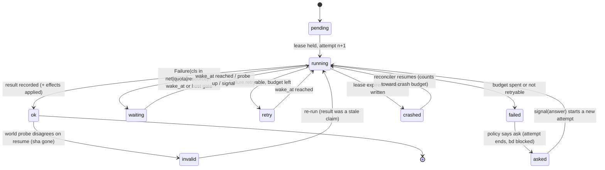
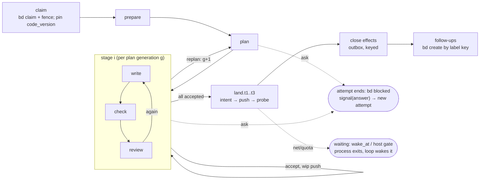

# Durable factory: retries by design (Opus design)

2026-11-02. Brief: `docs/design/durable-factory-brief.md`. Design only; nothing was built or run except read-only queries of the
devbox's own state and `bd list`. Code read: task-loop `/home/iorlas/Workspaces/wt/CRASHCAP` (0.23.301 plus the CRASHCAP commit
`b532d0fb`, the newest engine), cited as `tl/...` for `src/taskloop/...`; delegate `/home/iorlas/Workspaces/wt/UNITYD` (0.55.0 plus wip),
cited as `dg/...` for `src/delegate/...`. Every file:line below was opened for this document; "(unverified)" marks the rest.

## 0. Verdict in ten lines

1. **Adopt nothing.** DBOS was the strongest candidate and fails on three points: it pulls in `psycopg[binary]` and `sqlalchemy` even when it runs on
   SQLite, its own docs say SQLite is not for production, and it recovers only workflows whose application version matches the running code.
   At 69 releases a day, nearly every bead's run would be orphaned. Every other candidate needs a server or Postgres.
2. **Build a small run journal inside task-loop, not a shared shelf package.** The owner suggested a `durable-steps` package that both plugins
   use. I disagree: delegate needs no journal. One delegate call is one activity whose inner retries delegate must *report*, not journal.
   A library that two plugins ship on separate release schedules repeats the drift problem the review already found (T8 in review-synthesis.md).
3. **Most of the five symptoms are classification and policy bugs, not missing durability.** NETPAUSE: a DNS error is not classed as network.
   CRASHCAP: one reason has a cap and the others do not. STALE KeyError: an enum table is not total.
   Only the version hop needs a journal-backed rule (pin the version per run). Slice S0 below fixes four of the five without any journal.
4. **The journal still pays for itself, because we already keep eight partial journals.** They are the checkpoint with its `applied` keys, the
   manifest, parks, pauses, reexec notes, landed, follow-ups and the owner request. They have no shared key, no lock and several writers.
   One SQLite WAL file per host replaces them.
5. **Steps are data, not replayed code.** A run is a table of step ids (`p1/write[2].r1`). Resuming means "the first step id without an `ok` row". No
   determinism rule applies to our Python, and an LLM call is never replayed.
6. **The journal records claims; git and bd confirm them.** Every memoized result that names world state (a sha, a bead id, a pushed ref) is
   checked against git or bd on resume. bd and git win every disagreement, and the journal is repaired to match.
7. **Exactly once = write-ahead intent + probe + natural idempotency key**, for push, PR merge, bd create/close/comment, Dolt push.
8. **One layer owns each failure class.** Today seven layers retry and multiply each other. Delegate owns account, vendor and quota failures; the step
   policy owns engine-visible failures; the loop only schedules `wake_at`. The loop's own counters are deleted.
9. **Human waits end the attempt.** A run never sits as a pending workflow while an ask is open; the answer starts a new attempt that resumes from
   the journal.
10. **Net size:** about 550 new lines, about 1,400 deleted (estimated with `wc` in section 4.4), and three P1 review rows closed as a side effect:
   R9-01 CRASHCAP-2, R9-09 LOOPWAIT and R9-15 CRASHMATRIX.

---

## 1. Failure taxonomy, grounded

### 1.1 What the logs on this box can and cannot say

Most of the incidents in the brief happened on the Mac. The devbox `~/.config/task-loop` cannot reproduce them:

| Source (devbox) | What is there | Counted |
|---|---|---|
| `~/.config/task-loop/traces.jsonl` | 26 rows, all `landed`, bead ids `cg-1`.., worktree `/r` | test fixtures written into the live config (the R9-25 TESTHOME defect); **zero real runs** |
| `~/.config/task-loop/runs/*/manifest.json` | 26: 16 done, 2 failed, 8 `created` for `cg-*` | `tl check` standalone runs and fixtures |
| `~/.config/task-loop/loop/*/` | three empty folders; no `exits.jsonl`, no `died-*.json` | the devbox runs no factory loops (agrees with review-pipe-opus.md:121) |
| `parks/`, `pauses/`, `reexec/`, `checkpoints/` | absent | nothing paused or parked here |
| `~/.config/task-loop/events.jsonl` | 155 rows: 75 close, 51 land, 29 claim | session-driven work, not the loop |
| delegate `~/.claude/plugins/data/iorlas-delegate-iorlas-marketplace/history.jsonl` | 243 rows, 2026-10-29 23:17 to 11-02 21:48 | **159 runs: 158 ok, 1 `secrets`; 84 refusals: 55 `busy`, 29 `no_account`; 0 `network`** |
| `~/.config/agent-runs/runs/*.json` | 159 runs: 158 completed, 1 failed | matches delegate history |
| releases (git log of `0.x.y:` subjects) | 10-26: 20, 10-27: 14, 10-28: 59, 10-29: 40, **10-30: 69**, 10-31: 33, 11-01: 22 | **257 releases in 7 days** |
| `~/.config/task-loop/releases/suite-*.log` | 356 suite logs, 119 on 10-28 alone | the suite runs about 1.4 times per release |
| `bd list --all` (task-loop repo) | 722 beads; **112 (15.5 %) have a retry/pause/crash/resume/stale/lease/fence/park/timeout word in the title** (75 closed, 37 open) | retry handling is a sixth of all filed work |

Mac incidents, as reported in the brief and the reviews (not re-counted here): NETPAUSE (4 beads, 4 loops exited), the schema outage
(review-ops-opus.md:17, :46), the STALE KeyError (review-pipe-fable.md:8-20), CRASHPARK's retry that never stops (review-pipe-opus.md:20, :37), and the hop
that has no cap (review-ops-opus.md:59). **Gap to close first:** nothing collects the Mac's incidents onto the devbox. The journal's `failures` table (section 2.3) is
designed to be shipped (`tl journal export --since`), so the next taxonomy can be counted rather than reconstructed.

### 1.2 NETPAUSE reconstructed from the code

The chain is fully visible in the code, so this is a reconstruction, not a guess:

1. `RealGit.fetch` retries only `RefRace` (`tl/adapters/git.py:13-26`). The classifier has no network class: `classify` knows only index lock,
   pinned, ref race and dirty (`tl/adapters/git_base.py:43-53`). A DNS failure therefore becomes a plain `SlotGitError`.
2. `Checkout.fetch(check=True)` turns that into `FAULT_INFRA` (`tl/app/land/checkout.py:59-67`).

The network path (`PAUSE_NETWORK`, `NetState` probe, `tl/app/loop/net.py:1-37`, `settle.py:78-92`) existed and was correct. The failure was
**classification at the adapter**. Any design that does not move classification to one place will produce NETPAUSE again with `gh`, `bd dolt push` or `uv`.

### 1.3 Seven retry layers today

| # | Layer | Where | What it retries | Its counter |
|---|---|---|---|---|
| L1 | git port | `tl/adapters/git.py:19-26` | fetch on ref race | 5 tries, 0.1 s steps |
| L2 | delegate launch ladder | `dg/app/run.py:166-179`, `:194-212` | network drop before a session (once), schema re-ask (once), canary | per call |
| L3 | engine RetryPlan | `tl/domain/accounts/retry.py:31-39` | 7 rows: invalid_output 1, denied_read 1, denied_secret 1, account_poll 3 (20 s), crash 2 (30/120 s), resume_refused 1, worker_failed 1 then ask | per step, in process |
| L4 | Kind POLICY | `tl/domain/outcome.py:29-36`, `:55-57` | same fingerprint on one bead, 3 times, escalates to ASK_STUCK | across runs |
| L5 | pause table | `tl/domain/accounts/pauses.py:24-81`, `:88-113` | backoff 30-60 s doubling to a cap of 1,800-3,600 s; **only `engine_crash` has `max_attempts` (3)** (`:31`) | `Park.attempts` per reason |
| L6 | loop settle | `tl/app/loop/settle.py:94-121`; knobs `tl/contracts/config.py:136-150` | `pauses_to_rest` 3 then 1 h rest; `fault_cooldown` 1,800 s; `fails_to_stop` 2 then **exit** | in the loop's memory (lost on exit) |
| L7 | land | `config.py:173` `land_optimistic_tries` 2; in-lock STALE has no counter (PIPE-O-01) | gate re-runs | `Land.moved` |

These layers multiply. A delegate `crash` gives L3 3 launches → `FAULT_INFRA` → L4 retries the run 3 times with L6's 30 min cooldown → ASK_STUCK.
That is up to **9 launches and about 1.5 h** before anyone is asked, the factory can stop before the ask is raised.
A transient pause other than `engine_crash` is never capped (L5, the PIPE-O-09 finding).

### 1.4 The taxonomy and its policy

Rules for every row:
- **One classifier.** `classify(exc | stop | rc+stderr, probe) -> Failure(cls, retryable, retry_at, fingerprint)` lives in `tl/domain/failure.py`. Adapters raise
  typed errors; nothing above the adapter matches text.
- **The network class is decided by a probe, not by message text.** Any failed remote operation (git fetch/push/ls-remote, gh, bd dolt push, uv resolve,
  a delegate `network`) runs one `git ls-remote --exit-code origin HEAD` with a 10 s timeout. If the probe fails, the class is `network`, whatever the message says.
- **Wait classes never count toward any cap and never feed the breaker.** The wait classes are network, quota, human and resource.
- The **owner page** is one push message (ntfy, R9-11) plus a row at the top of the dashboard.

| Class | Examples (where raised today) | Retryable | Backoff | Max tries | Who decides | Persisted | Escalates to owner when | Dashboard |
|---|---|---|---|---|---|---|---|---|
| **net**: network/DNS | `git fetch` DNS (`checkout.py:66`), push drop, delegate `network` (`pauses.py:30`) | yes | none per bead; a **host gate** probes every 60 s (`net.py`, kept) | ∞ (does not count) | engine classifies, loop's host gate wakes | `failures` row + run `waiting(net)`; host row `net_down_since` | down for more than 6 h: one page ("offline 6 h") | one host banner "offline since 03:12, N runs waiting", no per-bead red |
| **quota**: rate or plan window (Codex 5 h / weekly) | delegate `rate_limited`, `no_account`, `busy`, `credit_exhausted` | yes, except `credit_exhausted`/`logged_out` | **delegate's `retry_at`**, never our own formula | ∞ (does not count) | **delegate** (account health, window); engine copies `retry_at` | run `waiting(account, wake_at)` | `needs_owner` permanence from delegate (logged out, credit), or week-out (R9-19) | account card from `status --json`; run shows "waits for writer account until 14:05" |
| **crash**: process crash, kill, reboot | SIGKILL, OOM, reboot, lost run (`lost_run`, `pause_killed`) | yes | resume at once after lease expiry (≤ 2 min); on boot, at loop start | 3 *unexplained* crashes of one step id | reconciler (lease + boot_id) | lease row expires; attempt `crashed` | 3 crashes of the same step: page with the step id and the last log row | run tile "resumed after crash ×2 at write[2]" |
| **bug**: engine exception (deterministic) | catch-all `run_once.py:59-60`, `parked_crash` (`tl/app/run/crash.py:14-24`) | **once** (the cause may be environmental) | 60 s | 2 total; the same fingerprint twice parks at once (keeps CRASHCAP's rule, `pauses.py:93-97`) | step policy | `failures` row with traceback | at the 2nd attempt; **breaker**: the same fingerprint on 2 beads quarantines that fingerprint | red "engine bug" with fingerprint and traceback link |
| **stale**: base moved | rebase conflict, gate STALE (`run_once.py:188-202`, PIPE-O-01) | yes | 0 (it is progress, not failure) | 3 STALE per land step, then `FAULT_LAND` (R9-13) | land phase | step attempt rows (`moved` counter) | conflict that the fix round could not solve | "land: main moved 2×" amber |
| **tool**: bd, git (local), dotnet, Unity | `shell.py:51`, `prepare.py:59-64`, `bd` failures, Unity license | depends: `tool_transient` (lock, timeout, exit 124) yes; `tool_broken` no | 30 s → 30 min cap | 3 per step | step policy; the slot set-aside stays the loop's (`settle.py:42-76`) | `failures` row | after 3, or at once for `tool_broken` (missing binary, license) | red with the tool name |
| **worker**: worker nonsense (same failure in a loop) | send-backs, `schema_invalid`, the same red check 3×, replans (`run_once.py:204-214`) | within budget only | 0 (each round is new work) | existing caps: rounds, replans (`cfg.max_replans`), stuck rule | stage logic (unchanged) | step rows per round with result digest | budget spent → ASK_STUCK (unchanged) | progress bar of rounds/replans |
| **human**: asks | ASK_* kinds, WAIT_ASK, OWNER_PARK | n/a | n/a | n/a | owner | attempt **ends**; bd blocked; `signals` row when answered | immediately (it *is* the page) | ask card (unchanged) |
| **resource**: lease (Unity, slots) | `needs:unity`, `resource-*.lock`, slot busy | yes | wait on the lock holder's release; poll 60 s | ∞ while the holder is alive; a dead holder's lock is broken | loop host affinity + lock | run `waiting(resource:unity)` | holder alive for more than 3 h | "waits for unity (held by tl-xyz)" |
| **skew**: version skew | contract skew (`run_once.py:124-128`), profile ahead (`settle.py:126-129`), checkpoint written by a newer schema | no | – | 0 | engine refuses; owner or release fixes | `failures` row | at once | red "skew: delegate contract 3 needed" |

Observed frequency where this box can count it: quota 84 of 243 delegate rows (34.6 %), the largest class by far, already handled well
by delegate's `retry_at`. Worker 1 (`secrets`). Net 0 on the devbox. Skew: the cause, 257 releases in 7 days. The Mac classes (net, bug, crash) are
the brief's incidents, with no count available here.

---

## 2. The model

### 2.1 Run, attempt, step

- **Run**: one bead's journey from claim to close, `run_id` (today's ULID). It spans several **attempts** (a process holding the lease).
  Today `take_up` already counts attempts (`tl/contracts/locator.py:137-150`).
- **Step**: one row of the step table, identified by a **deterministic id built from data**, not by a call counter:

| Step | Id pattern | Result (memoized) | World probe on resume |
|---|---|---|---|
| claim | `claim` | `{fence_gen}` | bd: assignee is us and fence gen equal (`tl/contracts/fence.py`) |
| prepare | `prepare` | `{base_sha, tree}` | worktree HEAD descends from base_sha |
| plan | `p{g}/plan` (g = plan generation, +1 per replan) | `{plan_digest, plan_json}` | none (pure data) |
| write | `p{g}/write[{i}].r{n}` | `{commit_sha, call_ref, tokens}` | `git cat-file -e sha` and sha is an ancestor of HEAD |
| check | `p{g}/check[{i}].r{n}` | `{check_keys[]}` | results cache by full key (content-addressed, already idempotent) |
| review | `p{g}/review[{i}].r{n}` | `{verdict, findings_digest}` | none |
| stage accept | `p{g}/accept[{i}]` | `{wip_sha}` | task branch on origin == wip_sha (ls-remote) |
| land | `land.t{k}` (k = land try) | `{land_sha}` | `land_sha` ancestor of `origin/<base>` |
| close | `close` | effect keys | per effect (section 2.4) |
| follow-ups | `followups` | `{key → bead id}` | bd label `fu:` lookup (`tl/app/land/record.py:54`) |

Replan is a new generation `g`, so ids never collide and old rows stay as history. The cursor is `first id in table(plan) with no ok row`. This is
what `RunOnce.prepare`/`stages` compute by hand today from checkpoint fields (`tl/app/run/run_once.py:141-186`). The 13 `checkpoints.save(` call
sites (counted with grep: planner 3, stages 3, run_once 2, fix_outside 2, fixer, recheck, stage_loop 1 each) are exactly the step boundaries, which makes the strangler
mechanical.

### 2.2 State diagram of one step



And one run, with the code pin and the places a human may stop it:



### 2.3 Journal schema (SQLite WAL, one file per host)

`~/.config/task-loop/factory.db`, `PRAGMA journal_mode=WAL; synchronous=NORMAL; busy_timeout=5000`. Python 3.15 ships SQLite 3.53.1 on the devbox
(checked with `uv run --python 3.15`). Writers: engine (its own run rows), loop (wakes, reconciler), owner verbs and dashboard POST (signals only).
Dashboard GET: `file:factory.db?mode=ro`.

```sql
CREATE TABLE runs (
  run TEXT PRIMARY KEY, bead TEXT NOT NULL, repo_key TEXT NOT NULL,
  code_version TEXT NOT NULL, code_root TEXT NOT NULL, journal_v INTEGER NOT NULL,   -- the pin
  state TEXT NOT NULL CHECK (state IN ('running','waiting','retry','asked','done','failed','stopped')),
  wait_cls TEXT, wake_at REAL, wait_why TEXT,                                         -- timers: one per run
  attempt INTEGER NOT NULL DEFAULT 0, started REAL NOT NULL, ended REAL,
  run_state BLOB,                                                                     -- today's RunState.dump() (checkpoint.py:71-120), msgspec JSON
  rev INTEGER NOT NULL DEFAULT 0                                                      -- CAS: UPDATE ... WHERE rev=?
);
CREATE TABLE leases (
  run TEXT PRIMARY KEY REFERENCES runs, host TEXT, pid INTEGER, boot_id TEXT,
  attempt INTEGER, expires_at REAL, beat_at REAL                                       -- beat every 30 s, expiry +120 s
);
CREATE TABLE steps (                                                                  -- append-only: the journal
  run TEXT, step_id TEXT, attempt INTEGER, seq INTEGER,
  status TEXT CHECK (status IN ('started','ok','retry','waiting','failed','crashed','invalid')),
  t REAL, result TEXT,                                                                -- small JSON: shas, ids, digests, never trees or prompts
  failure_cls TEXT, fingerprint TEXT,
  PRIMARY KEY (run, step_id, attempt, seq)
);
CREATE TABLE effects (                                                                -- the outbox
  key TEXT PRIMARY KEY,                                                               -- natural idempotency key, section 2.4
  run TEXT, step_id TEXT, kind TEXT,
  status TEXT CHECK (status IN ('intent','applied','confirmed','abandoned')),
  intent_t REAL, applied_t REAL, payload TEXT, probe TEXT
);
CREATE TABLE signals (                                                                -- inbox: owner answers, stop, park, note, repin
  id INTEGER PRIMARY KEY, run TEXT, bead TEXT, kind TEXT, payload TEXT, by TEXT, t REAL, taken_t REAL
);
CREATE TABLE failures (                                                               -- the incidents ledger; exportable across hosts
  id INTEGER PRIMARY KEY, t REAL, host TEXT, run TEXT, bead TEXT, step_id TEXT,
  cls TEXT, retryable INTEGER, fingerprint TEXT, detail TEXT, traceback TEXT
);
CREATE TABLE breaker (fingerprint TEXT PRIMARY KEY, beads TEXT, tripped_t REAL, until REAL, paged INTEGER);
CREATE TABLE host (k TEXT PRIMARY KEY, v TEXT);                                       -- net_down_since, clock_high_water
CREATE INDEX runs_wake ON runs(state, wake_at);
CREATE VIEW v_waiting AS SELECT run, bead, wait_cls, wake_at, wait_why FROM runs WHERE state IN ('waiting','retry');
```

What this replaces, file for file: `runs/<run>/manifest.json` (state, heartbeat, attempts) → `runs` + `leases`; `checkpoints/<bead>.json`
(cursor fields `step/stage/rounds/n`, `applied`, `ended`) → `steps` + `effects` + `runs.run_state`; `parks/<bead>.json` (`retry_at`, `attempts`,
`fingerprint`, `tl/contracts/parks.py:15-26`) → `runs.wake_at` + `failures`; `pauses/`, `reexec/`, `runs/<run>/reexec.json`, `pause.json` → gone (pin + wake);
`runs/<run>/owner-request.json` + lock → `signals`; `landed/<bead>.json` → an `effects` row with status `confirmed`.
**Kept as files:** `engine/<run>.jsonl` (verbose, human-readable history; never authority), asks, ADRs, check results, artifacts.

### 2.4 Exactly-once effects

Protocol, the same for every effect: (1) INSERT `effects(key, status='intent', payload)`; if the key exists and is `confirmed`, skip. (2) Run the probe
("did it already happen?"). If yes, mark `confirmed` and skip. (3) Apply. (4) Mark `applied`. (5) Probe again, then mark `confirmed`. A crash anywhere leaves
`intent` or `applied`, and the next attempt goes to (2). The existing interpreter already does steps 1, 3 and 4 with keys `bead/run/kind`
(`tl/domain/interpret.py:35-45`, `tl/domain/effects.py:127-129`). It lacks the probe, and its key is per run, so a new run repeats the effect. The fix is to key by
**what the effect does**, not by who did it:

| Effect | Idempotency key | "Did it already happen?" probe | Natural guard when applying |
|---|---|---|---|
| git push to base (land) | `push:{repo_key}:{base}:{land_tree_sha}` | `git fetch` then `merge-base --is-ancestor {land_sha} origin/{base}`, or a commit on `origin/{base}` whose subject ends `({bead})` and whose tree equals `land_tree_sha` (extends `Landed.already`, `tl/app/land/push.py:45-58`, which needs HEAD's subject today) | `git push --force-with-lease`-free fast-forward; the server refuses a non-ff push |
| wip push (task branch) | `wip:{bead}:{stage}:{sha}` | `git ls-remote origin refs/heads/task/{bead}` == sha | `--force-with-lease=task/{bead}:{expected}` |
| PR merge (`land-stack`) | `merge:{repo}#{pr}:{head_sha}` | `gh pr view {pr} --json state,mergeCommit,headRefOid` → MERGED with that head | `gh pr merge --match-head-commit {head_sha}` |
| bd create (follow-up) | `fu:{bead}:{hash(title+why)}` as a **bd label** (already: `fu.key_label`, `followups.py:54`) | `bd list --label {key} --all` (closed included); an unavailable lookup never creates (`followups.py:58-59`, kept) | none in bd; the label probe *is* the guard |
| bd close | `close:{bead}` (not per run: closing twice is the same fact) | `bd show {bead}` status closed | bd close of a closed bead is a no-op (`interpret.py:5-6` says so) |
| bd block/leave (status) | `status:{bead}:{run}:{to}` | `bd show` status + assignee | fence generation (`tl/contracts/fence.py`) |
| bd comment | `comment:{bead}:{run}:{effect}:{n}`, embedded in the text as `<!-- tl:{key} -->` | `bd comments {bead}` contains the marker | none; the marker is the guard (replaces the 1 h dedupe window `outcome.py:35` for engine comments) |
| Dolt push | `dolt:{repo_key}:{dolt_head}` | `bd dolt` status: remote has head | push is idempotent by content |
| ask raise | `ask:{bead}:{spec_hash}` | `AskStore` row with the same spec hash | per-bead ask lock (kept) |
| delegate call | `call:{run}/{step_id}/{attempt}` passed as `--call-id` (`dg/cli/parser.py:97`) | the stored `call_ref`; resume with `--resume ref` (delegate keeps the ref "whatever the outcome", `dg/app/run.py:148-152`) | a step whose call row is `started` with a ref resumes the thread instead of starting a new one |

Push detail: the land intent row is written **with `land_sha` before the push**. This closes PIPE-O-22 (a crash after the push leaves two truths). After a crash,
the probe answers from the remote and nothing else. If the remote has the commit, the run is LANDED, whatever the Park or EndRec said.

### 2.5 Step API sketch

```python
# tl/app/journal/step.py  (sketch; ~30 lines of the ~550 total)
@dataclass(frozen=True)
class Policy:
    budget: int = 3                       # failures of this step id that count (wait classes never count)
    base_s: float = 30; cap_s: float = 1800
    crash_budget: int = 3                 # lease expiries of this step id
    ask_on_spent: Kind = Kind.ASK_STUCK

def step(name: str, policy: Policy = Policy(), probe: Callable[[Ctx, dict], bool] | None = None):
    def deco(fn: Callable[[Ctx], dict]) -> Callable[[Ctx, str], dict]:
        def run(ctx: Ctx, sid: str) -> dict:
            j = ctx.journal
            if (done := j.ok(ctx.run, sid)) is not None:
                if probe is None or probe(ctx, done):
                    return done                                  # memoized: no replay
                j.mark(ctx.run, sid, "invalid")                  # the world disagrees: git/bd win
            ctx.signals.take_at_boundary()                       # stop/park/repin only between steps
            j.mark(ctx.run, sid, "started")
            try:
                out = fn(ctx)                                    # may call ctx.effect(key, probe, apply)
            except Exception as exc:
                f = classify(exc, ctx.net_probe)                 # the one classifier
                j.fail(ctx.run, sid, f)
                if f.cls in WAIT_CLASSES:
                    raise Wait(f.cls, f.retry_at)                # process exits; runs.wake_at set
                if j.counted(ctx.run, sid) >= policy.budget or not f.retryable:
                    raise Spent(policy.ask_on_spent, f)          # ask or park, attempt ends
                raise Retry(wake_at=ctx.now() + delay(policy, j.counted(ctx.run, sid)))
            j.ok_row(ctx.run, sid, out)
            return out
        return run
    return deco
```

`Wait`, `Retry` and `Spent` end the **attempt**, not the run. The process writes `runs.state/wake_at` and exits. There is no in-process sleep longer than
120 s: L3's 20 s and 30/120 s rests stay in process, and anything longer goes to the timer. The loop picks
`SELECT run FROM runs WHERE state IN ('waiting','retry') AND wake_at <= ?` alongside `bd ready`.

### 2.6 Leases, timers, signals, queries

- **Lease:** one row per run, beaten by the engine's existing beat thread (`run_once.py:77-84`), now one `UPDATE leases SET expires_at=?, beat_at=?
  WHERE run=? AND attempt=?`. A lost row count means fenced, and the process stops writing. That replaces the manifest get-then-put race (`locator.py:104-121`,
  c4 item 4). **Cross-host authority stays bd's claim + fence generation.** The lease is host-local liveness, no more. `boot_id` (Linux
  `/proc/sys/kernel/random/boot_id`; macOS `sysctl kern.boottime`) makes a reboot visible without waiting out the expiry.
- **Timers:** `runs.wake_at` is wall-clock epoch, because it must survive a reboot. **Clock-jump rule:** `host.clock_high_water` records the highest `now` seen. If
  `now < high_water - 300` (the clock went back), no lease is considered expired for one cycle. If `now > high_water + 3600` (a jump forward, or a long sleep),
  wakes are released at most 2 per minute so a laptop opening its lid does not stampede. Within a process, sleeps use `time.monotonic()`.
- **Signals:** one INSERT per owner act (answer, stop, park, note, repin), from `tl` verbs or the dashboard POST. Each write is a single insert, so there is no
  get-then-put (fixes the owner-request part of R-B). The engine takes signals at step boundaries; `stop` is still also delivered as SIGTERM to the
  process group for immediacy.
- **Queries (the read model):** the dashboard and `tl status` read the views. "Why is bead X not moving" is one row of `v_waiting` plus the last
  `failures` row, not a fold over five file families (PIPE-O-29).

### 2.7 Code-version rule for in-flight runs

- **Pin per run at claim:** `runs.code_version`, `code_root`, `journal_v`. The loop always spawns `uv run --script {code_root}/skills/task-loop/tl.py run-task`
  for that run, every attempt. **No mid-run hop:** delete `safe_point` (`tl/app/run/reload.py:68-88`; called at `run_once.py:158`, `:184`,
  `tl/app/write/stage_loop.py:45`), `TL_REEXEC`, `ReloadNote`, the loop's crash-after-exec fallback.
- **Repin only by signal at a step boundary.** `tl rollback`/`bad-versions` or the owner sends `repin`. It is taken only between steps, never inside `land.*` or
  `close`, and only if the new code's `journal_v` reads the run's journal. Otherwise the run finishes on its pin.
- **Retention:** prune and the release keep any `code_root` that a non-terminal run names (the OPS-O-18 cache).
- A pin whose `code_root` vanished (cache wiped) repins to the newest compatible install at the next boundary and logs a `failures` row of class
  `skew`. It does not stop.

This is DQ-04 (delete the hop) done the durable way. The journal makes it safe, because the attempt restarts from data, not from process memory.

### 2.8 Where delegate fits: an activity whose retries are not doubled

| Concern | Owner | Rule |
|---|---|---|
| account choice, vendor network relaunch, schema re-ask, canary | delegate (`dg/app/run.py:166-212`) | stays; **reported** as `attempts: [{outcome, t}]` in the answer (contract 3 → 4 additive field; this is R9-50's `RunResult.attempts`) |
| quota/window, account permanence, `retry_at` | delegate | the engine copies `permanence`/`retry_at` into `Wait(quota, retry_at)` and **never** computes its own backoff for these (delete the delegate-reason rows of `pauses.TABLE`, `pauses.py:25-53`) |
| delegate process died (`crash`) | engine step policy | counts once per launch toward the step budget; L3's `crash` row (2 retries) is removed. The step budget (3) is the one counter |
| schema invalid after delegate's re-ask | engine | one new-thread retry (L3 `invalid_output`) stays, inside the same step budget |
| resume after our own crash | engine | `call_ref` in the step row → `--resume ref`; delegate keeps refs for every outcome |

Rule: **a failure is counted by exactly one layer, the one that classified it.** The engine never retries a delegate `needs_owner`. Delegate never
retries an engine-visible schema failure more than its one re-ask.

### 2.9 What the journal must NOT own

| Fact | Authority | Journal holds only |
|---|---|---|
| bead status, assignee, priority, deps, labels | **bd** | the effect key and its `confirmed` time |
| who may work on a bead across hosts | bd claim + fence generation | nothing (the lease is host-local) |
| the work itself (commits, branches, base) | **git** (local + origin) | shas as claims, re-probed on resume |
| ask text, answers, ADRs | asks store / bd | a `signals` row pointing at the answer |
| account health, quota, sessions | delegate | the `retry_at` it said |
| check pass evidence | results cache keyed by full identity (content-addressed) | check keys |
| profile (`.task-loop.json`) | git at base (R9-32) | the profile digest the run started with |
| transcripts, worker output | vendors / `engine/<run>.jsonl` | nothing |

### 2.10 When durable execution is the wrong abstraction

- **Long human waits.** Temporal/DBOS model an ask as a workflow blocked on a signal for days, holding version and lease. Here the bead's truth
  is "blocked in bd", and the answer may come from another host, or after the code changed 30 times. So an ask **ends** the attempt. Durable signals are
  only for short in-attempt waits.
- **bd and git are the state.** A replay engine trusts its own history. Ours cannot: an owner resets a branch, another host lands, Dolt syncs. A
  journal that claims "write[2] ok sha X" when X is gone is worse than no journal. Hence the probes, and the rule that bd and git always win.
- **The expensive steps are non-deterministic LLM calls.** Re-executing workflow code to rebuild state (Temporal's model) is the wrong
  economics. Memoize results, never replay.
- **Most of today's pain is policy, not durability.** Four of the five named symptoms are fixed by S0 with no journal. If S0 lands and the
  crash matrix is green on today's checkpoints, the journal's remaining value is deletion and one read model. That is real but not urgent. Build the journal for the
  **eight partial journals it deletes**, not for "exactly once" in general.
- **Distributed state is out of scope.** One file per host. The day two hosts must share run state, the answer is bd (or a Dolt table), not a replicated
  journal.

---

## 3. Build vs adopt

Checked 2026-11-02. ✅ = fits; ❌ = does not; ❓ = untested.

| Option | Size / deps | Ops cost on Mac + devbox, no servers | License | Determinism / versioning demand | Python 3.15 + `uv run --script` | Verdict |
|---|---|---|---|---|---|---|
| **Temporal** (self-host; `temporal server start-dev` single binary, SQLite file) | Go server binary + Python SDK (`temporalio`, Rust core) | a server process per host to keep alive, ports, upgrades; dev server "does not emit metrics" (docs.temporal.io) | server MIT (docs); SDK MIT (unverified) | workflow code must be deterministic (sandbox); versioning by `patched()` / worker versioning | SDK wheels for cp315: ❓ | ❌ a server, plus replay economics wrong for LLM steps |
| **Restate** (single binary, embedded storage per secondary source) | Rust server + SDK; handlers are HTTP services | a server per host + we must serve endpoints | **BSL 1.1**, change to Apache 2.0 after 4 years; internal production use allowed (LICENSE fetched) | journaled handlers; code changes need versioned deployments (unverified details) | SDK cp315 ❓ | ❌ a server and an HTTP surface for a CLI tool |
| **DBOS Transact** (library) | `dbos` 3.4.0, MIT, Python ≥3.10; hard deps `psycopg[binary]`, `sqlalchemy[asyncio]`, `croniter`, `pyyaml`, `click`, `python-dateutil` (PyPI JSON) | none (library); SQLite 3.35+ supported **"not recommended for production"** (docs) | MIT core; Enterprise add-on proprietary | "a workflow function must be deterministic"; recovers only workflows "whose version matches the current application version", default = hash of workflow source; patching via `DBOS.patch()`; auto-upgrade is Enterprise | psycopg-binary cp315 wheel ❓; adds ~6 deps to every `uv run --script` cold start | ❌ see below |
| **Inngest** (single binary, SQLite default) | Go binary + SDK; functions served over HTTP | a dev server per host; self-host "no guaranteed support" | fair-source, becomes Apache 2.0 after 3 years | step memoization (closest model to ours), needs an HTTP endpoint | Python SDK ❓ | ❌ server + HTTP |
| **Hatchet** | Go engine + Postgres (third-party source) | Postgres per host | MIT | step DAGs | ❓ | ❌ Postgres |
| **Prefect / Dagster** | API server + DB + UI | heavy; designed for data pipelines | Apache 2.0 | tasks are retried, no exactly-once effects | ❓ | ❌ |
| **Procrastinate / pgqueuer** | Postgres queues | Postgres | MIT/BSD (unverified) | job queue, no step journal | ✅ likely | ❌ Postgres |
| **arq / dramatiq** | Redis (or RabbitMQ) | a broker | MIT / LGPL (unverified) | at-least-once jobs | ✅ likely | ❌ broker |
| **huey** (`SqliteHuey`) | one pure-Python package, SQLite storage | none | MIT | task queue with retries, delays, locks; **no step journal, no effect probes** | ✅ likely (pure Python) ❓ | ❌ solves scheduling, which we have; not resume |
| **APScheduler** | scheduler + SQLAlchemy job store | none | MIT | timers only | ✅ | ❌ timers only |
| **Own SQLite-WAL journal** ("poor man's Temporal": deterministic step ids, no code replay, memoized results, probes) | ~550 lines, stdlib `sqlite3` + msgspec (already a dependency) | none; one file per host; `sqlite3` CLI for debugging | ours | none on our code; ids are data | ✅ stdlib, SQLite 3.53.1 under 3.15 | ✅ |
| **Current JSONL + checkpoints** | ~2,700 lines over 28 files (section 4.4) | none | ours | none | ✅ | ❌ as is: 8 stores, no shared key, multi-writer get-then-put, no probes |

**Why not DBOS, the honest version.** Its step model (memoized step outputs, workflow id as idempotency key, `max_attempts`/`backoff_rate` step
retries, default `max_attempts=3`, `backoff_rate=2.0`) is almost what section 2 describes. It fails on fit, not quality:

- (a) Its recovery is tied to "same code version". Our release rate is the problem, so we would have to pin `application_version` manually, which turns
  off its main safety.
- (b) It recovers by re-running the workflow function and skipping recorded steps. That requires our run's control flow to be a deterministic Python function
  of step outputs. The engine is not that today (`Engine` is a service locator with about 75 mutable fields, review-rewrite-opus.md:93). Making it so *is*
  REWRITE-CORE, and after that rewrite the 550-line journal is the smaller step.
- (c) Postgres client and SQLAlchemy on every cold `uv run --script` of `tl`.
- (d) The SQLite backend is a development mode by the vendor's own words.
- (e) It cannot express "bd and git win": a recorded step output is final.

---

## 4. Migration by strangler slices

### 4.1 What today's engine already gives

- **An effect outbox for close and land.** `plan_close`/`plan_land` are pure (`tl/domain/effects.py:145-164`), the interpreter applies by key
  (`tl/domain/interpret.py:35-45`), and keys persist in `Checkpoint.applied` (`tl/contracts/checkpoint.py:176`). `EndRec` is stored before the first effect
  (`checkpoint.py:123-137`), so a dead close finishes (`run_once.py:65-75`).
- **A durable cursor.** The checkpoint holds `step/stage/rounds/n` (`checkpoint.py:162-180`); `resume.point()` turns it into `(plan, i, state)`
  (`run_once.py:144`). The run's carried state is one typed record (`RunState`, `checkpoint.py:71-120`).
- **Typed outcome policy.** `Kind` is closed (`tl/contracts/kinds.py:9-35`), `POLICY` is one table (`outcome.py:66-90`), pause rules have permanence + backoff
  (`pauses.py`), and parks carry `retry_at` and attempts (`parks.py:15-26`).
- **Partial exactly-once.** `Landed.already` (`push.py:45-58`), follow-up label keys (`followups.py:52-59`), delegate refs kept for every outcome.

So the slices **move** these into one store and add what is missing: probes, the classifier, the pin and the wait-not-exit rule. No logic is invented
twice.

### 4.2 Slices

| S | Slice | Changes | Deletes | Proves it | Size |
|---|---|---|---|---|---|
| **S0** | **Classify, cap, wait** (no journal) | `tl/domain/failure.py` classify + the remote probe; git/gh/bd adapters raise `RemoteUnreachable` when the probe fails → `PAUSE_NETWORK`; `max_attempts` on every transient engine reason (= R9-01); STALE counter (R9-13) | retired exit paths | network-down matrix (4.3) on today's engine | S-M |
| **S1** | **factory.db: runs, leases, signals, failures** | open/migrate module (`tl/stores/factory_db.py`); engine writes `runs`/`leases` *as well as* the manifest (dual write one release); owner verbs and dashboard POST insert `signals`; the engine reads signals instead of `owner-request.json` | `owner-request.json` + its lock (`tl/app/run/requests.py`), after one release | `tl status` and the dashboard show the same state from both sources on a fixture world; signal race test (two POSTs, one engine take) | M |
| **S2** | **Shadow journal of steps** | each of the 13 `checkpoints.save(` sites also writes a `steps` row with the deterministic id; at every resume the cursor is computed from both and a disagreement is logged as a `failures(cls=skew)` row | nothing yet | one week of zero disagreements across both hosts; kill matrix (4.3) on the shadow | M |
| **S3** | **Effects outbox with probes** | `CheckpointLedger` → `EffectsLedger` over `effects`; keys switch to the natural keys of 2.4; land writes the push intent with `land_sha` before the push; comment markers | `Checkpoint.applied`, `ended`/`EndRec`, `landed/<bead>.json`, `ended.py`, `done_memo.py` | kill-after-push test: probe says landed, bead closes LANDED, nothing pushed twice; double close/comment/follow-up count = 1 | M |
| **S4** | **Pin per run** | loop spawns the pinned `code_root`; repin signal at boundaries; prune keeps pinned roots | `reload.py` (124), `release/reexec.py` (76), the reexec part of `loop/run.py`, `TL_REEXEC`, `ReloadNote`, `NetPause` (restore across pause is now journal state) | release mid-run test: run finishes on its pin; bad-version repin happens only at a step boundary and never in land | S-M |
| **S5** | **The loop schedules from wakes** | pick = `bd ready` ∪ `wake_at <= now`; Settle keeps only slot set-aside; dashboard reads the views | `Counters.later/pauses/fails/net_first` (`settle.py:24-33`), `paused()`/`failed()` counting, `parks/`, `pauses.TABLE` delegate rows, `domain/beads/park.py` | loop restarts lose no wake (today `Counters` lives in memory); clock-jump tests | M |
| **S6** | **Checkpoint becomes `runs.run_state`** | `Checkpoints` reads and writes the blob through the journal; cursor from `steps` only | `checkpoints/` JSON, the cursor fields, the second cursor (`resume.py`) | crash matrix green with the checkpoint file removed | M |

Order and gates: S0 now; it is independent and removes the overnight outages. S1-S3 behind R9-33 (one store access path). S4 after S3 (the pin
needs resume from data). S5 and S6 last. Each slice is one announced release.

### 4.3 The tests that prove it

1. **Kill-at-every-step matrix** (R9-15, logic kind with fakes; a real-git subset for land, nightly).
   - Env `TL\_KILLPOINT=<step_id>:<phase>`, where phase ∈ {`after_started`, `inside_effect_before_apply`, `after_apply_before_mark`, `after_ok`}. The journal raises `os._exit(137)` at that point.
   - For every step id of a three-stage fixture plan and every phase: kill, run the reconciler, resume.
   - Assert: (a) the next step id equals the uninterrupted run's; (b) each effect's fake counter is exactly 1 (push, close, comment, create); (c) the final journal, minus
     timestamps, equals the uninterrupted one.
   - About 10 steps × 4 phases = 40 cells, each under 1 s with fakes.
2. **Network-down matrix.**
   - Operations: fetch, push, ls-remote, `gh pr view/merge`, `bd dolt push`, `uv` resolve, delegate `network`.
   - Faults: DNS fail, connection refused, timeout, and, for push and merge only, "dropped after the remote accepted".
   - Assert: class `net`; no cap counted; no breaker row; no loop exit; the run is `waiting(net)`; the host gate holds every claim; after the probe comes up, the
     same bead resumes first. In the "accepted" cells, the probe finds the commit or merge and nothing is applied twice.
   - NETPAUSE becomes one cell: fetch × DNS × 4 beads → 4 `waiting(net)`.
3. **Clock jump.** With a fake wall clock and monotonic clock: +2 h between `wake_at` written and pick (bounded release, 2 per minute); −2 h (no lease declared expired
   that cycle); reboot (new `boot_id`: the lease is reclaimed at once, the attempt is marked `crashed`, the crash budget is charged once).
4. **Budget totality.** A rule test: every `FailureClass` member has a policy row; every transient row has a finite budget or is a wait class. This closes
   CRASHCAP's "only one reason has a cap" class for good (the enum-total rule, R9-14).

### 4.4 Effect on lines (wc of the CRASHCAP worktree)

| Code | Lines (wc) | After | Why |
|---|---|---|---|
| `domain/accounts/pauses.py` | 113 | ~40 | delegate rows go (delegate's `retry_at`); engine rows generated from the class table |
| `domain/accounts/retry.py` | 58 | ~30 | `crash`, `account_poll` rows go (step budget, delegate owns accounts) |
| `app/loop/settle.py` + `verdict.py` | 166 + 101 | ~90 | counters, rest, fails_to_stop gone; slot set-aside stays |
| `app/run/reload.py` + `app/release/reexec.py` + reexec in `app/loop/run.py` | 124 + 76 + ~20 | 0 | pin per run |
| `contracts/parks.py` + `domain/beads/park.py` + `app/asks/parks.py` | 47 + 50 + 66 | ~40 (question count only) | wake and attempts → journal |
| `contracts/locator.py` + `contracts/runlife.py` | 178 + 85 | ~80 | manifest → `runs`/`leases` |
| `app/run/crash.py` | 24 | 0 | classify |
| `app/run/resume.py` + cursor/ledger parts of `app/run/state.py` | 191 + 243 | ~150 | one cursor from `steps` |
| `app/run/ended.py` + `done_memo.py` | 56 + 58 | 0 | `effects` + `runs` |
| **Total touched** | **~1,760** | **~460** | **−1,300** |
| New: `tl/stores/factory_db.py` (schema, CAS, views) ~170; `tl/app/journal/` (step, policy, reconcile, lease) ~200; `tl/domain/failure.py` (classify, probe rule) ~80; effect probes ~100 | | **+550** | |
| **Net** | | | **≈ −750 src lines**, plus the tests of the deleted code |

`domain/effects.py` (160) and `domain/interpret.py` (69) **stay**: they become the outbox's planner and interpreter. This is an estimate from `wc` and reading
the files, not a prototype.

---

## 5. What we rewrite, what stays

**Rewrite:**
- the run cursor (`run_once.prepare/stages`, `resume.py`, checkpoint cursor fields) → the step table + journal;
- every store of run lifecycle (manifest, parks, pauses, reexec, landed, owner request) → `factory.db`;
- classification → one `failure.py` behind typed adapter errors;
- loop scheduling → pick over `bd ready` ∪ wakes;
- the effect ledger → `effects` with natural keys and probes;
- the version hop → pin.

**Stays:** bd as the authority for beads and claims (fence included); git as the authority for work; the stage logic (plan, write, check, review, look,
prompts, send-backs, caps); the land's git choreography (it gets step ids per try, not a rewrite: REWRITE-09 stays a separate decision); the check results cache;
asks, ADRs and the ask lock; `engine/<run>.jsonl` as the verbose log; `effects.py`/`interpret.py`; delegate unchanged except an additive `attempts`
field; the host network gate (`net.py`); the slot set-aside; the dashboard page (it changes its reader, not its views).

**Not this design:** cross-host shared state, a supervisor (R9-10 is still needed: a journal does not restart a dead loop, it only lets the restarted
loop lose nothing), REWRITE-CORE's removal of the service locator. The journal makes CORE safer, but it does not require CORE.

---

## 6. UNSURE: yes/no for Denis

| U | Question | Idea (two sentences) | What changes | Size | Risk | Recommendation |
|---|---|---|---|---|---|---|
| U-01 | Adopt no workflow product, DBOS included? | DBOS is the closest fit, but it brings Postgres/SQLAlchemy deps, a SQLite mode its vendor calls dev-only, and recovery tied to code version, which fights 69 releases a day. A 550-line journal on stdlib sqlite3 gives the same step memoization with probes against bd and git. | nothing is installed; `factory.db` is ours | – | low | **Yes** |
| U-02 | Keep the journal inside task-loop instead of a shared `durable-steps` shelf package? | Delegate's work is one activity per call and needs reporting, not a journal. A library shared by two plugins on separate release schedules repeats T8 drift. | delegate adds only `attempts` to its answer | S | low | **Yes** (revisit if DQ-02 merges the repos) |
| U-03 | Run lifecycle authority moves to SQLite `factory.db` (runs, leases, steps, effects, signals, failures), with asks/ADRs/results staying files? | This answers Q-01/DQ-01 for run state only, where the multi-writer races are (manifest, parks, owner request). One CAS'd row beats eight unlocked JSON files. | ~8 file families gone; `sqlite3` replaces `cat` for those | L (S1-S6) | medium; mitigated by dual-write in S1 and shadow in S2 | **Yes**, after R9-33 |
| U-05 | Pin the code version per run and delete the mid-run hop (repin only by owner signal at a step boundary, never in land)? | The journal lets an attempt restart from data, so a new version can wait for the next bead. It removes `reload`, `reexec` and the crash-after-exec fallback. | a fix released at 10:00 reaches a bead started at 09:00 only after that bead ends | S-M | low after the release train | **Yes** (= DQ-04) |
| U-06 | An ask always ends the attempt (no durable in-process wait for a human)? | bd's "blocked" is the truth, and answers arrive from other hosts and after code changes. A new attempt resumes from the journal. | as today; written down as a rule | – | low | **Yes** |
| U-07 | Network outages never count toward caps, with one page after 6 h offline? | A network failure classified by probe is no bead's fault, and counting it is how NETPAUSE killed the factory. A page after 6 h covers the "box is really cut off" case. | `failures` rows of class net are excluded from every budget | S | low | **Yes** |
| U-08 | Delegate owns quota/account backoff entirely (engine copies `retry_at`, deletes its own delegate-reason rows and L3's `crash`/`account_poll` rows)? | Today two layers back off on the same account reasons with different numbers. One owner, one number. | `pauses.TABLE` loses 29 rows; `retry.py` loses 2 | S | medium: depends on delegate's `retry_at` being present (it is for `busy`, `dg/app/run.py:92-99`) | **Yes** (= DQ-10) |
| U-09 | Embed idempotency markers (`<!-- tl:key -->`) in engine bd comments and probe for them? | Today's dedupe is "same text within an hour" (`outcome.py:35`), which repeats after an hour and drops legitimate repeats. A marker makes "did I already say it" exact. | comments get one hidden line | S | low; markers are visible in raw bd text | **Yes** |
| U-10 | The kill matrix runs on every release (fakes, ~40 cells) and the real-git land subset nightly? | The fake matrix is fast enough to gate a release; real git for land catches the push probe. | `dev/suite.py` gains one test module; a nightly job | S | low | **Yes** |
| U-11 | Per-run hard ceiling: more than 6 counted failures (any class but wait classes) or more than 24 h of active time → owner? | Step budgets bound each step; nothing bounds a run that fails a little everywhere. The ceiling is the last line against an overnight burn. | one check in the step runner | S | low; may park a few long Unity beads | **Yes** |
| U-12 | Ship the `failures` table across hosts (`tl journal export` on the Mac, imported on the devbox) so incidents are countable in one place? | This document could not count the Mac's incidents. An append-only export is a file copy, not shared state. | a verb and a nightly copy over SSH or git | S | low | **Yes** |

Sources (checked 2026-11-02): [DBOS on PyPI (3.4.0, MIT, requires_dist)](https://pypi.org/pypi/dbos/json),
[DBOS workflow tutorial (determinism, workflow ID as idempotency key)](https://docs.dbos.dev/python/tutorials/workflow-tutorial),
[DBOS upgrading workflows (version-matched recovery, patching)](https://docs.dbos.dev/python/tutorials/upgrading-workflows),
[DBOS step tutorial (retries_allowed, max_attempts=3, backoff_rate=2.0)](https://docs.dbos.dev/python/tutorials/step-tutorial),
[DBOS Transact Enterprise (license split; SQLite dev-only per search summary)](https://docs.dbos.dev/explanations/transact-enterprise),
[Restate LICENSE (BSL 1.1)](https://raw.githubusercontent.com/restatedev/restate/main/LICENSE),
[restate dev listing (single binary, embedded storage; secondary)](https://gh.r-mj.com/api-evangelist/restate-dev),
[Temporal dev server (single process, SQLite)](https://docs.temporal.io/develop/run-a-development-server),
[Temporal Python project setup (server MIT)](https://docs.temporal.io/dev-guide/python/project-setup),
[Inngest self-hosting (single binary, SQLite default)](https://www.inngest.com/docs/self-hosting.md),
[Inngest 1.0 announcement (fair-source, Apache after 3 years)](https://inngest.com/blog/inngest-1-0-announcing-self-hosting-support),
[Hatchet review (MIT, Postgres; third-party)](https://aicoolies.com/reviews/hatchet-review). Not verified: Temporal/Restate/Inngest Python SDK
licenses and cp315 wheels, psycopg-binary cp315 wheels, Procrastinate/arq/dramatiq/huey licenses (from memory).
