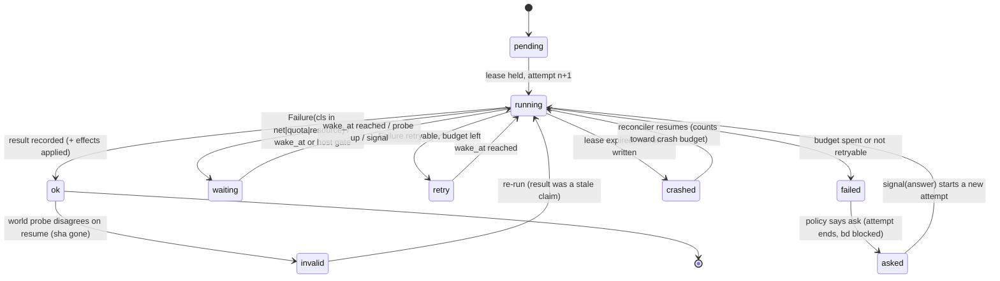
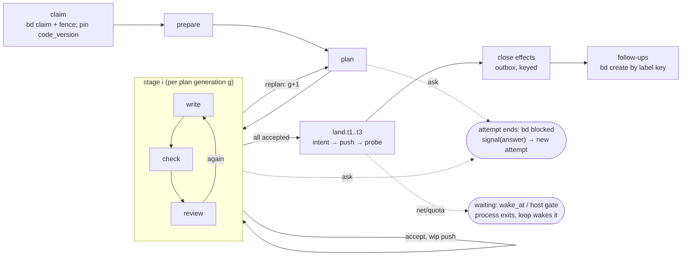

# Durable factory: design verdict (merged from two independent drafts)

Two designers (Fable, Opus) worked independently on `durable-factory-brief.md`. Their full documents follow as Part A (Fable) and
Part B (Opus). Design only: nothing is built until Denis approves. The devbox has no Mac incident logs, so the Mac failures are taken
from beads, commits and the lens reviews (both drafts say so); the code paths are verified.

## Where both agree (treat as the design)
1. **Adopt no server and no library.** Temporal, Restate (BUSL), Inngest (SSPL server), Hatchet (Postgres+Docker), Prefect/Dagster,
   the queue libraries: all refused. DBOS (MIT, Python) is refused as a dependency: SQLite mode is single-process and not for
   production, it pulls psycopg and sqlalchemy, its recovery assumes one code version (the factory ships 30-69 versions a day); it stays
   as an API reference only. This is a ✅ to the owner's prior "no server" and a ❌ to "DBOS-on-SQLite".
2. **Build a small SQLite-WAL journal (~600 lines)**: steps with data-built ids, results memoized and never replayed, a lease with a
   start id, waits with wake rules, signals; bd stays the authority for beads and git for code, and a stored sha or bead id is probed
   against them on resume.
3. **Exactly-once effects by intent row, then probe, then natural key**, for push, PR merge, bd create/close/comment, Dolt push.
4. **Pin the code bundle per run** (the mid-run version hop goes; FREEZEBUNDLE becomes part of the design).
5. **One layer owns each failure class**: delegate owns lane retries (today up to 7 stacked layers multiply; a delegate crash can mean 9
   launches and about 1.5 h before anyone is asked); a worker call is one activity.
6. **Most of the five symptoms are policy bugs, not missing durability** (NETPAUSE: no network class in the fetch classifier;
   CRASHCAP: only engine_crash capped; STALE: a table that is not total). Tests fix them,
   not a journal.

## Where they differ
| Point | Fable (Part A) | Opus (Part B) | Recommendation |
|---|---|---|---|
| First slice | S0 = FREEZEBUNDLE (deletes reload/reexec ~200 lines, then everything else on a pinned bundle) | S0 = policy fixes on today's stores (classify network by probe, cap every transient reason, network faults become waits) | **Do Opus S0 now** (it is the NETPAUSE/CRASHCAP class, small, no store change), FREEZEBUNDLE right after; both are prerequisites of the journal |
| Shared package | a shelf package `durable-steps` possible (U-question) | NO shared package: the journal lives inside task-loop, delegate only adds an `attempts` field | **Opus**: a library shared by two plugins released apart repeats the drift the review found; revisit after one plugin (DQ-02) |
| Stores | one `factory.db` per config dir, dashboard reads `mode=ro` | one `factory.db` per host replacing eight state stores | agree; ties to Q-01/DQ-01 (SQLite, second, after the store layer) |
| Lines | about 2,000 of the 4,173-line retry/park/pause/reexec/lease set deleted, net about -1,000 | about 1,300 deleted, 550 added, net about -750 src | estimate -750 to -1,000; neither is a prototype |

## Order (does not change the release priorities)
S0 policy fixes (classify, cap; in flight as NETPAUSE and CRASHCAP) -> FREEZEBUNDLE -> store layer with CAS (one access
path) -> the journal behind it (`factory.db`) -> steps one at a time (close first, land, check, review, write, plan) -> delete the old
retry/park/pause/reexec code per slice. Proof for every slice: the kill-at-every-step matrix (~40 cells), the network-down matrix, the
clock-jump test. What the journal must NOT own: bead state (bd), code (git), logs (evidence only), human waits (an ask ends the attempt).

## Yes/no questions for Denis
The two drafts each list 12 questions (Part A section 7, Part B section 6); the merged set to answer:
1. Adopt DBOS as a dependency? **No.** (Both drafts.)
2. Build the ~600-line SQLite-WAL journal inside task-loop after the store layer? **Yes, later** (after S0, FREEZEBUNDLE, CAS).
3. A shared shelf package `durable-steps` for task-loop and delegate? **No for now** (revisit after one plugin).
4. Do FREEZEBUNDLE (pin the bundle per run, delete the mid-bead hop) as the first structural step? **Yes.**
5. An offline network is a wait, never a lane exit? **Yes** (S0, in flight).
6. A human ask ends the run attempt (no durable sleep)? **Yes.**
7. Delegate owns all lane retries and permanence; task-loop only waits for retry_at? **Yes.**
8. One `factory.db` per host, the dashboard reads it read-only? **Yes, after CAS** (ties to Q-01).

---

# Part A: Fable draft

# Durable factory: retries designed, not accreted (Fable design)

2026-11-02. Design only. Read: the C4 set, zoom-out, RCA, synthesis, ledger, pipe/simple/fore/rewrite reviews, gate-host; then the code
of task-loop 0.23.299 (`/home/iorlas/Workspaces/wt/C4`, paths below are `src/taskloop/` unless prefixed), the CRASHCAP engine
(`/home/iorlas/Workspaces/wt/CRASHCAP`, commit `b532d0fb`), delegate UNITYD (`/home/iorlas/Workspaces/wt/UNITYD`), the devbox config root
`~/.config/task-loop` and `bd` read-only. Every `file:line` is one I opened; "(unverified)" marks what I did not. Web facts for section 3
come from a search pass today; each carries its source or "(unverified)".

**Verdict in six lines.** Do not adopt DBOS, Restate, Temporal or any queue: every one is either a server, Postgres-first, single-process on
SQLite, or without Python 3.15. Build `durable-steps`: one SQLite file per config dir, five tables, a `step()` memoizer, a lease, a wait
row with a wake rule, and a read-only projection for the dashboard. About 600 lines, stdlib only, shelf package used by task-loop first and
delegate second. The journal records *what happened* (attempts, results, effect receipts, waits); it never owns bead status (bd), code (git),
check evidence (`results/`), or lane truth (delegate). A human wait ends the run; nothing "sleeps" in a workflow for three days. The
prerequisite that pays for itself before any journal: freeze the bundle per run and delete the mid-bead hop.

---

## 0. What the real logs say (and do not say)

The brief asks for counts from `~/.config/task-loop`. On the devbox they are almost all zero. A read-only sweep I delegated (not re-run by
hand; treat the numbers as "delegated count") found: `events.jsonl` 155 rows (close 75, land 51, claim 29, 2026-10-29..11-01); `traces.jsonl`
26 rows, all `landed`, 23 of them releases, 3 test pollution (`cg-*`, repo `/r`); `runs/` 26 manifests (done 16, created 8 = test pollution,
failed 2); `engine/` 18 logs with 2 failed checks; **no** `exits.jsonl`, **no** `parks/`, **no** `pauses/`, **no**
`checkpoints/`, `loop/<key>/` empty. The source would write them at `app/loop/files.py:127` (`runs()/exits.jsonl`),
`contracts/parks.py:43`, `contracts/paths.py` (checkpoints; unverified line). So the unattended loop has never finished a bead on this box:
every failure class the owner names happened on the Mac, whose config root I cannot read from here. Releases are the one thing this box
counts: 224 installed versions 0.23.73..0.23.301 in five days (2026-10-28..11-01), about 56 a day, and `bin/tl` pinned to 0.23.271 while
0.23.301 is installed (delegated count).

The evidence for the taxonomy is therefore: the owner's own incident list (NETPAUSE, CRASHCAP, the STALE KeyError, the
version hop), the commit log (`cff2a794` "KeyError: STALE ended a 70-minute run"; `b532d0fb` CRASHCAP), bead prose (`tl-7y6.2.3`: a 53-bead
schema wave on 22 Oct, a 114-row Grok batch on 24 Oct, a "pause night" of about 500 SIGTERM rows; `tl-9un.11`: 37 lost bead branches in 30
days over 410 runs and 166 beads on the Mac, root cause stale-branch names; `tl-br2.20`: 36 lost runs from two loops, 36 TAKEN rows with an
empty run id), the lens reviews' Mac counts (FORE-OPUS-01: 154/154 runs on one lane; FORE-OPUS-12: 55 `busy` refusals on 11-01;
FORE-OPUS-14: 29 `no_lane` refusals; FORE-OPUS-02: 69 version commits on 10-30), and the code paths that produce each class. I say
"(owner-reported)" where I have only the brief's word.

---

## 1. Failure taxonomy with the policy per class

Legend for "today": the code path that classifies it now. "Policy" is what the durable design does; "Who" is the one decider.

| Class | Today (code) | Observed | Retryable | Backoff | Max tries | Who decides | Persisted (journal) | Escalates to owner when | Dashboard |
|---|---|---|---|---|---|---|---|---|---|
| **1 Network / DNS** | Two paths. A delegate call that stops `(machine, transient, poll)` waits in-process up to 600 s with probes, then yields `PAUSE_NETWORK`, charged to no cap (`domain/lanes/policy.py:27-35`, `:190-198`; `app/run/lane_acts.py:44-62`, `:183-201`); the loop holds all claims and probes every 60 s (`app/loop/settle.py:78-92`, `app/loop/net.py:25-37`, `app/loop/loop.py:187-199`). But `git fetch -q origin` failing is `FAULT_INFRA` (`app/land/checkout.py:66`), which is `retries=3, escalate ASK_STUCK` (`domain/outcome.py:55-57`, `:80`). | 4 beads faulted by one DNS blip, 4 lanes exited (owner-reported). Devbox: 0. | yes | probe-driven: 30 s then NET_BACKOFF while the probe says down; when the probe says up and calls still fail, 30 min doubling to 6 h (keep `policy.py:30-34`) | unbounded while the probe says down; 3 "up-but-failing" stops per 5 min flips to the long pause | engine classifies (one classifier for git, delegate, bd, gh: `transient(text)` is the same rule); the **loop** owns the wait | one `wait(kind=network, wake_on=probe, since)` per repo, not per bead; the run's attempt ends `yielded`; nothing on the bead | after 6 h continuous, or 3 long pauses in a day: one ntfy line; **never** a bead ask | factory banner "network down since HH:MM, probing"; beads unchanged |
| **2 Rate / quota (Codex 5 h, weekly)** | delegate classifies `rate_limited`/`held`/`hung` as `(lane, transient, predicted)` with `retry_at`; engine waits ≤180 s in-process else `PAUSE_LANE` with the time (`policy.py:272-279`); `credit_exhausted`/`logged_out` are `needs_owner` → `PAUSE_LANE` (`policy.py:267-269`, `pauses.py:46-47`); delegate benches a lane 900 s on logout, 1800 s hung, 6 h credit probe (`UNITYD src/delegate/app/settle.py:20-24`); loop wakes the bead when delegate says the role is usable (`settle.py:101-104`). | 154/154 runs on one lane; 55 `busy` and 29 `no_lane` refusals in one day (FORE-OPUS-01/12/14, Mac history.jsonl). Devbox: `snapshots/delegate.status.json` windows `5h`, `week` (delegated count). | yes | none: a timer to the vendor's reset, or to delegate's `back_at` | unbounded; the bead is not charged | **delegate** (lane truth); loop holds claims (quota-aware admission, R9-19) | `wait(kind=lane, wake_at=reset, lane, role)`; attempt `yielded` | every writer lane out → one ntfy; weekly window forecast to hit 100 % before reset → one ntfy at claim time | lane card ring + "held: quota until" on the floor |
| **3 Process crash / kill / reboot** | SIGTERM: `PAUSE_KILLED`, paused, no cap (`app/run/run_once.py:50-53`, `outcome.py:77`); a close ignores a second SIGTERM (`app/run/closer.py:88-89`); the push finishes before a stop (`app/land/push.py:71-85`). SIGKILL/reboot: manifest stays live; the reconciler marks `lost` when heartbeat is stale and the pid gone, **this host only** (`contracts/runlife.py:48-52`, `:62-73`); `lost_run` is transient 60→3600 s with **no cap** (`pauses.py:76`); engine crash (`Exception` in land/close) parks as `ENGINE_CRASH` (`run_once.py:100-106`, `:222-228`; CRASHCAP `app/run/crash.py:14-24`), capped at 3 tries or 2 same-site crashes → needs_owner (CRASHCAP `pauses.py` `max_attempts=3`, `exhausted()`). Crash soon after an exec: the loop falls back once (`app/loop/run.py:79-88`). | 36 lost runs from two loops (tl-br2.20); engine_crash retried hourly forever before CRASHCAP (PIPE-OPUS-03, owner-reported CRASHCAP); "pause night" ~500 SIGTERM rows (tl-7y6.2.3). | yes | none for kill/lost (resume at once on the next pick); crash: 60 s ×2 to 1 h | kill/lost: 3 lost attempts of one run in a row → owner; crash: 3 tries or 2 same fingerprint (keep CRASHCAP) | engine writes attempts; **lease expiry** in the journal replaces the pid+host reconciler; loop resumes | `attempt(run, n, host, pid, start_id, lease_until, ended, reason)`; `step` rows with results; crash fingerprint on the attempt | 3 lost attempts, or the CRASHCAP cap | run row "attempt 3, lost 2×, last at step land" |
| **4 Stale base (main moved)** | push rejected → 3 tries then `FAULT_LAND` (`push.py:86-95`, `app/land/state.py:6`); between stages a conflict gets one fix round then `FAULT_LAND` (`run_once.py:188-202`); a gate that went stale outside the lock crashed the fix round with `KeyError: STALE` until `cff2a794` (0.23.298); the in-lock STALE path has no counter (PIPE-OPUS-01, `app/land/lander.py` unverified here); land counters live in memory (`push.py:89`, `st.pushes`). `FAULT_STALE_BASE` is transient 60→3600 (`pauses.py:60`) **and** a `_fault()` (`outcome.py:83`): two tables, two answers (M-240). | one 70-minute run killed by the KeyError (commit `cff2a794`); push races: not counted anywhere. | yes | none: fetch, rebase, re-gate at once | 3 push races + 1 conflict fix + a land iteration cap of 5 (R9-13), all **per run, in the journal** | engine | `step(land, phase, n)` rows with `pushes`, `moved`, `stale` counters; the GatePass (tree, base) as the step input | any cap → one ask ("main moves faster than this bead lands") | land phase and try counts on the run card |
| **5 Tool fault (bd, git, dotnet, Unity, docker)** | bd unreachable: the fence **fails open** (`contracts/fence.py:87-98`: `peek` None → "" ); `bd sync` after a land is `FAULT_LAND` needs_owner (`app/land/outbound.py:134-150`, `pauses.py:64`), i.e. a Dolt hiccup parks a landed bead; git ref-lock: the port retries (`checkout.py:60`); a missing tool or a Unity timeout surfaces as a red check → fix rounds → replan → `ASK_STUCK`, or `FAULT_BASE_RED` if the base is red (`outcome.py:90`); a required container that is unavailable refuses the check (CHECKIDENT, `app/checks/execution.py` unverified). | bd prose: "design-tests fail when dotnet is not on PATH", "BuildToolTests opening test timed out (180 s)", Unity play-mode runs killed (devbox bead cache, delegated count); `.beads` 203 MB (M-127). | split: **transient** (bd/dolt unreachable, git lock, docker daemon down, Unity license server) yes; **deterministic** (tool missing, red base) no | transient: 30 s, 120 s, 600 s | transient 3 per step; deterministic 0 | the check executor and the bd client classify by exit code + text table, once, in `domain/` | `step` attempt rows with `fault_class`; check receipts stay in `results/` (evidence, full key) | deterministic at once (needs-you); transient after 3 | needs-you row with the tool name and the receipt path |
| **6 Worker nonsense (same-failure loops)** | schema invalid: 1 retry on a new thread; worker failed/timed out: 1 reroute then one `ASK_STUCK` (`domain/lanes/retry.py:29-37`, `policy.py:241-253`); rounds → `max_rounds` → replan → `max_replans` → cap ask (`run_once.py:204-214`); the same FAULT fingerprint 3× on one bead → `ASK_STUCK` (`outcome.py:170-188`); 2 runs ending on a question with the same bead text → capped (`domain/beads/park.py:12`, `:25-40`). | 53-bead schema wave (22 Oct), 114-row Grok batch (24 Oct) (tl-7y6.2.3 prose). | yes, capped | none inside a step; the round/replan caps are the budget | keep today's caps; make the per-fingerprint count **per (step, fingerprint)** and cross-bead | engine | `step` attempts carry `fingerprint`; a `wait(kind=quarantine, fingerprint, until)` per repo | the existing ask; a quarantine → one ntfy | the ask; quarantine banner with the fingerprint and the beads |
| **7 Human wait (asks, parks)** | `ASK_*` blocks the bead in bd, writes `asks/<bead>.json`, the loop skips it until an answer (`outcome.py:69-73`, `app/asks/parks.py:23-29`); `WAIT_ASK` says nothing new; `OWNER_PARK` wakes on the hold's release. | the normal end of a hard bead; not a failure. | no | none | n/a | engine raises; **owner** resolves; bd is the authority | nothing in the journal but the attempt's end `asked(ask_id)`; the run **ends** | it is the escalation | needs-you (exists) |
| **8 Resource lease (Unity, dotnet, slots)** | `WaitWhat.UNITY_SLOT/RESOURCE/EDITOR_LOCK` in-process waits (`contracts/enums.py:112-122`); slot tickets under `slot-take-*.lock`; a slot with 2 instant failures is set aside 12 h (`settle.py:42-76`, M-252 cliff); the engine lock lives in the worktree (`contracts/paths.py:276-281` per c4, unverified here). | Mac load 281 (gate-host); the 12 h set-aside is a capacity cliff (FORE-OPUS-30). | yes | poll 5..30 s in process up to the step's wall budget, then yield with `wake_on=resource` | unbounded; a set-aside is 30/60/120 min with a probe between (R9-56) | loop (admission) and the check executor (lanes) | `reservation(resource, attempt, until)`; `wait(kind=resource, name)` | a resource held > 2 h by one attempt → ntfy | floor view (exists) |
| **9 Version skew** | three hop points: loop between beads (`loop.py:353-369`), engine at a safe point mid-bead (`app/run/reload.py:68-88`, `:102-124`, `run_once.py:158`, `:184`), delegate re-resolved before every call (`app/run/delegation.py` unverified); hand-over by `reexec/<bead>.json` + `TL_REEXEC` (`app/release/reexec.py:54-70`); a crash within 120 s of an exec falls back once and marks the version bad (`reexec.py:16`, `loop/run.py:79-88`); a profile newer than tl exits the loop `EX_CONFIG` and parks the bead (`app/loop/verdict.py:18-24`, `app/loop/take.py:81-86`); delegate contract mismatch is `FAULT_CONTRACT_SKEW` needs_owner (`run_once.py:124-128`); delegate wipes `state.json` on a codec error (M-089). | 224 versions in 5 days, ~56/day; 69 on 10-30; Mac beads run 25-90 min so most span a release (FORE-OPUS-02); `bin/tl` at 0.23.271 vs 0.23.301 now. | only as "move between runs" | none | 1 fallback | **loop** moves; the engine never does; the **attempt pins the bundle** | `attempt.bundle = (tl_dir, tl_version, delegate_dir, delegate_version, contract, profile_commit)`; resume refuses a different bundle | a resumed run whose bundle dir is gone → owner wait with the version to `tl pin`; a version marked bad → ntfy | version column per run and per lane; "bundle missing" in needs-you |

Three cross-class rules the table enforces:

1. **One classifier per fact.** Today the same event has two or three permanences: `FAULT_STALE_BASE` is transient in `pauses.py:60` and
   a retryable fault in `outcome.py:83`; `fault_land` is needs_owner (`pauses.py:64`) while `bd sync` failures that produce it are
   transient by nature; `engine_crash` was "transient, uncapped" until CRASHCAP (`pauses.py:30` before `b532d0fb`). The journal takes one
   `fault_class` enum (`transient | capped | deterministic | owner`) on every attempt end, decided once in `domain/`, and the loop, the close
   and the dashboard read that column. `outcome.POLICY` keeps the bd verb and the trace word; `pauses.TABLE` dies.
2. **Network and quota are factory-level waits, not per-bead pauses.** A DNS blip is one row per repo, with a wake rule; the 4 beads it
   interrupted keep their attempts open with `yielded`, resume with the same run id (that part exists: `app/run/engine.py:153`,
   `reexec.py:37-45`), and no bead gets a label, a comment, a cooldown.
3. **Every cap lives in the journal, none in memory.** `st.pushes`, `c.pauses`, `c.fails`, `slot_quick`, `net_first` (`settle.py:25-34`,
   `push.py:89`) are counters that die with the process and are rebuilt by heuristics; the lost-run streak (tl-br2.20) is a symptom.

---

## 2. The model

A **run** is one bead's attempt to land. It is an ordered list of **steps**; each step is an **activity** with an idempotency key, a result
recorded in an append-only **journal**, a **lease** (owner attempt + heartbeat), and a retry policy from the table above. A new process
resumes by reading the journal: completed steps are skipped (their results are memoized, never recomputed), the first incomplete step
runs again. Nothing replays code; nothing demands determinism from LLM calls.

### 2.1 Steps

| Step | Key (within run) | Input digest | Result stored | Retry policy row |
|---|---|---|---|---|
| `claim` | `claim` | bead id, actor | `{gen, slot, slot_gen}` (the fence Claim, `contracts/fence.py:71-78`) | tool-transient 3 |
| `prepare` | `prepare/<n>` | profile commit, `engine.prepare.cmd`, tree | `{rc, log}` | tool-transient 3 |
| `plan` | `plan/<n>` | brief hash, answer id | `PlanData` (the checkpoint's `plan_data`) | worker (inside delegate), cap `max_replans` |
| `write` | `write/<stage>/<round>` | plan hash, stage i, feedback hash, tree before | writer answer file + tree after (the `done_memo` entry, `app/run/done_memo.py:20-58`) | worker; rounds cap |
| `check` | `check/<stage>/<round>` | tree, base, plan digest, check key | receipt ids in `results/` (evidence stays there) | tool-transient 3; red = next round |
| `review` | `review/<stage>/<round>` | tree, writer family | findings | worker |
| `verify` | `verify` | unchecked items hash | gaps | worker |
| `land` | `land/<n>` (phase sub-rows `fetch, rebase, gate, push, verify`) | GatePass(tree, base) | `{sha}` | 3 races, 1 fix, 5 iterations |
| `close` | `close` | outcome | the `EndRec` (`contracts/checkpoint.py:124-137`) | effects, each keyed |
| `followups` | `effect/file_notes/<FollowKey>` | FollowKey(bead, title) | bead ids filed | effect probe |

The worker-call activity: `write/<stage>/<round>` is **one** activity whose implementation is `WorkerCall` → delegate. Delegate's own ladder
(canary, network retry, schema re-ask: `UNITYD src/delegate/app/run.py:165`; the harness's own 429 reconnects: `src/delegate/contracts/live.py:100`)
runs *inside* the activity and is invisible to the journal except as `attempt.calls += 1` and the delegate `call_id` list. The journal's
retry policy for a worker activity is `max_attempts = 1`: a stopped call either yields (a wait row) or fails the step; it is never retried by
the journal. That removes the doubling the rewrite review names (Q-03: `retry.py` + `policy.py` + `pauses.py` = 490 lines retrying what
delegate already retried). What remains in task-loop is the mapping `Stop → Yield(wait kind) | Fail(class)`, about 60 lines of `policy.py`.

### 2.2 Journal schema (SQLite, WAL, one file `~/.config/task-loop/factory.db`)

```sql
-- every table is append-mostly; "state" columns change only through one CAS update
CREATE TABLE run (
  id TEXT PRIMARY KEY, repo TEXT NOT NULL, bead TEXT NOT NULL, created REAL NOT NULL,
  bundle TEXT NOT NULL,          -- JSON {tl_dir, tl_version, delegate_dir, delegate_version, contract, profile_commit}
  state TEXT NOT NULL,           -- open | landed | done | asked | parked | failed | void
  rev INTEGER NOT NULL DEFAULT 0 -- CAS revision
);
CREATE TABLE attempt (
  run TEXT NOT NULL, n INTEGER NOT NULL, host TEXT, pid INTEGER, start_id TEXT,   -- start_id: boot id + process start time
  lease_until REAL NOT NULL, beat REAL NOT NULL, started REAL NOT NULL, ended REAL,
  end_kind TEXT,                 -- yielded | asked | landed | done | failed | lost | killed
  fault_class TEXT, fingerprint TEXT, reason TEXT,
  PRIMARY KEY (run, n)
);
CREATE TABLE step (
  run TEXT NOT NULL, key TEXT NOT NULL, attempt INTEGER NOT NULL, try INTEGER NOT NULL,
  input_digest TEXT NOT NULL, started REAL NOT NULL, ended REAL,
  status TEXT NOT NULL,          -- running | done | failed | yielded
  result TEXT,                   -- JSON, small; big artefacts are files named here
  fingerprint TEXT, calls INTEGER DEFAULT 0,
  PRIMARY KEY (run, key, try)
);
CREATE TABLE effect (
  key TEXT PRIMARY KEY,          -- bead/run/<name>[/<sub>]  (today's effects.key_of, contracts kept)
  run TEXT NOT NULL, name TEXT NOT NULL, state TEXT NOT NULL,   -- intent | done | probed_done
  intent_at REAL NOT NULL, done_at REAL, receipt TEXT             -- JSON: sha, bead id, comment id, pr number
);
CREATE TABLE wait (
  id INTEGER PRIMARY KEY, repo TEXT NOT NULL, run TEXT, kind TEXT NOT NULL,   -- network | lane | quota | resource | quarantine | owner
  wake_at REAL, wake_on TEXT, facts TEXT, since REAL NOT NULL, cleared REAL
);
CREATE TABLE signal (
  id INTEGER PRIMARY KEY, run TEXT, kind TEXT NOT NULL,   -- stop | park | note | answer
  payload TEXT, at REAL NOT NULL, taken REAL
);
```

What is *not* in it: bead status (bd), the branch and its commits (git), check receipts (`results/`, content-keyed), the engine log
(`engine/<run>.jsonl`, evidence), worker answers (files under `runs/<run>/`), asks' text (`asks/`, bd comments), delegate lanes
(delegate's state). The `effect.key` format is today's `bead/run/name` (`domain/effects.py:127-129`), so the applied-keys list in
`Checkpoint.applied` (`contracts/checkpoint.py:176`) migrates by copy.

### 2.3 Step API (Python sketch, the whole public surface)

```python
class Journal:                                    # one per process, over sqlite3 (WAL, busy_timeout 5 s, BEGIN IMMEDIATE)
    def open_run(self, repo, bead, bundle) -> Run: ...
    def take(self, run_id, host, pid, start_id, lease_s) -> Attempt:   # CAS: no live lease, or lease expired
        ...
    def beat(self, attempt, lease_s) -> None: ...     # raises Fenced when the lease is not ours any more

class Attempt:
    def step(self, key: str, inputs: Mapping, policy: Policy):
        """Decorator-less context: `with att.step("write/2/1", {...}, WORKER) as s:` -> s.result if memoized, else run and s.done(result)."""
    def effect(self, key: str, probe: Callable[[], Receipt | None]) -> EffectGate:
        """`if gate.needed(): receipt = do(); gate.done(receipt)` ; needed() probes the world when state is `intent`."""
    def wait(self, kind, *, wake_at=None, wake_on=None, facts=None) -> NoReturn:   # ends the attempt `yielded`, writes the wait row
    def end(self, kind, *, fault_class=None, fingerprint="", reason="") -> None: ...

@dataclass(frozen=True)
class Policy:
    max_tries: int            # journal-level tries of the step (worker steps: 1)
    rests: tuple[float, ...]  # seconds before try i (last repeats)
    on_exhausted: str         # "fail" | "ask" | "yield"
    classes: Mapping[str, str]  # exception/exit -> fault_class

def resume(journal, run_id) -> Cursor:   # pure over rows: next step key, memoized results, open waits, bundle
def project(journal, *, repo=None) -> ReadModel   # dashboard and `tl status` read this; mode=ro connection
```

Thirty lines of surface; the rest is SQL, the CAS `take`, and the policy table. No decorators that hide the key: the key is explicit at the
call site because keys are the whole design (today's `effects.key_of` already does this right).

### 2.4 State diagram

```mermaid
stateDiagram-v2
    [*] --> open: run created (bundle pinned)
    open --> running: attempt.take (lease)
    running --> running: step done (memoized)
    running --> yielded: wait row (network, lane, quota, resource, quarantine)
    yielded --> running: wake rule true, next pick, same run id, same bundle
    running --> asked: ASK_* (bd blocked, ask filed); run ENDS
    asked --> open: owner answers (new run or resume from journal; new attempt)
    running --> lost: lease expired, no end row
    lost --> running: next pick resumes (attempt n+1), 3 in a row -> parked
    running --> parked: cap hit (crash x3, stale x5, rounds, replans) or deterministic fault
    parked --> open: owner act (tl park --release, fresh, text change)
    running --> landed: effect push done + probe true
    landed --> done: close effects all done (each keyed)
    running --> void: fenced (bead or slot taken by another run); writes nothing more
    done --> [*]
    void --> [*]
```



Two things the diagram says that the engine does not do today: `asked` is terminal for the run (the next run is a new attempt that
resumes from the journal), and `lost` is a lease fact, not a reconciler's inference from pid + host (`contracts/runlife.py:48-52` cannot
see a run of the other host; `start_id` makes a reused pid harmless).

### 2.5 Exactly-once effects

Every external effect is `intent → do → done`, with a **probe** that answers "did it already happen?" when the process died between `do`
and `done`. Today the interpreter writes the key after the effect (`domain/interpret.py:35-46`) and relies on "every effect is safe to
repeat", a docstring (PIPE-FABLE-10). The journal keeps that order but adds the probe, which is what makes "safe to repeat" true.

| Effect | Idempotency key | Probe ("did it happen?") | Today |
|---|---|---|---|
| `git push` (the land) | `bead/run/push/<tree>/<base>` (the GatePass) | `git fetch`, then `git merge-base --is-ancestor <sha> origin/<base>`; `sha` is the commit pinned in the refspec (`app/land/outbound.py:19-24`) and stored in `effect.intent` **before** the push | `Landed.already()` checks the subject ends with `(<bead>)` and ancestry (`app/land/landed.py:45-59`); a wip commit on top defeats the subject test (PIPE-OPUS-22). Storing the sha at intent removes the subject heuristic |
| wip push `task/<bead>` | `bead/run/wip/<stage>` | `git ls-remote origin refs/heads/task/<bead>` equals local head | force-with-lease, idempotent by construction (`outbound.py:104-132`); keep |
| PR merge (`land-stack`) | `bead/run/merge/<pr>` | `gh pr view <pr> --json state,mergeCommit` | `app/land/forge.py` (unverified) |
| `bd close` | `bead/run/close_bead` | `bd show --json`: status closed **and** `metadata.tl_run == run` | `close_as` under the fence (`app/track/verbs.py:69-87`); a close of a closed bead returns rc≠0 today and is logged as "close it by hand" (`app/run/closer_settle.py:72-73`): a false alarm after a crash-between-do-and-mark. Add `set_metadata tl_run` in the same `bd close`/`update` call |
| `bd update` block / leave open | `bead/run/block_bead`, `bead/run/leave_bead` | status + `tl_run` metadata | `block_as` (`verbs.py:96-...`), `leave_open` with `if_assignee` (`closer_settle.py:83`); keep the fence |
| `bd create` (follow-ups, owner-look bead) | `bead/run/file_notes/<FollowKey>` | `bd list --json` filtered by `metadata.tl_key == <FollowKey>` | `FollowKey` dedupe inside the run's `followup_ids` + the durable outbox (`app/run/state.py:200-217`); if bd created the bead and the process died before `keep_filed`, a second bead is filed. The metadata probe closes that |
| bd comment (engine failed/paused, reflect, ask text) | `bead/run/comment/<kind>/<fp>` | `bd show --json` comments with marker `tl:<key>` in the first line | one per (bead, kind, fingerprint) per hour by history (`outcome.py:185-187`); a crash inside the window still duplicates. Marker line makes it exact |
| raise ask | `bead/run/raise_ask` | `asks/<bead>.json` exists with `run == run` | per-bead file under a lock (`contracts/stores.py:252-270` per c4); already exact |
| `bd sync` (dolt push) | `bead/run/bd_sync` | none needed: a push of the same data is a no-op | `outbound.py:134-150`; make its failure **transient** |
| release slot | `bead/run/release_slot/<slot_gen>` | slot bead `held_bead` empty and gen unchanged | `ReleaseSlot(branch, slot_gen)` (`domain/effects.py:77-82`); keep |
| drop checkpoint | gone: the run row's `state` is the fact | – | `DropCheckpoint` last (`effects.py:85-88`) |

### 2.6 Code-version rule for in-flight runs

`run.bundle` is written at `open_run` and never changes. An attempt that would run under another bundle (a newer loop picked the bead)
**refuses** and the loop launches the engine from `bundle.tl_dir` (`uv run --script <bundle.tl_dir>/skills/task-loop/tl.py run-task ...`),
the same way `BeadRun.run(code=...)` already launches the fallback install (`app/loop/run.py:59-66`). The loop moves to a new install only
between its own passes (`loop.py:353-369`, keep). If `bundle.tl_dir` is gone (Claude Code pruned the cache), the run gets `wait(kind=owner,
facts={missing: version})` and the owner either `tl pin`s that version back or `tl run-task --adopt-bundle` re-pins the run to the current
install (one explicit verb, one journal row). Deleted: `app/run/reload.py` (124), `app/release/reexec.py` (76), `reexec/<bead>.json`,
`runs/<run>/reexec.json`, `TL_REEXEC`, the crash-after-exec fallback (`loop/run.py:79-88`), per-call delegate re-resolution. This is
Z05/R2/FREEZEBUNDLE and Q-10; the journal only makes it checkable.

### 2.7 Signals, timers, queries

- **Timers** are `wait.wake_at` for pipeline waits and `retry_at` in asks-owned `park` rows; the loop's idle computes the earliest wake (today `loop.py:270-280` already does this over parks).
- **Signals** are `signal` rows: `stop`, `park`, `note`, `answer`; the engine reads them at step boundaries through `SignalRows`. `answer` is also in bd; the row only tells the loop to pick the bead now.
- **Queries**: the dashboard opens `factory.db?mode=ro` and calls `project()`; it writes nothing (this makes "the dashboard only reads" true
  for run state; its nine POST verbs become `signal` rows or bd writes).

---

## 3. BUILD vs ADOPT

Facts from today's search pass (sources in parentheses; "(unverified)" where the page did not say). The box: one Mac, one Ubuntu container
with no Docker daemon, Python 3.15, no servers wanted, ~5 processes per lane (loop, engine, delegate, worker, checks) and 2-4 lanes.

| Candidate | What it is | License | SQLite / no server? | Python 3.15 | Model | Fits this box? | Verdict |
|---|---|---|---|---|---|---|---|
| **Temporal** self-hosted | server (Go) + UI + Python SDK | MIT server, MIT SDK | `temporal server start-dev` persists with `--db-filename`; docs: "not intended for production" (docs.temporal.io/cli/server) | SDK `temporalio` 1.35.0 classifiers 3.10-3.14; 3.15 not listed (PyPI) | code replay in a sandbox; deterministic workflow code required; non-deterministic calls raise (docs sdk sandbox) | a 45 MB server + UI process per host, a dev-mode DB, and workflow code that must be deterministic while our steps are LLM calls and git. No. | ❌ |
| **Restate** | single Rust binary + Python SDK | server **BUSL-1.1** (Apache after 4 y), SDK MIT (github LICENSE) | yes: embedded RocksDB | SDK 1.2.0 "we now support Python 3.15" (release notes) | journal replay; `ctx.run` memoizes; handler code must be deterministic; `ctx.sleep` durable | the best server-shaped option: one 41-49 MB binary, no DB. Still a server with its own state next to bd and git, BUSL, and replay-style determinism on handler code. | ❌ (closest runner-up) |
| **DBOS Transact** (`dbos`) | in-process library | MIT | Postgres or SQLite; SQLite is the default when no URL is set (docs); added in 1.13.0 (releases) | 3.4.0 classifiers 3.10-3.14, 3.15 not listed (PyPI); 3.5.0a5 unchecked | memoized steps; workflow must re-call the same steps with the same inputs or `DBOSStepNondeterminismError`; recovery re-runs pending workflows **in the restarting process**; workflows are tagged with an app version and a different version does not recover them (docs recovery) | SQLite mode: polling only (`use_listen_notify` ignored), "no concurrent writes from multiple processes", "not suitable for production" (mirror of the integrations page, wording unverified verbatim), queues on SQLite undocumented, `DBOS.migrate` unsupported. Our run spans **two processes and two versions** (loop → engine child, exec hops) and a workflow that "sleeps" for a human is exactly what DBOS `recv` is for and exactly what section 6 says we must not do. | ❌ for this factory; ✅ as the reference for the API shape (step memo, workflow id = idempotency key, `send/recv` with an idempotency key) |
| **Inngest** | Go server (single binary) + SDK | server **SSPL-1.0** (+Apache grant after 3 y), SDK Apache-2.0 | yes: SQLite + in-memory Redis with snapshots, single node | SDK classifiers 3.10-3.13 | step memoization; the server re-invokes your HTTP function per step | our app would have to expose HTTP or run a `connect()` worker; a server; SSPL | ❌ |
| **Hatchet** | server + Postgres | MIT | **no**: Postgres required; hatchet-lite is a Docker image | SDK requires >=3.10, no classifiers | task/DAG with durable tasks | Docker + Postgres on a box with no Docker daemon | ❌ |
| **Prefect 3** | orchestration API server + UI (ephemeral mode exists) | Apache-2.0 | SQLite default "for lightweight, single-server" | `>=3.11,<3.16`, classifiers to 3.15 | tasks with retries and result caching; not resume-from-journal of a half-done flow in another process | a 100+-dependency framework and an API process to get retries we already have; no journal-resume across process death without its server | ❌ |
| **Dagster** | asset orchestrator: webserver + daemon + code server | Apache-2.0 | SQLite default | `>=3.10,<3.15` — **no 3.15** | data assets, not steps with leases | wrong shape and wrong Python | ❌ |
| **Procrastinate / pgqueuer** | Postgres job queues | MIT | no | pgqueuer to 3.15; procrastinate no classifiers | queue, retries; no multi-step resume | Postgres | ❌ |
| **arq / dramatiq** | Redis (arq, maintenance mode) / Redis-RabbitMQ (dramatiq, LGPL-3.0) | MIT / LGPL | no | 3.14 max | queue only | Redis | ❌ |
| **huey** | task queue, SQLite backend built in | MIT | **yes** | no classifiers (`Python :: 3` only) | retries, delay, cron, pipelines; **no** durable resume of a multi-step job; one consumer process | would give us a timer and a queue, not a journal; we have the loop for that | ❌ |
| **APScheduler** | scheduler | MIT | 3.x SQLAlchemy jobstore | 3.11.3 to 3.14; 4.0 still alpha since 2025-04 | timers only | timers are one column | ❌ |
| **python-durable / pyergon / duron** | one-author "poor man's durable" libraries, 2026 | MIT / Apache-or-MIT | aiosqlite / `SqliteExecutionLog` | >=3.12 / 3.11-3.12 | step memoization, signals, retries | alpha, bus factor 1, async-first, 48 % coverage (pyergon's own page) | ❌ (read for ideas) |
| **SQLite-WAL + own ~600-line journal** ("poor man's Temporal": explicit step keys, memoized results, no code replay, lease + waits + effect receipts) | shelf package `durable-steps` | ours | yes: stdlib `sqlite3`; 3.15 changes nothing relevant (whatsnew: API cleanups only; `autocommit` default unchanged) | yes | the model in section 2 | one file, every process on the box opens it (WAL handles N readers + 1 writer with `busy_timeout`), the dashboard `mode=ro`, two hosts never share it (they share git and bd) | ✅ **build** |
| **Today: JSONL + checkpoints + 15 file families** | – | – | – | – | `Checkpoint.applied` + `interpret` (keyed effects, `domain/interpret.py`), `done_memo` (call memo), `Park.retry_at`, manifest heartbeat + reconciler, parks/pauses/reexec/landed/net-pause files, in-memory loop counters | it already has 60 % of the semantics and 0 % of the atomicity: six manifest writers with get-then-put (`contracts/locator.py:104-121`), unlocked parks (`contracts/parks.py:42-46`), counters in memory, three permanence tables | ❌ as the end state; ✅ as the migration source (section 4) |

Why not DBOS, said plainly, since it was the owner's one candidate: DBOS's recovery model assumes the process that restarts is the process
that owns the pending workflows and runs the same code version; its SQLite mode is single-process by the vendor's own words and
Postgres-recommended for production; it has no 3.15 classifier; and its workflow function would have to be the whole run (claim → close)
written as straight-line Python that re-invokes the same steps with the same inputs, which is the determinism requirement we cannot meet
once a replan changes the step list. What DBOS does well (step memo, workflow id as idempotency key, durable `send/recv`) is 150 lines
over `sqlite3`. The cost of owning those 600 lines is one shelf package with a kill matrix; the cost of DBOS is a dependency at every worker
call plus a model mismatch we would code around in task-loop anyway.

---

## 4. Migration by strangler slices

What the engine already gives: keyed close/land effects with an applied list (`domain/effects.py`, `domain/interpret.py`,
`contracts/checkpoint.py:176`); a step cursor (`app/run/stages.py:77-106`, `Checkpoint.step/stage/rounds/n`); a worker-call memo keyed by
call identity (`app/run/done_memo.py`); a run manifest with heartbeat/pid/host and one terminal state (`contracts/run.py:194-220`,
`contracts/locator.py:139-178`); a `Park` with `retry_at` and per-reason attempts (`contracts/parks.py:15-25`); the net-pause and reexec
notes that resume the same run id (`app/run/engine.py:149-159`). Each slice moves one of these into the journal and deletes its file family;
paths and record bytes of everything *not* moved stay identical.

| Slice | What moves | Deletes (file, lines, from `wc -l` on C4) | Test that proves it | Risk |
|---|---|---|---|---|
| **S0 prerequisite: FREEZEBUNDLE** (no journal yet) | bundle pinned in the manifest; engine launched from the bundle dir; mid-bead hop gone | `app/run/reload.py` 124, `app/release/reexec.py` 76, `loop/run.py:79-88` ~10, `engine_lock.py` TL_REEXEC hand-over ~12 (unverified lines), per-call `delegation.route` ~15 → **~235** | a release during a run: the run finishes on its bundle; the next bead runs on the new one; a pruned bundle dir yields an owner wait | low; one week of "a fix waits for the bead" |
| **S1 `durable-steps` package + effects** | `effect` table replaces `Checkpoint.applied` + `CheckpointLedger`; probes added for push, close, create, comment | `domain/interpret.py` 69 → 0 (the package), `Checkpoints.applied/mark_applied` ~15 (`app/run/state.py:166-174`), `landed.already` subject heuristic ~10 → **~90** | **kill-at-every-effect**: kill between `do` and `done` for each of 14 effects; rerun; assert one push, one close, one bead, one comment (the PIPE-FABLE-10 table test) | low: same keys, one more column |
| **S2 attempts + leases** | `attempt` rows replace manifest `state/heartbeat/pid/host/attempts`; lease expiry replaces `runlife.is_lost`; `mark_lost` writers (loop start, `tl wait`, `tl doctor`, `tl report`, owner requests) become readers | `contracts/runlife.py` 73, `contracts/locator.py:104-178` ~75 (writes), `app/reconcile/lost.py` 30, `leases.py` 20, `loopwatch.py` 15 → **~210** | **kill-at-every-step** (`dev/killpoints.py`, procsim, SIGKILL at each `step.started` and each `step.done`): the next process resumes at the same key with the same memoized results; a run of host A is not "lost" by host B; a reused pid with a new `start_id` is lost | medium: six writers become one |
| **S3 park rows and waits replace files** | asks-owned `park` rows; pipeline `wait` rows with wake rules; `fault_class` on attempt end | `contracts/parks.py` 46, `app/asks/parks.py` 66, `domain/lanes/pauses.py` 104 (table → 12 rows ~30 kept), `domain/beads/park.py` 50 (keep `HARD_AT` ~15), `app/loop/net.py` 37, `settle.py` 166 → ~50, `reexec.net_pause_*` ~20, `app/run/waits.py` 146 → ~40 → **~560** | **network-down matrix**: at every step, the git port and the delegate fake fail with `Could not resolve host` N times then succeed; assert one `wait(network)` row per repo, zero `FAULT_*`, same run id, no bead label/comment/cooldown; **clock-jump**: wall clock +7 d and −1 h between attempts: no wait fires early (wake uses wall time written at intent + a monotonic guard inside a process), no lease is marked lost on a backward jump (lease compares `beat`, not elapsed) | medium: the loop's pick reads one query instead of per-bead park files (`loop.py:255-268`) |
| **S4 step cursor + memo** | `step` rows replace `Checkpoint.step/stage/rounds/n/progress` and `done_memo`; `resume.py` becomes a projection over rows | `app/run/resume.py` 191 → ~60, `app/run/ended.py` 56, `app/run/done_memo.py` 58, `app/run/state.py` 243 → ~80, `contracts/checkpoint.py` 180 → ~90 (RunState stays, it is the run's carried state) → **~400** | replay corpus: the last 30 landed runs' engine logs projected to the same cursor the old `select_step` chose (golden) | medium-high: the engine's resume |
| **S5 worker retries to delegate** (Q-03) | task-loop keeps `Stop → Yield | Fail`; delegate owns lane retries and reports `attempts` | `domain/lanes/policy.py` 329 → ~80, `retry.py` 58, `lane_acts.py` 201 → ~70, `worker_recovery.py` 93 → ~30 → **~500** | the delegate fake returns each stop tuple once; assert one journal attempt per step and the right wait kind; the network-stop-with-data case (RESUME, `e4bea1f5`) still returns the answer | medium: two repos, one release |
| **S6 loop settle pure** | `settle(verdict, journal) → Continue \| Sleep \| Exit` over queries | `Counters` and the rest of `settle.py`, `loop/verdict.py` fields that mirror the journal ~40 → **~80** | REWRITE-10's counted test: one bd ready + one journal query per tick | low |
| **S7 delegate adopts the package** (optional, after DQ-02) | delegate's `Lease`, `history.jsonl` fold, `holds` with ends | delegate `app/lease.py`, parts of `app/settle.py` (unverified sizes) | the same kill matrix on a worker call | low |

Totals (est.): the modules in the retry/park/pause/reexec/lease set sum to **4,173 lines** on C4 (`wc -l`, section 0 list); the
slices delete about **2,000** of them and add the package (**~600**) plus glue (**~400**), so task-loop ends about **−1,000 lines** with one
store instead of nine file families for run state. Tests move with each slice (Q-04 rule: a slice must not grow the test line count).

Three tests are the gate for the whole thing, run nightly after S2:

1. **Kill-at-every-step matrix** (`dev/killpoints.py`): for each `(step key, before|after done)` point and each of the 14 effects, SIGKILL the
   engine there, rerun, diff the world (git refs, bd state via a fake, journal rows): exactly one of each effect, the same next step, no
   duplicate bead, no duplicate push.
2. **Network-down matrix**: for each step, inject `Could not resolve host` on every outbound call for N calls; assert the single
   `wait(network)` row, the resume on the same run id, zero `FAULT_*`; then the "probe says up, calls fail" variant assert the
   30-min pause and one ntfy.
3. **Clock jump**: `TL\_CLOCK\_OFFSET` ±7 d between attempts and inside one attempt; assert no early wake, no false lost, no cap double-count.

---

## 5. What is rewritten, what stays

| Rewritten | Stays as is |
|---|---|
| run state: manifest state fields, parks, pauses, net-pause, reexec, landed receipt, checkpoint cursor and applied keys → `factory.db` | `RunState` (the carried plan/round state, `contracts/checkpoint.py:71-121`) as the `step` result payload |
| the three permanence tables (`outcome.POLICY` rows that are not bd/trace words, `pauses.TABLE`, delegate's reasons duplicated in `policy.py`) → one `fault_class` enum decided in `domain/` | `outcome.POLICY`'s bd verb, trace word, label, `makes_ask` (`outcome.py:40-92`) |
| the reconciler (pid + host + heartbeat) → lease expiry with `start_id` | the engine log `engine/<run>.jsonl` (evidence) and `traces.jsonl` (projection, REWRITE-05) |
| in-memory loop counters → journal queries | the loop's pick order, queue rules, slot pool, area locks |
| the mid-bead hop → bundle pinned per run | `tl pin`, `rollback`, `bad-versions.json` (applied at `open_run`) |
| `interpret` + `CheckpointLedger` → `effect` gate with probes | `effects.plan_close`, `plan_land`, the `key_of` format |
| `lanes/policy.py` retries → delegate's ladder; task-loop keeps `Stop → Yield \| Fail` | delegate's classifier and breaker (`dg classify.py`, `HealthLedger`) |
| `runs/<run>/owner-request.json` → `signal` rows | asks (`asks/`, bd blocked status), ADRs, the dashboard's answer path |
| the dashboard's run readers (`readers/records.py`, manifests, parks, net pauses) → `project()` over `mode=ro` | the dashboard page, bd reads, lane cards from delegate's status |

---

## 6. When durable execution is the wrong abstraction here (be harsh)

1. **The run is not the unit of truth; the bead is.** A bead's status lives in bd and is written by people, the dashboard, two machines and
   the engine. A journal that "owns" the bead's state becomes a second truth and the reconciliation code we have now (fence generations,
   `if_assignee` guards, `closeguard`) stays. So the journal never holds bead status; it holds *receipts* of bd writes with a probe.
   PIPE-OPUS-22 ("two truths after a crash past the push") is what happens when the checkpoint thinks it owns "landed": git owns it.
2. **Human waits are not sleeps.** A Temporal/DBOS workflow that `await`s an owner answer for three days is a process-shaped lie: the
   process dies, the version moves, the bead text changes, the owner parks it. The right shape is what the engine already does by accident:
   the run ends `asked`, bd is blocked, and a *new* attempt resumes from the journal when the answer arrives. "Durable sleep" is a wait
   row with a wake rule and nothing running. Any design that keeps a step "in progress" across an ask is wrong for this factory.
3. **Replay is wrong for LLM steps.** Temporal and Restate replay handler code and need it deterministic. Our steps are a planner answer,
   a writer's edits, a reviewer's findings: re-running them yields different results. Only memoization fits (DBOS/Inngest shape), and
   memoization needs the input digest to be honest: `write/<stage>/<round>` keyed by plan hash + feedback hash + tree, which `done_memo`
   already gets right (`app/run/done_memo.py:28-35`).
4. **Git is the state, not a side effect.** The worktree after a write round *is* the result; a journal cannot store it and should not try.
   The step result is `(tree sha, answer file)`; resume checks the tree is still there (today's `missing_stage` rule, `app/run/decide.py`
   `World.missing_stage`). A crashed slot with a dirty tree is a git problem the journal only names.
5. **Two hosts, one remote, no shared journal.** The Mac and the devbox share git and bd, not a file. Cross-host facts (another machine ran
   this bead: `outbound.py:126-128`; claims per machine: Z06) are resolved through bd and git, never through the journal. A journal per
   config dir is the honest scope; anyone who wants one journal for both boxes is asking for Postgres, and then for a server.
6. **Retries at two layers multiply cost.** Delegate retries a call (canary, network, schema) and task-loop retries the step and the loop
   retries the bead. A durable layer that adds a fourth retry policy "because the framework has one" is a regression. Hence worker steps
   have `max_tries = 1` at the journal level and the table in section 1 names one decider per class.
7. **Determinism of our own code is the cheap part.** The KeyError (`cff2a794`), the uncapped engine_crash (CRASHCAP) and the in-lock STALE
   loop (PIPE-OPUS-01) are bugs no journal prevents; the kill matrix and the enum-total rule test (R9-14) do. The journal makes each of them
   *visible* (an attempt row with a fingerprint and a count) and *bounded* (a cap column). That is the whole promise: not fewer bugs, fewer
   nights lost to one.

**What the journal must NOT own:** bead status and assignee (bd); branch heads, commits, the land sha as truth (git; the journal keeps the
receipt); check evidence and the base-red cache (`results/`, content-keyed, shared by push judge and land); lane state, holds, quota
windows (delegate); the owner's answers and ADRs (asks store, bd comments); worker transcripts and answers (files); the engine log; the
profile (`.task-loop.json` at the base commit). It owns: runs, attempts, step results (small), effect receipts, waits, signals, the bundle.

---

## 7. UNSURE: yes/no for Denis

| Q | Question | Idea in two sentences | What changes | Size | Risk | Recommendation |
|---|---|---|---|---|---|---|
| U-01 | Adopt DBOS-on-SQLite instead of building? | DBOS gives step memo and idempotent workflow ids in-process over SQLite. Its SQLite mode is single-process, Postgres-recommended, and recovery assumes one process and one code version. | nothing built; task-loop wraps its run in a DBOS workflow; every worker call imports dbos | M to adopt, L to fit the loop→engine process split | high: model mismatch at exec hops and asks; no 3.15 classifier | **No** |
| U-02 | Freeze the bundle per run and delete the mid-bead hop first (S0), before any journal? | A run finishes on the install that started it; only the loop moves, between beads. Cuts ~235 lines and the incident class the owner calls "version hop mid-bead". | `reload.py`, `reexec.py`, TL_REEXEC, the fallback go; a fix waits for the bead | S | low (a 2 h release train, R9-16, makes the wait short) | **Yes, first** |
| U-03 | One `factory.db` per config dir, opened by every tl process and read-only by the dashboard? | SQLite WAL with `busy_timeout` handles N readers and a short writer; the dashboard uses `mode=ro`. You lose `cat` on run state and gain `tl journal <run>` that prints the rows. | nine file families become five tables; `tl journal`, `tl doctor --db` added | M | medium: a corrupt DB stops every lane (mitigated by nightly `.backup` next to the bd backup) | **Yes** |
| U-05 | A human wait ends the run (no in-progress step across an ask)? | `asked` is terminal for the attempt; the answer starts a new attempt that resumes from the journal. This is the engine's behaviour today formalised, and it rules out any "durable sleep" library. | `WAIT_ASK` rows become a query; nothing sleeps | S | low | **Yes** |
| U-06 | Add `tl_run` / `tl_key` metadata on every engine bd write (close, block, create, comment marker) so effect probes are exact? | Idempotency probes need a marker the engine wrote, not a subject line or a dedupe window. bd metadata and a first-line marker on comments give it. | `verbs.close_as`, `block_as`, `FileNotes`, `comment` gain one field | S | low; bd rules on reason length unchanged | **Yes** |
| U-07 | Delegate owns every lane retry; task-loop's journal has `max_tries=1` for worker steps (Q-03)? | Two retry layers multiply one failure's cost. Delegate reports `attempts` and `call_ids`; task-loop maps a stop to a wait or a fail. | `policy.py` 329 → ~80, `retry.py` gone, `lane_acts.py` 201 → ~70; delegate `RunResult.attempts` | M (two repos) | medium | **Yes**, same release as S5 |
| U-08 | `durable-steps` lives in shelf and is vendored by both plugins (not a task-loop-only module)? | One journal shape for delegate's lease/history later; one kill matrix. Until DQ-02 (one plugin) it is one more vendored copy to keep equal. | `_vendor/durable_steps` in both; a rule test holds the hashes equal | S | low | **Yes** |
| U-09 | Keep `engine/<run>.jsonl` and `traces.jsonl` as evidence/projection and never as authority (REWRITE-05)? | The journal is small rows; logs stay files. `tl report`, reflect, the dashboard read projections. | nothing deleted now; the rule is written into the package docstring and a rule test (no reader of a log decides a transition) | S | low | **Yes** |
| U-10 | Network and quota as repo-level waits (one row), not per-bead pauses? | NETPAUSE was one blip turned into four bead faults. One wait row holds claims; beads keep their attempts `yielded` and resume in order (`net_first` becomes a query). | `settle.network`, `net.py`, `NetPause` files | S | low | **Yes** |
| U-11 | Resume refuses a different bundle unless the owner `--adopt-bundle`s? | The safe default is "finish on what you started on"; a missing bundle dir is an owner wait with the version named. The alternative (auto-adopt newest) is the hop again. | `tl run-task --adopt-bundle`, `wait(kind=owner, facts)` | S | low | **Yes** |
| U-12 | Lease liveness by `(host, pid, start_id, lease_until)` instead of pid + heartbeat age + host match? | Today a run of the other host is never lost and a reused pid resurrects a run. A lease with an expiry and a boot-unique `start_id` is the standard answer and lets `mark_lost` writers become readers. | `runlife.py`, `locator.mark_lost`, 5 reconciler call sites | S | low | **Yes** |


---

# Part B: Opus draft

# Durable factory: retries by design (Opus design)

2026-11-02. Brief: `docs/design/durable-factory-brief.md`. Design only; nothing was built or run except read-only queries of the
devbox's own state and `bd list`. Code read: task-loop `/home/iorlas/Workspaces/wt/CRASHCAP` (0.23.301 plus the CRASHCAP commit
`b532d0fb`, the newest engine), cited as `tl/...` for `src/taskloop/...`; delegate `/home/iorlas/Workspaces/wt/UNITYD` (0.55.0 plus wip),
cited as `dg/...` for `src/delegate/...`. Every file:line below was opened for this document; "(unverified)" marks the rest.

## 0. Verdict in ten lines

1. **Adopt nothing.** DBOS was the strongest candidate and fails on three points: it pulls in `psycopg[binary]` and `sqlalchemy` even when it runs on
   SQLite, its own docs say SQLite is not for production, and it recovers only workflows whose application version matches the running code.
   At 69 releases a day, nearly every bead's run would be orphaned. Every other candidate needs a server or Postgres.
2. **Build a small run journal inside task-loop, not a shared shelf package.** The owner suggested a `durable-steps` package that both plugins
   use. I disagree: delegate needs no journal. One delegate call is one activity whose inner retries delegate must *report*, not journal.
   A library that two plugins ship on separate release schedules repeats the drift problem the review already found (T8 in review-synthesis.md).
3. **Most of the five symptoms are classification and policy bugs, not missing durability.** NETPAUSE: a DNS error is not classed as network.
   CRASHCAP: one reason has a cap and the others do not. STALE KeyError: an enum table is not total.
   Only the version hop needs a journal-backed rule (pin the version per run). Slice S0 below fixes four of the five without any journal.
4. **The journal still pays for itself, because we already keep eight partial journals.** They are the checkpoint with its `applied` keys, the
   manifest, parks, pauses, reexec notes, landed, follow-ups and the owner request. They have no shared key, no lock and several writers.
   One SQLite WAL file per host replaces them.
5. **Steps are data, not replayed code.** A run is a table of step ids (`p1/write[2].r1`). Resuming means "the first step id without an `ok` row". No
   determinism rule applies to our Python, and an LLM call is never replayed.
6. **The journal records claims; git and bd confirm them.** Every memoized result that names world state (a sha, a bead id, a pushed ref) is
   checked against git or bd on resume. bd and git win every disagreement, and the journal is repaired to match.
7. **Exactly once = write-ahead intent + probe + natural idempotency key**, for push, PR merge, bd create/close/comment, Dolt push.
8. **One layer owns each failure class.** Today seven layers retry and multiply each other. Delegate owns lane, vendor and quota failures; the step
   policy owns engine-visible failures; the loop only schedules `wake_at`. The loop's own counters are deleted.
9. **Human waits end the attempt.** A run never sits as a pending workflow while an ask is open; the answer starts a new attempt that resumes from
   the journal.
10. **Net size:** about 550 new lines, about 1,400 deleted (estimated with `wc` in section 4.4), and three P1 review rows closed as a side effect:
   R9-01 CRASHCAP-2, R9-09 LOOPWAIT and R9-15 CRASHMATRIX.

---

## 1. Failure taxonomy, grounded

### 1.1 What the logs on this box can and cannot say

Most of the incidents in the brief happened on the Mac. The devbox `~/.config/task-loop` cannot reproduce them:

| Source (devbox) | What is there | Counted |
|---|---|---|
| `~/.config/task-loop/traces.jsonl` | 26 rows, all `landed`, bead ids `cg-1`.., worktree `/r` | test fixtures written into the live config (the R9-25 TESTHOME defect); **zero real runs** |
| `~/.config/task-loop/runs/*/manifest.json` | 26: 16 done, 2 failed, 8 `created` for `cg-*` | `tl check` standalone runs and fixtures |
| `~/.config/task-loop/loop/*/` | three empty folders; no `exits.jsonl`, no `died-*.json` | the devbox runs no factory lanes (agrees with review-pipe-opus.md:121) |
| `parks/`, `pauses/`, `reexec/`, `checkpoints/` | absent | nothing paused or parked here |
| `~/.config/task-loop/events.jsonl` | 155 rows: 75 close, 51 land, 29 claim | session-driven work, not the loop |
| delegate `~/.claude/plugins/data/iorlas-delegate-iorlas-marketplace/history.jsonl` | 243 rows, 2026-10-29 23:17 to 11-02 21:48 | **159 runs: 158 ok, 1 `secrets`; 84 refusals: 55 `busy`, 29 `no_lane`; 0 `network`** |
| `~/.config/agent-runs/runs/*.json` | 159 runs: 158 completed, 1 failed | matches delegate history |
| releases (git log of `0.x.y:` subjects) | 10-26: 20, 10-27: 14, 10-28: 59, 10-29: 40, **10-30: 69**, 10-31: 33, 11-01: 22 | **257 releases in 7 days** |
| `~/.config/task-loop/releases/suite-*.log` | 356 suite logs, 119 on 10-28 alone | the suite runs about 1.4 times per release |
| `bd list --all` (task-loop repo) | 722 beads; **112 (15.5 %) have a retry/pause/crash/resume/stale/lease/fence/park/timeout word in the title** (75 closed, 37 open) | retry handling is a sixth of all filed work |

Mac incidents, as reported in the brief and the reviews (not re-counted here): NETPAUSE (4 beads, 4 lanes exited), the schema outage
(review-ops-opus.md:17, :46), the STALE KeyError (review-pipe-fable.md:8-20), CRASHPARK's retry that never stops (review-pipe-opus.md:20, :37), and the hop
that has no cap (review-ops-opus.md:59). **Gap to close first:** nothing collects the Mac's incidents onto the devbox. The journal's `failures` table (section 2.3) is
designed to be shipped (`tl journal export --since`), so the next taxonomy can be counted rather than reconstructed.

### 1.2 NETPAUSE reconstructed from the code

The chain is fully visible in the code, so this is a reconstruction, not a guess:

1. `RealGit.fetch` retries only `RefRace` (`tl/adapters/git.py:13-26`). The classifier has no network class: `classify` knows only index lock,
   pinned, ref race and dirty (`tl/adapters/git_base.py:43-53`). A DNS failure therefore becomes a plain `SlotGitError`.
2. `Checkout.fetch(check=True)` turns that into `FAULT_INFRA` (`tl/app/land/checkout.py:59-67`).

The network path (`PAUSE_NETWORK`, `NetState` probe, `tl/app/loop/net.py:1-37`, `settle.py:78-92`) existed and was correct. The failure was
**classification at the adapter**. Any design that does not move classification to one place will produce NETPAUSE again with `gh`, `bd dolt push` or `uv`.

### 1.3 Seven retry layers today

| # | Layer | Where | What it retries | Its counter |
|---|---|---|---|---|
| L1 | git port | `tl/adapters/git.py:19-26` | fetch on ref race | 5 tries, 0.1 s steps |
| L2 | delegate launch ladder | `dg/app/run.py:166-179`, `:194-212` | network drop before a session (once), schema re-ask (once), canary | per call |
| L3 | engine RetryPlan | `tl/domain/lanes/retry.py:31-39` | 7 rows: invalid_output 1, denied_read 1, denied_secret 1, lane_poll 3 (20 s), crash 2 (30/120 s), resume_refused 1, worker_failed 1 then ask | per step, in process |
| L4 | Kind POLICY | `tl/domain/outcome.py:29-36`, `:55-57` | same fingerprint on one bead, 3 times, escalates to ASK_STUCK | across runs |
| L5 | pause table | `tl/domain/lanes/pauses.py:24-81`, `:88-113` | backoff 30-60 s doubling to a cap of 1,800-3,600 s; **only `engine_crash` has `max_attempts` (3)** (`:31`) | `Park.attempts` per reason |
| L6 | loop settle | `tl/app/loop/settle.py:94-121`; knobs `tl/contracts/config.py:136-150` | `pauses_to_rest` 3 then 1 h rest; `fault_cooldown` 1,800 s; `fails_to_stop` 2 then **exit** | in the loop's memory (lost on exit) |
| L7 | land | `config.py:173` `land_optimistic_tries` 2; in-lock STALE has no counter (PIPE-O-01) | gate re-runs | `Land.moved` |

These layers multiply. A delegate `crash` gives L3 3 launches → `FAULT_INFRA` → L4 retries the run 3 times with L6's 30 min cooldown → ASK_STUCK.
That is up to **9 launches and about 1.5 h** before anyone is asked, the factory can stop before the ask is raised.
A transient pause other than `engine_crash` is never capped (L5, the PIPE-O-09 finding).

### 1.4 The taxonomy and its policy

Rules for every row:
- **One classifier.** `classify(exc | stop | rc+stderr, probe) -> Failure(cls, retryable, retry_at, fingerprint)` lives in `tl/domain/failure.py`. Adapters raise
  typed errors; nothing above the adapter matches text.
- **The network class is decided by a probe, not by message text.** Any failed remote operation (git fetch/push/ls-remote, gh, bd dolt push, uv resolve,
  a delegate `network`) runs one `git ls-remote --exit-code origin HEAD` with a 10 s timeout. If the probe fails, the class is `network`, whatever the message says.
- **Wait classes never count toward any cap and never feed the breaker.** The wait classes are network, quota, human and resource.
- The **owner page** is one push message (ntfy, R9-11) plus a row at the top of the dashboard.

| Class | Examples (where raised today) | Retryable | Backoff | Max tries | Who decides | Persisted | Escalates to owner when | Dashboard |
|---|---|---|---|---|---|---|---|---|
| **net**: network/DNS | `git fetch` DNS (`checkout.py:66`), push drop, delegate `network` (`pauses.py:30`) | yes | none per bead; a **host gate** probes every 60 s (`net.py`, kept) | ∞ (does not count) | engine classifies, loop's host gate wakes | `failures` row + run `waiting(net)`; host row `net_down_since` | down for more than 6 h: one page ("offline 6 h") | one host banner "offline since 03:12, N runs waiting", no per-bead red |
| **quota**: rate or plan window (Codex 5 h / weekly) | delegate `rate_limited`, `no_lane`, `busy`, `credit_exhausted` | yes, except `credit_exhausted`/`logged_out` | **delegate's `retry_at`**, never our own formula | ∞ (does not count) | **delegate** (lane health, window); engine copies `retry_at` | run `waiting(lane, wake_at)` | `needs_owner` permanence from delegate (logged out, credit), or week-out (R9-19) | lane card from `status --json`; run shows "waits for writer lane until 14:05" |
| **crash**: process crash, kill, reboot | SIGKILL, OOM, reboot, lost run (`lost_run`, `pause_killed`) | yes | resume at once after lease expiry (≤ 2 min); on boot, at loop start | 3 *unexplained* crashes of one step id | reconciler (lease + boot_id) | lease row expires; attempt `crashed` | 3 crashes of the same step: page with the step id and the last log row | run tile "resumed after crash ×2 at write[2]" |
| **bug**: engine exception (deterministic) | catch-all `run_once.py:59-60`, `parked_crash` (`tl/app/run/crash.py:14-24`) | **once** (the cause may be environmental) | 60 s | 2 total; the same fingerprint twice parks at once (keeps CRASHCAP's rule, `pauses.py:93-97`) | step policy | `failures` row with traceback | at the 2nd attempt; **breaker**: the same fingerprint on 2 beads quarantines that fingerprint | red "engine bug" with fingerprint and traceback link |
| **stale**: base moved | rebase conflict, gate STALE (`run_once.py:188-202`, PIPE-O-01) | yes | 0 (it is progress, not failure) | 3 STALE per land step, then `FAULT_LAND` (R9-13) | land phase | step attempt rows (`moved` counter) | conflict that the fix round could not solve | "land: main moved 2×" amber |
| **tool**: bd, git (local), dotnet, Unity | `shell.py:51`, `prepare.py:59-64`, `bd` failures, Unity license | depends: `tool_transient` (lock, timeout, exit 124) yes; `tool_broken` no | 30 s → 30 min cap | 3 per step | step policy; the slot set-aside stays the loop's (`settle.py:42-76`) | `failures` row | after 3, or at once for `tool_broken` (missing binary, license) | red with the tool name |
| **worker**: worker nonsense (same failure in a loop) | send-backs, `schema_invalid`, the same red check 3×, replans (`run_once.py:204-214`) | within budget only | 0 (each round is new work) | existing caps: rounds, replans (`cfg.max_replans`), stuck rule | stage logic (unchanged) | step rows per round with result digest | budget spent → ASK_STUCK (unchanged) | progress bar of rounds/replans |
| **human**: asks | ASK_* kinds, WAIT_ASK, OWNER_PARK | n/a | n/a | n/a | owner | attempt **ends**; bd blocked; `signals` row when answered | immediately (it *is* the page) | ask card (unchanged) |
| **resource**: lease (Unity, slots) | `needs:unity`, `resource-*.lock`, slot busy | yes | wait on the lock holder's release; poll 60 s | ∞ while the holder is alive; a dead holder's lock is broken | loop host affinity + lock | run `waiting(resource:unity)` | holder alive for more than 3 h | "waits for unity (held by tl-xyz)" |
| **skew**: version skew | contract skew (`run_once.py:124-128`), profile ahead (`settle.py:126-129`), checkpoint written by a newer schema | no | – | 0 | engine refuses; owner or release fixes | `failures` row | at once | red "skew: delegate contract 3 needed" |

Observed frequency where this box can count it: quota 84 of 243 delegate rows (34.6 %), the largest class by far, already handled well
by delegate's `retry_at`. Worker 1 (`secrets`). Net 0 on the devbox. Skew: the cause, 257 releases in 7 days. The Mac classes (net, bug, crash) are
the brief's incidents, with no count available here.

---

## 2. The model

### 2.1 Run, attempt, step

- **Run**: one bead's journey from claim to close, `run_id` (today's ULID). It spans several **attempts** (a process holding the lease).
  Today `take_up` already counts attempts (`tl/contracts/locator.py:137-150`).
- **Step**: one row of the step table, identified by a **deterministic id built from data**, not by a call counter:

| Step | Id pattern | Result (memoized) | World probe on resume |
|---|---|---|---|
| claim | `claim` | `{fence_gen}` | bd: assignee is us and fence gen equal (`tl/contracts/fence.py`) |
| prepare | `prepare` | `{base_sha, tree}` | worktree HEAD descends from base_sha |
| plan | `p{g}/plan` (g = plan generation, +1 per replan) | `{plan_digest, plan_json}` | none (pure data) |
| write | `p{g}/write[{i}].r{n}` | `{commit_sha, call_ref, tokens}` | `git cat-file -e sha` and sha is an ancestor of HEAD |
| check | `p{g}/check[{i}].r{n}` | `{check_keys[]}` | results cache by full key (content-addressed, already idempotent) |
| review | `p{g}/review[{i}].r{n}` | `{verdict, findings_digest}` | none |
| stage accept | `p{g}/accept[{i}]` | `{wip_sha}` | task branch on origin == wip_sha (ls-remote) |
| land | `land.t{k}` (k = land try) | `{land_sha}` | `land_sha` ancestor of `origin/<base>` |
| close | `close` | effect keys | per effect (section 2.4) |
| follow-ups | `followups` | `{key → bead id}` | bd label `fu:` lookup (`tl/app/land/followups.py:54`) |

Replan is a new generation `g`, so ids never collide and old rows stay as history. The cursor is `first id in table(plan) with no ok row`. This is
what `RunOnce.prepare`/`stages` compute by hand today from checkpoint fields (`tl/app/run/run_once.py:141-186`). The 13 `checkpoints.save(` call
sites (counted with grep: planner 3, stages 3, run_once 2, fix_outside 2, fixer, recheck, stage_loop 1 each) are exactly the step boundaries, which makes the strangler
mechanical.

### 2.2 State diagram of one step



And one run, with the code pin and the places a human may stop it:



### 2.3 Journal schema (SQLite WAL, one file per host)

`~/.config/task-loop/factory.db`, `PRAGMA journal_mode=WAL; synchronous=NORMAL; busy_timeout=5000`. Python 3.15 ships SQLite 3.53.1 on the devbox
(checked with `uv run --python 3.15`). Writers: engine (its own run rows), loop (wakes, reconciler), owner verbs and dashboard POST (signals only).
Dashboard GET: `file:factory.db?mode=ro`.

```sql
CREATE TABLE runs (
  run TEXT PRIMARY KEY, bead TEXT NOT NULL, repo_key TEXT NOT NULL,
  code_version TEXT NOT NULL, code_root TEXT NOT NULL, journal_v INTEGER NOT NULL,   -- the pin
  state TEXT NOT NULL CHECK (state IN ('running','waiting','retry','asked','done','failed','stopped')),
  wait_cls TEXT, wake_at REAL, wait_why TEXT,                                         -- timers: one per run
  attempt INTEGER NOT NULL DEFAULT 0, started REAL NOT NULL, ended REAL,
  run_state BLOB,                                                                     -- today's RunState.dump() (checkpoint.py:71-120), msgspec JSON
  rev INTEGER NOT NULL DEFAULT 0                                                      -- CAS: UPDATE ... WHERE rev=?
);
CREATE TABLE leases (
  run TEXT PRIMARY KEY REFERENCES runs, host TEXT, pid INTEGER, boot_id TEXT,
  attempt INTEGER, expires_at REAL, beat_at REAL                                       -- beat every 30 s, expiry +120 s
);
CREATE TABLE steps (                                                                  -- append-only: the journal
  run TEXT, step_id TEXT, attempt INTEGER, seq INTEGER,
  status TEXT CHECK (status IN ('started','ok','retry','waiting','failed','crashed','invalid')),
  t REAL, result TEXT,                                                                -- small JSON: shas, ids, digests, never trees or prompts
  failure_cls TEXT, fingerprint TEXT,
  PRIMARY KEY (run, step_id, attempt, seq)
);
CREATE TABLE effects (                                                                -- the outbox
  key TEXT PRIMARY KEY,                                                               -- natural idempotency key, section 2.4
  run TEXT, step_id TEXT, kind TEXT,
  status TEXT CHECK (status IN ('intent','applied','confirmed','abandoned')),
  intent_t REAL, applied_t REAL, payload TEXT, probe TEXT
);
CREATE TABLE signals (                                                                -- inbox: owner answers, stop, park, note, repin
  id INTEGER PRIMARY KEY, run TEXT, bead TEXT, kind TEXT, payload TEXT, by TEXT, t REAL, taken_t REAL
);
CREATE TABLE failures (                                                               -- the incidents ledger; exportable across hosts
  id INTEGER PRIMARY KEY, t REAL, host TEXT, run TEXT, bead TEXT, step_id TEXT,
  cls TEXT, retryable INTEGER, fingerprint TEXT, detail TEXT, traceback TEXT
);
CREATE TABLE breaker (fingerprint TEXT PRIMARY KEY, beads TEXT, tripped_t REAL, until REAL, paged INTEGER);
CREATE TABLE host (k TEXT PRIMARY KEY, v TEXT);                                       -- net_down_since, clock_high_water
CREATE INDEX runs_wake ON runs(state, wake_at);
CREATE VIEW v_waiting AS SELECT run, bead, wait_cls, wake_at, wait_why FROM runs WHERE state IN ('waiting','retry');
```

What this replaces, file for file: `runs/<run>/manifest.json` (state, heartbeat, attempts) → `runs` + `leases`; `checkpoints/<bead>.json`
(cursor fields `step/stage/rounds/n`, `applied`, `ended`) → `steps` + `effects` + `runs.run_state`; `parks/<bead>.json` (`retry_at`, `attempts`,
`fingerprint`, `tl/contracts/parks.py:15-26`) → `runs.wake_at` + `failures`; `pauses/`, `reexec/`, `runs/<run>/reexec.json`, `pause.json` → gone (pin + wake);
`runs/<run>/owner-request.json` + lock → `signals`; `landed/<bead>.json` → an `effects` row with status `confirmed`.
**Kept as files:** `engine/<run>.jsonl` (verbose, human-readable history; never authority), asks, ADRs, check results, artifacts.

### 2.4 Exactly-once effects

Protocol, the same for every effect: (1) INSERT `effects(key, status='intent', payload)`; if the key exists and is `confirmed`, skip. (2) Run the probe
("did it already happen?"). If yes, mark `confirmed` and skip. (3) Apply. (4) Mark `applied`. (5) Probe again, then mark `confirmed`. A crash anywhere leaves
`intent` or `applied`, and the next attempt goes to (2). The existing interpreter already does steps 1, 3 and 4 with keys `bead/run/kind`
(`tl/domain/interpret.py:35-45`, `tl/domain/effects.py:127-129`). It lacks the probe, and its key is per run, so a new run repeats the effect. The fix is to key by
**what the effect does**, not by who did it:

| Effect | Idempotency key | "Did it already happen?" probe | Natural guard when applying |
|---|---|---|---|
| git push to base (land) | `push:{repo_key}:{base}:{land_tree_sha}` | `git fetch` then `merge-base --is-ancestor {land_sha} origin/{base}`, or a commit on `origin/{base}` whose subject ends `({bead})` and whose tree equals `land_tree_sha` (extends `Landed.already`, `tl/app/land/landed.py:45-58`, which needs HEAD's subject today) | `git push --force-with-lease`-free fast-forward; the server refuses a non-ff push |
| wip push (task branch) | `wip:{bead}:{stage}:{sha}` | `git ls-remote origin refs/heads/task/{bead}` == sha | `--force-with-lease=task/{bead}:{expected}` |
| PR merge (`land-stack`) | `merge:{repo}#{pr}:{head_sha}` | `gh pr view {pr} --json state,mergeCommit,headRefOid` → MERGED with that head | `gh pr merge --match-head-commit {head_sha}` |
| bd create (follow-up) | `fu:{bead}:{hash(title+why)}` as a **bd label** (already: `fu.key_label`, `followups.py:54`) | `bd list --label {key} --all` (closed included); an unavailable lookup never creates (`followups.py:58-59`, kept) | none in bd; the label probe *is* the guard |
| bd close | `close:{bead}` (not per run: closing twice is the same fact) | `bd show {bead}` status closed | bd close of a closed bead is a no-op (`interpret.py:5-6` says so) |
| bd block/leave (status) | `status:{bead}:{run}:{to}` | `bd show` status + assignee | fence generation (`tl/contracts/fence.py`) |
| bd comment | `comment:{bead}:{run}:{effect}:{n}`, embedded in the text as `<!-- tl:{key} -->` | `bd comments {bead}` contains the marker | none; the marker is the guard (replaces the 1 h dedupe window `outcome.py:35` for engine comments) |
| Dolt push | `dolt:{repo_key}:{dolt_head}` | `bd dolt` status: remote has head | push is idempotent by content |
| ask raise | `ask:{bead}:{spec_hash}` | `AskStore` row with the same spec hash | per-bead ask lock (kept) |
| delegate call | `call:{run}/{step_id}/{attempt}` passed as `--call-id` (`dg/cli/parser.py:97`) | the stored `call_ref`; resume with `--resume ref` (delegate keeps the ref "whatever the outcome", `dg/app/run.py:148-152`) | a step whose call row is `started` with a ref resumes the thread instead of starting a new one |

Push detail: the land intent row is written **with `land_sha` before the push**. This closes PIPE-O-22 (a crash after the push leaves two truths). After a crash,
the probe answers from the remote and nothing else. If the remote has the commit, the run is LANDED, whatever the Park or EndRec said.

### 2.5 Step API sketch

```python
# tl/app/journal/step.py  (sketch; ~30 lines of the ~550 total)
@dataclass(frozen=True)
class Policy:
    budget: int = 3                       # failures of this step id that count (wait classes never count)
    base_s: float = 30; cap_s: float = 1800
    crash_budget: int = 3                 # lease expiries of this step id
    ask_on_spent: Kind = Kind.ASK_STUCK

def step(name: str, policy: Policy = Policy(), probe: Callable[[Ctx, dict], bool] | None = None):
    def deco(fn: Callable[[Ctx], dict]) -> Callable[[Ctx, str], dict]:
        def run(ctx: Ctx, sid: str) -> dict:
            j = ctx.journal
            if (done := j.ok(ctx.run, sid)) is not None:
                if probe is None or probe(ctx, done):
                    return done                                  # memoized: no replay
                j.mark(ctx.run, sid, "invalid")                  # the world disagrees: git/bd win
            ctx.signals.take_at_boundary()                       # stop/park/repin only between steps
            j.mark(ctx.run, sid, "started")
            try:
                out = fn(ctx)                                    # may call ctx.effect(key, probe, apply)
            except Exception as exc:
                f = classify(exc, ctx.net_probe)                 # the one classifier
                j.fail(ctx.run, sid, f)
                if f.cls in WAIT_CLASSES:
                    raise Wait(f.cls, f.retry_at)                # process exits; runs.wake_at set
                if j.counted(ctx.run, sid) >= policy.budget or not f.retryable:
                    raise Spent(policy.ask_on_spent, f)          # ask or park, attempt ends
                raise Retry(wake_at=ctx.now() + delay(policy, j.counted(ctx.run, sid)))
            j.ok_row(ctx.run, sid, out)
            return out
        return run
    return deco
```

`Wait`, `Retry` and `Spent` end the **attempt**, not the run. The process writes `runs.state/wake_at` and exits. There is no in-process sleep longer than
120 s: L3's 20 s and 30/120 s rests stay in process, and anything longer goes to the timer. The loop picks
`SELECT run FROM runs WHERE state IN ('waiting','retry') AND wake_at <= ?` alongside `bd ready`.

### 2.6 Leases, timers, signals, queries

- **Lease:** one row per run, beaten by the engine's existing beat thread (`run_once.py:77-84`), now one `UPDATE leases SET expires_at=?, beat_at=?
  WHERE run=? AND attempt=?`. A lost row count means fenced, and the process stops writing. That replaces the manifest get-then-put race (`locator.py:104-121`,
  c4 item 4). **Cross-host authority stays bd's claim + fence generation.** The lease is host-local liveness, no more. `boot_id` (Linux
  `/proc/sys/kernel/random/boot_id`; macOS `sysctl kern.boottime`) makes a reboot visible without waiting out the expiry.
- **Timers:** `runs.wake_at` is wall-clock epoch, because it must survive a reboot. **Clock-jump rule:** `host.clock_high_water` records the highest `now` seen. If
  `now < high_water - 300` (the clock went back), no lease is considered expired for one cycle. If `now > high_water + 3600` (a jump forward, or a long sleep),
  wakes are released at most 2 per minute so a laptop opening its lid does not stampede. Within a process, sleeps use `time.monotonic()`.
- **Signals:** one INSERT per owner act (answer, stop, park, note, repin), from `tl` verbs or the dashboard POST. Each write is a single insert, so there is no
  get-then-put (fixes the owner-request part of R-B). The engine takes signals at step boundaries; `stop` is still also delivered as SIGTERM to the
  process group for immediacy.
- **Queries (the read model):** the dashboard and `tl status` read the views. "Why is bead X not moving" is one row of `v_waiting` plus the last
  `failures` row, not a fold over five file families (PIPE-O-29).

### 2.7 Code-version rule for in-flight runs

- **Pin per run at claim:** `runs.code_version`, `code_root`, `journal_v`. The loop always spawns `uv run --script {code_root}/skills/task-loop/tl.py run-task`
  for that run, every attempt. **No mid-run hop:** delete `safe_point` (`tl/app/run/reload.py:68-88`; called at `run_once.py:158`, `:184`,
  `tl/app/write/stage_loop.py:45`), `TL_REEXEC`, `ReloadNote`, the loop's crash-after-exec fallback.
- **Repin only by signal at a step boundary.** `tl rollback`/`bad-versions` or the owner sends `repin`. It is taken only between steps, never inside `land.*` or
  `close`, and only if the new code's `journal_v` reads the run's journal. Otherwise the run finishes on its pin.
- **Retention:** prune and the release keep any `code_root` that a non-terminal run names (the OPS-O-18 cache).
- A pin whose `code_root` vanished (cache wiped) repins to the newest compatible install at the next boundary and logs a `failures` row of class
  `skew`. It does not stop.

This is DQ-04 (delete the hop) done the durable way. The journal makes it safe, because the attempt restarts from data, not from process memory.

### 2.8 Where delegate fits: an activity whose retries are not doubled

| Concern | Owner | Rule |
|---|---|---|
| lane choice, vendor network relaunch, schema re-ask, canary | delegate (`dg/app/run.py:166-212`) | stays; **reported** as `attempts: [{outcome, t}]` in the answer (contract 3 → 4 additive field; this is R9-50's `RunResult.attempts`) |
| quota/window, lane permanence, `retry_at` | delegate | the engine copies `permanence`/`retry_at` into `Wait(quota, retry_at)` and **never** computes its own backoff for these (delete the delegate-reason rows of `pauses.TABLE`, `pauses.py:25-53`) |
| delegate process died (`crash`) | engine step policy | counts once per launch toward the step budget; L3's `crash` row (2 retries) is removed. The step budget (3) is the one counter |
| schema invalid after delegate's re-ask | engine | one new-thread retry (L3 `invalid_output`) stays, inside the same step budget |
| resume after our own crash | engine | `call_ref` in the step row → `--resume ref`; delegate keeps refs for every outcome |

Rule: **a failure is counted by exactly one layer, the one that classified it.** The engine never retries a delegate `needs_owner`. Delegate never
retries an engine-visible schema failure more than its one re-ask.

### 2.9 What the journal must NOT own

| Fact | Authority | Journal holds only |
|---|---|---|
| bead status, assignee, priority, deps, labels | **bd** | the effect key and its `confirmed` time |
| who may work on a bead across hosts | bd claim + fence generation | nothing (the lease is host-local) |
| the work itself (commits, branches, base) | **git** (local + origin) | shas as claims, re-probed on resume |
| ask text, answers, ADRs | asks store / bd | a `signals` row pointing at the answer |
| lane health, quota, sessions | delegate | the `retry_at` it said |
| check pass evidence | results cache keyed by full identity (content-addressed) | check keys |
| profile (`.task-loop.json`) | git at base (R9-32) | the profile digest the run started with |
| transcripts, worker output | vendors / `engine/<run>.jsonl` | nothing |

### 2.10 When durable execution is the wrong abstraction

- **Long human waits.** Temporal/DBOS model an ask as a workflow blocked on a signal for days, holding version and lease. Here the bead's truth
  is "blocked in bd", and the answer may come from another host, or after the code changed 30 times. So an ask **ends** the attempt. Durable signals are
  only for short in-attempt waits.
- **bd and git are the state.** A replay engine trusts its own history. Ours cannot: an owner resets a branch, another host lands, Dolt syncs. A
  journal that claims "write[2] ok sha X" when X is gone is worse than no journal. Hence the probes, and the rule that bd and git always win.
- **The expensive steps are non-deterministic LLM calls.** Re-executing workflow code to rebuild state (Temporal's model) is the wrong
  economics. Memoize results, never replay.
- **Most of today's pain is policy, not durability.** Four of the five named symptoms are fixed by S0 with no journal. If S0 lands and the
  crash matrix is green on today's checkpoints, the journal's remaining value is deletion and one read model. That is real but not urgent. Build the journal for the
  **eight partial journals it deletes**, not for "exactly once" in general.
- **Distributed state is out of scope.** One file per host. The day two hosts must share run state, the answer is bd (or a Dolt table), not a replicated
  journal.

---

## 3. Build vs adopt

Checked 2026-11-02. ✅ = fits; ❌ = does not; ❓ = untested.

| Option | Size / deps | Ops cost on Mac + devbox, no servers | License | Determinism / versioning demand | Python 3.15 + `uv run --script` | Verdict |
|---|---|---|---|---|---|---|
| **Temporal** (self-host; `temporal server start-dev` single binary, SQLite file) | Go server binary + Python SDK (`temporalio`, Rust core) | a server process per host to keep alive, ports, upgrades; dev server "does not emit metrics" (docs.temporal.io) | server MIT (docs); SDK MIT (unverified) | workflow code must be deterministic (sandbox); versioning by `patched()` / worker versioning | SDK wheels for cp315: ❓ | ❌ a server, plus replay economics wrong for LLM steps |
| **Restate** (single binary, embedded storage per secondary source) | Rust server + SDK; handlers are HTTP services | a server per host + we must serve endpoints | **BSL 1.1**, change to Apache 2.0 after 4 years; internal production use allowed (LICENSE fetched) | journaled handlers; code changes need versioned deployments (unverified details) | SDK cp315 ❓ | ❌ a server and an HTTP surface for a CLI tool |
| **DBOS Transact** (library) | `dbos` 3.4.0, MIT, Python ≥3.10; hard deps `psycopg[binary]`, `sqlalchemy[asyncio]`, `croniter`, `pyyaml`, `click`, `python-dateutil` (PyPI JSON) | none (library); SQLite 3.35+ supported **"not recommended for production"** (docs) | MIT core; Enterprise add-on proprietary | "a workflow function must be deterministic"; recovers only workflows "whose version matches the current application version", default = hash of workflow source; patching via `DBOS.patch()`; auto-upgrade is Enterprise | psycopg-binary cp315 wheel ❓; adds ~6 deps to every `uv run --script` cold start | ❌ see below |
| **Inngest** (single binary, SQLite default) | Go binary + SDK; functions served over HTTP | a dev server per host; self-host "no guaranteed support" | fair-source, becomes Apache 2.0 after 3 years | step memoization (closest model to ours), needs an HTTP endpoint | Python SDK ❓ | ❌ server + HTTP |
| **Hatchet** | Go engine + Postgres (third-party source) | Postgres per host | MIT | step DAGs | ❓ | ❌ Postgres |
| **Prefect / Dagster** | API server + DB + UI | heavy; designed for data pipelines | Apache 2.0 | tasks are retried, no exactly-once effects | ❓ | ❌ |
| **Procrastinate / pgqueuer** | Postgres queues | Postgres | MIT/BSD (unverified) | job queue, no step journal | ✅ likely | ❌ Postgres |
| **arq / dramatiq** | Redis (or RabbitMQ) | a broker | MIT / LGPL (unverified) | at-least-once jobs | ✅ likely | ❌ broker |
| **huey** (`SqliteHuey`) | one pure-Python package, SQLite storage | none | MIT | task queue with retries, delays, locks; **no step journal, no effect probes** | ✅ likely (pure Python) ❓ | ❌ solves scheduling, which we have; not resume |
| **APScheduler** | scheduler + SQLAlchemy job store | none | MIT | timers only | ✅ | ❌ timers only |
| **Own SQLite-WAL journal** ("poor man's Temporal": deterministic step ids, no code replay, memoized results, probes) | ~550 lines, stdlib `sqlite3` + msgspec (already a dependency) | none; one file per host; `sqlite3` CLI for debugging | ours | none on our code; ids are data | ✅ stdlib, SQLite 3.53.1 under 3.15 | ✅ |
| **Current JSONL + checkpoints** | ~2,700 lines over 28 files (section 4.4) | none | ours | none | ✅ | ❌ as is: 8 stores, no shared key, multi-writer get-then-put, no probes |

**Why not DBOS, the honest version.** Its step model (memoized step outputs, workflow id as idempotency key, `max_attempts`/`backoff_rate` step
retries, default `max_attempts=3`, `backoff_rate=2.0`) is almost what section 2 describes. It fails on fit, not quality:

- (a) Its recovery is tied to "same code version". Our release rate is the problem, so we would have to pin `application_version` manually, which turns
  off its main safety.
- (b) It recovers by re-running the workflow function and skipping recorded steps. That requires our run's control flow to be a deterministic Python function
  of step outputs. The engine is not that today (`Engine` is a service locator with about 75 mutable fields, review-rewrite-opus.md:93). Making it so *is*
  REWRITE-CORE, and after that rewrite the 550-line journal is the smaller step.
- (c) Postgres client and SQLAlchemy on every cold `uv run --script` of `tl`.
- (d) The SQLite backend is a development mode by the vendor's own words.
- (e) It cannot express "bd and git win": a recorded step output is final.

---

## 4. Migration by strangler slices

### 4.1 What today's engine already gives

- **An effect outbox for close and land.** `plan_close`/`plan_land` are pure (`tl/domain/effects.py:145-164`), the interpreter applies by key
  (`tl/domain/interpret.py:35-45`), and keys persist in `Checkpoint.applied` (`tl/contracts/checkpoint.py:176`). `EndRec` is stored before the first effect
  (`checkpoint.py:123-137`), so a dead close finishes (`run_once.py:65-75`).
- **A durable cursor.** The checkpoint holds `step/stage/rounds/n` (`checkpoint.py:162-180`); `resume.point()` turns it into `(plan, i, state)`
  (`run_once.py:144`). The run's carried state is one typed record (`RunState`, `checkpoint.py:71-120`).
- **Typed outcome policy.** `Kind` is closed (`tl/contracts/kinds.py:9-35`), `POLICY` is one table (`outcome.py:66-90`), pause rules have permanence + backoff
  (`pauses.py`), and parks carry `retry_at` and attempts (`parks.py:15-26`).
- **Partial exactly-once.** `Landed.already` (`landed.py:45-58`), follow-up label keys (`followups.py:52-59`), delegate refs kept for every outcome.

So the slices **move** these into one store and add what is missing: probes, the classifier, the pin and the wait-not-exit rule. No logic is invented
twice.

### 4.2 Slices

| S | Slice | Changes | Deletes | Proves it | Size |
|---|---|---|---|---|---|
| **S0** | **Classify, cap, wait** (no journal) | `tl/domain/failure.py` classify + the remote probe; git/gh/bd adapters raise `RemoteUnreachable` when the probe fails → `PAUSE_NETWORK`; `max_attempts` on every transient engine reason (= R9-01); STALE counter (R9-13) | retired exit paths | network-down matrix (4.3) on today's engine | S-M |
| **S1** | **factory.db: runs, leases, signals, failures** | open/migrate module (`tl/stores/factory_db.py`); engine writes `runs`/`leases` rows only; owner verbs and dashboard POST insert `signals`; the engine reads signals instead of `owner-request.json`; each family flips in one release | manifest and owner-request file writers, indexer slices and file readers; `owner-request.json` + its lock (`tl/app/run/requests.py`), in the same release | fixture-world `snapshot.build` from files equals from DB in release CI before the flip; signal race test (two POSTs, one engine take) | M |
| **S2** | **Journal of steps** | each of the 13 `checkpoints.save(` sites writes a `steps` row with the deterministic id; resume computes the cursor from `steps` only | old cursor writer, indexer slice and file reader in the same release; carried checkpoint state remains until S6 | fixture parity in release CI before the flip; kill matrix (4.3) on the journal | M |
| **S3** | **Effects outbox with probes** | `CheckpointLedger` → `EffectsLedger` over `effects`; keys switch to the natural keys of 2.4; land writes the push intent with `land_sha` before the push; comment markers | `Checkpoint.applied`, `ended`/`EndRec`, `landed/<bead>.json`, `ended.py`, `done_memo.py` | kill-after-push test: probe says landed, bead closes LANDED, nothing pushed twice; double close/comment/follow-up count = 1 | M |
| **S4** | **Pin per run** | loop spawns the pinned `code_root`; repin signal at boundaries; prune keeps pinned roots | `reload.py` (124), `release/reexec.py` (76), the reexec part of `loop/run.py`, `TL_REEXEC`, `ReloadNote`, `NetPause` (restore across pause is now journal state) | release mid-run test: run finishes on its pin; bad-version repin happens only at a step boundary and never in land | S-M |
| **S5** | **The loop schedules from wakes** | pick = `bd ready` ∪ `wake_at <= now`; Settle keeps only slot set-aside; dashboard reads the views | `Counters.later/pauses/fails/net_first` (`settle.py:24-33`), `paused()`/`failed()` counting, `parks/`, `pauses.TABLE` delegate rows, `domain/beads/park.py` | loop restarts lose no wake (today `Counters` lives in memory); clock-jump tests | M |
| **S6** | **Checkpoint becomes `runs.run_state`** | `Checkpoints` reads and writes the blob through the journal; cursor from `steps` only | `checkpoints/` JSON, the cursor fields, the second cursor (`resume.py`) | crash matrix green with the checkpoint file removed | M |

Order and gates: S0 now; it is independent and removes the overnight outages. S1-S3 behind R9-33 (one store access path). S4 after S3 (the pin
needs resume from data). S5 and S6 last. Each slice is one announced release.

### 4.3 The tests that prove it

1. **Kill-at-every-step matrix** (R9-15, logic kind with fakes; a real-git subset for land, nightly).
   - Env `TL\_KILLPOINT=<step_id>:<phase>`, where phase ∈ {`after_started`, `inside_effect_before_apply`, `after_apply_before_mark`, `after_ok`}. The journal raises `os._exit(137)` at that point.
   - For every step id of a three-stage fixture plan and every phase: kill, run the reconciler, resume.
   - Assert: (a) the next step id equals the uninterrupted run's; (b) each effect's fake counter is exactly 1 (push, close, comment, create); (c) the final journal, minus
     timestamps, equals the uninterrupted one.
   - About 10 steps × 4 phases = 40 cells, each under 1 s with fakes.
2. **Network-down matrix.**
   - Operations: fetch, push, ls-remote, `gh pr view/merge`, `bd dolt push`, `uv` resolve, delegate `network`.
   - Faults: DNS fail, connection refused, timeout, and, for push and merge only, "dropped after the remote accepted".
   - Assert: class `net`; no cap counted; no breaker row; no loop exit; the run is `waiting(net)`; the host gate holds every claim; after the probe comes up, the
     same bead resumes first. In the "accepted" cells, the probe finds the commit or merge and nothing is applied twice.
   - NETPAUSE becomes one cell: fetch × DNS × 4 beads → 4 `waiting(net)`.
3. **Clock jump.** With a fake wall clock and monotonic clock: +2 h between `wake_at` written and pick (bounded release, 2 per minute); −2 h (no lease declared expired
   that cycle); reboot (new `boot_id`: the lease is reclaimed at once, the attempt is marked `crashed`, the crash budget is charged once).
4. **Budget totality.** A rule test: every `FailureClass` member has a policy row; every transient row has a finite budget or is a wait class. This closes
   CRASHCAP's "only one reason has a cap" class for good (the enum-total rule, R9-14).

### 4.4 Effect on lines (wc of the CRASHCAP worktree)

| Code | Lines (wc) | After | Why |
|---|---|---|---|
| `domain/lanes/pauses.py` | 113 | ~40 | delegate rows go (delegate's `retry_at`); engine rows generated from the class table |
| `domain/lanes/retry.py` | 58 | ~30 | `crash`, `lane_poll` rows go (step budget, delegate owns lanes) |
| `app/loop/settle.py` + `verdict.py` | 166 + 101 | ~90 | counters, rest, fails_to_stop gone; slot set-aside stays |
| `app/run/reload.py` + `app/release/reexec.py` + reexec in `app/loop/run.py` | 124 + 76 + ~20 | 0 | pin per run |
| `contracts/parks.py` + `domain/beads/park.py` + `app/asks/parks.py` | 47 + 50 + 66 | ~40 (question count only) | wake and attempts → journal |
| `contracts/locator.py` + `contracts/runlife.py` | 178 + 85 | ~80 | manifest → `runs`/`leases` |
| `app/run/crash.py` | 24 | 0 | classify |
| `app/run/resume.py` + cursor/ledger parts of `app/run/state.py` | 191 + 243 | ~150 | one cursor from `steps` |
| `app/run/ended.py` + `done_memo.py` | 56 + 58 | 0 | `effects` + `runs` |
| **Total touched** | **~1,760** | **~460** | **−1,300** |
| New: `tl/stores/factory_db.py` (schema, CAS, views) ~170; `tl/app/journal/` (step, policy, reconcile, lease) ~200; `tl/domain/failure.py` (classify, probe rule) ~80; effect probes ~100 | | **+550** | |
| **Net** | | | **≈ −750 src lines**, plus the tests of the deleted code |

`domain/effects.py` (160) and `domain/interpret.py` (69) **stay**: they become the outbox's planner and interpreter. This is an estimate from `wc` and reading
the files, not a prototype.

---

## 5. What we rewrite, what stays

**Rewrite:**
- the run cursor (`run_once.prepare/stages`, `resume.py`, checkpoint cursor fields) → the step table + journal;
- every store of run lifecycle (manifest, parks, pauses, reexec, landed, owner request) → `factory.db`;
- classification → one `failure.py` behind typed adapter errors;
- loop scheduling → pick over `bd ready` ∪ wakes;
- the effect ledger → `effects` with natural keys and probes;
- the version hop → pin.

**Stays:** bd as the authority for beads and claims (fence included); git as the authority for work; the stage logic (plan, write, check, review, look,
prompts, send-backs, caps); the land's git choreography (it gets step ids per try, not a rewrite: REWRITE-09 stays a separate decision); the check results cache;
asks, ADRs and the ask lock; `engine/<run>.jsonl` as the verbose log; `effects.py`/`interpret.py`; delegate unchanged except an additive `attempts`
field; the host network gate (`net.py`); the slot set-aside; the dashboard page (it changes its reader, not its views).

**Not this design:** cross-host shared state, a supervisor (R9-10 is still needed: a journal does not restart a dead loop, it only lets the restarted
loop lose nothing), REWRITE-CORE's removal of the service locator. The journal makes CORE safer, but it does not require CORE.

---

## 6. UNSURE: yes/no for Denis

| U | Question | Idea (two sentences) | What changes | Size | Risk | Recommendation |
|---|---|---|---|---|---|---|
| U-01 | Adopt no workflow product, DBOS included? | DBOS is the closest fit, but it brings Postgres/SQLAlchemy deps, a SQLite mode its vendor calls dev-only, and recovery tied to code version, which fights 69 releases a day. A 550-line journal on stdlib sqlite3 gives the same step memoization with probes against bd and git. | nothing is installed; `factory.db` is ours | – | low | **Yes** |
| U-02 | Keep the journal inside task-loop instead of a shared `durable-steps` shelf package? | Delegate's work is one activity per call and needs reporting, not a journal. A library shared by two plugins on separate release schedules repeats T8 drift. | delegate adds only `attempts` to its answer | S | low | **Yes** (revisit if DQ-02 merges the repos) |
| U-03 | Run lifecycle authority moves to SQLite `factory.db` (runs, leases, steps, effects, signals, failures), with asks/ADRs/results staying files? | This answers Q-01/DQ-01 for run state only, where the multi-writer races are (manifest, parks, owner request). One CAS'd row beats eight unlocked JSON files. | ~8 file families gone; `sqlite3` replaces `cat` for those | L (S1-S6) | medium; fixture parity in release CI before each single-release family flip; backups and `tl doctor --reindex` for recovery | **Yes**, after R9-33 |
| U-05 | Pin the code version per run and delete the mid-run hop (repin only by owner signal at a step boundary, never in land)? | The journal lets an attempt restart from data, so a new version can wait for the next bead. It removes `reload`, `reexec` and the crash-after-exec fallback. | a fix released at 10:00 reaches a bead started at 09:00 only after that bead ends | S-M | low after the release train | **Yes** (= DQ-04) |
| U-06 | An ask always ends the attempt (no durable in-process wait for a human)? | bd's "blocked" is the truth, and answers arrive from other hosts and after code changes. A new attempt resumes from the journal. | as today; written down as a rule | – | low | **Yes** |
| U-07 | Network outages never count toward caps, with one page after 6 h offline? | A network failure classified by probe is no bead's fault, and counting it is how NETPAUSE killed the factory. A page after 6 h covers the "box is really cut off" case. | `failures` rows of class net are excluded from every budget | S | low | **Yes** |
| U-08 | Delegate owns quota/lane backoff entirely (engine copies `retry_at`, deletes its own delegate-reason rows and L3's `crash`/`lane_poll` rows)? | Today two layers back off on the same lane reasons with different numbers. One owner, one number. | `pauses.TABLE` loses 29 rows; `retry.py` loses 2 | S | medium: depends on delegate's `retry_at` being present (it is for `busy`, `dg/app/run.py:92-99`) | **Yes** (= DQ-10) |
| U-09 | Embed idempotency markers (`<!-- tl:key -->`) in engine bd comments and probe for them? | Today's dedupe is "same text within an hour" (`outcome.py:35`), which repeats after an hour and drops legitimate repeats. A marker makes "did I already say it" exact. | comments get one hidden line | S | low; markers are visible in raw bd text | **Yes** |
| U-10 | The kill matrix runs on every release (fakes, ~40 cells) and the real-git land subset nightly? | The fake matrix is fast enough to gate a release; real git for land catches the push probe. | `dev/suite.py` gains one test module; a nightly job | S | low | **Yes** |
| U-11 | Per-run hard ceiling: more than 6 counted failures (any class but wait classes) or more than 24 h of active time → owner? | Step budgets bound each step; nothing bounds a run that fails a little everywhere. The ceiling is the last line against an overnight burn. | one check in the step runner | S | low; may park a few long Unity beads | **Yes** |
| U-12 | Ship the `failures` table across hosts (`tl journal export` on the Mac, imported on the devbox) so incidents are countable in one place? | This document could not count the Mac's incidents. An append-only export is a file copy, not shared state. | a verb and a nightly copy over SSH or git | S | low | **Yes** |

Sources (checked 2026-11-02): [DBOS on PyPI (3.4.0, MIT, requires_dist)](https://pypi.org/pypi/dbos/json),
[DBOS workflow tutorial (determinism, workflow ID as idempotency key)](https://docs.dbos.dev/python/tutorials/workflow-tutorial),
[DBOS upgrading workflows (version-matched recovery, patching)](https://docs.dbos.dev/python/tutorials/upgrading-workflows),
[DBOS step tutorial (retries_allowed, max_attempts=3, backoff_rate=2.0)](https://docs.dbos.dev/python/tutorials/step-tutorial),
[DBOS Transact Enterprise (license split; SQLite dev-only per search summary)](https://docs.dbos.dev/explanations/transact-enterprise),
[Restate LICENSE (BSL 1.1)](https://raw.githubusercontent.com/restatedev/restate/main/LICENSE),
[restate dev listing (single binary, embedded storage; secondary)](https://gh.r-mj.com/api-evangelist/restate-dev),
[Temporal dev server (single process, SQLite)](https://docs.temporal.io/develop/run-a-development-server),
[Temporal Python project setup (server MIT)](https://docs.temporal.io/dev-guide/python/project-setup),
[Inngest self-hosting (single binary, SQLite default)](https://www.inngest.com/docs/self-hosting.md),
[Inngest 1.0 announcement (fair-source, Apache after 3 years)](https://inngest.com/blog/inngest-1-0-announcing-self-hosting-support),
[Hatchet review (MIT, Postgres; third-party)](https://aicoolies.com/reviews/hatchet-review). Not verified: Temporal/Restate/Inngest Python SDK
licenses and cp315 wheels, psycopg-binary cp315 wheels, Procrastinate/arq/dramatiq/huey licenses (from memory).

---

## Storage consolidation

2026-11-03 update: one data path per family. Each migrated STATE family flips in one release: the engine writes state rows only, and its old state-file writer, indexer slice and state-file reader are deleted together. This replaces dual writes, runtime shadow comparisons, fallback and rollback switches with fixture parity tests in release CI before the flip. The dashboard reads runs only from `factory.db`; a missing or broken DB shows a visible error page, and `tl doctor --reindex` rebuilds from backups and retained engine logs. Logs stay age-rotated files behind one log reader API; ADRs stay files with no DB table (decision (e)).

2026-11-02. Owner decision (Denis), amended 2026-11-03: SQLite is the main bet for STATE only. One schema family (runs, steps, attempts, checks, asks, leases, cached beads) serves
both the durable journal of Parts A/B and the dashboard's read model. Order: an indexer extracts state facts from the files first (state files stay the
source of truth until each family's flip), then the engine writes the DB directly and that family's file path is removed in the same release. The DBOS spike (`spike/dbos-spike-criteria.md`) is the
alternative this has to beat; nothing here repeats it. Code cited at `~/Workspaces/iorlas-task-loop` `e6c7f2a7` (0.23.293): `tl/` =
`src/taskloop/`, `dash/` = `src/taskloop_dash/`. Sizes are this devbox's `~/.config/task-loop` (`du`, `wc -l`, today); the Mac's are not
readable from here (unverified). Every line number below was opened; "(unverified)" marks the rest.

**The finding that changes the plan.** Reading the code, the most likely cause of the slow dashboard is not the number of files.
It is the processes started inside one snapshot build: for each registered project, one `bd` query for the slot beads and two `git`
calls for the profile check, with no cache (H1 in 5.1). SQLite does not fix that; a stamp-keyed cache does, and it costs one day.
Measure first (bead DB-01), fix H1 (DB-02), then build the index. The DB is still the right move for the rest of the reads (H2-H8)
and for the journal.

### 1. Inventory: every durable file the engine and the dashboard touch

"Hist" = which of the six run-history writers it is. A run's end is written in six places today: (1) engine log, (2) `traces.jsonl`,
(3) `events.jsonl`, (4) `loop/<key>.jsonl`, (5) `exits.jsonl`, (6) the manifest's terminal state. Five of them are counted in
`architecture/review-split-opus.md:60` (SPLIT-OPUS-26), and M-115 (`architecture/review-ledger.md:144`) adds the manifest and EndRec.
JSONL families written through `JsonlStore` rotate at 5 MiB and keep 5 files (`tl/contracts/stores.py:136-145`, `tl/contracts/rotating.py:1-20`,
`shelf/packages/jsonl-log/src/jsonl_log/__init__.py:37`, `:40`; the version tl pins is unverified). JSON documents are written whole with
an atomic replace and no lock (`tl/contracts/stores.py:80-121`).

| Path | Writer(s) | Readers | Size / growth (devbox) | Access | Hist |
|---|---|---|---|---|---|
| `engine/<run>.jsonl` | engine `RunLog.emit` (`tl/stores/runlog.py:24-35`, store `tl/contracts/stores.py:169-171`); a `Beat` every 60 s (`tl/app/run/run_once.py:76-81`, `tl/contracts/runlife.py:15`) | dash `RunLogs.typed_run` (`dash/readers/runlogs.py:18-25`), live tail (`dash/api/live.py:49-58`), `tl trace/wait/report` (per c4-task-loop.md:179) | 18 files, 156 KB; one per run, kept ≥ 30 days after close (`tl/contracts/runlife.py:18`) | append, rotate at 5 MiB | 1 |
| `engine/<run>.live/*.jsonl` | delegate's worker (not ours) | dash `world.py:156-165`, `live.py:78-87` | per call | append (foreign) | – |
| `runs/<run>/manifest.json` | engine create/take_up/beat/end (`tl/contracts/locator.py:104-171`); `mark_lost` (`:173-178`) from `reconcile` (`tl/contracts/runlife.py:64-75`) called by `tl wait` (`tl/cli/wait.py:33`, `:39`), doctor (`tl/app/wire/doctor.py:102`), report (`tl/app/report/card.py:53`), owner requests (`tl/app/run/requests.py:48`), which the dashboard POST reaches | everything that shows runs; dash 3× per snapshot (5.1 H2) | 26 run dirs, 868 KB in total with the files below | rewrite every 60 s per live run, get-then-put with no lock (`locator.py:104-121`) | 6 |
| `runs/<run>/` other: `engine-checks[.rN].json`, `checks/`, `plan.json`, `pause.json`, `reexec.json`, `done.json`, `handoff.json`, `prepare.stamp`, `plan-note-*` | engine (`tl/app/run/stages.py:172`, `:342`, `tl/app/write/check_round.py:26`, `tl/app/checks/runner.py:160`, `tl/app/launch/check.py:85`; `tl/app/run/reload.py:63`, `:94`; `tl/app/run/done_memo.py:18`) | dash, next run | small JSON; check logs large | rewrite | – |
| `<dir>/<bead>.call.json` (CallState) | engine before and after each vendor call (`tl/stores/call_state.py:4-7`, `:45`) | engine resume | one per call in flight | rewrite by tmp + replace | – |
| `runs/<run>/owner-request.json` + `.lock` | `tl park/stop/note`, dash POST (`tl/app/run/requests.py:35`, `:53`) | engine at a step boundary | tiny | locked rewrite | – |
| `checkpoints/<bead>.json` | engine only, fenced (`tl/app/run/state.py:106-121`) | engine resume, `--dry-run` | none on the devbox | read-modify-write | (EndRec, 6) |
| `events.jsonl` | `trail.event` from verbs, loop, engine (`tl/app/track/trail.py:31-40`), under `locks/log-events.lock`; pruned to 7 days once over 2 MB (`trail.py:24`, `:68-75`) | dash `Records.events` (`dash/readers/records.py:35-54`), `serve.py:29` idle check | 155 rows, 60 KB | append (held handle), rewrite on prune | 3 |
| `traces.jsonl` | engine `file_trace` (`tl/app/run/records.py:95-100`), closeguard (`tl/app/wire/closeguard.py:57`) | dash (`records.py:72-86`), report (`tl/app/report/inputs.py:45`), closeguard (`closeguard.py:41`) | 26 rows, 32 KB | append, rotate (the docstring "never pruned" is wrong once it passes 5 MiB) | 2 |
| `loop/<key>.<pid>.json` (LoopState) | loop each pass (`tl/app/loop/core.py:106`), factory placeholder (`tl/app/loop/factory.py:44`); any `LoopFiles.live()` caller renames a dead one to `died-<pid>.json` (`tl/app/loop/files.py:49-61`) | dash glob (`dash/readers/world.py:69-70`), `tl status` | 3 repos | rewrite; rename by readers | – |
| `loop/<key>.jsonl` | loop (`tl/app/loop/loop.py:347`) | `tl report` (`tl/app/report/card.py:47`), `tl loop status` | small | append, rotate | 4 |
| `loop/<key>/exits.jsonl`, `died-*.json`, run logs, `*.outcome.json` | loop (`tl/app/loop/core.py:133`, `files.py:126-127`) | `last_exit` reads the whole file for one line (`files.py:129-133`) | none on the devbox | append, never rotated | 5 |
| `loop/<key>.command.json`, `loop/<key>-rest.json` | `tl stop`, lanes, under the loop lock (`files.py:71-114`) | loops | tiny | locked rewrite | – |
| `parks/<bead>.json` | engine close (`tl/app/asks/parks.py:42-62`), loop on profile-ahead (`tl/app/loop/take.py:84`) | loop pick (`tl/app/loop/settle.py:132`), dash 2× per snapshot (`world.py:96`, `:148`) | none on the devbox | unlocked read-modify-write | – |
| `pauses/<bead>.json` (NetPause), `reexec/<bead>.json` | engine (`tl/app/release/reexec.py:20-25`, `tl/app/run/reload.py:58-63`) | next engine (`tl/app/run/engine.py:153`), dash (`records.py:62-66`) | none | write once, take once | – |
| `landed/<bead>.json` | engine (`tl/app/run/engine.py:360`), `tl land` (`tl/cli/land.py:31`) | reconcile, loop, closeguard (per c4-task-loop.md:189) | small | rewrite | – |
| `followups/<bead>.json` | engine close and review (per c4-task-loop.md:190) | engine | small | rewrite | – |
| `asks/<bead>.json`, `asks/.<sweep>` | engine, `tl ask`, loop sweeps, dash answers, each under `locks/ask-<bead>.lock` (`tl/contracts/stores.py:252-270`) | dash `AskStore.live()` reads them all (`stores.py:325-327`, `world.py:90`) | 4 KB | locked read-modify-write | – |
| `ask-ledger.jsonl` | `AskStore` on every transition (`stores.py:227-231`, `:267`) | dash reads it whole every 5 s (`world.py:129`) | absent here | append, rotate | – |
| `decisions/<repo>/ADR-n.json`, `uses.jsonl` | engine, owner verbs, dash prune/stick | planner, dash (5 s TTL, `world.py:120-126`) | absent here | rewrite / append | – |
| `results/<repo>/<sha1(check)>/<digest>.json`, `results/<repo>/base-red/` | every check runner through `RunMemo._put`; keeps 8 per check by listing and deleting (`tl/app/checks/cache.py:64`, `:217-226`) | land gate, push judge, `tl green`, dash | 80 KB | write one file per key, prune by delete | – |
| `check-durations/<repo>.json` | check runner (per c4-task-loop.md:192) | planner | tiny | rewrite | – |
| `snapshots/delegate.status.json`, `usage-history.jsonl` | `tl lanes`, `tl usage`, loop chores (`tl/app/wire/lanes.py:31`; prune under a lock `stores.py:191-214`) | dash (`world.py:147`) | 8 KB | rewrite / append | – |
| `factory.db`: `bead`, `kv` (`beads.<repo_key>`) | dashboard indexer | dashboard readers | full typed listing | marker-gated projection; bd authoritative | DB-BEADS replaces the former JSON cache |
| `repos.json` | every `trail.event` registers its repo under a lock (`trail.py:39`, `:53-60`; `stores.py:497-524`) | dash 4× per snapshot (H6) | 4 KB | locked rewrite | – |
| `locks/*.lock` + `.holder` | every process (flock) | dash holder hints (`tl/adapters/locks.py:46-55`) | 44 KB | flock | – |
| `releases/last.json`, `suite-green.json`, `suite-*.log`; `release/` clone | `dev/release.py`, `dev/suite.py` (`tl/contracts/paths.py:211-219`) | `tl status`, the release cache | **209 MB** (`releases/`), 45 MB (`release/`) | write once | – |
| `profile_changes` | not found: `grep -rn profile_change` matches nothing in `iorlas-task-loop/src` or `wt/C4/src` (unverified that it exists on the Mac) | – | – | – | – |

The run-history picture in one line: one fact (this run ended, how) is written by three processes (engine, loop, closeguard) into six
files with six decoders. The dashboard reads four of them, and no test holds them equal.

### 2. Schema family

One file per config dir, `~/.config/task-loop/factory.db` (both drafts: lines 28 and 47 above). The journal tables `effect`, `wait`
and `signal` are the ones in Part A 2.2 (lines 177-189); this section adds the read-model tables and the indexer's bookkeeping, and
makes `run` and `attempt` one shared definition. `factory.db` holds state only: run/step/attempt facts, effect receipts,
checks, asks, waits, leases and thin cached projections. There is no log/event archive or ADR/decision table.
Engine logs, worker console, transcripts, traces, the loop log and exits log stay files behind one log reader API (section 4).

```sql
PRAGMA journal_mode=WAL;  PRAGMA synchronous=NORMAL;  PRAGMA busy_timeout=5000;  PRAGMA foreign_keys=ON;
PRAGMA user_version=1;    -- schema major; additive changes (new nullable column, new table) keep it

CREATE TABLE family (name TEXT PRIMARY KEY,              -- state families: 'run','attempt','step','parks','asks','checks',...
  authority TEXT NOT NULL CHECK (authority IN ('files','db')), since REAL NOT NULL);
CREATE TABLE source (path TEXT PRIMARY KEY, family TEXT NOT NULL,   -- the indexer's cursor, one row per file it read
  dev INTEGER, ino INTEGER, size INTEGER, mtime_ns INTEGER, head TEXT,  -- head = sha1 of the first 4 KiB: rotation or replacement
  offset INTEGER NOT NULL DEFAULT 0, seen REAL NOT NULL, error TEXT);

CREATE TABLE run (run TEXT PRIMARY KEY, repo TEXT NOT NULL, repo_key TEXT NOT NULL, bead TEXT NOT NULL DEFAULT '',
  mode TEXT NOT NULL DEFAULT '', owner TEXT, session TEXT, loop TEXT, worktree TEXT, branch TEXT, sha TEXT,
  state TEXT NOT NULL, reason TEXT, started REAL NOT NULL, ended REAL, next_step TEXT,     -- RunManifest
  outcome TEXT, why TEXT, version TEXT, stats TEXT,                                       -- state facts and aggregate stats, not a trace copy
  bundle TEXT,                                                                            -- the pin (Part A 2.6)
  facts TEXT,                              -- bounded run-state summary; no raw records, text logs or transcript payloads
  writer TEXT NOT NULL,                     -- 'index' | 'engine:<version>': who owns this row
  rev INTEGER NOT NULL DEFAULT 0);          -- CAS: UPDATE ... WHERE run=? AND rev=?
CREATE INDEX run_bead   ON run(bead, started);
CREATE INDEX run_recent ON run(repo_key, started);
CREATE INDEX run_live   ON run(state) WHERE state IN ('created','running');

CREATE TABLE attempt (run TEXT NOT NULL REFERENCES run, n INTEGER NOT NULL, host TEXT, pid INTEGER, start_id TEXT,
  started REAL NOT NULL, beat REAL, ended REAL, end_kind TEXT, fault_class TEXT, fingerprint TEXT, reason TEXT,
  PRIMARY KEY (run, n));
CREATE TABLE step (run TEXT NOT NULL REFERENCES run, key TEXT NOT NULL, try INTEGER NOT NULL, attempt INTEGER NOT NULL,
  status TEXT NOT NULL, started REAL NOT NULL, ended REAL, input_digest TEXT, result TEXT, fingerprint TEXT, calls INTEGER DEFAULT 0,
  PRIMARY KEY (run, key, try));
CREATE TABLE lease (kind TEXT NOT NULL CHECK (kind IN ('run','loop','resource','slot')), name TEXT NOT NULL,
  holder TEXT NOT NULL, run TEXT, host TEXT, pid INTEGER, start_id TEXT, since REAL NOT NULL, beat REAL, until REAL,
  body TEXT, PRIMARY KEY (kind, name));    -- loop rows carry LoopState JSON in body

CREATE TABLE bead (id TEXT PRIMARY KEY, title TEXT NOT NULL, status TEXT NOT NULL, priority INTEGER,
  labels TEXT, parent TEXT, stamp TEXT NOT NULL);  -- thin cached bd projection; indexer is the only writer

CREATE TABLE check_pass (repo_key TEXT NOT NULL, check_id TEXT NOT NULL, digest TEXT NOT NULL,
  kind TEXT NOT NULL CHECK (kind IN ('pass','base_red')), tree TEXT, base TEXT, run TEXT, host TEXT, ts REAL NOT NULL,
  body TEXT NOT NULL,                       -- PassRecord / BaseRedRecord wire JSON; the full RunKey stays inside (CHECKIDENT)
  PRIMARY KEY (repo_key, check_id, digest, kind));
CREATE INDEX check_tree ON check_pass(repo_key, tree, base);
CREATE TABLE check_round (run TEXT NOT NULL, round INTEGER NOT NULL, ts REAL, body TEXT NOT NULL, PRIMARY KEY (run, round));

CREATE TABLE ask (bead TEXT PRIMARY KEY, id TEXT NOT NULL, repo TEXT, status TEXT NOT NULL, t REAL NOT NULL, consumed REAL,
  body TEXT NOT NULL, rev INTEGER NOT NULL DEFAULT 0);
CREATE INDEX ask_live ON ask(status, t);
CREATE TABLE ask_ledger (id INTEGER PRIMARY KEY, t REAL NOT NULL, event TEXT NOT NULL, ask TEXT, bead TEXT, repo TEXT,
  body TEXT NOT NULL, origin TEXT NOT NULL UNIQUE); -- typed ask-state transitions/answer receipts only, no text-log copy

CREATE TABLE kv (k TEXT PRIMARY KEY, v TEXT NOT NULL, t REAL NOT NULL, stamp TEXT);
  -- 'status:delegate', 'slots:<repo>' (stamp = .beads/last-touched mtime), 'profile:<repo>' (stamp = base sha)
```

| Table | Replaces (phase 0: indexed from; later: instead of) |
|---|---|
| `run` | `runs/<run>/manifest.json` and the dashboard's per-log `run_of` state fold (`dash/readers/runlogs.py:21-23`); outcome, end time and sha are state facts, while `traces.jsonl` stays a file |
| `attempt`, `lease(kind='run')` | the manifest's `heartbeat/pid/host/attempts` and `runlife.is_lost` (`tl/contracts/runlife.py:49-52`) |
| `step` | the checkpoint cursor and `done.json` (journal slice S4, Part A section 4) |
| `bead` | One cached bd listing per repo, gated by `.beads/last-touched`; full dashboard row in `body`, marker and health in `kv`. The indexer alone writes it; bd/Dolt remains authoritative. No file cache |
| `park` (asks) | `parks/` |
| `wait` (Part A) | `pauses/`, `reexec/`, `runs/<run>/pause.json`, `reexec.json` |
| `signal` (Part A) | `runs/<run>/owner-request.json` + lock |
| `effect` (Part A) | `checkpoint.applied`, `landed/<bead>.json`, `followups/<bead>.json` |
| `check_pass`, `check_round` | `results/**`, `base-red/`, `runs/<run>/engine-checks[.rN].json` (the logs stay files) |
| `ask`, `ask_ledger` | `asks/<bead>.json`, `ask-ledger.jsonl`, and the per-bead flock |
| `lease(kind='loop'/'resource')`, `kv` | `loop/<key>.<pid>.json`, resource holder hints (read only; the flock stays), `snapshots/delegate.status.json` |

**How several processes write safely.**
`family.authority` retains only `files|db` to gate indexing during migration: `files` permits ingest; `db` forbids it. It never selects a dashboard reader or permits two write paths. The flip sets `db` and deletes the family's indexer slice in the same release.

1. **One write connection per process, owned by one thread.** The engine's gate lanes and beat thread do not write themselves; they hand
   rows to the writer thread through a queue. Readers open their own connections. The dashboard opens `file:factory.db?mode=ro`
   (the pattern `tl/adapters/opencode.py:36` already uses). The temporary phase-0 indexer runs in the back end (rule 4).
2. **Every write is `BEGIN IMMEDIATE`, short, and never spans a process or network call.** No `bd`, `git` or delegate call runs inside a
   transaction. The effect order is intent row committed, then the call, then the done row. `busy_timeout=5000`; on `SQLITE_BUSY` after
   that, the engine's writer retries with backoff up to 60 s, then the run yields (`wait(kind=resource, name='db')`), never crashes.
   WAL readers never block writers, so the dashboard does not slow the engine.
3. **Each row has one owner.** The engine writes its run's `run`, `attempt`, `step` and `effect` rows, with a CAS
   on `run.rev`. The loop writes `lease(kind='loop')` and its repo's `wait` rows. Owner verbs and dashboard
   POSTs write `signal` and `ask` rows (through `AskStore`, which keeps its API). Reconcile and doctor write only `attempt.end_kind='lost'`,
   and only where `lease.until < now`: a CAS on the lease, not get-then-put (today `tl/contracts/locator.py:173-178`).
4. **The indexer** runs in the back end, outside the read-only dashboard. Temporary state-ingest slices write rows with
   `writer='index'` only while their family's `authority` is `'files'`; an upsert by natural key makes a restarted pass harmless.
   They extract state facts, never archive log records, and each slice is deleted when its state family flips.
   Separately, the indexer remains the only writer of `bead`: one cached bd listing gated by `.beads/last-touched`,
   with the full typed dashboard row in `body`. Show and comments remain live bd calls; there is no file cache or second read path.
   Recovery through `tl doctor --reindex` restores backups and extracts state facts from retained engine logs; it does not revive deleted family readers.
5. **Layer rule.** The dashboard may import only `tlkernel` (`.importlinter:94-106`). So the schema, the row codecs and the
   read queries go in `tl/contracts/factorydb.py` (sqlite3 is not on that layer's ban list, `tl/contracts/ruff.toml`). The engine's writer
   thread and temporary indexer go in `tl/stores/` (contracts may not start threads, `tl/contracts/ruff.toml`).
6. **Checkpointing.** Automatic (1000 pages). `tl doctor` runs `PRAGMA wal_checkpoint(TRUNCATE)`. A dashboard read transaction lasts one
   request at most, because a long reader keeps the WAL growing.

### 3. Migration in phases

Each migrated state family has one data path and flips in one release: the engine writes state rows only, and the state-file writer, indexer slice and state-file reader
for that family are deleted in that release. Log writers and their reader API remain; ADRs remain files. There is no dual-write phase or runtime shadow. Before a flip, CI for that release proves
fixture parity: `snapshot.build(World_from_files) == snapshot.build(World_from_db)` byte for byte after `version_of`
(`dash/views/snapshot.py:110-113`), on `tests/fixtures/dash/` and 200 generated worlds (random runs, rotations, torn tails, deleted runs,
renamed `died-*`). The files path exists only in test fixtures after the flip, never as a production dashboard reader.
Because bundles are pinned per run (FREEZEBUNDLE, line 43), finish or explicitly migrate affected live and resumable pre-flip runs
before releasing the flip; do not retain a compatibility writer or reader. Release each family as soon as its tests and this gate pass.

From phase 0 onward, the dashboard reads runs only from `factory.db`. A missing, incompatible, inaccessible or corrupt DB, failed
`quick_check`, or query corruption produces a visible error page naming the failure and `tl doctor --reindex`. An overdue indexer
pass is reported as stale DB data, never resolved by reading files. Recovery is an explicit back-end operation: `tl doctor --reindex`
restores the newest valid backup and replays retained engine logs, then probes effects left in `intent` (Part A 2.5). If recovery
material is insufficient, report the failure visibly; the dashboard never reads files to recover run state.

**Phase 0: indexer from files; the dashboard reads the DB.**
- The indexer runs a pass at most every 1 s, with a budget of 200 ms per pass and the rest carried to the next pass. It finds runs with a
  `scandir` of `runs/`, then for each file compares `(dev, ino, size, mtime_ns, head)` with `source`. For JSONL it reads from `offset`
  (a torn last line waits, as `dash/jsonl.py:32-53` does today). For JSON documents it reads the file again when the stamp moved. A
  Missing state documents remove their derived rows; log rotation or age expiry never deletes authoritative state. It folds each run's new engine-log lines into bounded `run.facts`, using the cursor in `source`; this needs
  `run_of` (`dash/views/runfacts.py:143`) to become a fold over (state, new records), a pure refactor tested against the whole-file fold.
  It also caches `kv('slots:<repo>')` and `kv('profile:<repo>')` by stamp (H1).
- **Parity.** The fixture-world snapshot test above gates the release that switches dashboard reads. Kill the indexer at random
  offsets, run it again, and require row counts equal to a from-scratch ingest. Record measured p95 before and after.

**Phase 1: write state facts directly, one flip per state family.** Persist run/step/attempt state (including outcome, end time,
sha and retry counters) in their rows; no `event` table and no history rows copying engine, trace, loop or exit records.
Delete each superseded state-file writer, state-ingest slice and state reader in that release. Engine logs, `events.jsonl`,
`traces.jsonl`, the loop log and `exits.jsonl` retain their file writers, age rotation and one log reader API (section 4).
These files are evidence and recovery input, never a second run-state resolution path.
- **Parity.** Fixture parity in release CI before each state flip; for 20 landed beads, the DB's outcome, end time and sha
  match the expected state facts. Log-reader fixtures cover rotation and retained tails without copying logs into the DB.

**Phase 2: run state is the journal (Part A slices S1-S4, in the order of line 33).** The manifest becomes `run` + `attempt` +
`lease`; parks become asks-owned `park` rows, pauses and reexec become `wait`; the checkpoint becomes `step` + `effect`; owner requests become `signal`. These are the
journal's own slices. This section only adds that they write the same `run` row the dashboard reads, so there is no second projection.
- Each family flips directly to row-only writes with CAS `rev`; delete its file writer, indexer slice and file reader in the same release.
  DB corrupt: the loop starts no new run (a `wait(kind=owner)` cannot be written either, so
  the loop exits with `EX_TEMPFAIL` and one ntfy). A live engine finishes its current effect from the journal it already holds in memory,
  then yields. The dashboard shows the error page; `tl doctor --reindex` rebuilds from backups and retained engine logs.
- **Parity.** The kill-at-every-step matrix and the network-down matrix (Part A section 4), plus the fixture-world snapshot test in
  release CI before each family flips.

**Phase 3: asks and checks.** `AskStore` keeps its API over `ask` rows. The per-bead flock (`tl/contracts/stores.py:252-270`) becomes
`BEGIN IMMEDIATE` + `rev`. `Stores.results` / `base_red` (`tl/stores/bundle.py:30-31`) are backed by `check_pass`, and
`KEEP=8` becomes one `DELETE ... WHERE rowid NOT IN (SELECT ... ORDER BY ts DESC LIMIT 8)`.
- Each family flips to direct row writes; delete its file writer, indexer slice and file reader in the same release.
  **A receipt is never trusted from the DB without the full key compare** (CHECKIDENT, `gate-host.md:57-63`). A missing receipt is a cache miss, not a file lookup.
- **Parity.** Before the flip, release CI proves `authorization.results` gives the same answer from DB and file fixtures over the CHECKIDENT test corpus, plus snapshot parity. Race test:
  two answers to one ask, exactly one wins, and the ledger has both attempts.

**Phase 4: verify removal, one family at a time.** Removal is part of each flip in phases 1-3, not a later compatibility release.
Verify that migrated state writes rows only and the old state-file writer, state-ingest slice and production state-file reader are absent. Retained log files and ADRs keep their own paths. No five-release
wait, live comparison period or file-import reader remains. Exercise backup restoration, engine-log replay and effect probes through
`tl doctor --reindex`, and verify that the dashboard shows the error page until the DB is usable.

### 4. What stays a file on purpose

All log consumers use ONE log reader interface, for example `read(stream, cursor, limit) -> (records, next_cursor)` and
`tail(stream, cursor)`, injected as a port. Its API abstracts storage, offsets and rotated segments away; the file adapter is
the single implementation path. This includes dashboard tails, CLI readers and recovery tooling. Reading logs never resolves
missing DB state. Rotate and expire owned log files by age (`KEEP_DAYS`), including low-volume logs; size limits may also
roll segments but are not the retention policy. Worker console and transcripts use the same reader, with age retention
performed by their owning component; task-loop does not rewrite delegate/vendor-owned files.

| File | Why |
|---|---|
| `engine/<run>.jsonl` | Human-readable evidence and retained recovery input for `tl doctor --reindex` (never run-state authority). Age-rotated file behind the log reader API; DB holds only state facts. |
| `events.jsonl`, `traces.jsonl`, `loop/<key>.jsonl`, `loop/<key>/exits.jsonl` | Evidence stays in age-rotated files behind the same log reader API; no DB log mirror. Run/step/attempt facts have their sole authority in the DB. |
| `engine/<run>.live/`, worker console | Delegate-owned files behind the log reader API; retention belongs to delegate (`docs/dev/integrations.md`, CLAUDE.md "Only the contract is shared"). |
| Transcripts (Claude, OpenCode) | Remain outside `factory.db`, read through the same API; vendor ownership and age retention stay with the owner. OpenCode's SQLite is read read-only (`tl/adapters/opencode.py:36`). |
| Check logs (`runs/<run>/checks/`, `.task/checks/`), `releases/suite-*.log` (209 MB here), `artifacts/<bead>/`, plan/brief/answer files | Large blobs. The DB stores the path and a digest. |
| bd's Dolt (`.beads/`) | The authority for beads (Part A section 6, item 1). `bead` is only a thin cached projection; the indexer is its only writer. |
| `.task-loop.json`, `host.json` (`tl/contracts/paths.py:182-184`), `pinned.json`, `bad-versions.json` | Written by a person or read before any DB code loads (the pin chooses the install). |
| `sessions/`, `handoff/<key>.md`, `githooks/`, `bin/tl` | Written by hooks on plain `python3` with no msgspec (CLAUDE.md, PreToolUse rule); shell scripts. |
| `locks/*.lock` | flock: the OS drops a lock when its holder dies; a DB row does not. |
| `slots/<key>/NNNNNN.json` tickets | Link-based so a dead waiter is harmless (`tl/stores/files.py:39-63`). Revisit with the slot design, not here. |
| `decisions/` (ADRs), `uses.jsonl` | Stay files for the planner and people to read/edit. No ADR/decision table or DB copy. |
| `repos.json` | The bind refusal on 7878 reads it before anything else (`dash/bind.py`, per c4-task-loop.md:204). |

### 5. Dashboard read model

#### 5.1 Slow paths found by reading the code (hypotheses, not measured)

One snapshot build (`dash/readers/world.py:137-148`) happens at most once a second (`SNAPSHOT_TTL`, `dash/api/reads.py:17`, `:42-44`)
while a page polls every 2.5 s (`dash/static/js/api.js:7`). Notation: N = run folders on disk, R = runs inside the 7-day window
(`tl/contracts/runlife.py:17`), P = registered projects, K = park files. Estimate for the Mac: about 14 runs a day (410 in 30 days, line
85 above) kept 30 days, so N ≈ 400 and P = 3 (est.).

| # | Path | Work per snapshot (est.) | Query that replaces it |
|---|---|---|---|
| H1 | Per project: slot beads through `bd` (`world.py:68` → `tl/app/launch/dash_ports.py:141-142` → `tl/app/slots/pool.py:115`), profile check through `git rev-parse` + `git show` (`dash_ports.py:147-148` → `tl/app/doctor/profiles.py:28-34`), and `.task-loop.json` read twice (`tl/app/wire/slots.py:103`, `profiles.py:18`). None of it cached. | **3P process spawns** (9 on the Mac) | `kv('slots:<repo>')` keyed by `.beads/last-touched` mtime (the stamp `dash/readers/beads.py:39` already uses), `kv('profile:<repo>')` keyed by the base sha; refreshed by the indexer, at most every 30 s |
| H2 | `RunLocator.runs()` is called 3 times per build (`dash/readers/records.py:88-100` via `world.py:83`, `world.py:97`, `world.py:111`): a `scandir` plus one `stat` per manifest (`tl/contracts/locator.py:66-77`, `:89-101`), plus a `getmtime` per log in `engine_logs`. Every live run's manifest changes every 60 s, so it is decoded again. | 3 scandir + ~4N stat ≈ 1,600 | `SELECT ... FROM run WHERE started >= :cut OR state IN ('created','running')` (index `run_live`, `run_recent`) |
| H3 | `typed_run` parses a changed log whole (`dash/jsonl.py:22-29` via `runlogs.py:21-23`). A live run's log changes at least every 60 s (`Beat`) and on every record. | R stat + full parse of every live log on each change | `run.facts` kept by the incremental fold; read one column |
| H4 | `events.jsonl` parsed whole on every append by any process (`records.py:35-54`, FileCache keyed on mtime+size, `dash/cache.py:45-72`). `traces.jsonl` tail of up to 20 MB parsed whole on change (`records.py:72-86`), asked twice per build (`world.py:134`, `:148`). | 1 full parse per append | State: `run WHERE outcome='landed'`; evidence: cursor-based reads through the log reader API over age-rotated files |
| H5 | Parks read twice per build with no cache (`records.py:56-60` via `world.py:96`, `:148`); net pauses (`records.py:62-66`); every ask file (`stores.py:325-327`); loop states per project (`world.py:69-70`); resource holders glob (`tl/adapters/locks.py:46-55`). | 2K + pauses + asks + loop files + locks reads | asks-owned `park` rows, `wait WHERE cleared IS NULL`, `ask WHERE status IN (...)` (`ask_live`), `lease WHERE kind IN ('loop','resource')` |
| H6 | `ask-ledger.jsonl` read from offset 0 every 5 s (`world.py:129`); `repos.json` parsed 4 times per build (`world.py:140`, `:142`, `:94`, `:112` via `records.py:68-70`). | whole ledger per 5 s; 4 parses | `ask_ledger WHERE id > :seen`; `repos` read once per build |
| H7 | `/api/bead` and `/api/cost` build a whole World. The bead drawer is not cached at all (`reads.py:46-58`), and it adds a full-history log scan for its bead (`world.py:85-86`). | a full build per drawer open and per drawer poll | `run WHERE bead = ?` (`run_bead`) and its step/attempt state; evidence through the log reader API: one project, one bead |
| H8 | `version_of` serializes and hashes the whole snapshot with `sort_keys` on every build (`snapshot.py:110-113`). | one dump per build | Compare `PRAGMA data_version` on one held read-only connection; unchanged means reuse the snapshot/304, without a rebuild every 2.5 s |

**Measurement that would confirm each.** One script, `dev/dash_profile.py`, run against a read-only copy of the Mac's
`~/.config/task-loop` and its registered repos. It installs `sys.addaudithook` to count `open`, `os.stat`/`os.scandir` and
`subprocess.Popen` events per build, wraps each reader of `Worlds.world` with `perf_counter`, and runs 50 builds cold and 50 warm. It
reports p50/p95 per reader. H1 holds if the spawns take more than half the build. H2/H3 hold if the locator plus the log fold take more
than 20 % of the build at N ≥ 300. H4 holds if parse time grows with file size during a run. H7 is confirmed by timing drawer polls. H8 by
timing `version_of` alone. With no Mac copy, the same script over `dev/dash_fixtures.py` scaled to N = 400 gives an upper bound only.

#### 5.2 What the dashboard reads after phase 0

One read transaction per request, about 10 queries for the snapshot and about 4 for a bead. The World type does not change, and the views
in `dash/views/` stay pure. `readers/` uses `DbWorlds` as the only run-state reader; the production state-file reader is deleted.
A missing or broken DB shows the visible error page with `tl doctor --reindex`. Bead lists read the indexer-owned `bead` projection;
The former file cache and its writer/reader are deleted. The full typed list row is stored as JSON in `body`; show and comments stay live bd calls.

**Change counter (DB-WAKE, tl-zej9.17).** Hold one read-only connection across polls and compare `PRAGMA data_version` only on
that connection: its values are not comparable across connections. End each short read transaction before the next check so the held
connection does not pin the WAL. A changed value invalidates the cached snapshot; unchanged polls reuse it or return 304 without
rebuilding every 2.5 s. The dashboard never writes the DB, so updates from the engine and indexer are external commits.
Non-DB inputs deliberately kept as files (ADRs/config) invalidate their own views by stamp; log tails use reader cursors independently.

**Age retention (DB-PRUNE, tl-zej9.18).** Back-end chores prune terminal run/step/attempt state older than `KEEP_DAYS` in short
transactions, deleting dependent rows in foreign-key order. Retain live/resumable runs, pending effects, active asks/waits/leases
and any facts needed to resume or deduplicate effects; prune only after those references are resolved. This is age retention,
not a count of log rows. Expire log files and rotated segments by age through their owning component, independently of DB pruning.
Report the retained recovery window: `tl doctor --reindex` cannot reconstruct evidence already expired. ADRs are not log retention targets.

### 6. Risks

| Risk | What happens | Rule |
|---|---|---|
| Network or shared filesystems, Docker volumes | WAL needs shared memory (`-shm`, mmap) and POSIX locks on one kernel; it is not safe on NFS/SMB or across a macOS host and a Docker Desktop VM sharing a folder (sqlite.org/wal.html, unverified fetch). The devbox home is local ext4 (`df -T ~`: `/dev/vda3 ext4`). | Open refuses unless `PRAGMA journal_mode=WAL` returns `wal`, and on Linux `statfs` is not nfs/cifs/fuse; the dashboard shows the error page. Never mount the config dir into a check container. |
| Mac vs Linux | uv's standalone Python bundles its own SQLite (3.53.1 under 3.15 on the devbox, line 624 above; the Mac's is unverified). On macOS `fsync` does not flush the drive cache. | Effect-intent transactions use `PRAGMA synchronous=FULL` and `fullfsync=ON` on Darwin. Everything else stays NORMAL (it survives a process crash; a power cut can lose the last transactions, which the probes cover). |
| Backup | `cp` of a live WAL database is inconsistent, and Time Machine copies `.db` and `-wal` at different moments. | Nightly `VACUUM INTO backups/factory-<date>.db`, keep 7, from loop chores. Backups are what Time Machine should rely on. |
| Schema change while bundle-pinned runs live | A run on 0.23.3xx writes schema v1 while 0.23.4xx wants v2. | Additive only within a `user_version` major. A newer writer must not need a column an older one leaves empty. A destructive migration runs only from `tl doctor --migrate` under `locks/factorydb-migrate.lock`, and only when no live run has an older `writer`. A reader that finds a higher major refuses with the version named on the error page. Finish or explicitly migrate affected pre-flip runs before a family flips. |
| Corruption | One bad DB stops every lane (Part A U-03). | Visible dashboard error page; `tl doctor --reindex` restores a valid backup, replays retained engine logs and probes effects. No dashboard file reads for run state. `quick_check` at every open and nightly. |
| Write contention | 4 lanes, beats every 60 s, engine records, indexer passes. | Est. under 50 writes/s at peak, well within one WAL writer. Busy past 5 s yields the run (rule 2). |
| DB growth | State accumulates over many runs. | State facts only: no event/log archive, transcript payloads or ADRs. DB-PRUNE deletes eligible terminal state by age while preserving recovery/deduplication dependencies; logs stay files with independent age rotation. |
| The bet misses | The dashboard stays slow because H1 dominates. | DB-01 and DB-02 come before any schema work. |

### 7. Beads to file

| Id | Title | Acceptance |
|---|---|---|
| DB-01 | Profile a snapshot build on a copy of the Mac config | `dev/dash_profile.py` prints per-reader p50/p95 and open/stat/scandir/spawn counts for 50 cold and 50 warm builds; numbers attached to the bead |
| DB-02 | No process spawn in a snapshot build | audit-hook test: with `.beads/last-touched` and the base sha unchanged, a build starts 0 processes; slot list and profile row are cached by stamp |
| DB-03 | `contracts/factorydb.py`: schema v1, open with pragmas and checks | open reports an explicit error when WAL does not take, `user_version` differs or `quick_check` fails; the dashboard renders the error page; a rule test says every table in the 2. mapping has one owner |
| DB-04 | Temporary incremental indexer (back end) | killed at random offsets and run again, row counts equal a from-scratch ingest; rotation, replacement and deletion are detected by `(dev, ino, head)`; each family's slice is deleted when it flips |
| DB-05 | `run_of` as an incremental fold | the fold over (state, new records) equals the whole-file fold on every engine log in the test corpus |
| DB-06 | Dashboard reads runs only from the DB | missing, incompatible and corrupt DB show the visible error page (tests), with no fallback or run-state file reads; release CI proves fixture-world `snapshot.build` equality between files and DB before the flip |
| DB-07 | Superseded by the pre-flip parity test | no runtime shadow; the fixture-world `snapshot.build` files/DB parity test runs in CI of each release that flips a family; p95 snapshot build time recorded before and after |
| DB-08 | Run/step/attempt state facts written directly | one flip per state family: direct state writes replace the state-file writer, state-ingest slice and state reader in that release; fixture parity passes before the flip; 20 landed beads have the expected outcome, end time and sha in DB state. No event/log mirror; trace and log files retain age rotation and one log reader API, whose fixtures cover rotated tails |
| DB-09 | Asks and ledger in the DB | two concurrent answers: exactly one wins, both appear in `ask_ledger`; `AskStore` API unchanged |
| DB-10 | Check receipts in the DB | one flip per family: rows written directly, file writer, indexer slice and file reader deleted in that release, no dual write; before the flip, release CI proves `authorization.results` equality on DB/file fixtures over the CHECKIDENT corpus; KEEP=8 by one DELETE |
| DB-11 | Backup, check, rebuild | nightly `VACUUM INTO` keeps 7; checks detect damage; missing or truncated `factory.db` shows the visible error page; `tl doctor --reindex` rebuilds from valid backups and retained engine logs, then probes pending effects; dashboard never reads files to recover run state |
| DB-12 | Refuse WAL on a foreign filesystem | a DB where `journal_mode` is not `wal` (or on nfs/cifs/fuse) is never written; dashboard shows the error page |
| DB-13 | Flip one state-file family (template, one bead per family) | pre-flip fixture parity passes in release CI; engine writes state rows only; old state-file writer, state-ingest slice and state reader are deleted in the same release; affected pre-flip runs are finished or explicitly migrated; no compatibility phase; retained log files and ADRs keep their own paths |
| tl-zej9.16 DB-BEADS | One cached beads projection | Schema v3 adds `bead.body` for the full typed dashboard row; `.beads/last-touched`, success time and error live in `kv`; indexer alone lists bd; bd/Dolt remains authoritative; show/comments stay live; no file cache |
| tl-zej9.17 DB-WAKE | Change counter on a held read-only connection | compare `PRAGMA data_version` on the same connection across polls, with no held read transaction; unchanged polls reuse the snapshot/304 with zero rebuilds, external commits trigger a rebuild; no rebuild every 2.5 s; file-view stamps and log cursors invalidate independently |
| tl-zej9.18 DB-PRUNE | Age retention for state and log files | short transactions prune eligible terminal run/step/attempt state older than `KEEP_DAYS` in dependency order; live/resumable state and unresolved effects/asks/waits/leases survive; low-volume and rotated log files expire by age through their owner; ADR files survive; retained recovery window is explicit |

### Decision record 2026-11-03 (Denis, supersedes any "two files" wording above or in relayed designs)
- END STATE: one state-only `factory.db` per host. The dashboard reads it read-only through views defined in `tl/contracts/factorydb.py`; the engine and `tl VERB` calls write authoritative state, and the back-end indexer alone writes cached bead projections. `delegate.db` stays delegate's own file (contract-only sharing).
- No `index.db`, ever. The phase-0 indexer writes derived rows INTO `factory.db` with `writer='index'` for families whose `family.authority` is `files`; when a family flips to `db` its indexer slice is deleted. There is no ETL pipeline and no second file to migrate later.
- Bead ids remain plain text references to bd (no foreign key; bd/Dolt stays authoritative). The indexer alone writes one listing per repo into `bead`, with the full dashboard row in `body` and marker/health in `kv`. The storage primary key qualifies bd's id by repo; `body.id` preserves the external id. Show and comments stay live bd calls (DB-BEADS, tl-zej9.16).
- One factory instance per host; the DB is never shared between hosts; a remote PC runs its own instance and DB, managed by the workflow. Tailscale/multi-host is out of scope. DBOS: not adopted (spike 2026-11-02, wt/SPIKE/REVIEW.md).
- Back end owns state (tl verbs + factory.db); the DB views are the read API; dashboard writes only by spawning `tl VERB --expect ID` (no HTTP API on the engine, no write path from the dashboard process into factory.db).
- Order unchanged: finish_run (one first-wins outcome writer) first, then DB-03 schema, indexer, reads, per-family direct writes (switch is per family, not global).

### Decision record 2026-11-03 (b): timers only for retries
- Clocks are allowed ONLY for retries: a retry's next-attempt time (`wake_at` is the same thing) with a reason and a clear condition, held as data in the durability layer. Vendor usage-limit unlock times are retry data too. Everything else that makes work unavailable (slot, lane, task claimability, loop running) is purely task dependencies plus derived probes: no 12 h / 1 h / 30 min policy holds, no set-aside.
- All retry/wake/backoff/lease behaviour sits behind ONE module with a narrow interface. Proposed (pure, no IO beyond a store port):
  `schedule(key, reason, clear_condition, not_before, *, max_attempts=None) -> Attempt`; `due(now) -> list[Attempt]`; `record_attempt(key, outcome, fingerprint="") -> Next` (Next = retry at T | needs_owner | done); `clear(key, why)`; `lease(key, owner, start_id, until) / reap(now)`; `waiting() -> list[Wait]` (the read side the dashboard shows: key, reason, clear_condition, wake_at, attempts).
  Backoff table and caps stay data (today `domain/lanes/pauses.py` TABLE). Store port = a table in factory.db (`wait`, `attempt`, `lease` in Part A) with a file adapter for the transition.
- Shelf or internal first: INTERNAL module first (`taskloop/durable/`), interface frozen and documented now. Rule of three, honestly: today there is one real consumer (task-loop pauses/parks/leases); delegate has its own lane holds and usage-limit unlock times (a second consumer in principle, not yet migrated) and the dashboard is a read-only third. Promote to a shelf package when delegate has actually switched one of its holds to it, not before; extracting earlier would freeze an interface from one user.

### Decision record 2026-11-03 (c): the store port IS the interface to our SQLite
The durability module owns the logic (schedule / due / record_attempt / lease / reap / waiting). State comes in through ONE injected narrow `StatePort`: `read(key)`, `write(key, value, *, expect_rev=None)` (CAS), `scan(prefix)`, `transaction()` (context manager, short, no process or network call inside). Adapters: in-memory (tests), file (transition; wraps today's JsonStore), SQLite factory.db (in `taskloop/adapters/`). The module never imports `sqlite3` and never opens a path. Caveat: `contracts/factorydb.py` (DB-03) holds the schema and `open_rw/open_ro` because the dashboard may import only `tlkernel`; it is the one place besides adapters allowed to import `sqlite3`.
Composability rule (for the agent guides): "Every module with state, time or IO takes it through a narrow port passed in (store, clock, spawner, forge, tasks); adapters implement ports; only adapters (and contracts/factorydb.py) import sqlite3/subprocess or open paths; domain code takes values and returns values."

### Decision record 2026-11-03 (d): SINGLE PATH

Denis, verbatim:

> if database is broken, dashboard should not fall back to reading any files. Hell no, no backward compatibility, no redundancy, please. We need to keep things simple, only single paths for data. Alright, only single paths for resolutions. That's part of constitution, should be. So that's why, remove every code associated with file read. I mean it. We need to use only our database. I accept if we'll need to read any files, but only in the case if we're not moving it into database.

Authority changes in one step per migrated state family, in one release: the engine writes the row and stops writing the state file; the old state-file writer,
indexer slice and file reader are deleted in that release. Release as soon as pre-flip fixture parity passes in that release's CI and
affected pre-flip runs have finished or been explicitly migrated. There is no dual write, runtime shadow, fallback switch or
compatibility release. The transition file adapters in records (b)/(c) apply only before their family's flip and are deleted with it.
The dashboard reads runs only from `factory.db`. A broken or missing DB shows a visible error page directing the owner to
`tl doctor --reindex`, which rebuilds from engine logs and valid backups outside the dashboard. Files deliberately kept outside the
DB (section 4) retain their own single path; they never resolve missing DB run state.

### Decision record 2026-11-03 (e): state not logs

Denis, verbatim:

> engine log file should be stored as a file still and be properly log rotated. Otherwise, our database will blow up. Database is not a place for logs. Database is a place for state management.

Log reads go through an API that, in Denis's words, "should abstract the implementation away". `factory.db` holds STATE only:
run/step/attempt state and other state-management facts, never copies of log records. Engine logs (`engine/<run>.jsonl`), worker
console, transcripts, traces, the loop log and exits log stay files behind one reader interface with age rotation/retention by their
owners. There is no `event` archive table. ADRs/decisions stay files and have no table. SINGLE PATH applies per data family:
DB for migrated state, the reader API for retained log files, files for ADRs; a log read never substitutes for missing DB state.

DB-BEADS (tl-zej9.16) stores one indexer-owned bead projection only in factory.db, with no file cache. DB-WAKE (tl-zej9.17) compares
`PRAGMA data_version` on a held connection instead of rebuilding every 2.5 s. DB-PRUNE (tl-zej9.18) applies age retention to
eligible state and separately to log files, preserving live/resumable state and unresolved effect receipts.
