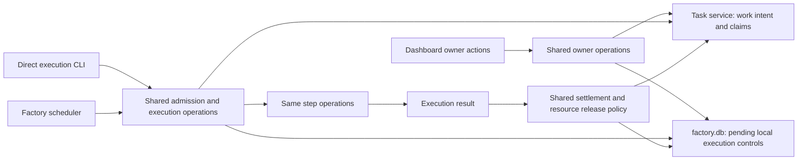

# Admission, claims, execution and completion

Status: **evidence** and **design**. Historical baseline lifecycle review with proposed changes; references to
`tl task` passthrough and close guards below are baseline commands, not current routes. Use the current
[README](../../../README.md) and [explicit land](../tl-8bh9.14.8/plan.md) for successor delivery.

> STORE scope update, 2026-11-09: Denis accepted the identity/lifecycle contract and lifted its design hold for
> [reconciled STORE slices](../tl-sqd3.26/plan.md) only. Earlier blanket-hold statements below describe prior review history.
> Explicit dependencies still gate affected actions; historical migration/compatibility scope and unrelated holds remain excluded.

Review under tl-8bh9.3, 2026-11-08. Source assessment only; no Git revision queried or real factory exercised.
Quoted identifiers use current code vocabulary. Target vocabulary remains task -> step -> attempt.

## Entry points and actual reuse

| Consumer | Current route | Meaning |
|---|---|---|
| Factory scheduler | Taker.claimed -> loop_ops.claim -> verbs.claim; prepares slot, starts run-task child with --loop. | Select eligible work and keep feeding the shared executor. |
| Direct execution CLI | run entry -> run_in -> run_bead -> Engine.run. | Execute one requested step, auto-next step or continuous workflow. |
| Continuous execution | Standalone.run_stages(continuous=True) -> once.go / RunBody. | Drives the full workflow using existing stage capabilities. |
| Single-step execution | Same entry and stage_run lifecycle -> Standalone.one_stage/dispatch. | Executes one step, records next cursor, releases claim; task is not complete merely because that step ended. |
| Tracker CLI | verbs.claim, close_as, block_as; tl task passthrough applies close guard before raw adapter call. | Administrative work assignment/status actions; claiming a task does not itself start execution. |
| Dashboard | Shared Intake/OwnerVerbs ports for responses, notes, stop/park and other owner actions. | No separate task-start/claim/completion engine was found in current write ports. Do not invent one for symmetry. |

Factory already invokes the direct run-task entry. This is valuable reuse, not three independent engines to replace.
Continuous and single-step execution already share lifecycle and underlying capabilities, but repeat some setup and
finish orchestration. A scheduler loop and a one-step driver are legitimate caller policies, not duplication by themselves.

## Target division

This is a responsibility map, not a proposal for new classes/services. UI formatting and transports stay at the edge.
Resource release and pending settlement need an explicit order per outcome; a tracker outage must not silently turn
failure into completion or imply a running process has released its workspace.

## Admission and claim handoff

Observed: factory parent calls asks.admission.admit and verbs.claim, then the child calls admission.enter, which
releases dead claims, checks park/admission and calls verbs.claim again before fence.take. verbs.claim also records
branch/slot metadata, local event and provenance, so the second call is not just a cheap pure predicate.
It is not established that both calls must be removed: eligibility can change while waiting/resetting/spawning.

Recommendation, tl-8bh9.3.5: separate read-only eligibility, authoritative acquisition and validation of a handed-over
claim. Make parent/child ownership explicit; avoid another task claim and repeated metadata/provenance for the same
acquisition. Handle failed preparation/spawn with the same ownership-aware cleanup. A task read that is unavailable
must not be treated as an eligible empty task. Keep dependencies, owner holds, pending responses and live ownership
as explicit facts; do not infer permission to reopen from comment prefixes/author/time order.

asks.admission._blocked_by_engine currently searches Blocked: comments and later owner comments, joined with AskStore.
Existing PORTABLE-ASKS work owns replacing that implicit control path with linked work requests/responses and pending
incorporation. No additional admission-specific question database is needed.

Manual versus automatic area policy differs today: areas.hand warns and continues beside a busy area unless exclusive
was requested; areas.loop refuses the busy candidate. Keep shared exclusion observation and acquisition mechanics.
Earlier proposal was to make manual/automatic defaults consistent. Owner has now chosen the simpler alternative:
remove area grouping/admission entirely (tl-8bh9.3.6). Highest-priority tasks approved for automation and unblocked by
dependencies/holds/claims fill available slots. Independent children of an epic can run concurrently. Keep actual
workspace exclusion and command-level resource permits; do not replace area rules with another group-lock feature.

## Portable assignment versus disposable execution ownership

The real work-task claim stays with the task adapter. Slot/workspace reservation, process identity, lease generation
and pending control belong to the local execution owner in factory.db. Current Taker/run entry publish held_bead on
slot tasks and fence.Claim carries slot-task identity/generation; existing tl-8bh9.2.1 must migrate the entire lifecycle,
not only the slot pool. Do not create a second SQLite task-management system.

verbs.claim stores metadata branch (existing override or deterministic task_branch) plus slot and worktree provenance.
The owner already chose deterministic branches and no portable slot/runtime records. Remove those control dependencies;
local evidence may still describe where execution actually occurred. Do not preserve an old branch override simply
to keep its stored format working.

Do not delete fencing with slot tasks. Current fence.take is read/increment/write/read, not compare-and-set. Final
writes check generation then condition only on assignee, leaving a same-actor retake race. Existing tl-r2g4 already
tracks the atomic conditional-write gap. Verify actual task-adapter guarantees; no claim of global atomicity across
independently synced tracker databases is justified. Local process/workspace locks protect different resources and
are not redundant merely because a task has an assignee.

## Execution setup and teardown

Owner refinement, 2026-11-08: the whole factory is local to one PC, and most operations, especially state management,
should be Python-native even inside shared libraries. Prefer application calls over invoking our own CLI. Review the
parent-to-run-task process boundary itself as well as its duplicated admission; a library wrapper alone does not
justify retaining a process. Genuine external harnesses/tools and demonstrated isolation/cancellation needs can justify
subprocesses. Same-PC state can use SQLite transactions and native OS locks across processes; it need not all become
in-memory state in one interpreter. Check current per-process environment/deadline assumptions before changing the
process topology. Do not infer a single-process rewrite from this preference.

RunBody.begin and Standalone.one_stage both load the task, start heartbeat/lease, load acceptance/context and handle
human input. Continuous RunBody also resets/prepares the tree, plans/resumes and loops through capabilities;
standalone explicitly selects/refuses/dispatched one step and has its own completion/unclaim handling.

Reuse step preparation, result handling and resource teardown through existing application operations. Preserve the
single-step CLI: it is a useful controlled execution path, not an obsolete second product. Continuous mode should
drive the same steps until a terminal/wait outcome instead of reproduce their rules. Validate actual differences
before extracting a helper; no generic workflow engine or new Run tier is requested.
Existing STEP-ATTEMPTS, RESTART and agent-interface design govern attempt/session identity and continuation.
Visual-only branches in both paths belong to already approved removal tl-8bh9.5.4, not a new consolidation framework.

## Completion: three facts that must not be conflated

Code reaching the integration target, an execution ending, and the task service accepting completion are distinct.
Current Closer.finish records the terminal outcome before applying settlement effects. Settle.run calls close/block,
but on nonzero rc warns and returns normally. effectinterpret then marks the effect applied. Thus a failed tracker
close can coexist with a recorded successful execution and an applied settlement key. This is source-path evidence,
not a reproduced production incident.

Reuse existing tl-br2.8 SETTLE rather than file another recovery subsystem. Keep the minimal pending settlement state
and truthful outcome, with failures propagated to the caller that decides whether an effect is applied. Normal restart
with intact DB must finish required pending work; discarded DB does not trigger history reconstruction.
The existing finish_run first-winner transaction prevents competing terminal outcomes and should be retained until
an equivalent shared owner exists. Repeated effect execution after a crash must be safe; a key saved after an external
effect is not proof of exactly-once delivery.

Current manual close guard uses traces.read_from to decide whether land exists, while the engine supplies an empty
ENGINE guard because workflow already established its result. tl task close guards then passes through; close_as
also checks its claim. Consolidate retained completion policy, with explicit administrative outcomes for obsolete/
duplicate/no-code tasks. Do not force all tracker administration to launch an engine or delete safety checks as wrappers.
Land/completion eligibility must not depend on replaying raw logs. Inspect existing DB finish and portable landed
metadata/actual Git proof together; no new independent delivery ledger or unconditional bypass is proposed.

tl-br2.19 already tracks explicit acceptance disposition for no-code/done paths. Keep that meaningful requirement:
no commit is not proof the task was satisfied. Reuse review/structured result rather than add another AI review loop.

## Scope and validation

The [selection review](selection-review.md) traces additional queue, epic-order and retry policies against that model.

New consolidation work is tl-8bh9.3.5; settlement, fencing, slot ownership and human requests reuse existing tasks.
RepoId/store review is joint and STORE implementation remains held. No tasks closed or source/config/tests edited.
Reviewed loop Taker/BeadRun/launch binding, run entry, asks/pipeline admission, areas policy, tracker verbs/close guard,
fence, standalone/RunBody, Closer/Settle, close effects/interpreter and finish_run; selected dashboard write ports.
Useful eventual fake-backed cases: admission changes during spawn, failed handoff, same-actor retake, single-step
success versus whole-task completion, tracker refusal after delivery, and interrupted settlement with intact DB.
Owning libraries test real IO. Eventual gates are just check and just test, never a full/live run from this review.
