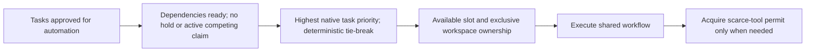

# Simple scheduling and existing queue policies

Status: **built** for bounded selection behavior described by [the scheduling slice](../tl-8bh9.4.3.1.13/plan.md);
other alternatives remain **design**. This is a historical review: `tl plan next` is now `tl step next`.
See the current [README](../../../README.md) for syntax.

> Implemented for plan admission in [.4.3.1.13](../tl-8bh9.4.3.1.13/plan.md) (`tl plan next`, one-shot rounds); approval
> is the tracker label `auto`; eligibility is revalidated at acquisition by admission's claim.

> STORE scope update, 2026-11-09: Denis accepted the identity/lifecycle contract and lifted its design hold for
> [reconciled STORE slices](../tl-sqd3.26/plan.md) only. Earlier blanket-hold statements below describe prior review history.
> Explicit dependencies still gate affected actions; historical migration/compatibility scope and unrelated holds remain excluded.

Tasks: tl-8bh9.3.6 (owner-approved areas removal) and tl-8bh9.3.7 (next queue-policy review).
Source read 2026-11-08; no Git revision queried, no running scheduler exercised or source changed.

Owner subsequently approved removal of manual queue and epic ordering rules: task priority is the only ordering,
with explicit automation approval and dependencies retained. This supersedes the proposal status in the historical
assessment table below. A later owner question reopens one detail: whether native parent/epic priority should affect
child selection. That question is resolved by the accepted ordering contract below; it did not reopen manual queue
or area exclusivity.

Subsequent owner clarification: own priority dominates; equal-priority tasks should consider higher-order priorities.
Owner accepted Astra's nearest-parent-first ancestry tie-breaks, with P2 defaults for absent priorities/levels and
natural task-ID ordering last. See [the required contract and expected outcomes](hierarchical-priority.md).
The comparison is deterministic and mandatory; source implementation remains pending.

## Owner-approved model

See [ADR 02](../tl-8bh9.14.119/adr-02-ready-task-selection.md) for current scope and tests. Eligibility is separate from the hierarchy comparator in ADR 09.

Independent siblings need no grouping rule. Dependencies express actual prerequisites. Resource permits cap Unity
or other scarce tools; workspace ownership prevents conflicting use of the same checkout. Eligibility must be
revalidated at acquisition. Native Python APIs and local state are preferred; no separate scheduling service needed.

Remove packages/areas and area-only configuration/admission/diagnostics/tests after mapping callers. QueueRule
currently also delegates parent/epic traversal to Areas; preserve a needed lookup at its actual owner only while
other consumers remain. Removing the area feature does not authorize deleting workspaces, tasks or useful task hierarchy.
The old recommendation to retain a shared manual/automatic area default is superseded.

## Additional current policies

| Existing behavior | Purpose/cost | Recommendation status |
|---|---|---|
| store.ready(cfg.pick_label) plus common QueueRule used by factory and tl next | Reuses native dependency readiness and common ranking. pick_label defaults empty. | Keep common selection and explicit automation approval/scope; exact retained approval representation still needs settling. |
| pickset queue label and queue_at metadata | Owner-maintained selection list and order, shared with dashboard queue strip. Nonempty queue excludes all other candidates and sorts chosen position before priority. | Proposed removal/simplification under tl-8bh9.3.7. Do not silently equate this queue with approval. |
| Empty pickset means no additional selection limit | Automatically broadens work to all ready tasks allowed by pick_label. Closing the last queued task can trigger that transition. | Retained automation permission must not broaden merely because a manual list empties; owner must settle intended queue override behavior. |
| epic_order and epic_only | Extra ranking among equal priorities, or exclusion of tasks outside selected epic ancestry; requires parent traversal. | Proposed removal in favor of task priority and explicit automation scope. Existing behavior is intentional old policy, not a newly discovered implementation bug. |
| ordered label on epic | Rejects direct child with no non-parent dependency, adding another label/parent read. It checks for a dependency's presence, not a complete sequential graph. | Proposed removal: native dependencies already express required order. Do not assume every sibling needs a predecessor. |
| --only | Explicit run-local task set; currently also orders it before task priority. | May retain a scope filter if useful; should not bypass dependencies, approval or ownership. Separate scope from any deliberately retained order override. |
| Automatic exclusion of epics/parents with open children | Avoids scheduling containers; parent can be any task with open children. | Distinguish true containers from ordinary executable tasks; do not expand removal to this behavior without checking its task-management purpose. |
| Retry due times, network-first list and slot-failure recovery | Avoids tight failure loops and repeatedly using a broken/dirty workspace, but layers scheduling state across Counters and ParkStore. | Keep demonstrated safety/backoff purpose; assess duplicated state and priority exceptions. No blanket deletion of waits or recovery probes needed for intact local execution. |

Concrete current example: task A has priority P2 and is the only queued task; task B has priority P0 but is not queued.
A is considered and B is excluded. When A closes, queue membership becomes empty, and B may become eligible even
though nobody approved it through that queue. A configured pick_label can still constrain both cases; default config
does not require a label. This is source behavior, not a claim about any particular active deployment's profile.

## Scope versus approval versus order

These are three questions, not necessarily three systems:

- Is the task permitted for autonomous execution?
- Is this run intentionally restricted to a subset of permitted tasks?
- Which eligible task has highest priority?

Prefer one explicit task-service approval signal/policy, optional explicit run scope only if useful, and native task
priority plus a stable tie-break. Avoid a second manually managed ordering system or implicit permission changes.
Keep selection failures explicit; inability to query the task service must never mean take anything.
Do not introduce new labels/metadata/config solely to model the distinction; reuse the minimal existing task contract.

## Existing work and limits

tl-9un.50 PICKSET and tl-bxk.9.1 record earlier chosen queue/ranking behavior. Proposed cuts supersede those policies
deliberately; no claim they were stale or never implemented. The speculative merge queue tl-7s2f is a separate held
topic; this review does not start it. SLOT-STATE and LIFECYCLE-REUSE own workspace/claim changes, and STORE remains held.

Read loop/queue.py, kernel/pickset.py, loop candidate/idle handling, settle.py, host filtering, config defaults and
selected dashboard queue consumer references. No tests executed for this design pass. Eventual fake-backed tests
must cover priority, explicit dependencies, independent siblings, approval/scope transitions and bounded retry waits.
Use just check and just test for source implementation, not a full/live suite.

## Retry and pause follow-on assessment

Current waits serve distinct purposes: an owner decision, transient execution failure, account/network unavailability,
and unsafe/broken workspace. Keep those facts explicit instead of treating every pause as the task failing.

- loop.candidates applies net_first after queue ranking. After network recovery, that can promote lower-priority work.
  Remove the hidden ordering override under tl-8bh9.3.7. Continuing an already-active unfinished attempt is a separate
  lifecycle concern; do not misinterpret priority ordering as abandoning a session at each scheduler poll.
- Scheduling time is represented in persistent Park.retry_at, repo-level loop-rest DB documents and Counters.later.
  A memory cache of DB state is not automatically a second authority. Map writes, invalidation, reason and wake owner
  before consolidating; do not replace them with a larger generic scheduler. LoopFiles.rests is DB-backed despite
  the class name, so do not claim this path is a filesystem fallback.
- closing_decide.Decide reads recent_closes(home.traces(), repo_id, now), then runoutcome.apply uses that history to
  decide fault escalation. This makes execution control depend on retained trace evidence. Move required fault
  counters/pending wake state to the existing execution store owner; keep traces as evidence/analysis. Discarded DB
  loses those runtime counters by design and does not reconstruct them from logs.
- beadpark.verdict uses task text hash and question-run count as another gate, including a hard cap, while answered
  requests can clear it. Existing PORTABLE-ASKS design should make explicit outstanding request/response state control
  continuation; preserve bounded repair/failure budgets without making arbitrary text changes the normal wake signal.
- accountpauses owns reason-specific backoff/counts and producer distinctions; fault policy has separate history
  counts, and the shared agent interface can have execution/schema repair retries. Map actual budgets end-to-end so
  layers do not multiply work unexpectedly. Do not remove genuine limits or require owner help for every network blip.
- Slot quick-failure handling protects dirty/failed workspaces from immediate repeat use. Keep demonstrated safety;
  a healthy agent account recovering and a workspace becoming safe are different wake conditions.

Existing tl-7i9k.56.1 covers retry/wake consolidation, but its old proposed packaged module/file-first adapter is not
current authority: local state is already SQLite-backed and user prefers native Python and minimal code. Reassess
that scope rather than implement a new broad durable framework. Held STORE child tl-sqd3.26.2 overlaps storage and
must remain held; its historic dual-read migration text is superseded by the hard-cut/no-fallback decision.
This is read-only evidence and backlog preparation, not permission to start either implementation.
