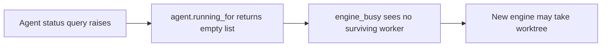

# Adapter audit: purpose, ownership and workflow consequences

Task: tl-8bh9.4.6. Source review 2026-11-09; implementation is separate work.
All 38 current adapter modules were read by the review team, including their relevant consumers.
Two cheaper-model scans covered Git/check and execution mechanisms; Astra read task/state adapters and
challenged the combined conclusions. The primary reviewer checked the consequential paths below directly.
This covers the current adapter directory and selected workflows, not every provider, dev tool or library file.

No Git operations were used in this audit, so no fetched revision is asserted. The companion
[inventory](inventory.json) records per-adapter SHA256, physical line counts and static import consumers.
The directory contains 3,466 physical lines, not a measured amount of removable code. Static imports do not
prove reachability: markers.py, for example, is launched by path. The historical slot-lifecycle review document
is absent in this worktree; its conclusions have not been assumed verified.

The owner subsequently requested a stricter [behavior-removal challenge](removal-challenge.md) for every module.
It corrects placement-only assumptions and records explicit losses, retained invariants and proposed cuts.

## How to read the recommendations

Purpose comes before placement. A caller proves use, not that the behavior is worth retaining.
"Shelf" means reuse or extend the actual owning library and its semantic fake; it does not mean relocate a
subprocess wrapper or automatically create one new library per adapter. Thin factory translation remains only
where factory-owned types/policy need it. Local state operations prefer native Python even inside libraries.

The standing contracts already approve removing runtime backup/restore, migration, built-in URL checking,
visual-only review and factory-owned process/Git mechanisms. New product choices below remain **proposed**.
No production source was changed and no deletion or library capability is claimed implemented.

## Complete adapter disposition

Paths in the consumer column are relative to the repository; inventory.json includes additional static consumers.

| Adapter | Purpose and current cost / consumers | Disposition and reason |
|---|---|---|
| [agent.py](https://github.com/iorlas/iorlas-task-loop/blob/731b7c76ef214ce35229f77814f98b6e1d6d5c0f/src/taskloop/adapters/agent.py#L16) | Execution handle/thread plus live-file parsing; runner and wire/slotfx. Query errors become empty worker lists. | Merge execution/conversation/status into shelf agent owner; remove factory live-file parser. Unknown liveness must remain unknown. |
| [delegate.py](https://github.com/iorlas/iorlas-task-loop/blob/731b7c76ef214ce35229f77814f98b6e1d6d5c0f/src/taskloop/adapters/delegate.py#L141) | API request translated through temporary files, argv, runner, JSON text and back into records; worker_call and account/doctor consumers. | Replace competing execution/status seam with one shelf API; retain only necessary factory type/policy translation. In-process JSON roundtrip and synthetic subprocess shape have no intrinsic value. |
| [delegate_wire.py](https://github.com/iorlas/iorlas-task-loop/blob/731b7c76ef214ce35229f77814f98b6e1d6d5c0f/src/taskloop/adapters/delegate_wire.py#L155) | Contract-number/stop checks and tolerant result mapping; worker_call/delegate. worker_of coerces unknown end to ok; any_contract checks contract number/capabilities, not this field. | Shared agent contract owns validation/repair. Preserve explicit unknown worker termination; worker end is not the overall task outcome. Keep factory transitions in factory. |
| [runner.py](https://github.com/iorlas/iorlas-task-loop/blob/731b7c76ef214ce35229f77814f98b6e1d6d5c0f/src/taskloop/adapters/runner.py#L62) | Polls agent thread/live file, enforces wall/cancel, wraps typed result as CompletedProcess/JSON. | Fold into shared agent lifecycle; remove subprocess-shaped in-process transport, preserve actual cancellation/survivors. |
| [spawner.py](https://github.com/iorlas/iorlas-task-loop/blob/731b7c76ef214ce35229f77814f98b6e1d6d5c0f/src/taskloop/adapters/spawner.py#L17) | Generic external capture/stream/held/detached launch, env and timeout conversion; wire/real and many commands. | Shared process API/fake owns mechanism. Keep only justified external-tool/isolation boundaries, not self-CLI calls for native operations. |
| [procs.py](https://github.com/iorlas/iorlas-task-loop/blob/731b7c76ef214ce35229f77814f98b6e1d6d5c0f/src/taskloop/adapters/procs.py#L23) | stream_proc wrapper plus timeout/result/process-table translations; most other mechanism adapters. | Remove competing process substrate; use actual library operations/types. Not every old launch deserves preservation. |
| [pidcheck.py](https://github.com/iorlas/iorlas-task-loop/blob/731b7c76ef214ce35229f77814f98b6e1d6d5c0f/src/taskloop/adapters/pidcheck.py#L5) | Converts PID inputs to start-token/liveness queries; slotfx and loop/brief state. | Merge into shared process/liveness contract, including unknown observation semantics. |
| [threadflag.py](https://github.com/iorlas/iorlas-task-loop/blob/731b7c76ef214ce35229f77814f98b6e1d6d5c0f/src/taskloop/adapters/threadflag.py#L6) | Thread-local booleans for killed/wall_hit; RunFields and check host. | Replace ambient command flags with typed per-command outcomes; preserve concurrent-check isolation. No new utility package. |
| [halt.py](https://github.com/iorlas/iorlas-task-loop/blob/731b7c76ef214ce35229f77814f98b6e1d6d5c0f/src/taskloop/adapters/halt.py#L15) | Signal scope, deferred cancellation and bounded sleep; run entry/plumbing. | Consolidate lifecycle/signal mechanism with owning process/run control. Internal cancellation remains despite deferred Stop UI. |
| [deadline.py](https://github.com/iorlas/iorlas-task-loop/blob/731b7c76ef214ce35229f77814f98b6e1d6d5c0f/src/taskloop/adapters/deadline.py#L16) | Process-global nested budgets shared by check threads; spawner/procs/runner/halt. | Keep clamping behavior through explicit per-execution context; do not carry process-global budgets into a multi-run process. No new budget kinds. |
| [locks.py](https://github.com/iorlas/iorlas-task-loop/blob/731b7c76ef214ce35229f77814f98b6e1d6d5c0f/src/taskloop/adapters/locks.py#L20) | Thread mutex, ProcessLock, holder records and resource observations; slotfx, stores and land. | Shared lock mechanisms; factory DB owns local reservations. Audit worker lifetime separately from coordinator lock lifetime. |
| [landlock.py](https://github.com/iorlas/iorlas-task-loop/blob/731b7c76ef214ce35229f77814f98b6e1d6d5c0f/src/taskloop/adapters/landlock.py#L23) | Remote-derived lock identity/acquisition plus arbitrary command launcher; land/release use lock methods. | Shared lock mechanism with explicit delivery identity; remove orphan run_locked helper after checking advertised CLI surface. Remote exclusion identity is not local RepoId. |
| [ram.py](https://github.com/iorlas/iorlas-task-loop/blob/731b7c76ef214ce35229f77814f98b6e1d6d5c0f/src/taskloop/adapters/ram.py#L4) | Pure vm_stat parser; loop_ops/stages execute Mac probe. | Owner accepted initial removal of proactive RAM admission; bounded slots remain. No new host-observation framework. |
| [factory.py](https://github.com/iorlas/iorlas-task-loop/blob/731b7c76ef214ce35229f77814f98b6e1d6d5c0f/src/taskloop/adapters/factory.py#L6) | Returns optional caffeinate argv; factory start spawns one helper per loop. | Owner accepted lifetime-scoped keep-awake while factory runs, including waits. A small OS capability is justified; no new framework/native binding solely for this. |
| [git.py](https://github.com/iorlas/iorlas-task-loop/blob/731b7c76ef214ce35229f77814f98b6e1d6d5c0f/src/taskloop/adapters/git.py#L25) | Broad RealGit port with porcelain plus direct Git mechanics; real composition and land/slots/checks/doctor. | Retain required Git behavior in owning shelf API/fake, not this parallel factory implementation wholesale. |
| [git_base.py](https://github.com/iorlas/iorlas-task-loop/blob/731b7c76ef214ce35229f77814f98b6e1d6d5c0f/src/taskloop/adapters/git_base.py#L51) | Pinned env, process execution, fsmonitor handling, error classification and memoization. | Merge generic Git mechanics into shelf; factory keeps workflow reactions only. Preserve checkout pinning without redundant runners/classifiers. |
| [git_ops.py](https://github.com/iorlas/iorlas-task-loop/blob/731b7c76ef214ce35229f77814f98b6e1d6d5c0f/src/taskloop/adapters/git_ops.py#L14) | Diff/index/commit/rebase/lease-push operations inherited by RealGit. | Use shared Git operations; remove task-history rebase/force-push behavior rejected by delivery contract. |
| [git_pool.py](https://github.com/iorlas/iorlas-task-loop/blob/731b7c76ef214ce35229f77814f98b6e1d6d5c0f/src/taskloop/adapters/git_pool.py#L14) | Translates porcelain errors to factory errors; RealGit/LandGit. | Collapse generic classification with Git owner; only necessary domain translation remains. Full diagnostics survive. |
| [gitrepo.py](https://github.com/iorlas/iorlas-task-loop/blob/731b7c76ef214ce35229f77814f98b6e1d6d5c0f/src/taskloop/adapters/gitrepo.py#L16) | Reads .git topology and derives root/pinned environment; widely used outside Git adapter too. | Common-dir/checkout identity belongs to shared Git owner; direct .git readers across factory should disappear. Separate actor identity from repository identity. |
| [gitmemo.py](https://github.com/iorlas/iorlas-task-loop/blob/731b7c76ef214ce35229f77814f98b6e1d6d5c0f/src/taskloop/adapters/gitmemo.py#L20) | Stats/reads known config/ref files to cache mutable Git observations; GitBase, slotcheck, doctor. | Settled direction: remove memo layer and repeated caller queries; pass operation inputs/results, retaining fresh observations where required. Do not relocate the cache to shelf. Distinct from successful-check reuse. |
| [ignored.py](https://github.com/iorlas/iorlas-task-loop/blob/731b7c76ef214ce35229f77814f98b6e1d6d5c0f/src/taskloop/adapters/ignored.py#L12) | Temp excludes file + check_ignore; used by check and land checkout. Error becomes empty match set. | Shared Git rule-matching operation if still needed; typed failure, not guessed empty. Content-selection policy must follow committed-step contract. |
| [slotcheck.py](https://github.com/iorlas/iorlas-task-loop/blob/731b7c76ef214ce35229f77814f98b6e1d6d5c0f/src/taskloop/adapters/slotcheck.py#L27) | Rechecks ambient Git checkout/config redirection around steps; RunParts.assert_tree. | Retain correct-checkout invariant through shared preparation/Git API. Do not preserve every memo/probe/repair-advice layer merely because it exists. |
| [ident.py](https://github.com/iorlas/iorlas-task-loop/blob/731b7c76ef214ce35229f77814f98b6e1d6d5c0f/src/taskloop/adapters/ident.py#L17) | Config roots, actor/session, host and version; many CLI/wire consumers; imports migration guard. | Split minimal configuration/actor/version duties at composition; remove layout_stop. No new general identity entity. |
| [land_probe.py](https://github.com/iorlas/iorlas-task-loop/blob/731b7c76ef214ce35229f77814f98b6e1d6d5c0f/src/taskloop/adapters/land_probe.py#L10) | Zero-time land-lock probe for push hook; GUARD_MAIN is false in launch/push_judge.py. | Do not carry a disabled guard into successor by default. Final hook scope owns retirement; library lock API alone does not justify feature. |
| [check_probe.py](https://github.com/iorlas/iorlas-task-loop/blob/731b7c76ef214ce35229f77814f98b6e1d6d5c0f/src/taskloop/adapters/check_probe.py#L18) | PATH/path/just recipe inspection and caching for plan lint, exposed by RunParts.shell_probe to tlwork plan/probe and sendback. | Remove with the obsolete planner check-command protocol rather than move to shelf; opaque candidate recipes do not need this just parser/cache. Retained task-specific acceptance still belongs in the plan and review. |
| [check_net.py](https://github.com/iorlas/iorlas-task-loop/blob/731b7c76ef214ce35229f77814f98b6e1d6d5c0f/src/taskloop/adapters/check_net.py#L17) | Selects sandbox-exec/unshare prefix and host probe; checks/shell when configured. | Separate optional product decision; default false is not removal evidence. If retained, execution library owns OS mechanism and typed unavailable capability. |
| [links.py](https://github.com/iorlas/iorlas-task-loop/blob/731b7c76ef214ce35229f77814f98b6e1d6d5c0f/src/taskloop/adapters/links.py#L29) | URL extraction/filtering plus concurrent HTTP requests; no production consumer found in search. | Delete under accepted built-in link-check removal; do not move unused product behavior to shelf. |
| [bd.py](https://github.com/iorlas/iorlas-task-loop/blob/731b7c76ef214ce35229f77814f98b6e1d6d5c0f/src/taskloop/adapters/bd.py#L109) | Task-service mapping and client wrapper; admission, briefs, dashboard and settlement; comments/claim failures swallowed. | Thin replaceable TaskPort adapter only; shared service client owns necessary service transport. Preserve conditional/uncertain/error outcomes. |
| [beadtools.py](https://github.com/iorlas/iorlas-task-loop/blob/731b7c76ef214ce35229f77814f98b6e1d6d5c0f/src/taskloop/adapters/beadtools.py#L13) | Client construction/PATH, CLI error and tolerant helper reexports. | Construction belongs composition, rendering CLI; delete workflow dependence on error-as-absence helpers. |
| [bdbackup.py](https://github.com/iorlas/iorlas-task-loop/blob/731b7c76ef214ce35229f77814f98b6e1d6d5c0f/src/taskloop/adapters/bdbackup.py#L32) | Daily task exports/count sidecars and monthly count check, called per loop. | Durable task protection remains separate. Proposed service ownership; current implementation is not a proven full restore and cannot silently be deleted with factory backup. |
| [closes.py](https://github.com/iorlas/iorlas-task-loop/blob/731b7c76ef214ce35229f77814f98b6e1d6d5c0f/src/taskloop/adapters/closes.py#L7) | Reads historical close traces for retry policy; closer_ports → closing_decide. | Delete log-derived control state. Actual attempts and retry policy already have accepted DB/factory owners. |
| [factorybackup.py](https://github.com/iorlas/iorlas-task-loop/blob/731b7c76ef214ce35229f77814f98b6e1d6d5c0f/src/taskloop/adapters/factorybackup.py#L39) | SQLite snapshots, integrity checks and restore/quarantine; loop chores and reindex. | Delete under disposable-DB contract, including hidden roots. Preserve intact-DB restart; no always-fresh shortcut. |
| [layout_paths.py](https://github.com/iorlas/iorlas-task-loop/blob/731b7c76ef214ce35229f77814f98b6e1d6d5c0f/src/taskloop/adapters/layout_paths.py#L7) | Migration journal/retired directory paths only. | Delete with migration; no independent retained purpose. |
| [layout_migrate.py](https://github.com/iorlas/iorlas-task-loop/blob/731b7c76ef214ce35229f77814f98b6e1d6d5c0f/src/taskloop/adapters/layout_migrate.py#L35) | Historical-layout detection, moves, journals and DB rewrites; track/wire/doctor/ident. | Delete detection, command gating, migration and old callers together; do not delete user data/worktrees. |
| [key_migrate.py](https://github.com/iorlas/iorlas-task-loop/blob/731b7c76ef214ce35229f77814f98b6e1d6d5c0f/src/taskloop/adapters/key_migrate.py#L37) | Reconstructs old keys, retired paths and rows for migration. | Delete; current identity contract replaces historical key discovery. |
| [looks.py](https://github.com/iorlas/iorlas-task-loop/blob/731b7c76ef214ce35229f77814f98b6e1d6d5c0f/src/taskloop/adapters/looks.py#L9) | sips/ImageMagick/copy fallback for tlwork/look/shots; warning ignored. | Delete with approved visual-review removal. Generic artifact preview is a separate retained consumer, not justification for retaining this workflow. |
| [markers.py](https://github.com/iorlas/iorlas-task-loop/blob/731b7c76ef214ce35229f77814f98b6e1d6d5c0f/src/taskloop/adapters/markers.py#L13) | Separate Python → git grep command; RunFields embeds path, land fix invokes it. | Remove script/process boundary; relevant marker check belongs shared/native check mechanism. Distinguish scan failure from markers found. |
| [__init__.py](https://github.com/iorlas/iorlas-task-loop/blob/731b7c76ef214ce35229f77814f98b6e1d6d5c0f/src/taskloop/adapters/__init__.py) | Package docstring only. | Keep only if resulting package needs it; no behavior to extract. |

## Verified workflow traces

These are code-path audits, not production incident reproductions or executed integration tests. Trace 3 also has
a [successful in-memory reproduction](settlement-probe.md) using actual settlement/interpreter code and fake effects.

### 1. Worker-status failure can authorize unsafe reuse



agent.py:16–24 is wired through app/wire/slotfx.py:4–7. In
packages/slots/src/tlslots/engine_lock.py:99–102 an empty result permits reuse after the coordinator is gone;
release at :133–139 can drop the reservation. The risk is conditional on a surviving worker plus failed status,
not proof that a duplicate writer incident occurred. AGENT-STATUS .4.2, agent contract .4.3 and slot lifecycle
.2.1 own the correction: unavailable is not confirmed empty. Do not replace this with parallel factory ps/file probes.

### 2. Task-service errors disappear into admission and planning

bd.py:165–169 reduces every failed claim to false; app/track/verbs.py:35–43 prints TAKEN and
app/loop/stages.py:147–152 reports another claimant. The vendored client already distinguishes contention
from service errors. Separately bd.py:142–146 converts comment failures to an empty discussion, consumed by
packages/work/src/tlwork/plan/briefs.py:38–56 and dashboard readers. An outage can therefore produce a misleading
wait reason or an incomplete planning context. TASK-CONTRACT .6.2 owns both adapter and consumer changes.

Conditional mutation has another concrete gap: empty expected-assignee is lost as "no condition", if_status is
not represented, and conditional close is a check/update followed by a separate unconditional close. Advertised
atomicity is not established by tests asserting that command sequence. Upstream tl-r2g4 remains a real prerequisite.

### 3. Refused settlement can be marked applied

```mermaid
sequenceDiagram
    participant L as Land
    participant C as Close operation
    participant T as Task tracker
    participant E as Effect interpreter
    L->>T: Record land and sync
    C->>T: Close task
    T-->>C: Refused / failed
    C-->>E: Return normally after warning
    E->>E: Mark effect applied
    E->>E: Release slot; drop finished checkpoint
```

packages/pipeline/src/tlpipeline/closing_settle.py:47–67 warns on nonzero rc but returns normally.
packages/kernel/src/tlkernel/effectinterpret.py:35–45 marks a normally returned effect applied.
The close plan in kernel/closeeffects.py:150–160 then proceeds to release/drop. The earlier land sync at
:145–147 cannot confirm later close/follow-up mutations. SETTLE tl-br2.8 and STORE .26.4 must retain unfinished
typed actions and final required sync, including uncertain answers. This is a correction to an existing owner,
not a request for another generic outbox framework. The in-memory probe confirmed the refused close is marked
applied and the following cleanup callbacks run. Failed close need not occupy a clean safe slot forever;
it must remain visible and resumable even after a justified release.

### 4. Logs secretly control retries

closer_ports.py:63 injects closes.recent_closes. pipeline/closing_decide.py:52–57 catches unreadable history,
warns and applies retry policy with empty history. kernel/runoutcome.py:171–183 uses it for streak/comment
deduplication. The adapter-level test expects unreadability to raise; the workflow still swallows it.
Remove this entire log fold under RETRY-OWNER tl-7i9k.56.1 and STORE .26.2; retain diagnostic logs as evidence.

### 5. Ignore-query failure can change commit contents

ignored.py:18–21 maps Git failure to an empty ignored set. land/checkout.py:121–125 uses that set while
stage_all(everything=True) includes new paths. Empty is conservative for a dirty warning but can be permissive
for content staging. Git errors .9.2 and step completion .3.1 must preserve uncertainty and enforce the already
agreed same-step feedback for unresolved edits, rather than blind factory content selection/commit.

### 6. Marker checking exposes hidden command and result policy

RunFields.MARKERS_ARGV launches markers.py, which launches Git. land/fix.py:125–133 interprets any nonzero
result as remaining markers, including command failure. gate/domain/plan.py:56–62 deliberately chooses a focused
repair subset. Focused debugging is allowed; there is no claim here that later mandatory gate checks are bypassed.
CHECK-EXECUTION .5.1 must trace final validation across this path; process .4.4 removes redundant launch boundaries.

### 7. Planning still executes checks and maintains a command language

packages/work/src/tlwork/plan/probe.py:39–60 extracts command-like acceptance text and may run up to three
registered checks on the base before planning. run_one at :82–99 turns a pass into advice to plan nothing for
that check. plan/sendback.py and gate/domain/lint.py validate planner check commands, inspect just recipes,
filter stage/gate scope and can launch another planner correction. This is more than an inexpensive path adapter.
Accepted routine-precheck and check-request retirement must include these callers; do not preserve their DSL
by promoting PathProbe to shelf. Keep semantic acceptance assessment and repository-owned validation, not a
factory interpreter that mistakes a passing generic check for completion of a requested behavior.

The local git_porcelain implementation already provides runner/environment pinning and many ref/worktree/
record/push operations. RealGit._pool explicitly disables its memoization at git.py:40–42 while GitBase and
gitmemo maintain another runner/classifier/cache stack. This proves competing mechanism owners, not that
every factory method already has a suitable public shelf equivalent. Verify remaining gaps individually.

check_net is also a policy, not just process syntax: check_net_isolate defaults false; configured checks with
network=True bypass the wrapper. config.py:205–206 says unsupported hosts only warn, while checks/shell.py:128–134
raises an infrastructure failure. If this feature is retained, its unsupported-host behavior must be selected
and tested explicitly. Do not infer either permission to silently weaken it or necessity to retain it.

## Important constraints from Astra's challenge

- A read/bump/write/read-back generation is not CAS: kernel/fence.py:64–73 can give two callers the same number.
  Ordinary same-worktree entry has a lock, so this is an unsafe primitive/conditional cross-worktree scenario,
  not a reproduced duplicate execution. Same actor reclaim can be idempotent; actor name alone is not attempt identity.
- Missing task/slot records are accepted by fence.stale, unlike unreadable records. Do not use absence as proof
  of ownership for checkpoint writes or cleanup. A later task close can still fail; missing-task success is unproven.
- Local reservation and task claims have different scopes. Fixing local SQLite atomicity does not manufacture
  cross-clone conditional task mutations; do not build a speculative distributed ownership service.
- Never make every unavailable observation fatal. Optional memory/idle helpers differ from ownership/liveness
  proofs. Use the retained operation's contract to decide fail, wait or best effort.
- Don't drop correct-checkout pinning when deleting memo/probe layers. Prepared-slot reuse needs a real custody
  and checkout invariant; eleven repeated probes are not themselves the requirement.

## Reconciliation and owner menu

Existing source tasks own the concrete corrections above; their notes/acceptance link back here. This review
does not reopen decisions already made about truthful failures, conditional writes or disposable state.
The first implementation milestone remains a complete CLI task with these failure paths included.

The remaining proposals are deliberately small. Correction, 2026-11-09: the owner subsequently accepted task-tracker
maintenance ownership of durable backups and the storage division in the [glossary](../../glossary.md#storage-ownership).
tl-8bh9.6.3 still assesses actual coverage/recovery before exports can be retired; that guarantee is not yet verified.
Git memo retirement/query consolidation was subsequently settled by the owner; see ../tl-8bh9.9/plan.md.
Configuration .1.2 carries remaining feature proposals without new duplicate implementation tasks:

| Topic | Purpose / cost | Recommendation, not decided |
|---|---|---|
| Task-data backup owner | Protect portable work/discussions; current per-loop exporter and count-only drill duplicate tracker maintenance and can race on fixed temporary paths. | Agreed: task-tracker maintenance tooling owns protection/recovery. Preserve existing exports until coverage of questions/answers/dependencies and recovery are verified. Do not add factory backup health machinery. |
| Optional check network isolation | Executes sandbox-exec/unshare when configured; OS support/probe and per-check exception policy add a separate surface. | Defer in minimal successor unless a concrete repository needs it; if retained, own mechanism in execution library. Harness sandbox and repository tools are separate concerns. |
| Factory Git memoization | Repeated helper queries and cache freshness/backend assumptions duplicate Git ownership. | Agreed direction: remove the cache and redundant queries together. Pass typed operation inputs/receipts; fresh verification remains at required mutation/reconciliation boundaries. |

Owner accepted omitting proactive RAM throttling and retaining lifetime-scoped keep-awake, 2026-11-09.
Keep-awake is a small host capability, not another workflow or resource scheduler.
Image resizing in the removed visual-review flow is not automatically a generic artifact requirement.
Actual shelf APIs, provider internals and timings still need verification at their owning implementation boundary.
