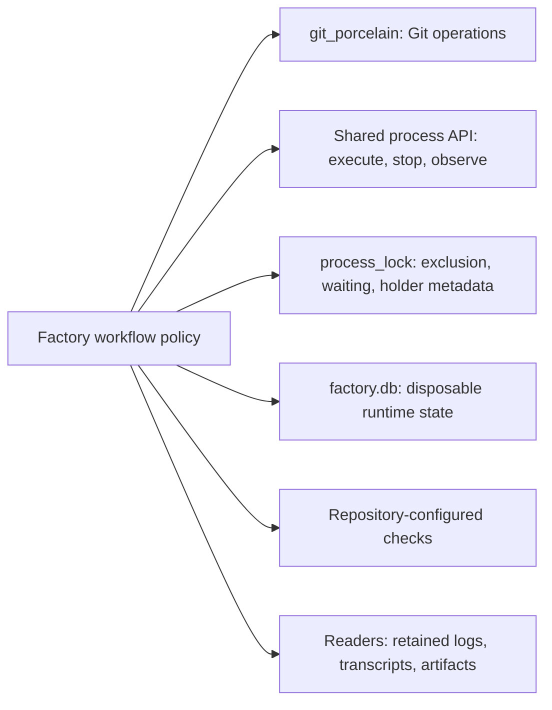

# Runtime helpers: remove, consolidate or keep

Status: **design**. Accepted decisions and pending proposals are distinguished below; historical source observations are not a delivery receipt. Explicit holds remain in force except where superseded.

> STORE scope update, 2026-11-09: Denis accepted the identity/lifecycle contract and lifted its design hold for
> [reconciled STORE slices](../tl-sqd3.26/plan.md) only. Earlier blanket-hold statements below describe prior review history.
> Explicit dependencies still gate affected actions; historical migration/compatibility scope and unrelated holds remain excluded.

Task: tl-8bh9.4. Source review on 2026-11-08. Design only; no implementation or execution tests.
This records current behavior and recommendations, not owner approval of every proposed deletion.
Paths below are relative to this checkout. No Git revision was queried in this pass.

## Responsibility map

This is the target division. Existing source still duplicates several mechanisms.
Factory policy decides when and why; owning libraries implement retained generic mechanisms and their fakes.

## Factory snapshots and restore

Purpose: retain seven daily verified database snapshots and recover damaged storage.
Cost: SQLite snapshot validation, temporary copies, retention, quarantine/restore control, scheduling and doctor wiring.

Checked adapters/factorybackup.py, app/launch/loop_ops.py and app/launch/reindex.py.
The daily chore calls backup; doctor reindex first attempts restore. This was intentional historical work
(tl-zej9.11), but the owner has since chosen a disposable factory database and no recovery framework.

Recommendation: retire factory-only snapshot/restore behavior under tl-8bh9.8.1. Keep ordinary restart using an
intact database and the same unfinished step/session. Deliberate database discard permits normal workflow
reevaluation; no history reconstruction. This does not authorize wiping a live database or user files.

Two boundaries matter. adapters/bdbackup.py imports backup_dir from factorybackup: move that path helper before
deleting its provider, and assess durable task backups separately. Dashboard reindex also invokes ordinary ingestion;
its independent purpose needs checking before deletion. Correction after reading tldash.index on 2026-11-08:
the command's message about run files was too broad a basis for the earlier assessment. Reindex does rebuild
log-derived display facts from engine logs, while preserving rather than recreating authoritative engine run rows.
See the [dashboard review](../tl-8bh9.7/plan.md). Held STORE work is not started by this cleanup.

## Old layout conversion

Purpose: carry old runtime directories and repository keys into a new layout without losing files.
Cost: adapter scanning, hashes, rename journal, old-key conversion, command wiring, doctor diagnostics and a check
that blocks normal commands when old files are found.

Checked adapters/layout_migrate.py, layout_paths.py, ident.py and app/track/verbs.py plus doctor wiring.
Existing task tl-9un.44 describes this conversion and is still open despite substantial implementation being present.
Do not duplicate it or call it complete without checking its full acceptance and current integration state.

Proposed direction: retire conversion-only code and old-layout command blocking under the no-consumers/no-compatibility
policy. First distinguish portable requirements/design files from disposable runtime state and retained local evidence.
Removing migration support must not remove existing files, worktrees, logs or artifacts. Reconcile current identity
binding with RepoId/store design; do not add another key scheme or start held STORE work.
The original task records an earlier explicit preservation decision. Owner decided on 2026-11-08 to remove
obsolete migration support and old-layout command blocking, superseding that earlier cutover policy. The existing
task tl-9un.44 now tracks removal. This does not establish that the original implementation was wrong or unused.

## Lock mechanics already owned by shelf

Purpose: exclude competing processes and threads, support interruptible waits and show who holds a lock.
Cost: adapters/locks.py adds a mutex registry, exponential polling, its own deadline and .holder JSON sidecars.

Checked local implementation and vendored process_lock public API. ProcessLock.acquire already supports timeout,
on_wait, label, meta and reentrant=False. holder(path) exposes pid, created time, label and metadata.
Recommendation in tl-8bh9.4.5: consolidate generic mechanics into that owner and remove redundant local machinery.
Keep required LockWhat/LockRecord mapping and workflow cancellation policy at the factory boundary.

This is not yet a verified drop-in replacement. Check same-process exclusion with reentrant=False, interruptibility,
once-only factory wait notification, timeout behavior, holder observation and release behavior. Any demonstrated
generic gap belongs in the owning library and its real/fake contracts. Factory tests use the library fake.
any_lease resource occupancy is a separate behavior; this finding does not justify deleting it.

## Last-command state can disappear with a better result

Purpose: distinguish cancellation and wall timeout from ordinary failure, even with concurrent checks.
Cost: adapters/threadflag.py implements mutable per-thread flags because shell returns only rc and output tail.

Checked app/run/fields.py, app/launch/check_host.py and packages/gate/src/tlgate/attempts.py.
Gate reconstructs an Ended result by reading host.killed and host.wall_hit after host.sh returns.
Another execution path already receives those properties with the result itself.

Recommendation: carry outcome fields in the owning process API's command result, then remove the mutable
last-command fields and ThreadFlag when callers migrate. This is part of tl-8bh9.4.4, not another shelf utility.
Preserve concurrent-check isolation and cancellation versus wall-limit semantics. Do not extract a tiny descriptor
that exists only to compensate for an incomplete return value.

## Built-in web checking: owner chose removal

Purpose: avoid claiming references were verified when an agent's sandbox cannot open them.
Cost: adapters/links.py owns URL extraction, DNS/public-address filtering, HTTP/redirect handling and parallel network
checks; tlwork/review/link_check.py adds retry memory, review findings and owner questions.
Kernel config check_links defaults true, extending beyond the original research-task motivation in tl-bxk.7.

Earlier alternatives were a repository-configured check, a justified built-in capability, or removal where unwanted.
Owner decided on 2026-11-08 to remove the built-in checker entirely: tl-8bh9.5.3 now tracks deletion of the crawler,
config and special review routing. Repository checks remain available if a repository needs link validation;
there is no requirement to build a replacement crawler or extract this feature to shelf.
Reachability does not verify a citation's contents, and bot rejection does not prove a source is bad.
Any retained host-side network tool must preserve its network-boundary safeguards; removing feature code does not
justify replacing it with unrestricted fetching. No claim was made that another shelf package is already a drop-in.

## Keep the policy that has a purpose

adapters/deadline.py supplies nested whole-task budget policy shared by checks in one engine process.
Its module states the one-engine-per-process assumption. No cross-factory deadline bug was demonstrated.
Keep the factory's budget decision and pass remaining limits through library APIs. Generic timing mechanisms may
be shared when useful; moving workflow policy wholesale to shelf is not a simplification.

## Verification limits

Read source and existing task descriptions; no real Git/process/network behavior was exercised, no whole suite run,
no source changed and no tasks closed. Shelf API observations concern the vendored version; verify owning shelf
source before extension. Eventual implementation uses meaningful library contracts and factory policy tests,
then just check and just test. Deletion savings must include replacement library code and tests.

## Agent interface consolidation direction

Owner on 2026-11-08: leave one interface, preferably in shelf, and reuse it from factory.
Current delegate already imports any_agent harness/supervisor primitives. Its public run API still manages account
routing, session selection, retries and merged results. Vendored any_agent exposes launch/resume inputs, typed stream
events, supervision/classification and harness transcript lookup; it explicitly leaves routing/state/holds to callers.
It is not yet demonstrated to replace the entire delegate API directly.

Promote only needed reusable capabilities into one shelf-owned public interface; delete competing delegate ownership
after consumers migrate. Factory retains workflow, task identity, step schemas, fresh-versus-resume intent and whole-task
budgets. Shared interface owns session execution/continuation, bounded structured-output repair, execution limits and
available account/model capabilities. Each actual execution retains its attempt and session/result/usage association.
Do not move work/review-specific routing choices into shelf merely because they currently sit in delegate.api.
Existing tl-8bh9.4.3 tracks this contract; no second agent abstraction or compatibility facade is requested.

Evidence is the vendored any_agent snapshot and local delegate source, not a claim about latest shelf HEAD.
The inspected shelf checkout has older catalog material; no fetch or remote-version comparison was performed here.

## Shared interface follow-up, 2026-11-09

The [capability matrix](shared-interfaces.md) distinguishes available Git/SQLite mechanisms, actual agent/task gaps
and unverified process/permit lifetime and shared fakes. New TASK-CONTRACT tl-8bh9.6.2 owns namespace/discussion/error
semantics and coordinates upstream conditional writes. No new service or universal protocol is proposed. Corrected
STORE slices depend only on the interfaces needed by their actions.
