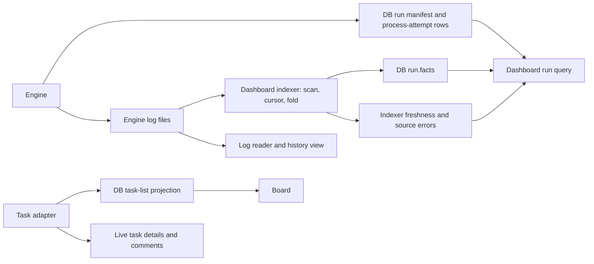

# Dashboard state, evidence and task reads

> STORE scope update, 2026-11-09: Denis accepted the identity/lifecycle contract and lifted its design hold for
> [reconciled STORE slices](../tl-sqd3.26/plan.md) only. Earlier blanket-hold statements below describe prior review history.
> Explicit dependencies still gate affected actions; historical migration/compatibility scope and unrelated holds remain excluded.

Task: tl-8bh9.7. Reviewed 2026-11-08 in the architecture-review worktree.
This is a source-based design proposal, not implementation. No Git revision queried or live factory exercised.

The [owner/agent workflow review](owner-actions.md) records user actions, actual agent delivery and the owner's
recent-history plus live-tail requirement: latest ten actions in a selected task/step/attempt, then live updates.
Removing log-derived workflow state must preserve that evidence-reading behavior.

## Current write/read map

The indexer updates facts on existing run rows; it does not insert an engine run from an orphan log.
The dashboard's run list has no fallback to run files. Retained logs are intentionally readable separately.

## Verified findings

| Behavior and purpose | Cost or mismatch | Recommendation and work |
|---|---|---|
| Engine RunRows writes authoritative manifest plus process-attempt records in one transaction. | Manifest lifecycle is sound as an authority, but existing attempt counter counts engine take-up, not the agreed operation attempt. | Keep transactional ownership; reconcile through existing STEP-ATTEMPTS and held STORE design. Do not create another attempt hierarchy. |
| Indexer tails engine logs, folds displayed execution facts and updates run.facts. | File scanning, identity/hash/reset checks, byte offsets and a second representation of steps/calls/waits/transitions. | tl-8bh9.7.2: owners write retained structured execution state directly; dashboard queries it. Remove obsolete log-derived state indexing after field coverage is mapped. |
| runprojection requires an index pass within five seconds and no run-source error. | Valid engine run rows disappear when the log indexer is stale or one source is unreadable. | Separate database/state availability from log/history availability; do not use a log-index heartbeat to gate authoritative state reads. |
| Worlds.runs and bead_runs require has_log. | Ordinary task run/detail visibility depends on log presence, unlike run_headers. | Show valid execution state without a log. Missing history is an evidence condition. |
| dbruns.read_kept retains last rows when database schema is foreign. | Schema-specific compatibility branch and server-memory stale rows. | Remove it under the owner's no-compatibility policy. Unreadable database shows an error, without serving kept rows or falling back to files. |
| BeadPass writes a disposable listing projection through the task adapter. | Dashboard inspects .beads/last-touched itself; unchanged marker can suppress refresh until it changes. Markerless mode instead polls at 60 seconds. | tl-8bh9.7.3: put backend change detection behind the task adapter/query boundary; verify actual marker guarantees before retaining indefinite marker gating. |
| Task list comes from DB, detail/comments may query task adapter live. | Separate refresh policies; read errors can look like empty list or missing task. | Give callers explicit absent/empty/stale/unavailable outcomes and post-write refresh behavior. Do not invent a second task authority. |

These are proposals derived from already agreed state/log and no-compatibility rules. Source still has every listed path.

## What direct state writing requires

RunManifest already supplies task/repository association, lifecycle, owner, heartbeat, reason, session and next step.
It does not provide every field currently displayed by FoldState. FoldState retains spans, calls/token-cost summaries,
waits, transitions, artifacts, said messages, check summaries, budgets and latest stuck information.
Do not delete the indexer and assume the manifest can replace all of that immediately.

Map each retained field before implementation. Workflow/step/attempt outcomes and transition reasons belong to the
execution owner in factory.db, using the same state changes the workflow acts upon. Agent execution/session/result/usage
facts come through the one shared agent interface and are associated with the actual attempt. Raw console/transcript text
stays with readers; artifact bytes and existing artifact metadata keep their agreed owner. A display concern may remain
a pure transformation or be removed if unwanted. No parallel event store, new telemetry system or history replay is needed.

Existing RunRows writes indexed columns and a serialized manifest together in one transaction. That alone is not two
independent authorities. Inspect ownership and consistency, rather than count every representation as a defect.
Likewise, a disposable task-list projection can have a practical purpose for expensive service queries; justify its
cost and refresh semantics instead of either preserving all caching or requiring every page to query the service anew.

## Keep the useful reader boundaries

Logs.read exposes records and an opaque cursor. Delegate live stream reads already go through its public API.
Keep a storage-neutral evidence interface while consolidating delegate into shelf. Do not move raw logs into SQLite.
Worlds currently also derives historical landing metrics from traces; a historical analysis over retained evidence
is not automatically a competing live-state owner. Inspect its actual product need before deleting it.
UI response caches, content hashes and long polling are delivery mechanisms, not alternate durable truth.
Their need must be judged separately from the foreign-schema compatibility cache.

## Task and repository boundaries

Checked beadrows.read_repo: SQLite/parse failures currently return empty rows with no error. Checked Beads.show
in readers/beads.py: service exceptions return None, the same value as a missing task.
The current UI has some global/per-service error reporting, so this is a path-specific ambiguity rather than proof
that every failure is hidden. Task queries should carry the outcome needed by their caller instead of depend on a
different component having detected the failure first. Preserve stable comment IDs for portable question/response links.

Repo keys in these paths use loop_key(real checkout path). See the joint RepoId/storage review; do not move such local
keys into portable work records or add another dashboard-only key algorithm. Existing STORE hold stays in force.

## Reindex correction

Earlier runtime-helper notes relied too heavily on launch/reindex.py's printed statement that run files are no longer
a source. Reading tldash.index.clear/_run/_write and runfacts confirms the narrower truth: reindex clears/rebuilds
log-derived display facts and cursors while leaving engine manifests intact. Remove that machinery only as direct
structured state replaces the retained facts, not on the false claim that it does no work.

## Evidence and validation limits

Read tldash index, worker, beadpass, readers/dbruns, runprojection, world, records, beads, logs, views/runfacts and api/reads;
kernel runrows, attemptrows, runfacts, beadrows and RunManifest; selected caller/test definitions and dashboard wiring.
No execution, network, process or Git checks were run. Implementation must use fake-backed policy/query tests covering
valid rows without logs, isolated history errors, DB/schema errors, fresh task responses and concurrent state visibility.
Use existing owning-library contracts for real IO and eventual just check / just test. No broad/live suite authorized.
