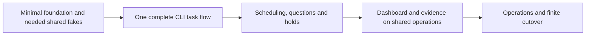

# Final coverage and implementation sequence

Review: tl-8bh9. Evidence checked 2026-11-09.

Implementation update: the isolated source foundation now passes focused gates/independent review, with actual CLI
smoke checks; see [provenance](../tl-8bh9.8.7/implementation.md). It is not task-factory functionality or product
cutover. The [38-module removal challenge](../tl-8bh9.4.6/removal-challenge.md) now makes behavior losses explicit. This is the design coverage and scope map;
task state, claims, priorities and dependencies remain authoritative in the tracker.
Source implementation has not started in this review. Astra challenged both coverage and ordering.

## What this review establishes

The retained workflows have an agreed direction: task admission, preparation, execution, checks,
review, delivery, owner questions/holds and observation. Identity, state/log ownership, configuration,
terminology, shared mechanisms and curated replacement have explicit contracts in the linked plans.
This is enough to start bounded implementation. It is not an exhaustive audit of every file or all 251
active task records returned by the final snapshot (224 open, 17 in progress, 10 deferred).
The broad task scan supplied leads; the retirement decisions below used the relevant acceptance and source.

Owner approved removing automatic post-task AI reflection and daily digest/task filing on 2026-11-09.
tl-8bh9.5.5 owns deletion of the model calls, scheduling, private state/config and automatic intake path.
Evidence: pipeline `reflect.py`/`closing_record.py`, application `report/reflect.py` and `launch/loop_ops.py`.
Keep normal outcomes, usage, retained evidence, explicit RCA and grounded implementation/review findings.
Do not replace the removed mechanism with another automatic summarizer.

## Coverage boundaries

Owner addition, 2026-11-09: the explicit adapter-by-adapter assessment is recorded in
[tl-8bh9.4.6](../tl-8bh9.4.6/plan.md), with all 38 current modules accounted for, actual consumers,
source hashes and seven workflow traces. A fake-driven probe of actual settlement/interpreter code confirms
that refused close is marked applied before cleanup callbacks. This assessment corrects the earlier inventory-only
coverage; it is not source implementation or an exhaustive library/provider audit. Concrete findings were attached
to existing agent/task/check/retry/STORE/settlement owners. Task-tracker maintenance ownership of durable backups
is now agreed in the glossary; actual coverage/recovery still needs verification. Optional network isolation
and handwritten Git memo retirement remain proposed. The historical slot-lifecycle document is absent here and
was not assumed verified. Each affected behavior must follow its reviewed owner before successor carry-over.

| Concern | Established | Still needs verification |
|---|---|---|
| Workflow and state | Task/step/attempt/session relationships; disposable DB versus intact-DB restart; one owner per fact | Implement actual typed transitions and uncertain-effect reconciliation; do not copy the old kernel wholesale |
| Git, slots and resource lifetime | Linked-worktree identity, owned clean preparation/release, append-only task branches, target squash | Current shelf APIs/fakes; worker survival beyond coordinator exit; actual setup and validation inputs |
| Agent and task interfaces | One execution/conversation owner; typed outcomes and conditional task mutations | Shelf prelaunch admission/recovery and concurrent calls; semantic fakes; upstream task conditional mutation tl-r2g4 |
| Checks and delivery | Mandatory current-candidate checks; no historical cache/request protocol; retry only unfinished effects | Candidate/target validation across handoff, publication uncertainty and closure/sync settlement |
| Dashboard and owner actions | Shared operations, direct state readers, latest ten actions plus live cursor, exact evidence refs, portable asks, hold/unhold | Consumer migration without a log-fold fallback; no duplicated CLI/dashboard workflow |
| Install/release/skill | Fixed version until restart; lightweight explicit helper; safe cleanup direction | Reduced already-landed-only release and required distribution effects remain proposed; hook retirement remains a recommendation pending final scope |
| Provider/account policy | Execution interface owns capabilities, limits and usage; no initial token/dollar caps | Detailed routing/account internals and cross-provider behavior have not been exhaustively audited |
| Development and instructions | Library-owned process/Git/lock mechanisms and fakes; no factory subprocess target | Final entry-point/composition, prompts, doctor and individual dev-tool pass against retained workflows |

No representative Unity timing/run-history analysis was performed. Do not promise quantified savings.
The old slot-review branch was not verified against a fetched revision in this no-Git session.
Durable task-data backup (`bdbackup`) is different from disposable factory-state backup; do not delete both
under one cleanup rule. Existing artifacts/user worktrees and uncommitted work remain protected.

## Reconciled old scopes

Superseded means another task owns the remaining work, not that its implementation has landed.

| Old task | Disposition and retained owner |
|---|---|
| tl-7i9k.33 SUBSTRATE | Superseded by process .4.4, Git .9, locks .4.5 and task contract .6.2 under tl-8bh9 |
| tl-7i9k.35 FACTLOG | Superseded by direct state .7.2 / STORE .26.11 and attempt links .7.1; log reconstruction refused, raw evidence retained |
| tl-7i9k.37 STAGE | Superseded by encapsulated step attempts .3.1, handover .3.3 and STORE .26.3 |
| tl-7i9k.39 LOOP | Superseded by shared lifecycle .3.5, selection .3.7 and STORE waits .26.2; current Loop still inherits Core |
| tl-br2.7 HOPSAFE | Live version hopping refused; restart .3.4, stable identity STORE .26.1, profile .1.1 and install .8.3 retain necessary obligations |
| tl-sqd3.27 STEPS | Old host/Engine coupling absent in inspected narrow-port run code; remaining transition work transferred to .3.1 / STORE .26.3 |
| tl-7i9k.38.2 LAND child | Folded into corrected parent tl-7i9k.38; no separate old phase-name/rebase contract |
| tl-9un.43 LAYOUT writers | Superseded by actual attempt/evidence .7.1/.7.6 and STORE .26.3/.26.11; file-state manifests/ledgers and migration refused |
| tl-9un.45 LOOPID | Stable coordinator identity transferred to STORE .26.1; actual attempt output to .7.1/.26.3; live version re-exec refused |
| tl-9un.47 RETENTION | Lifecycle-safe evidence retention transferred to .8.5; no immortal runtime ledgers or layout migration |
| tl-br2.15 SAMEFAIL | Counting and bounded repair transferred to RETRY-OWNER tl-7i9k.56.1 and actual attempts; no independent fingerprint stop policy |
| tl-7i9k.38 LAND | Reused for actual orchestration through confirmed integration, closure and required sync |
| tl-wxcg GATEINSLOT | Reused for prepared-slot checks, exact relevant inputs and current-workflow validation; historical cache/fresh-default rollout removed |
| tl-idnv SCHEMAGUARD | Narrowed to explicit state isolation and fail-fast unusable store open; no branch-aware migration subsystem |
| tl-7i9k.16 QUOTA | Narrowed to typed provider availability/usage; initial token caps and speculative exhaustion prediction removed |
| tl-s5dm test isolation | Fix present in inspected tree and byte-identical main-checkout files; focused regression passed. Delivery receipt not verified: keep that verification open |
| tl-sqd3.30 / .30.2 | Keep one-reader capstone and typed termination ownership; manual Stop deferral does not remove outcome ownership |
| tl-7y6.1.5 retro | Keep already-simplified typed outcome/usage reporting; do not restore automatic judge/digest under this title |

Do not close REPOID .18 wholesale: binding ownership and revised rule enforcement remain real work.
Old claims that migration/STORE is wholly held are historical; only the corrected STORE slices are admitted.
Other candidates need a specific follow-up scope check, not bulk closure: refuted SLOTQUEUE tl-bxk.10.33.10,
repository-specific failed-test reruns tl-7y6.7.8, setup/probe leftovers and fine-grained
hook/development tasks. Preserve useful repository incremental tooling without a factory framework classifier.
tl-oi1 nightly loop budgets are held as a future idea, not an initial runtime budget requirement; question display is
already owned by portable asks and shared observation. Do not treat the older title as current authorization.

## Implementation sequence

1. **Minimal foundation.** tl-8bh9.8.7 implements the accepted .8.2 design: explicit build/test/import boundary
   and composition, no baseline runtime imports/fallback. Shared test work tl-z6np + shelf-69pz and the specific
   shelf capabilities needed next can proceed in separate ownership areas. Do not wait for every library wish.
2. **One complete task through CLI.** Identity/binding (REPOID .18), claim/admission, slot ownership, real attempt,
   plan/code publication, mandatory checks, review, target squash and settlement. Reuse .3.1/.3.2/.3.4/.3.5,
   .2.1, .5.1, tl-wxcg, tl-7i9k.38, SETTLE tl-br2.8 and ACCEPTDONE tl-br2.19. Transfer only the STORE fields
   and shared contracts actually needed. Include uncertain publication, worker liveness and intact-DB restart
   in this slice, not a later safety retrofit. No requirement to finish the whole STORE epic first.
3. **Scheduling and owner intervention.** Remove areas/manual queue ordering; apply exact accepted hierarchical
   priority and eligibility. Add portable questions/answers, holds and bounded retry/wait/repair using the same
   operations. Relevant owners: .3.6/.3.7, .6.1/.6.2, .7.5 and tl-7i9k.56.1. No separate Stop/restart UI.
4. **Dashboard and evidence.** Move consumers to actual attempt/state owners; last-ten-plus-live conversation,
   exact artifact refs and question evidence through .7.1–.7.6 and necessary STORE progress fields. Delete old
   log-derived readers only when each retained fact has its new owning path. No second dashboard workflow.
5. **Operations and cutover.** Explicit install/skill/doctor, fixed running version, safe cleanup and final
   composition/prompts/glossary review. Resolve proposed release/hook scope before its implementation. Run normal
   affected gates and the integrated one-reader capstone; remove competing owners in the successor. Preserve the
   baseline in history, never as a maintained runtime fallback.

This is integration order, not permission for a five-task serial mega-rewrite. Existing bounded tasks remain the
units of ownership and review. Add dependency edges only for actual contracts; unrelated files/libraries can proceed
in parallel. Enforce critical ownership rules from the first slice; tl-sqd3.30 is the final integration check.

## Still gated

FILEVERB tl-w7lt.38.9, REPOOWNER tl-sqd3.23, MQUEUE tl-7s2f and descendants, future strict/fast visual-review
modes, immediate Stop .7.7 and Windows build work remain parked. Missing explicit descendant holds on five claimed
MQUEUE tasks were added without changing their assignees/status. Generic delivered-tree correctness lives in normal
LAND; that does not activate a speculative merge queue.

Reduced release publication effects, final hook-retirement scope and numeric transient retry timing still need
decisions before those particular changes. Current shelf API/recovery/fake guarantees require code evidence.
These are bounded gates, not reasons to delay the minimal foundation or all identity/store work.
